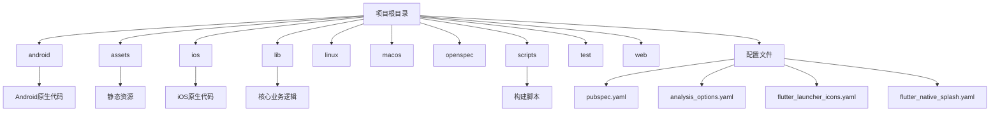

# 开发环境搭建

<cite>
**本文档引用的文件**  
- [pubspec.yaml](file://pubspec.yaml)
- [analysis_options.yaml](file://analysis_options.yaml)
- [flutter_launcher_icons.yaml](file://flutter_launcher_icons.yaml)
- [flutter_native_splash.yaml](file://flutter_native_splash.yaml)
- [android/build.gradle](file://android/build.gradle)
- [ios/Podfile](file://ios/Podfile)
- [scripts/install.sh](file://scripts/install.sh)
- [scripts/build_android.sh](file://scripts/build_android.sh)
- [scripts/build_ios.sh](file://scripts/build_ios.sh)
- [lib/main.dart](file://lib/main.dart)
- [android/gradle.properties](file://android/gradle.properties)
- [android/local.properties](file://android/local.properties)
- [ios/Runner/Info.plist](file://ios/Runner/Info.plist)
- [lib/config/config.dart](file://lib/config/config.dart)
- [lib/global/storage.dart](file://lib/global/storage.dart)
</cite>

## 目录
1. [简介](#简介)
2. [项目结构](#项目结构)
3. [先决条件](#先决条件)
4. [依赖安装](#依赖安装)
5. [关键配置文件说明](#关键配置文件说明)
6. [构建与运行](#构建与运行)
7. [常见问题排查](#常见问题排查)
8. [结论](#结论)

## 简介
本指南旨在为新贡献者提供一个清晰的开发环境搭建路径，帮助快速启动油品业务应用的开发工作。文档详细说明了项目所需的先决条件、依赖安装步骤、关键配置文件的作用以及构建和运行应用的方法。通过遵循本指南，开发者可以确保开发环境的正确配置，避免常见的环境问题。

## 项目结构
本项目是一个基于Flutter框架的跨平台移动应用，支持Android和iOS平台。项目结构遵循Flutter标准布局，同时包含特定于业务的模块化设计。



**图示来源**  
- [pubspec.yaml](file://pubspec.yaml)
- [android](file://android)
- [ios](file://ios)
- [lib](file://lib)
- [scripts](file://scripts)

**本节来源**  
- [pubspec.yaml](file://pubspec.yaml)
- [project_structure](file://project_structure)

## 先决条件
在开始开发之前，需要确保系统中安装了正确的开发工具和环境。本项目对开发环境有明确的版本要求。

### Flutter SDK 和 Dart 版本
根据 `pubspec.yaml` 文件中的环境配置，本项目要求：
- Flutter SDK 版本：3.4.0 或更高版本，但低于 4.0.0
- Dart SDK 版本：3.4.0 或更高版本（由 Flutter SDK 自动管理）

```yaml
environment:
  sdk: ">=3.4.0 <4.0.00"
```

建议使用 Flutter 3.4+ 版本以确保兼容性。可以通过以下命令检查当前 Flutter 版本：
```bash
flutter --version
```

如果需要升级 Flutter SDK，可以运行：
```bash
flutter upgrade
```

### Android 开发环境
Android 开发环境需要满足以下要求：
- Android SDK 版本：最低 API 级别 21（Android 5.0）
- Android Studio 或其他支持 Android 开发的 IDE
- Gradle 版本：由 Flutter 工具链自动管理，但建议使用 7.0+ 版本

项目中 `android/local.properties` 文件指定了 Android SDK 的路径：
```
sdk.dir=E:\\Android\\sdk
```

### iOS 开发环境
iOS 开发环境需要满足以下要求：
- Xcode 版本：12.0 或更高版本
- macOS 操作系统
- CocoaPods 包管理器

虽然 `ios/Podfile` 中注释掉了平台版本，但建议使用 Xcode 12+ 以确保最佳兼容性。

### 其他工具
- Git：用于版本控制
- Bash shell：用于运行构建脚本（Windows 用户可使用 Git Bash 或 WSL）

**本节来源**  
- [pubspec.yaml](file://pubspec.yaml#L21-L22)
- [android/local.properties](file://android/local.properties#L1)
- [ios/Podfile](file://ios/Podfile#L2)

## 依赖安装
项目的依赖管理通过 Flutter 的包管理工具 `pub` 实现。所有依赖项都在 `pubspec.yaml` 文件中定义。

### 安装项目依赖
要安装项目所需的所有依赖项，请在项目根目录下运行以下命令：
```bash
flutter pub get
```

此命令会读取 `pubspec.yaml` 文件中的依赖声明，并从 pub.dev 仓库下载相应的包。项目依赖分为两类：

1. **直接依赖 (dependencies)**：应用运行所必需的包，如 `flutter_bloc`、`dio`、`go_router` 等状态管理和网络请求库。
2. **开发依赖 (dev_dependencies)**：仅在开发和测试时需要的包，如 `flutter_test`、`build_runner` 等。

### 安装开发工具
项目包含一些自定义脚本，可以通过以下命令安装：
```bash
flutter pub run install
```

这将执行 `scripts/install.sh` 脚本，设置 Git 钩子（pre-commit），确保代码提交前的自动化检查。

### 生成代码
项目使用代码生成技术来减少样板代码：
- **模型类生成**：使用 `freezed` 和 `json_serializable` 生成不可变数据模型和序列化代码
- **API 客户端生成**：使用 `retrofit` 生成 REST API 客户端

要生成这些代码，请运行：
```bash
flutter pub run build_runner build --delete-conflicting-outputs
```

### 安装镜像源
为提高依赖下载速度，项目配置了阿里云和腾讯云的 Maven 镜像源。这些配置位于 `android/build.gradle` 文件中。

**本节来源**  
- [pubspec.yaml](file://pubspec.yaml#L54-L138)
- [scripts/install.sh](file://scripts/install.sh)
- [android/build.gradle](file://android/build.gradle#L3-L15)

## 关键配置文件说明
项目包含多个关键的配置文件，每个文件都有特定的作用和配置项。

### pubspec.yaml
`pubspec.yaml` 是 Flutter 项目的核心配置文件，主要功能包括：

- **项目元数据**：定义项目名称、描述和版本号
- **依赖管理**：声明项目所需的所有 Dart 包依赖
- **资源管理**：指定应用使用的静态资源文件
- **字体配置**：定义自定义字体（如 sportsIcon）
- **插件配置**：集成第三方插件和原生功能

项目中的资源管理配置如下：
```yaml
assets:
  - assets/img/
  - assets/img/splase/
  - assets/icon/
  - assets/svg/
  - assets/html/
  - assets/json/pca-code.json
```

### analysis_options.yaml
`analysis_options.yaml` 文件定义了代码分析和静态检查规则，确保代码质量和一致性。

主要配置包括：
- **代码风格规则**：强制使用驼峰命名法、避免不必要的容器等
- **最佳实践**：建议使用 const 构造函数、优先使用空值感知操作符等
- **行长度限制**：最大行长度为 180 个字符
- **排除文件**：忽略自动生成的文件（如 *.g.dart、*.freezed.dart）

这些规则有助于维护代码库的一致性和可读性。

### flutter_launcher_icons.yaml
`flutter_launcher_icons.yaml` 文件用于自动生成应用图标，避免手动为不同平台和分辨率创建图标。

主要配置：
- **输入图像**：`assets/icon/icon.png` 作为源图像
- **平台支持**：同时为 Android 和 iOS 生成图标
- **最小 SDK**：Android 最小 SDK 版本为 21

使用方法：
```bash
flutter pub run flutter_launcher_icons:main
```

### flutter_native_splash.yaml
`flutter_native_splash.yaml` 文件用于配置应用启动屏，提供更好的用户体验。

主要配置：
- **背景图像**：使用 `assets/img/splase/splase.png` 作为启动屏背景
- **全屏模式**：`fullscreen: true` 隐藏状态栏
- **平台支持**：支持 iOS，Android 12+ 有特殊配置

使用方法：
```bash
dart run flutter_native_splash:create
```

**本节来源**  
- [pubspec.yaml](file://pubspec.yaml)
- [analysis_options.yaml](file://analysis_options.yaml)
- [flutter_launcher_icons.yaml](file://flutter_launcher_icons.yaml)
- [flutter_native_splash.yaml](file://flutter_native_splash.yaml)

## 构建与运行
本节介绍如何构建和运行应用，包括开发模式和生产模式的构建方法。

### 开发模式运行
在开发过程中，可以使用以下命令启动应用：
```bash
flutter run --flavor oppo
```

或者使用项目脚本：
```bash
flutter pub run dev
```

这将启动应用并连接到开发服务器，支持热重载功能。

### 构建 Android 应用
要构建 Android APK，可以使用以下命令：
```bash
sh ./scripts/build_android.sh <渠道> <分支> <build number> <http env>
```

构建脚本会：
1. 从 `pubspec.yaml` 读取版本号
2. 使用指定的 flavor 和环境变量构建应用
3. 将生成的 APK 文件移动到 `./dist/android/` 目录

### 构建 iOS 应用
要构建 iOS IPA，可以使用以下命令：
```bash
sh ./scripts/build_ios.sh <build number> <测试标志>
```

构建脚本会：
1. 创建临时钥匙串并导入证书
2. 使用 `flutter build ipa` 命令构建应用
3. 将生成的 IPA 文件移动到指定目录

### 其他常用命令
项目还定义了其他有用的脚本命令：
- `flutter pub run build_android`：构建 Android 应用
- `flutter pub run build_ios`：构建 iOS 应用
- `flutter pub run gen_model`：生成模型代码
- `flutter pub run gen_assets`：生成静态资源

**本节来源**  
- [scripts/build_android.sh](file://scripts/build_android.sh)
- [scripts/build_ios.sh](file://scripts/build_ios.sh)
- [pubspec.yaml](file://pubspec.yaml#L24-L40)

## 常见问题排查
在搭建开发环境时可能会遇到一些常见问题，本节提供解决方案。

### Gradle 版本冲突
由于项目使用了自定义的 Maven 镜像源，可能会出现 Gradle 版本不兼容的问题。

**解决方案**：
1. 清理 Gradle 缓存：
```bash
flutter clean
rm -rf ~/.gradle/caches/
```
2. 确保 `android/gradle.properties` 中的配置正确：
```
org.gradle.jvmargs=-Xmx4G -XX:MaxMetaspaceSize=2G
org.gradle.parallel=true
org.gradle.caching=true
```

### Xcode 配置问题
在 iOS 构建过程中可能会遇到代码签名和证书问题。

**解决方案**：
1. 确保 Xcode 命令行工具已正确安装：
```bash
sudo xcode-select --install
```
2. 接受 Xcode 许可协议：
```bash
sudo xcodebuild -license accept
```
3. 确保 `ios/Podfile` 中的 post_install 钩子正确配置：
```ruby
post_install do |installer|
  installer.pods_project.targets.each do |target|
    flutter_additional_ios_build_settings(target)
    target.build_configurations.each do |config|
      config.build_settings['ONLY_ACTIVE_ARCH'] = 'YES'
    end
  end
end
```

### 依赖下载失败
由于网络原因，可能会出现依赖包下载失败的情况。

**解决方案**：
1. 使用国内镜像源：
```bash
export PUB_HOSTED_URL=https://pub.flutter-io.cn
export FLUTTER_STORAGE_BASE_URL=https://storage.flutter-io.cn
```
2. 清理并重新获取依赖：
```bash
flutter pub cache repair
flutter pub get
```

### 构建脚本权限问题
在 Unix 系统上，构建脚本可能没有执行权限。

**解决方案**：
```bash
chmod +x scripts/*.sh
```

**本节来源**  
- [android/build.gradle](file://android/build.gradle)
- [android/gradle.properties](file://android/gradle.properties)
- [ios/Podfile](file://ios/Podfile)
- [scripts/build_android.sh](file://scripts/build_android.sh)
- [scripts/build_ios.sh](file://scripts/build_ios.sh)

## 结论
本指南详细介绍了油品业务应用的开发环境搭建过程。通过遵循这些步骤，新贡献者可以快速配置开发环境并开始编码工作。关键要点包括：
- 确保使用正确的 Flutter SDK 版本（3.4+）
- 正确配置 Android 和 iOS 开发环境
- 使用 `flutter pub get` 安装所有依赖项
- 理解关键配置文件的作用和配置方法
- 掌握构建和运行应用的命令
- 了解常见问题的解决方案

遵循这些最佳实践将有助于确保开发环境的一致性和稳定性，提高开发效率。