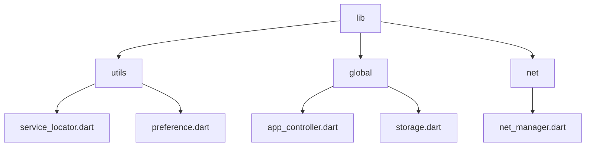
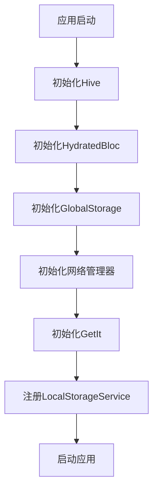
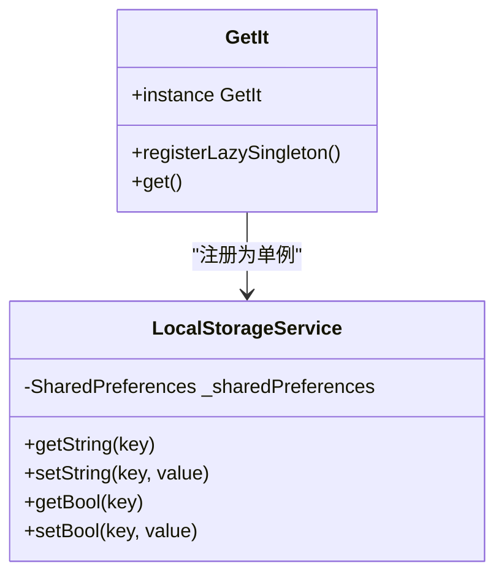
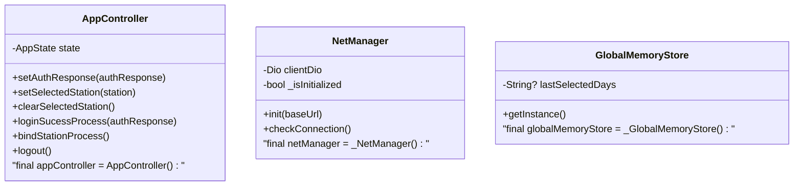
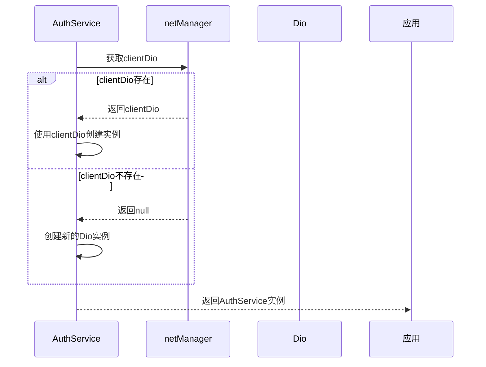
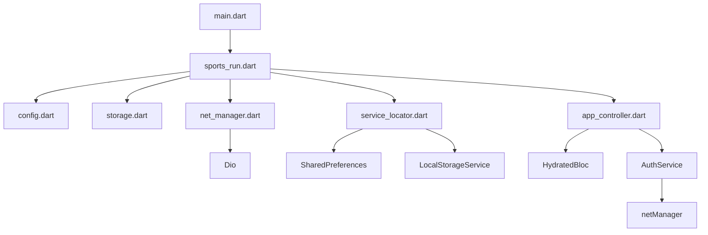

# 依赖注入

<cite>
**本文档引用的文件**
- [service_locator.dart](file://lib/utils/service_locator.dart)
- [app_controller.dart](file://lib/global/app_controller.dart)
- [net_manager.dart](file://lib/net/net_manager.dart)
- [auth_service.dart](file://lib/global/service/auth_service.dart)
- [main.dart](file://lib/main.dart)
- [sports_run.dart](file://lib/sports_run.dart)
- [config.dart](file://lib/config/config.dart)
- [storage.dart](file://lib/global/storage.dart)
- [preference.dart](file://lib/utils/preference.dart)
- [memory_store.dart](file://lib/global/memory_store.dart)
</cite>

## 目录
1. [简介](#简介)
2. [项目结构](#项目结构)
3. [核心组件](#核心组件)
4. [架构概述](#架构概述)
5. [详细组件分析](#详细组件分析)
6. [依赖分析](#依赖分析)
7. [性能考虑](#性能考虑)
8. [故障排除指南](#故障排除指南)
9. [结论](#结论)

## 简介
本文档详细说明了油品业务App的依赖注入实现机制，重点分析了全局单例的创建和管理，包括appController、netManager和各AuthService实例。文档解释了这些全局实例如何在应用启动时初始化，并在整个应用生命周期中被各个组件访问。同时，文档还描述了依赖注入在解耦组件、提高可测试性和管理服务生命周期方面的作用。

## 项目结构
油品业务App的项目结构遵循典型的Flutter应用模式，将代码按功能和职责进行组织。核心的依赖注入相关文件主要位于`lib/utils`和`lib/global`目录下。

**Diagram sources**
- [service_locator.dart](file://lib/utils/service_locator.dart)
- [app_controller.dart](file://lib/global/app_controller.dart)
- [net_manager.dart](file://lib/net/net_manager.dart)

**Section sources**
- [service_locator.dart](file://lib/utils/service_locator.dart)
- [app_controller.dart](file://lib/global/app_controller.dart)

## 核心组件
本应用的依赖注入系统主要由以下几个核心组件构成：GetIt服务定位器、全局单例实例、网络管理器和认证服务。这些组件共同协作，确保应用中的各个部分能够正确地获取所需的依赖。

**Section sources**
- [service_locator.dart](file://lib/utils/service_locator.dart)
- [app_controller.dart](file://lib/global/app_controller.dart)
- [net_manager.dart](file://lib/net/net_manager.dart)

## 架构概述
油品业务App的依赖注入架构采用混合模式，结合了服务定位器模式和直接实例化模式。应用启动时，通过`GetIt`注册关键服务，同时对一些核心管理器采用直接的单例实例化。

**Diagram sources**
- [sports_run.dart](file://lib/sports_run.dart)
- [config.dart](file://lib/config/config.dart)
- [storage.dart](file://lib/global/storage.dart)

## 详细组件分析

### 依赖注入机制分析
油品业务App采用了两种依赖注入方式：基于GetIt的服务定位器模式和直接的单例实例化模式。这种混合方法既提供了灵活性，又保证了关键服务的可访问性。

#### 服务定位器模式

**Diagram sources**
- [service_locator.dart](file://lib/utils/service_locator.dart)
- [preference.dart](file://lib/utils/preference.dart)

#### 全局单例实例

**Diagram sources**
- [app_controller.dart](file://lib/global/app_controller.dart)
- [net_manager.dart](file://lib/net/net_manager.dart)
- [memory_store.dart](file://lib/global/memory_store.dart)

**Section sources**
- [app_controller.dart](file://lib/global/app_controller.dart)
- [net_manager.dart](file://lib/net/net_manager.dart)
- [memory_store.dart](file://lib/global/memory_store.dart)

### 认证服务依赖分析
认证服务的依赖注入采用了直接实例化的方式，通过依赖网络管理器来创建服务实例。

**Diagram sources**
- [auth_service.dart](file://lib/global/service/auth_service.dart)
- [net_manager.dart](file://lib/net/net_manager.dart)

**Section sources**
- [auth_service.dart](file://lib/global/service/auth_service.dart)

## 依赖分析
油品业务App的依赖关系清晰，主要依赖注入相关的组件之间形成了明确的依赖链。通过分析这些依赖关系，可以更好地理解应用的初始化流程和组件交互。

**Diagram sources**
- [main.dart](file://lib/main.dart)
- [sports_run.dart](file://lib/sports_run.dart)
- [config.dart](file://lib/config/config.dart)
- [storage.dart](file://lib/global/storage.dart)

**Section sources**
- [main.dart](file://lib/main.dart)
- [sports_run.dart](file://lib/sports_run.dart)

## 性能考虑
依赖注入系统的性能主要体现在应用启动时间和内存使用上。油品业务App通过懒加载和异步初始化来优化启动性能，同时使用单例模式减少内存占用。

- **启动性能**：关键服务在应用启动时异步初始化，避免阻塞主线程
- **内存使用**：所有管理器和服务都采用单例模式，避免重复实例化
- **延迟加载**：非关键服务采用懒加载策略，按需创建
- **错误处理**：网络初始化失败时应用仍可启动，提供降级体验

## 故障排除指南
在使用依赖注入系统时，可能会遇到一些常见问题。以下是这些问题的解决方案：

**Section sources**
- [net_manager.dart](file://lib/net/net_manager.dart)
- [sports_run.dart](file://lib/sports_run.dart)
- [service_locator.dart](file://lib/utils/service_locator.dart)

### 网络管理器初始化失败
如果网络管理器初始化失败，应用会以离线模式启动。检查以下几点：
- 确保BaseAddress.baseApiPath配置正确
- 检查设备网络连接状态
- 验证代理设置（如果使用）

### SharedPreferences获取失败
如果SharedPreferences获取失败，可能导致LocalStorageService注册失败。确保：
- 在调用initializeDependenciesGoozzyEcommerceApp前已正确初始化Flutter环境
- 设备有足够的存储空间

### 服务获取异常
当通过GetIt获取服务时出现异常，检查：
- 服务是否已正确注册
- 应用是否已完成初始化流程
- 依赖的服务是否已就绪

## 结论
油品业务App的依赖注入系统设计合理，通过混合使用GetIt服务定位器和直接单例实例化，实现了灵活性和可靠性的平衡。系统在应用启动时初始化关键服务，确保了全局状态的一致性。这种设计不仅解耦了组件，提高了可测试性，还有效地管理了服务的生命周期。对于未来可能的改进，可以考虑将更多服务迁移到GetIt管理，以实现更统一的依赖管理。