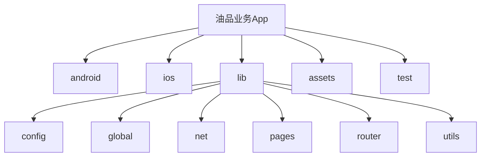
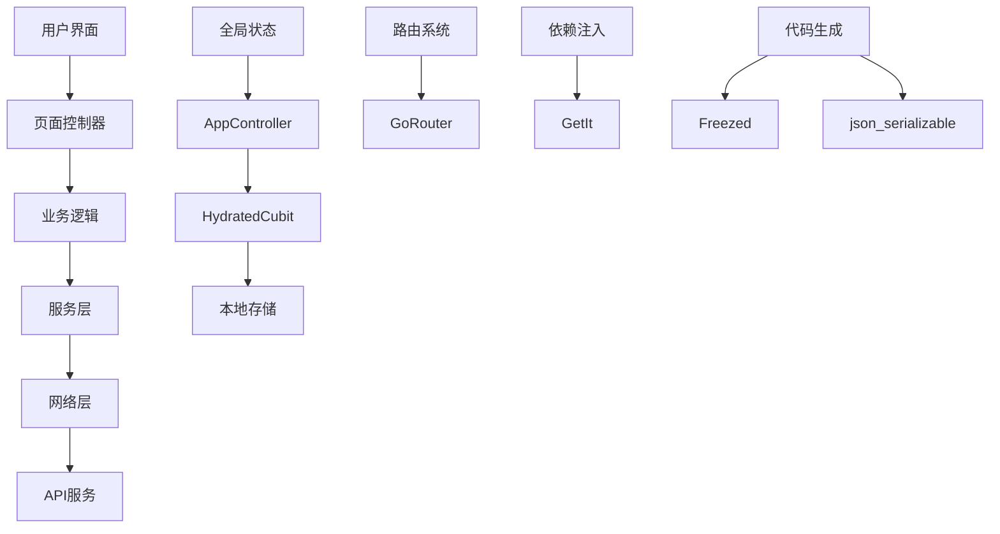
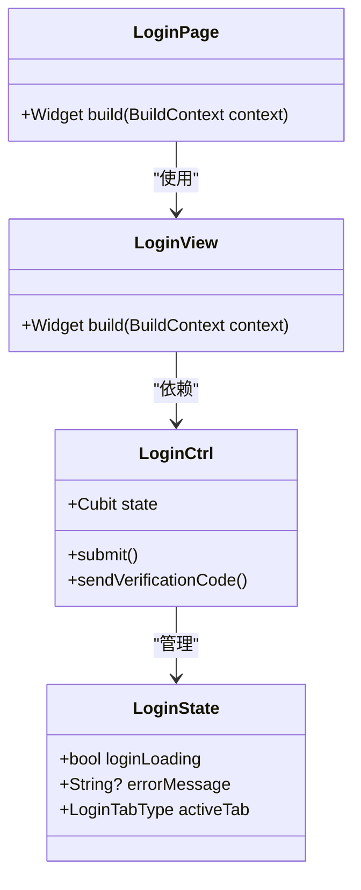
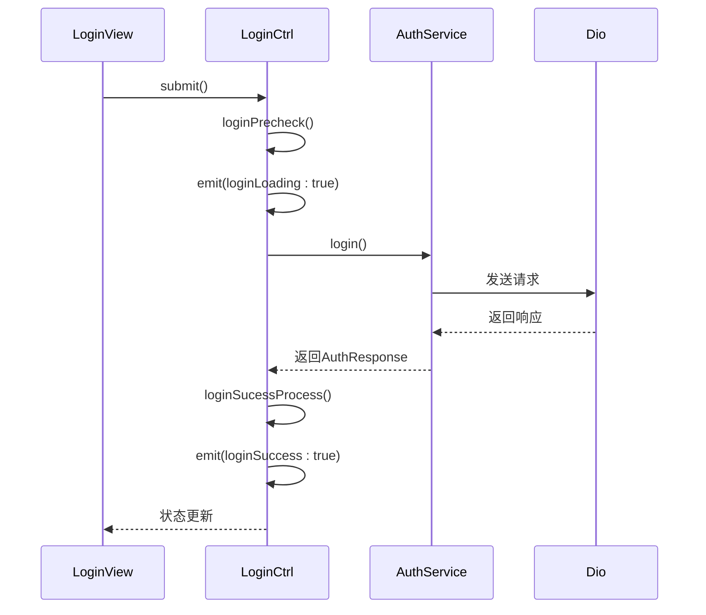
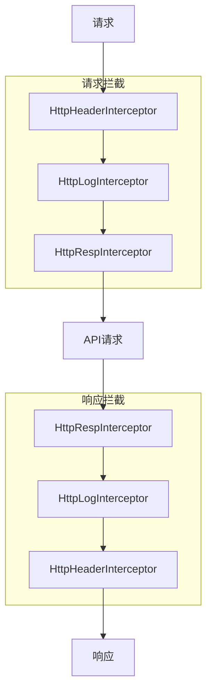
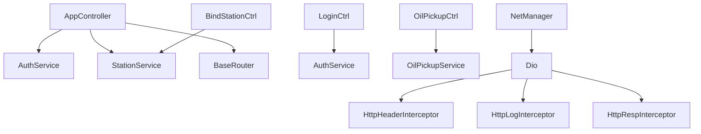

# 技术架构

<cite>
**本文档引用的文件**
- [main.dart](file://lib/main.dart)
- [app.dart](file://lib/app.dart)
- [app_controller.dart](file://lib/global/app_controller.dart)
- [app_state.dart](file://lib/global/app_state.dart)
- [router.dart](file://lib/router/router.dart)
- [routes.dart](file://lib/router/routes.dart)
- [net_manager.dart](file://lib/net/net_manager.dart)
- [dio_io.dart](file://lib/net/dio_io.dart)
- [http_header_interceptor.dart](file://lib/net/http_header_interceptor.dart)
- [http_log_interceptor.dart](file://lib/net/http_log_interceptor.dart)
- [http_resp_interceptor.dart](file://lib/net/http_resp_interceptor.dart)
- [storage.dart](file://lib/global/storage.dart)
- [service_locator.dart](file://lib/utils/service_locator.dart)
- [login/controller.dart](file://lib/pages/login/controller.dart)
- [bind_station/controller.dart](file://lib/pages/bind_station/controller.dart)
- [oil_pickup/controller.dart](file://lib/pages/oil_pickup/controller.dart)
</cite>

## 目录
1. [简介](#简介)
2. [项目结构](#项目结构)
3. [核心组件](#核心组件)
4. [架构概览](#架构概览)
5. [详细组件分析](#详细组件分析)
6. [依赖分析](#依赖分析)
7. [性能考虑](#性能考虑)
8. [故障排除指南](#故障排除指南)
9. [结论](#结论)

## 简介
本技术架构文档详细描述了油品业务App的系统设计，涵盖MVVM模式下的分层架构、BLoC模式的状态管理、GoRouter的路由机制、网络层设计、依赖注入和代码生成等关键技术。文档旨在为开发团队提供全面的系统理解，确保代码质量和可维护性。

## 项目结构
油品业务App采用清晰的分层架构，主要分为以下几个目录：

- **android/**: Android原生代码
- **ios/**: iOS原生代码
- **lib/**: Dart核心代码
  - **config/**: 配置文件
  - **global/**: 全局状态和模型
  - **hooks/**: 自定义Hook
  - **interfaces/**: 接口定义
  - **models/**: 数据模型
  - **net/**: 网络层
  - **pages/**: 页面组件
  - **resources/**: 资源文件
  - **router/**: 路由配置
  - **static/**: 静态资源
  - **utils/**: 工具类
  - **widgets/**: 通用组件
- **assets/**: 静态资源
- **test/**: 测试代码

这种结构化的组织方式使得代码易于维护和扩展。



**图源**
- [main.dart](file://lib/main.dart)
- [app.dart](file://lib/app.dart)

**章节源**
- [main.dart](file://lib/main.dart)
- [app.dart](file://lib/app.dart)

## 核心组件
油品业务App的核心组件包括：

- **展示层（pages/widgets）**: 负责UI展示和用户交互
- **业务逻辑层（controller）**: 处理业务逻辑和状态管理
- **数据层（service/net）**: 负责网络请求和数据处理
- **全局状态管理（AppController）**: 管理应用全局状态

这些组件通过清晰的职责划分，实现了高内聚低耦合的设计原则。

**章节源**
- [app_controller.dart](file://lib/global/app_controller.dart)
- [login/controller.dart](file://lib/pages/login/controller.dart)
- [net_manager.dart](file://lib/net/net_manager.dart)

## 架构概览
油品业务App采用MVVM模式，结合BLoC进行状态管理，形成了清晰的分层架构。应用启动时，通过`main.dart`初始化全局配置和路由，然后进入`app.dart`构建应用主界面。全局状态由`AppController`管理，通过HydratedCubit实现状态持久化。路由系统基于GoRouter，实现了灵活的页面导航。网络层使用Dio客户端，通过拦截器链处理请求头、日志、响应和错误。



**图源**
- [app.dart](file://lib/app.dart)
- [app_controller.dart](file://lib/global/app_controller.dart)
- [router.dart](file://lib/router/router.dart)
- [net_manager.dart](file://lib/net/net_manager.dart)

## 详细组件分析
### 展示层分析
展示层由`pages`和`widgets`目录组成，采用MVVM模式。每个页面通常包含`page.dart`、`view.dart`、`controller.dart`和`state.dart`四个文件，分别负责页面构建、视图展示、业务逻辑和状态管理。

#### 页面结构示例


**图源**
- [login/controller.dart](file://lib/pages/login/controller.dart)
- [login/state.dart](file://lib/pages/login/state.dart)

### 业务逻辑层分析
业务逻辑层由`controller.dart`文件组成，继承自`Cubit`或`Bloc`，负责处理业务逻辑和状态管理。以`LoginCtrl`为例，它管理登录状态、处理登录逻辑、发送验证码等。

#### 登录流程


**图源**
- [login/controller.dart](file://lib/pages/login/controller.dart)
- [global/service/auth_service.dart](file://lib/global/service/auth_service.dart)

### 数据层分析
数据层由`net`目录和`service`目录组成，负责网络请求和数据处理。`net`目录包含Dio客户端配置和拦截器，`service`目录包含API服务。

#### 网络拦截器链


**图源**
- [net_manager.dart](file://lib/net/net_manager.dart)
- [http_header_interceptor.dart](file://lib/net/http_header_interceptor.dart)
- [http_log_interceptor.dart](file://lib/net/http_log_interceptor.dart)
- [http_resp_interceptor.dart](file://lib/net/http_resp_interceptor.dart)

### 全局状态管理分析
全局状态管理由`AppController`实现，继承自`HydratedCubit`，负责管理应用全局状态，如用户认证信息和选中的加油站。

#### AppController状态持久化
```mermaid
classDiagram
class AppController {
+HydratedCubit<AppState> state
+setAuthResponse()
+setSelectedStation()
+logout()
}
class AppState {
+AuthResponse? authResponse
+Station? selectedStation
}
class HydratedCubit {
+fromJson()
+toJson()
}
AppController --> AppState : "管理"
AppController --> HydratedCubit : "继承"
HydratedCubit --> "本地存储" : "持久化"
```

**图源**
- [app_controller.dart](file://lib/global/app_controller.dart)
- [app_state.dart](file://lib/global/app_state.dart)

## 依赖分析
油品业务App的依赖关系清晰，各组件之间通过明确的接口进行通信。



**图源**
- [app_controller.dart](file://lib/global/app_controller.dart)
- [login/controller.dart](file://lib/pages/login/controller.dart)
- [net_manager.dart](file://lib/net/net_manager.dart)

**章节源**
- [app_controller.dart](file://lib/global/app_controller.dart)
- [login/controller.dart](file://lib/pages/login/controller.dart)
- [net_manager.dart](file://lib/net/net_manager.dart)

## 性能考虑
油品业务App在性能方面做了以下优化：

1. **状态管理**: 使用BLoC模式，避免不必要的UI重建
2. **网络请求**: 配置合理的超时时间，避免请求长时间挂起
3. **内存管理**: 及时释放控制器和定时器，防止内存泄漏
4. **本地存储**: 使用Hive进行高效的数据持久化
5. **代码生成**: 使用Freezed和json_serializable减少运行时开销

这些优化措施确保了应用的流畅性和响应速度。

## 故障排除指南
### 常见问题及解决方案
1. **登录失败**: 检查网络连接，确认账号密码正确
2. **网络请求超时**: 检查网络环境，确认API服务正常
3. **状态不持久**: 确认HydratedCubit正确配置，检查本地存储权限
4. **路由跳转失败**: 检查路由配置，确认页面路径正确
5. **UI卡顿**: 检查是否有不必要的UI重建，优化复杂Widget

### 调试工具
- **日志系统**: 使用自定义日志工具记录关键操作
- **网络监控**: 通过HttpLogInterceptor监控网络请求
- **状态调试**: 使用BlocObserver监控状态变化
- **性能分析**: 使用Flutter DevTools进行性能分析

**章节源**
- [utils/log.dart](file://lib/utils/log.dart)
- [net/http_log_interceptor.dart](file://lib/net/http_log_interceptor.dart)

## 结论
油品业务App采用MVVM模式结合BLoC进行状态管理，形成了清晰的分层架构。通过GoRouter实现灵活的路由导航，使用Dio和拦截器链构建健壮的网络层，利用HydratedCubit实现状态持久化，结合GetIt进行依赖注入，使用Freezed和json_serializable提高开发效率。这种架构设计既保证了代码的可维护性，又确保了应用的性能和稳定性，为油品业务的数字化转型提供了坚实的技术基础。