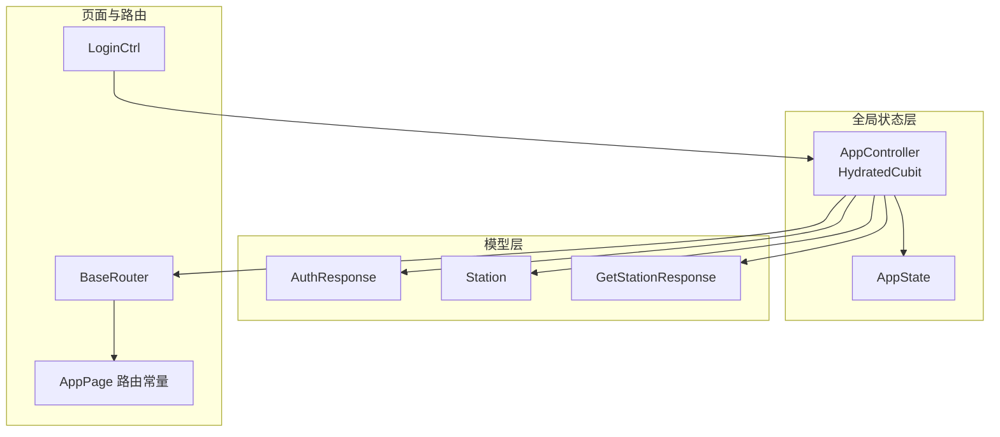
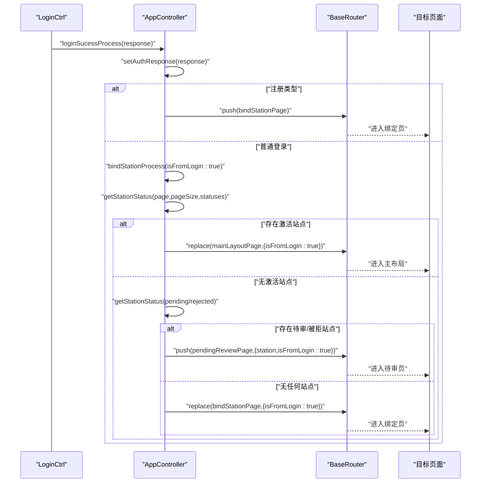
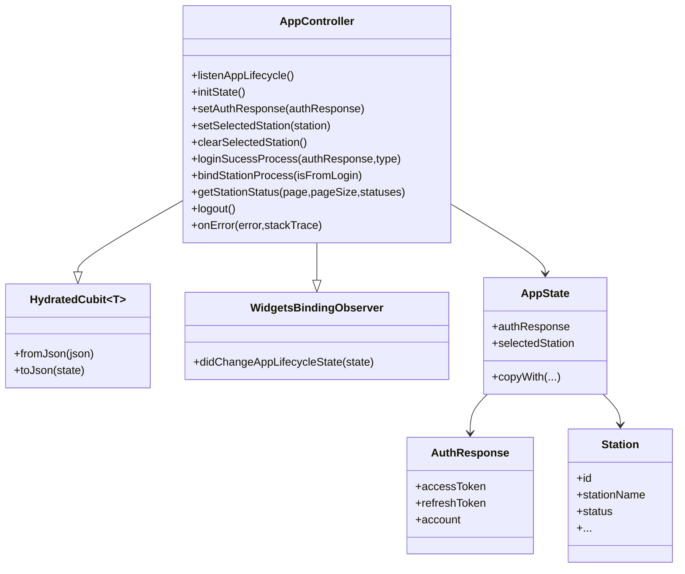
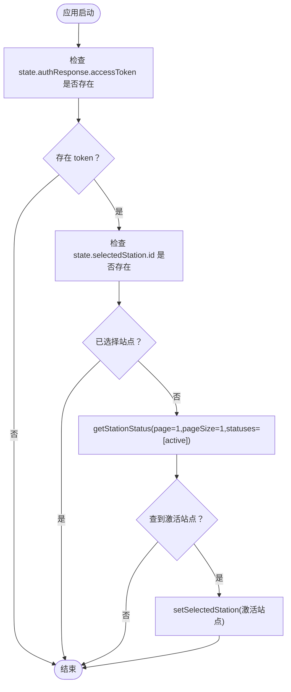
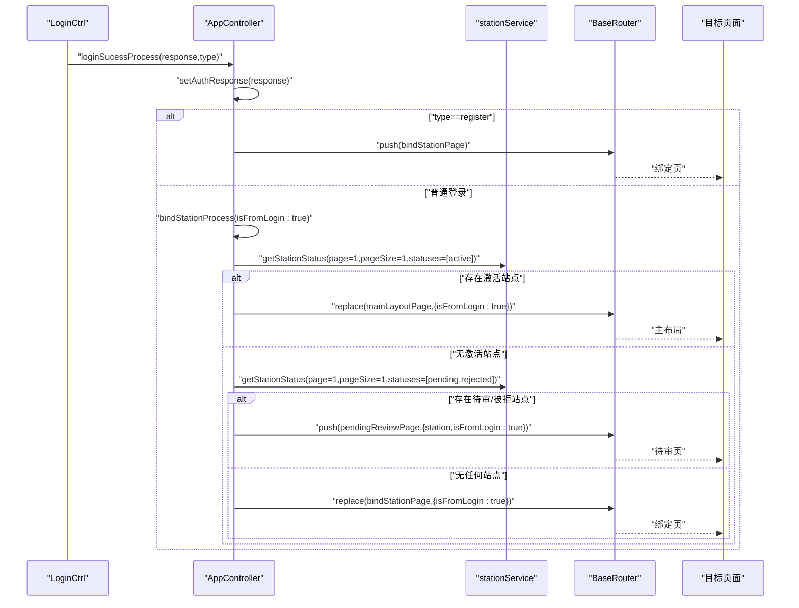
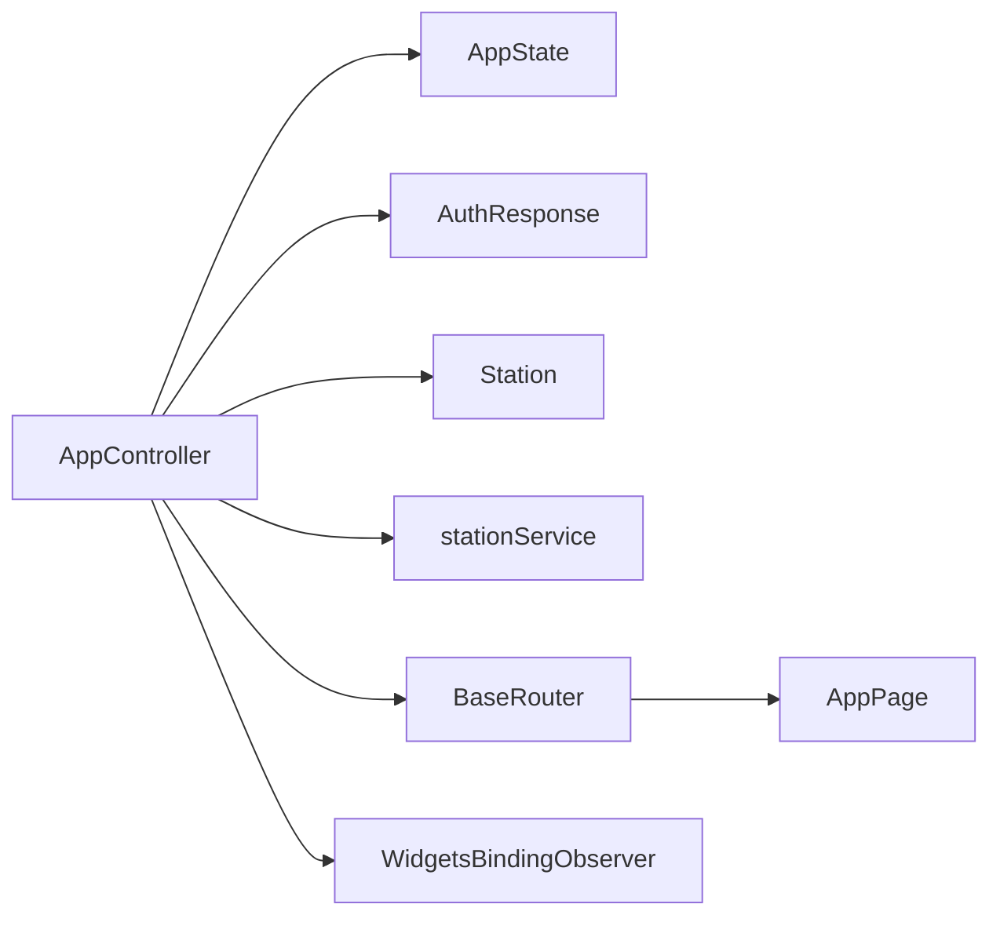

# AppController 全局状态控制器

<cite>
**本文引用的文件列表**
- [app_controller.dart](file://lib/global/app_controller.dart)
- [app_state.dart](file://lib/global/app_state.dart)
- [auth_rep_type.dart](file://lib/global/model/auth_rep_type.dart)
- [station_res_type.dart](file://lib/global/model/station_res_type.dart)
- [controller.dart](file://lib/pages/login/controller.dart)
- [global_update_ui.dart](file://lib/widgets/common/global_update_ui.dart)
- [router.dart](file://lib/router/router.dart)
- [routes.dart](file://lib/router/routes.dart)
- [main.dart](file://lib/main.dart)
</cite>

## 目录
1. [简介](#简介)
2. [项目结构](#项目结构)
3. [核心组件](#核心组件)
4. [架构总览](#架构总览)
5. [详细组件分析](#详细组件分析)
6. [依赖关系分析](#依赖关系分析)
7. [性能考量](#性能考量)
8. [故障排查指南](#故障排查指南)
9. [结论](#结论)
10. [附录](#附录)

## 简介
本文件围绕 AppController 全局状态控制器展开，重点阐述其作为 HydratedCubit 子类的实现机制与状态持久化策略；详解其通过 setAuthResponse、setSelectedStation 等方法管理用户认证信息与选中加油站状态，并通过 emit 触发状态变更；说明应用启动时 initState 自动加载激活加油站的逻辑；解析 loginSucessProcess 与 bindStationProcess 在登录后的加油站绑定流程中的业务规则；描述 logout 如何清理状态并重定向至登录页；提供在页面中通过 context.read<AppController>() 获取实例并调用方法的示例路径；分析其与 WidgetsBindingObserver 集成以监听应用生命周期的设计意图；最后讨论单例模式（final appController）的利弊及其在跨组件通信中的作用。

## 项目结构
AppController 位于全局状态层，与 AppState、认证模型、站点模型、路由系统紧密协作：
- 状态定义：AppState
- 认证模型：AuthResponse、Account
- 站点模型：Station、GetStationResponse
- 控制器：AppController（HydratedCubit + WidgetsBindingObserver）
- 页面与路由：LoginCtrl（登录流程）、BaseRouter（导航封装）、AppPage 路由常量
- 示例用法：GlobalUpdateUi 展示如何在页面中通过 context.read<AppController>() 获取实例

图表来源
- [app_controller.dart](file://lib/global/app_controller.dart#L16-L145)
- [app_state.dart](file://lib/global/app_state.dart#L1-L23)
- [auth_rep_type.dart](file://lib/global/model/auth_rep_type.dart#L1-L46)
- [station_res_type.dart](file://lib/global/model/station_res_type.dart#L1-L164)
- [controller.dart](file://lib/pages/login/controller.dart#L142-L176)
- [router.dart](file://lib/router/router.dart#L127-L148)
- [routes.dart](file://lib/router/routes.dart#L177-L209)

章节来源
- [app_controller.dart](file://lib/global/app_controller.dart#L16-L145)
- [app_state.dart](file://lib/global/app_state.dart#L1-L23)
- [auth_rep_type.dart](file://lib/global/model/auth_rep_type.dart#L1-L46)
- [station_res_type.dart](file://lib/global/model/station_res_type.dart#L1-L164)
- [controller.dart](file://lib/pages/login/controller.dart#L142-L176)
- [router.dart](file://lib/router/router.dart#L127-L148)
- [routes.dart](file://lib/router/routes.dart#L177-L209)

## 核心组件
- AppController：继承 HydratedCubit<AppState>，实现状态持久化（fromJson/toJson），并混入 WidgetsBindingObserver 以监听应用生命周期；提供 setAuthResponse、setSelectedStation、clearSelectedStation、loginSucessProcess、bindStationProcess、logout 等方法；在构造函数中初始化生命周期监听与应用启动状态加载。
- AppState：承载当前认证响应与选中加油站两个关键字段，并提供 copyWith 生成新状态。
- 认证模型 AuthResponse/Account：封装登录返回的令牌与账户信息。
- 站点模型 Station/GetStationResponse：封装站点查询结果与站点详情。
- 登录控制器 LoginCtrl：在登录成功后调用 AppController.loginSucessProcess 完成后续流程。
- 路由系统 BaseRouter/AppPage：封装导航与页面跳转。

章节来源
- [app_controller.dart](file://lib/global/app_controller.dart#L16-L145)
- [app_state.dart](file://lib/global/app_state.dart#L1-L23)
- [auth_rep_type.dart](file://lib/global/model/auth_rep_type.dart#L1-L46)
- [station_res_type.dart](file://lib/global/model/station_res_type.dart#L1-L164)
- [controller.dart](file://lib/pages/login/controller.dart#L142-L176)
- [router.dart](file://lib/router/router.dart#L127-L148)

## 架构总览
AppController 作为全局状态中心，负责：
- 用户认证状态管理：setAuthResponse 更新 accessToken/refreshToken/account
- 站点选择状态管理：setSelectedStation/clearSelectedStation
- 应用启动时的状态恢复与自动选择激活站点
- 登录后的业务流程编排：loginSucessProcess → bindStationProcess
- 生命周期感知：onAppLifecycleStateChanged 用于后台/前台切换时的处理
- 状态持久化：HydratedCubit 的 fromJson/toJson 实现本地持久化

图表来源
- [controller.dart](file://lib/pages/login/controller.dart#L142-L176)
- [app_controller.dart](file://lib/global/app_controller.dart#L62-L99)
- [router.dart](file://lib/router/router.dart#L127-L148)
- [routes.dart](file://lib/router/routes.dart#L177-L209)

## 详细组件分析

### AppController 类设计与职责
- 继承关系：HydratedCubit<AppState> + WidgetsBindingObserver
- 状态持久化：fromJson 将 JSON 还原为 AppState（含 AuthResponse 与 Station），toJson 将 AppState 序列化为 JSON
- 生命周期：构造时注册 WidgetsBindingObserver；close 时移除观察者
- 方法职责：
  - setAuthResponse：通过 emit 更新认证响应
  - setSelectedStation/clearSelectedStation：更新/清空选中站点
  - loginSucessProcess：登录成功后的流程编排（区分注册与普通登录）
  - bindStationProcess：根据站点状态决定跳转到主布局、待审页或绑定页
  - getStationStatus：封装站点查询服务调用
  - logout：清空选中站点与认证信息，跳转登录页
  - onError：统一错误输出

图表来源
- [app_controller.dart](file://lib/global/app_controller.dart#L16-L145)
- [app_state.dart](file://lib/global/app_state.dart#L1-L23)
- [auth_rep_type.dart](file://lib/global/model/auth_rep_type.dart#L1-L46)
- [station_res_type.dart](file://lib/global/model/station_res_type.dart#L1-L164)

章节来源
- [app_controller.dart](file://lib/global/app_controller.dart#L16-L145)
- [app_state.dart](file://lib/global/app_state.dart#L1-L23)

### 状态管理与 emit 触发机制
- setAuthResponse：通过 state.copyWith 生成新状态并 emit，触发订阅方重建
- setSelectedStation/clearSelectedStation：同上，分别设置选中站点或清空
- 优点：immutable 状态、清晰的变更轨迹、便于调试与持久化
- 注意：确保 Station/Account/StationDetailResponse 等模型具备 toJson/fromJson 支持（由 freezed 自动生成）

章节来源
- [app_controller.dart](file://lib/global/app_controller.dart#L50-L60)
- [auth_rep_type.dart](file://lib/global/model/auth_rep_type.dart#L1-L46)
- [station_res_type.dart](file://lib/global/model/station_res_type.dart#L1-L164)

### 应用启动时自动加载激活加油站逻辑（initState）
- 条件：当存在 accessToken 且尚未选择站点时，自动查询激活站点
- 流程：getStationStatus 查询激活站点列表，若存在则 setSelectedStation
- 设计意图：提升用户体验，避免每次进入应用都手动选择

图表来源
- [app_controller.dart](file://lib/global/app_controller.dart#L34-L48)
- [app_controller.dart](file://lib/global/app_controller.dart#L101-L109)

章节来源
- [app_controller.dart](file://lib/global/app_controller.dart#L34-L48)
- [app_controller.dart](file://lib/global/app_controller.dart#L101-L109)

### 登录后加油站绑定流程（loginSucessProcess 与 bindStationProcess）
- loginSucessProcess：
  - setAuthResponse 更新认证信息
  - 若为注册类型，直接跳转绑定页
  - 否则执行 bindStationProcess
- bindStationProcess：
  - 优先查询激活站点：若有，跳转主布局
  - 否则查询待审/被拒站点：若有，跳转待审页
  - 否则跳转绑定页
- 设计意图：根据站点状态引导用户完成绑定，减少歧义与重复操作

图表来源
- [controller.dart](file://lib/pages/login/controller.dart#L142-L176)
- [app_controller.dart](file://lib/global/app_controller.dart#L62-L99)
- [router.dart](file://lib/router/router.dart#L127-L148)
- [routes.dart](file://lib/router/routes.dart#L177-L209)

章节来源
- [controller.dart](file://lib/pages/login/controller.dart#L142-L176)
- [app_controller.dart](file://lib/global/app_controller.dart#L62-L99)

### logout 清理与重定向
- 清理选中站点：clearSelectedStation
- 清理认证信息：setAuthResponse(accessToken/refreshToken/account=null)
- 跳转登录页：BaseRouter.replace(AppPage.loginPage.path)
- 设计意图：保证登出后状态完全清空，避免敏感信息残留

章节来源
- [app_controller.dart](file://lib/global/app_controller.dart#L111-L116)
- [router.dart](file://lib/router/router.dart#L127-L148)
- [routes.dart](file://lib/router/routes.dart#L177-L209)

### 页面中获取与使用 AppController 的示例路径
- 通过 context.read<AppController>() 获取单例实例
- 在 GlobalUpdateUi 中演示了在页面中读取控制器并结合 BlocBuilder 使用
- 登录控制器 LoginCtrl 在登录成功后调用 AppController.loginSucessProcess

章节来源
- [global_update_ui.dart](file://lib/widgets/common/global_update_ui.dart#L1-L18)
- [controller.dart](file://lib/pages/login/controller.dart#L142-L176)

### 与 WidgetsBindingObserver 集成的设计意图
- AppController 混入 WidgetsBindingObserver，可在应用前后台切换时接收生命周期事件
- 该能力可扩展用于：后台暂停时停止轮询、前台恢复时刷新数据、记录活跃度等
- 构造时注册，close 时移除，避免泄漏

章节来源
- [app_controller.dart](file://lib/global/app_controller.dart#L16-L27)
- [app_controller.dart](file://lib/global/app_controller.dart#L29-L32)

### 单例模式（final appController）的利弊与跨组件通信
- 利：
  - 全局唯一实例，便于跨组件共享状态与行为
  - 减少依赖注入复杂度，简化调用链
  - 与 HydratedCubit 结合实现状态持久化
- 弊：
  - 可能导致测试耦合，难以模拟多实例场景
  - 全局状态易被滥用，增加状态管理复杂度
  - 与其他全局单例冲突时需谨慎协调
- 在本项目中，单例模式使 LoginCtrl、页面、弹窗等组件均可直接通过 context.read<AppController>() 获取实例，实现一致的状态访问与控制。

章节来源
- [app_controller.dart](file://lib/global/app_controller.dart#L145-L146)
- [global_update_ui.dart](file://lib/widgets/common/global_update_ui.dart#L1-L18)
- [controller.dart](file://lib/pages/login/controller.dart#L142-L176)

## 依赖关系分析
- AppController 依赖：
  - AppState：状态载体
  - AuthResponse/Account：认证信息
  - Station/GetStationResponse：站点信息
  - stationService：站点查询服务
  - BaseRouter/AppPage：页面跳转
  - WidgetsBinding：生命周期监听
- 关键耦合点：
  - loginSucessProcess 与 bindStationProcess 串联登录后流程
  - BaseRouter 封装导航，避免各处直接依赖具体路由实现
  - HydratedCubit 提供状态持久化，避免重启丢失

图表来源
- [app_controller.dart](file://lib/global/app_controller.dart#L16-L145)
- [router.dart](file://lib/router/router.dart#L127-L148)
- [routes.dart](file://lib/router/routes.dart#L177-L209)

章节来源
- [app_controller.dart](file://lib/global/app_controller.dart#L16-L145)
- [router.dart](file://lib/router/router.dart#L127-L148)
- [routes.dart](file://lib/router/routes.dart#L177-L209)

## 性能考量
- 状态不可变性：通过 copyWith 生成新状态，有利于缓存与重用，降低不必要的重建
- 持久化成本：fromJson/toJson 在应用启动时进行，建议避免频繁写入；仅在关键状态变更时触发
- 网络查询：bindStationProcess 中的 getStationStatus 仅在必要时发起，避免重复请求
- 生命周期监听：WidgetsBindingObserver 注册/移除时机正确，避免内存泄漏

## 故障排查指南
- 登录后未跳转：
  - 检查 loginSucessProcess 是否被调用
  - 检查 bindStationProcess 的站点状态查询结果
- 无法自动选择激活站点：
  - 确认 initState 条件满足（存在 token 且未选择站点）
  - 检查 getStationStatus 返回值
- 登出后仍保留状态：
  - 确认 logout 是否调用了 clearSelectedStation 与 setAuthResponse
  - 检查 BaseRouter.replace 是否执行
- 生命周期事件未生效：
  - 确认构造时已注册，close 时已移除
  - 检查是否在需要时覆写 didChangeAppLifecycleState

章节来源
- [controller.dart](file://lib/pages/login/controller.dart#L142-L176)
- [app_controller.dart](file://lib/global/app_controller.dart#L34-L48)
- [app_controller.dart](file://lib/global/app_controller.dart#L62-L99)
- [app_controller.dart](file://lib/global/app_controller.dart#L111-L116)
- [app_controller.dart](file://lib/global/app_controller.dart#L29-L32)

## 结论
AppController 通过 HydratedCubit 实现了全局状态的统一管理与持久化，结合 WidgetsBindingObserver 提升了应用生命周期感知能力。其方法体系清晰地覆盖了认证状态、站点选择、登录后流程编排与登出清理等核心场景。单例模式简化了跨组件通信，但需注意测试与耦合风险。整体设计在可维护性与用户体验之间取得了良好平衡。

## 附录
- 页面中获取实例的参考路径：
  - [global_update_ui.dart](file://lib/widgets/common/global_update_ui.dart#L1-L18)
- 登录成功后调用控制器的参考路径：
  - [controller.dart](file://lib/pages/login/controller.dart#L142-L176)
- 应用入口与路由初始化：
  - [main.dart](file://lib/main.dart#L1-L22)