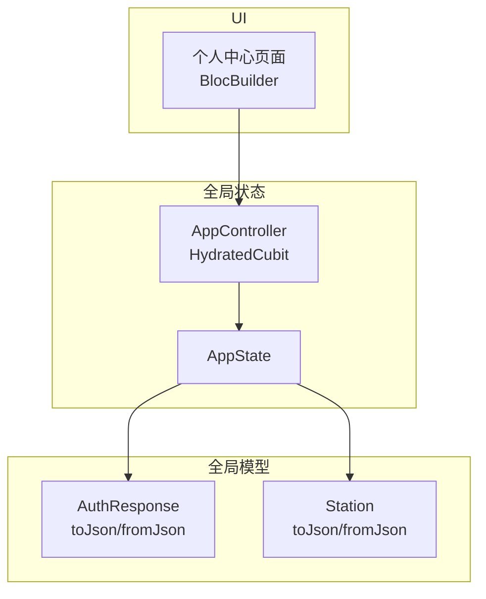
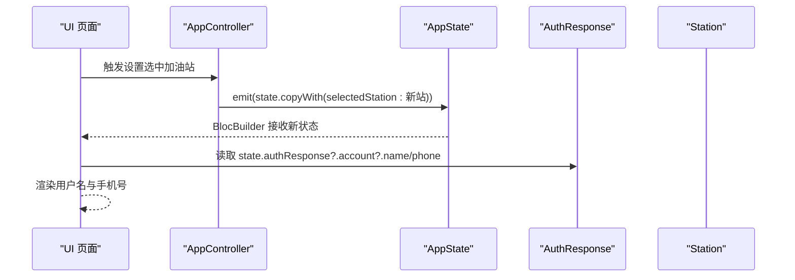
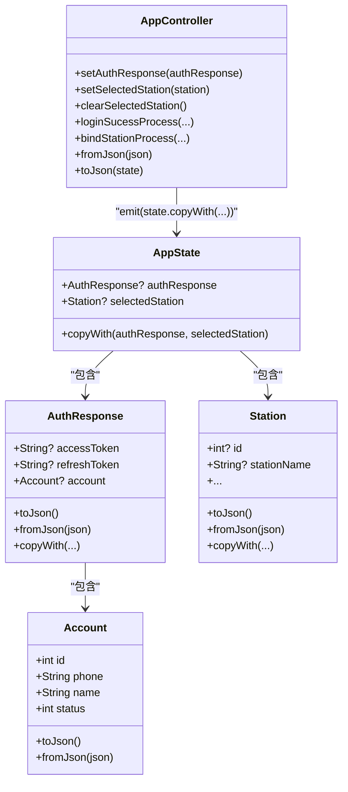

# AppState 数据模型

<cite>
**本文引用的文件列表**
- [app_state.dart](file://lib/global/app_state.dart)
- [app_controller.dart](file://lib/global/app_controller.dart)
- [auth_rep_type.dart](file://lib/global/model/auth_rep_type.dart)
- [auth_rep_type.g.dart](file://lib/global/model/auth_rep_type.g.dart)
- [station_res_type.dart](file://lib/global/model/station_res_type.dart)
- [station_res_type.g.dart](file://lib/global/model/station_res_type.g.dart)
- [account_screen.dart](file://lib/pages/profile/widgets/account_screen.dart)
- [global_update_ui.dart](file://lib/widgets/common/global_update_ui.dart)
</cite>

## 目录
1. [简介](#简介)
2. [项目结构](#项目结构)
3. [核心组件](#核心组件)
4. [架构总览](#架构总览)
5. [组件详解](#组件详解)
6. [依赖关系分析](#依赖关系分析)
7. [性能考量](#性能考量)
8. [故障排查指南](#故障排查指南)
9. [结论](#结论)
10. [附录](#附录)

## 简介
本文件系统性阐述 AppState 不可变状态模型的设计与实现，重点覆盖以下内容：
- 核心字段：authResponse（用户认证响应）、selectedStation（选中加油站）
- 不可变更新机制：copyWith 方法如何保证每次状态变更返回新实例
- 实际使用场景：如何通过 AppController 的 setter 或 emit(state.copyWith(...)) 局部更新状态
- 序列化/反序列化：与 AuthResponse、Station 模型的 JSON 转换链路
- 在 UI 中的监听与消费：BlocBuilder 监听 AppState 并在个人中心页面展示用户名与手机号

## 项目结构
AppState 所在模块位于全局状态管理目录，配合 HydratedBloc 提供持久化能力；AuthResponse 与 Station 分别来自全局模型层，二者均采用 freezed_annotation 自动生成 JSON 序列化代码。

图表来源
- [app_state.dart](file://lib/global/app_state.dart#L1-L22)
- [app_controller.dart](file://lib/global/app_controller.dart#L16-L21)
- [auth_rep_type.dart](file://lib/global/model/auth_rep_type.dart#L5-L26)
- [station_res_type.dart](file://lib/global/model/station_res_type.dart#L26-L103)
- [account_screen.dart](file://lib/pages/profile/widgets/account_screen.dart#L86-L129)

章节来源
- [app_state.dart](file://lib/global/app_state.dart#L1-L22)
- [app_controller.dart](file://lib/global/app_controller.dart#L16-L21)

## 核心组件
- AppState：承载全局不可变状态，包含两个核心字段：
  - authResponse：用户认证响应，类型为 AuthResponse?
  - selectedStation：选中的加油站，类型为 Station?
- AppController：继承 HydratedCubit<AppState>，负责状态初始化、登录流程、登出清理、以及持久化序列化/反序列化。
- AuthResponse：包含 accessToken、refreshToken、account（Account）等字段，支持 toJson/fromJson 与 copyWith。
- Station：包含 id、stationName、地址信息、状态等字段，支持 toJson/fromJson 与 copyWith。

章节来源
- [app_state.dart](file://lib/global/app_state.dart#L4-L21)
- [app_controller.dart](file://lib/global/app_controller.dart#L16-L21)
- [auth_rep_type.dart](file://lib/global/model/auth_rep_type.dart#L5-L26)
- [station_res_type.dart](file://lib/global/model/station_res_type.dart#L26-L103)

## 架构总览
AppState 作为全局状态容器，通过 AppController 进行不可变更新与持久化。UI 层通过 BlocBuilder 订阅 AppController 的 AppState 流，实现对用户名、手机号等信息的展示与交互。

图表来源
- [app_controller.dart](file://lib/global/app_controller.dart#L54-L60)
- [app_state.dart](file://lib/global/app_state.dart#L13-L21)
- [account_screen.dart](file://lib/pages/profile/widgets/account_screen.dart#L86-L129)

## 组件详解

### AppState 不可变状态模型
- 字段定义
  - authResponse：用户认证响应，可能为空，用于保存登录后的令牌与账户信息。
  - selectedStation：当前选中的加油站，可能为空，用于页面间传递或切换站点。
- 不可变更新
  - copyWith 方法接收可空参数，若传入非空值则替换对应字段，否则保留原值，最终返回一个新实例，满足 BLoC 不可变更新的最佳实践。

章节来源
- [app_state.dart](file://lib/global/app_state.dart#L4-L21)

### AppController 状态管理与持久化
- 初始化与生命周期
  - 继承 HydratedCubit<AppState>，在构造时初始化状态并监听应用生命周期。
- setter 方法
  - setAuthResponse：通过 emit(state.copyWith(authResponse: ...)) 更新认证信息。
  - setSelectedStation：通过 emit(state.copyWith(selectedStation: ...)) 更新选中站点。
  - clearSelectedStation：清空选中站点，通常在登出时调用。
- 登录流程
  - loginSucessProcess：设置认证信息后根据注册类型决定路由跳转。
  - bindStationProcess：根据站点状态引导绑定或跳过绑定流程。
- 持久化
  - fromJson：将持久化的 JSON 反序列化为 AppState，内部递归调用 AuthResponse 和 Station 的 fromJson。
  - toJson：将 AppState 序列化为 JSON，内部递归调用 AuthResponse 和 Station 的 toJson。

章节来源
- [app_controller.dart](file://lib/global/app_controller.dart#L16-L21)
- [app_controller.dart](file://lib/global/app_controller.dart#L50-L60)
- [app_controller.dart](file://lib/global/app_controller.dart#L63-L99)
- [app_controller.dart](file://lib/global/app_controller.dart#L118-L143)

### AuthResponse 与 Account 模型
- AuthResponse
  - 字段：accessToken、refreshToken、account（Account）
  - 支持 toJson/fromJson 与 copyWith，便于状态持久化与局部更新。
- Account
  - 字段：id、phone、name、status
  - 支持 toJson/fromJson，用于序列化用户基本信息。

章节来源
- [auth_rep_type.dart](file://lib/global/model/auth_rep_type.dart#L5-L26)
- [auth_rep_type.dart](file://lib/global/model/auth_rep_type.dart#L28-L46)
- [auth_rep_type.g.dart](file://lib/global/model/auth_rep_type.g.dart#L9-L23)
- [auth_rep_type.g.dart](file://lib/global/model/auth_rep_type.g.dart#L24-L36)

### Station 模型
- Station
  - 字段：id、stationName、省市区编码与名称、详细地址、许可证 URL、状态、创建/更新时间等
  - 支持 toJson/fromJson 与 copyWith，便于在站点选择、编辑、列表刷新等场景进行不可变更新。
- StationDetailResponse（相关模型）
  - 包含发票相关信息与审核字段，同样具备序列化能力。

章节来源
- [station_res_type.dart](file://lib/global/model/station_res_type.dart#L26-L103)
- [station_res_type.dart](file://lib/global/model/station_res_type.dart#L105-L164)
- [station_res_type.g.dart](file://lib/global/model/station_res_type.g.dart#L1-L164)

### 在 UI 中监听与消费 AppState
- 个人中心页面示例
  - 使用 BlocBuilder<AppController, AppState> 订阅 AppController 的 AppState 流。
  - 从 state.authResponse?.account 中读取 name 与 phone，实现用户名与手机号的展示。
- 全局 UI 更新包装器
  - GlobalUpdateUi 通过 BlocBuilder<AppController, AppState> 包裹子树，使子组件能够访问 AppController 与 AppState。

章节来源
- [account_screen.dart](file://lib/pages/profile/widgets/account_screen.dart#L86-L129)
- [global_update_ui.dart](file://lib/widgets/common/global_update_ui.dart#L1-L18)

## 依赖关系分析
AppState 依赖于 AuthResponse 与 Station 两个模型；AppController 依赖 AppState，并在持久化过程中调用 AuthResponse 与 Station 的序列化/反序列化方法。

图表来源
- [app_state.dart](file://lib/global/app_state.dart#L4-L21)
- [app_controller.dart](file://lib/global/app_controller.dart#L50-L60)
- [auth_rep_type.dart](file://lib/global/model/auth_rep_type.dart#L5-L26)
- [auth_rep_type.dart](file://lib/global/model/auth_rep_type.dart#L28-L46)
- [station_res_type.dart](file://lib/global/model/station_res_type.dart#L26-L103)

## 性能考量
- 不可变更新的优势
  - 每次状态变更返回新实例，避免共享可变状态带来的副作用，提升 UI 重绘可控性与调试便利性。
- 序列化开销
  - AppState 的 toJson/fromJson 会递归调用嵌套对象的序列化方法，建议在高频更新场景下避免不必要的全量序列化。
- UI 订阅粒度
  - 将 AppState 拆分为更细粒度的状态（例如独立的用户信息状态与站点状态）可减少不必要的重建，但需权衡复杂度与一致性。

[本节为通用指导，无需列出具体文件来源]

## 故障排查指南
- 空指针异常
  - 当 authResponse 或 selectedStation 为空时，UI 中应做空值保护（如三元表达式或空合并），避免直接访问其成员导致崩溃。
- 序列化失败
  - 若持久化 JSON 缺失关键字段，fromJson 将无法正确还原对象，请检查服务端返回或本地存储格式是否一致。
- 登录后未更新选中站点
  - 确认 loginSucessProcess 后是否调用了 setSelectedStation，或在初始化阶段是否触发了自动绑定逻辑。

章节来源
- [app_controller.dart](file://lib/global/app_controller.dart#L34-L47)
- [app_controller.dart](file://lib/global/app_controller.dart#L63-L99)
- [account_screen.dart](file://lib/pages/profile/widgets/account_screen.dart#L86-L129)

## 结论
AppState 通过简洁的不可变设计与完善的序列化/反序列化链路，为全局状态管理提供了稳定基础。结合 AppController 的 setter 与 emit(state.copyWith(...))，可在不破坏 BLoC 最佳实践的前提下实现局部状态更新。UI 层通过 BlocBuilder 订阅 AppState，即可安全地消费认证与站点信息，如个人中心的用户名与手机号展示。

[本节为总结性内容，无需列出具体文件来源]

## 附录

### 使用 copyWith 局部更新状态的实践
- 局部更新选中站点
  - 通过 AppController.setSelectedStation(Station) 触发 emit(state.copyWith(selectedStation: ...))，仅更新 selectedStation 字段。
- 局部更新认证信息
  - 通过 AppController.setAuthResponse(AuthResponse) 触发 emit(state.copyWith(authResponse: ...))，仅更新 authResponse 字段。
- 清空选中站点
  - 通过 AppController.clearSelectedStation() 触发 emit(state.copyWith(selectedStation: Station()))，清空站点信息。

章节来源
- [app_controller.dart](file://lib/global/app_controller.dart#L50-L60)
- [app_controller.dart](file://lib/global/app_controller.dart#L54-L60)

### 个人中心页面典型用法片段路径
- 在个人中心页面中，通过 BlocBuilder<AppController, AppState> 订阅 AppState，并从 state.authResponse?.account 中读取 name 与 phone 进行展示。

章节来源
- [account_screen.dart](file://lib/pages/profile/widgets/account_screen.dart#L86-L129)