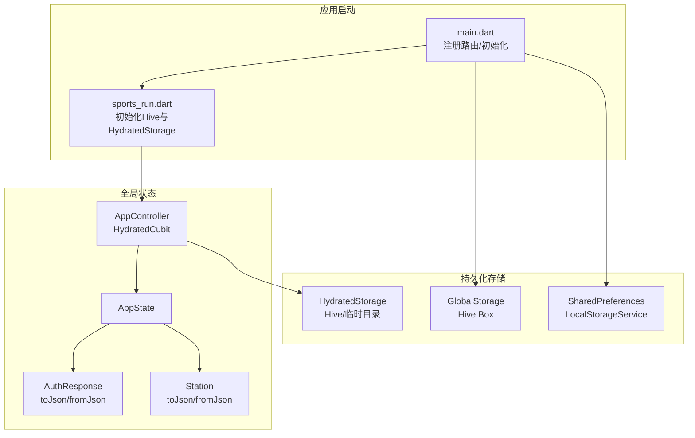
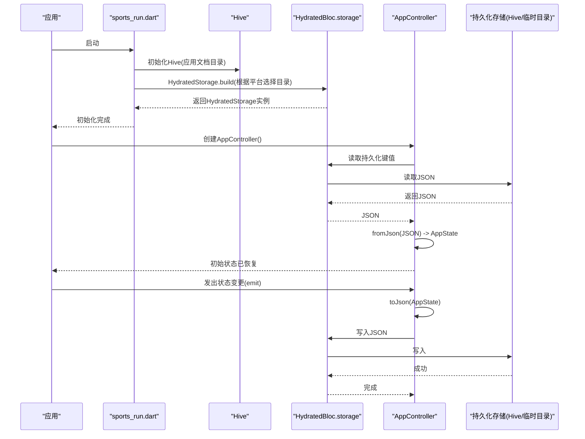
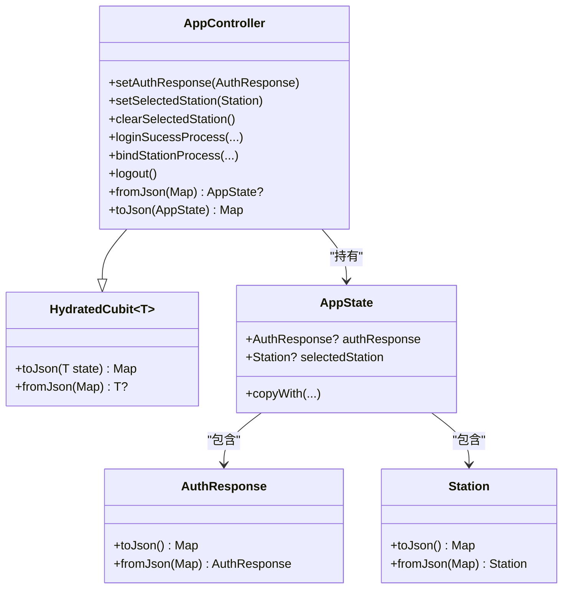
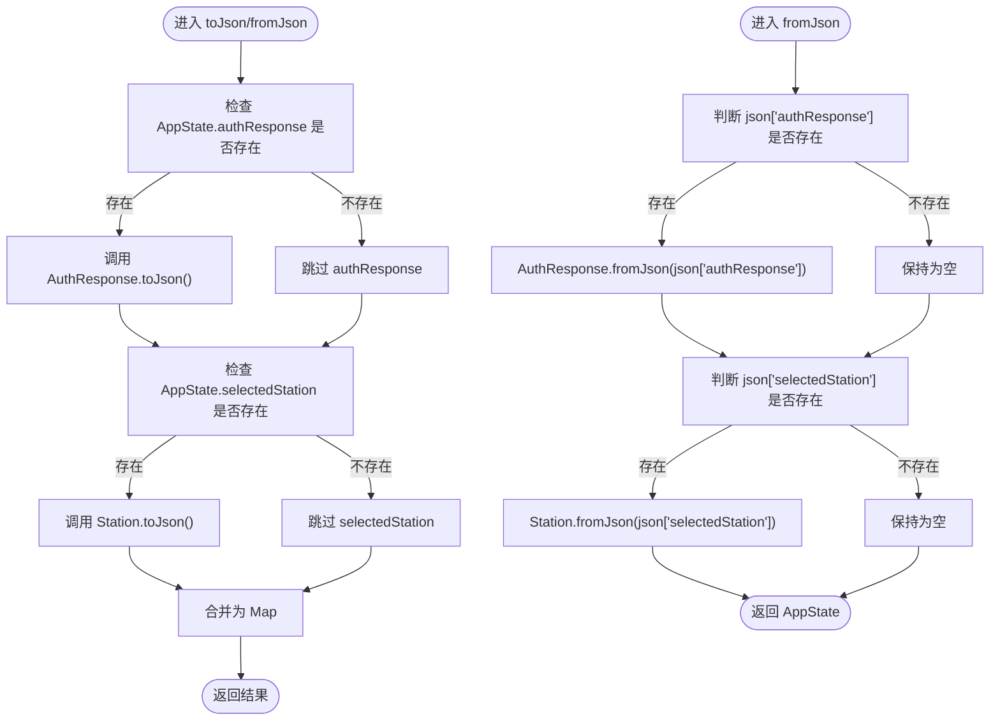
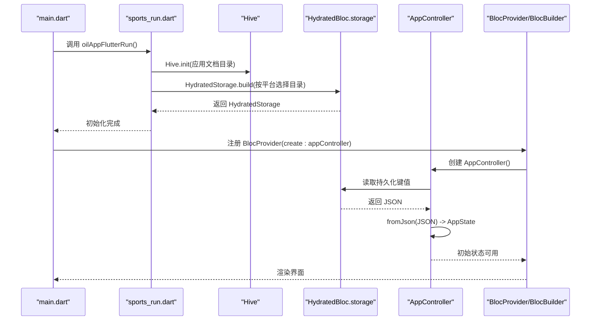
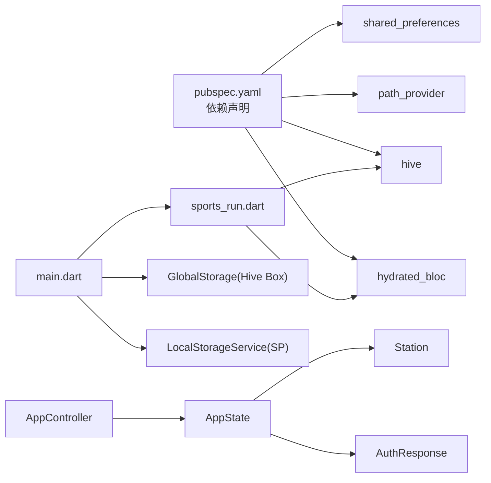

# 状态持久化机制

<cite>
**本文引用的文件**
- [main.dart](file://lib/main.dart)
- [sports_run.dart](file://lib/sports_run.dart)
- [app.dart](file://lib/app.dart)
- [app_controller.dart](file://lib/global/app_controller.dart)
- [app_state.dart](file://lib/global/app_state.dart)
- [auth_rep_type.dart](file://lib/global/model/auth_rep_type.dart)
- [station_res_type.dart](file://lib/global/model/station_res_type.dart)
- [storage.dart](file://lib/global/storage.dart)
- [preference.dart](file://lib/utils/preference.dart)
- [service_locator.dart](file://lib/utils/service_locator.dart)
- [pubspec.yaml](file://pubspec.yaml)
</cite>

## 目录
1. [简介](#简介)
2. [项目结构](#项目结构)
3. [核心组件](#核心组件)
4. [架构总览](#架构总览)
5. [组件详解](#组件详解)
6. [依赖关系分析](#依赖关系分析)
7. [性能与可靠性](#性能与可靠性)
8. [故障排查指南](#故障排查指南)
9. [结论](#结论)
10. [附录](#附录)

## 简介
本文件围绕基于 HydratedCubit 的全局状态持久化进行深入解析，重点阐述：
- AppState 对象如何通过 HydratedCubit 的 fromJson 与 toJson 将 authResponse 与 selectedStation 字段递归序列化/反序列化；
- HydratedBloc 底层如何借助 Hive 或 HydratedStorage 在不同平台（移动端/桌面/Web）自动完成状态的读写；
- 应用冷启动时全局状态自动恢复的时序流程；
- 在用户切换加油站后重启 App 仍能保留上下文体验的关键价值；
- 与其他手动持久化方案（如 SharedPreferences/Hive 手动存取）的对比与权衡。

## 项目结构
本项目采用 Flutter + Bloc 架构，HydratedCubit 作为全局状态容器，配合 HydratedStorage 实现跨进程/冷启动的自动持久化与恢复。关键路径如下：
- 应用入口与初始化：main.dart -> sports_run.dart（初始化 Hive、HydratedBloc.storage）
- 全局状态控制器：AppController（继承 HydratedCubit<AppState>），提供 toJson/fromJson
- 全局状态模型：AppState（包含 authResponse 与 selectedStation）
- 模型序列化：AuthResponse、Station 均具备 toJson/fromJson（Freezed 生成）
- 其他存储：Hive Box（GlobalStorage）、SharedPreferences（LocalStorageService）

图表来源
- [main.dart](file://lib/main.dart#L1-L22)
- [sports_run.dart](file://lib/sports_run.dart#L22-L56)
- [app_controller.dart](file://lib/global/app_controller.dart#L15-L142)
- [app_state.dart](file://lib/global/app_state.dart#L1-L22)
- [auth_rep_type.dart](file://lib/global/model/auth_rep_type.dart#L1-L46)
- [station_res_type.dart](file://lib/global/model/station_res_type.dart#L1-L164)
- [storage.dart](file://lib/global/storage.dart#L1-L34)
- [preference.dart](file://lib/utils/preference.dart#L1-L57)
- [service_locator.dart](file://lib/utils/service_locator.dart#L1-L12)

章节来源
- [main.dart](file://lib/main.dart#L1-L22)
- [sports_run.dart](file://lib/sports_run.dart#L22-L56)

## 核心组件
- AppController（HydratedCubit<AppState>）
  - 提供 setAuthResponse、setSelectedStation、clearSelectedStation 等状态变更方法
  - 实现 toJson/fromJson，将 AppState 中的 authResponse 与 selectedStation 分别调用其 toJson/fromJson 进行递归序列化/反序列化
- AppState
  - 包含两个关键字段：AuthResponse? authResponse 与 Station? selectedStation
  - 提供 copyWith 以便不可变更新
- AuthResponse/Station
  - 基于 Freezed 生成 toJson/fromJson，支持嵌套对象的 JSON 序列化
- HydratedBloc.storage
  - 在应用启动时通过 HydratedStorage.build 初始化，指定存储目录（移动端/桌面使用临时目录，Web 使用 web 目录）
- 其他存储
  - GlobalStorage：Hive Box 存储环境变量、代理地址、版本时间等
  - LocalStorageService：SharedPreferences 封装，用于偏好设置

章节来源
- [app_controller.dart](file://lib/global/app_controller.dart#L15-L142)
- [app_state.dart](file://lib/global/app_state.dart#L1-L22)
- [auth_rep_type.dart](file://lib/global/model/auth_rep_type.dart#L1-L46)
- [station_res_type.dart](file://lib/global/model/station_res_type.dart#L1-L164)
- [sports_run.dart](file://lib/sports_run.dart#L22-L56)
- [storage.dart](file://lib/global/storage.dart#L1-L34)
- [preference.dart](file://lib/utils/preference.dart#L1-L57)
- [service_locator.dart](file://lib/utils/service_locator.dart#L1-L12)

## 架构总览
HydratedCubit 的工作流概览：
- 应用启动时，Hive 初始化并设置 HydratedBloc.storage
- AppController 作为全局状态根，在首次创建时尝试从持久化存储恢复 AppState
- 当状态变更时，AppController 自动调用 toJson 将 AppState 写入存储
- 恢复阶段，AppController 自动调用 fromJson 将 JSON 数据还原为 AppState

图表来源
- [sports_run.dart](file://lib/sports_run.dart#L22-L56)
- [app_controller.dart](file://lib/global/app_controller.dart#L15-L142)

## 组件详解

### AppController：HydratedCubit<AppState> 的持久化链路
- 继承 HydratedCubit<AppState>，在构造时传入默认 AppState()
- 实现 toJson(AppState state)
  - 将 AppState.authResponse?.toJson() 与 AppState.selectedStation?.toJson() 放入 Map
- 实现 fromJson(Map<String,dynamic> json)
  - 若 json['authResponse'] 存在，则调用 AuthResponse.fromJson(json['authResponse']) 还原
  - 若 json['selectedStation'] 存在，则调用 Station.fromJson(json['selectedStation'] as Map<String,dynamic>) 还原
- 生命周期与状态初始化
  - 监听应用生命周期，必要时根据已有 token 自动绑定活动加油站

图表来源
- [app_controller.dart](file://lib/global/app_controller.dart#L15-L142)
- [app_state.dart](file://lib/global/app_state.dart#L1-L22)
- [auth_rep_type.dart](file://lib/global/model/auth_rep_type.dart#L1-L46)
- [station_res_type.dart](file://lib/global/model/station_res_type.dart#L1-L164)

章节来源
- [app_controller.dart](file://lib/global/app_controller.dart#L15-L142)

### AppState 的序列化/反序列化完整链路
- toJson(AppState state)
  - 调用 state.authResponse?.toJson() 与 state.selectedStation?.toJson()，得到嵌套 Map
- fromJson(Map<String,dynamic> json)
  - 若 json['authResponse'] 非空，调用 AuthResponse.fromJson(json['authResponse'])
  - 若 json['selectedStation'] 非空，调用 Station.fromJson(json['selectedStation'] as Map<String,dynamic>)

图表来源
- [app_controller.dart](file://lib/global/app_controller.dart#L124-L141)
- [auth_rep_type.dart](file://lib/global/model/auth_rep_type.dart#L1-L46)
- [station_res_type.dart](file://lib/global/model/station_res_type.dart#L1-L164)

章节来源
- [app_controller.dart](file://lib/global/app_controller.dart#L124-L141)
- [auth_rep_type.dart](file://lib/global/model/auth_rep_type.dart#L1-L46)
- [station_res_type.dart](file://lib/global/model/station_res_type.dart#L1-L164)

### 应用冷启动时全局状态自动恢复时序
- 启动阶段
  - main.dart 注册路由与初始化
  - sports_run.dart 初始化 Hive 并设置 HydratedBloc.storage
- 控制器阶段
  - AppController 构造时触发 HydratedBloc 恢复流程
  - HydratedBloc 读取持久化键值，调用 AppController.fromJson 还原 AppState
- UI 阶段
  - BlocProvider<AppController> 提供状态，BlocBuilder/AppStateBuilder 渲染界面

图表来源
- [main.dart](file://lib/main.dart#L1-L22)
- [sports_run.dart](file://lib/sports_run.dart#L22-L56)
- [app_controller.dart](file://lib/global/app_controller.dart#L15-L142)
- [app.dart](file://lib/app.dart#L23-L90)

章节来源
- [main.dart](file://lib/main.dart#L1-L22)
- [sports_run.dart](file://lib/sports_run.dart#L22-L56)
- [app_controller.dart](file://lib/global/app_controller.dart#L15-L142)
- [app.dart](file://lib/app.dart#L23-L90)

### 关键字段在持久化过程中的递归处理
- authResponse
  - AppState.authResponse 为 AuthResponse?
  - 持久化时调用 AuthResponse.toJson()，内部由 Freezed 生成的序列化方法完成
  - 恢复时调用 AuthResponse.fromJson(json)，内部由 Freezed 生成的反序列化方法完成
- selectedStation
  - AppState.selectedStation 为 Station?
  - 持久化时调用 Station.toJson()，内部由 Freezed 生成的序列化方法完成
  - 恢复时调用 Station.fromJson(json)，内部由 Freezed 生成的反序列化方法完成

章节来源
- [app_controller.dart](file://lib/global/app_controller.dart#L124-L141)
- [auth_rep_type.dart](file://lib/global/model/auth_rep_type.dart#L1-L46)
- [station_res_type.dart](file://lib/global/model/station_res_type.dart#L1-L164)

### HydratedBloc 底层存储引擎与平台差异
- 初始化与存储目录
  - 移动端/桌面：使用临时目录（getTemporaryDirectory）作为 HydratedStorageDirectory
  - Web：使用 HydratedStorageDirectory.web
- 存储介质
  - HydratedBloc.storage 通过 HydratedStorage.build 构建，底层通常基于 Hive（本地持久化）或浏览器存储（Web）
- 生命周期
  - 应用启动时设置 HydratedBloc.storage，随后 AppController 在构造时自动触发恢复；状态变更时自动写入

章节来源
- [sports_run.dart](file://lib/sports_run.dart#L22-L56)
- [pubspec.yaml](file://pubspec.yaml#L54-L68)

### 用户切换加油站后重启 App 的上下文保留
- 场景说明
  - 用户在某个加油站上下文工作，切换到另一个加油站后重启 App
  - 由于 AppState.selectedStation 被持久化并在恢复时重建，AppController 可在恢复后根据策略自动绑定活动加油站，从而保留上下文体验
- 关键点
  - AppState.selectedStation 持久化与恢复
  - AppController.initState 中对活动加油站的自动绑定逻辑

章节来源
- [app_controller.dart](file://lib/global/app_controller.dart#L33-L47)

### 与其他持久化方案的对比
- SharedPreferences（LocalStorageService）
  - 优点：轻量、易用、适合小规模键值对
  - 局限：不适合复杂对象（需手动序列化/反序列化），且易受类型不匹配影响
  - 适用：主题、语言、引导页等偏好设置
- Hive（GlobalStorage）
  - 优点：高性能、支持 Box、适合中等复杂度数据
  - 局限：需要显式 openBox、管理键名
  - 适用：环境参数、代理地址、版本时间等
- HydratedCubit（AppState）
  - 优点：自动持久化/恢复、与状态管理解耦、无需手动键名管理
  - 局限：仅适合与 Bloc/Cubit 直接关联的状态；复杂对象需确保 toJson/fromJson 完整
  - 适用：全局登录态、当前选中站点等跨页面共享状态

章节来源
- [storage.dart](file://lib/global/storage.dart#L1-L34)
- [preference.dart](file://lib/utils/preference.dart#L1-L57)
- [service_locator.dart](file://lib/utils/service_locator.dart#L1-L12)
- [app_controller.dart](file://lib/global/app_controller.dart#L15-L142)

## 依赖关系分析
- 外部依赖
  - hydrated_bloc、hive、path_provider、shared_preferences
- 内部依赖
  - AppController 依赖 AppState、AuthResponse、Station
  - sports_run.dart 依赖 Hive 与 HydratedBloc.storage
  - main.dart 依赖路由与全局存储初始化

图表来源
- [pubspec.yaml](file://pubspec.yaml#L54-L68)
- [sports_run.dart](file://lib/sports_run.dart#L22-L56)
- [main.dart](file://lib/main.dart#L1-L22)
- [storage.dart](file://lib/global/storage.dart#L1-L34)
- [preference.dart](file://lib/utils/preference.dart#L1-L57)
- [app_controller.dart](file://lib/global/app_controller.dart#L15-L142)

章节来源
- [pubspec.yaml](file://pubspec.yaml#L54-L68)
- [sports_run.dart](file://lib/sports_run.dart#L22-L56)
- [main.dart](file://lib/main.dart#L1-L22)

## 性能与可靠性
- 性能
  - HydratedCubit 自动化持久化/恢复，避免重复键名管理与手动序列化开销
  - Hive 作为底层存储，移动端/桌面性能稳定；Web 环境下 HydratedStorageDirectory.web 适配浏览器存储
- 可靠性
  - Freezed 生成的 toJson/fromJson 保证字段一致性与类型安全
  - AppState.copyWith 与 HydratedCubit 的不可变更新模式降低竞态风险
- 注意事项
  - 确保 AppState 中所有嵌套对象均实现 toJson/fromJson
  - 避免在 toJson 中遗漏关键字段，否则恢复时会丢失状态

[本节为通用建议，无需特定文件引用]

## 故障排查指南
- 恢复失败或状态为空
  - 检查 AppController.fromJson 是否正确处理了 json['authResponse'] 与 json['selectedStation']
  - 确认 AuthResponse.fromJson 与 Station.fromJson 正常工作
- 序列化异常
  - 检查嵌套对象是否实现了 toJson/fromJson
  - 确认字段命名与 JSON 键一致
- 存储路径问题（移动端/桌面）
  - 确认 Hive.init 使用的是应用文档目录
  - 确认 HydratedStorage.build 的目录选择符合平台要求
- Web 环境
  - 确认 HydratedStorageDirectory.web 生效
  - 浏览器隐私模式可能影响存储

章节来源
- [app_controller.dart](file://lib/global/app_controller.dart#L124-L141)
- [auth_rep_type.dart](file://lib/global/model/auth_rep_type.dart#L1-L46)
- [station_res_type.dart](file://lib/global/model/station_res_type.dart#L1-L164)
- [sports_run.dart](file://lib/sports_run.dart#L22-L56)

## 结论
- HydratedCubit 通过 HydratedBloc.storage 实现全局状态的自动化持久化与恢复，显著简化了状态管理与跨进程/冷启动的复杂度
- AppState 的 authResponse 与 selectedStation 通过各自 toJson/fromJson 递归处理，确保复杂对象的完整序列化
- 在用户切换加油站后重启 App 的场景中，持久化的 selectedStation 能够帮助快速恢复上下文，提升用户体验
- 与 SharedPreferences/Hive 手动存储相比，HydratedCubit 更加“即插即用”，但需确保嵌套对象的序列化完整性

[本节为总结，无需特定文件引用]

## 附录
- 关键实现参考路径
  - AppController.toJson/fromJson：[app_controller.dart](file://lib/global/app_controller.dart#L124-L141)
  - AppState 定义：[app_state.dart](file://lib/global/app_state.dart#L1-L22)
  - AuthResponse/Station 序列化：[auth_rep_type.dart](file://lib/global/model/auth_rep_type.dart#L1-L46)、[station_res_type.dart](file://lib/global/model/station_res_type.dart#L1-L164)
  - 应用启动与存储初始化：[sports_run.dart](file://lib/sports_run.dart#L22-L56)、[main.dart](file://lib/main.dart#L1-L22)
  - 其他存储示例：[storage.dart](file://lib/global/storage.dart#L1-L34)、[preference.dart](file://lib/utils/preference.dart#L1-L57)、[service_locator.dart](file://lib/utils/service_locator.dart#L1-L12)

[本节为补充说明，无需特定文件引用]