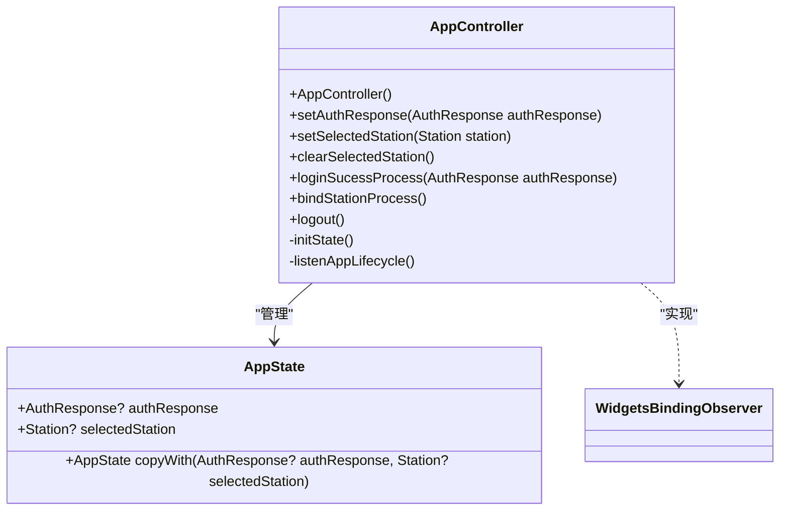
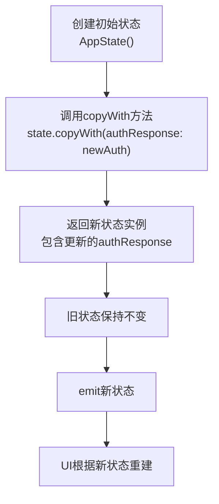
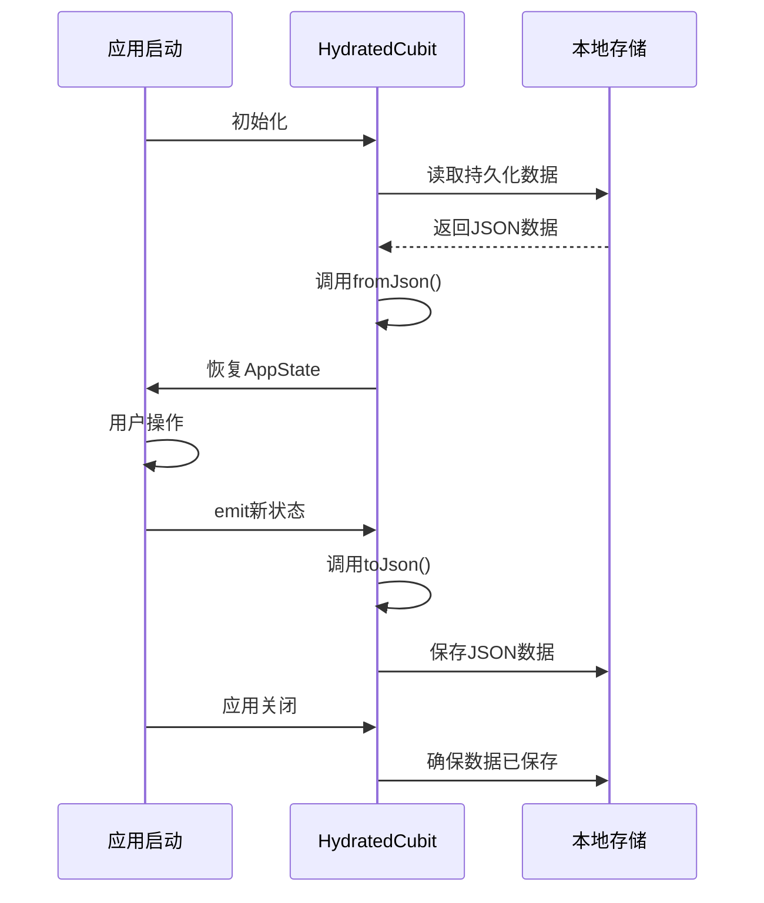
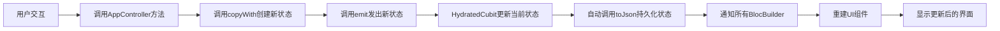

# 状态管理

<cite>
**本文档引用的文件**
- [app_controller.dart](file://lib/global/app_controller.dart)
- [app_state.dart](file://lib/global/app_state.dart)
- [storage.dart](file://lib/global/storage.dart)
- [memory_store.dart](file://lib/global/memory_store.dart)
- [global_update_ui.dart](file://lib/widgets/common/global_update_ui.dart)
</cite>

## 目录
1. [简介](#简介)
2. [核心组件](#核心组件)
3. [AppController 全局状态管理](#appcontroller-全局状态管理)
4. [AppState 不可变数据模型](#appstate-不可变数据模型)
5. [状态持久化机制](#状态持久化机制)
6. [状态更新流程](#状态更新流程)
7. [全局状态使用示例](#全局状态使用示例)
8. [技术权衡与优势](#技术权衡与优势)

## 简介
本文档详细说明油品业务App基于BLoC模式的状态管理实现，重点关注HydratedCubit在全局状态管理中的应用。文档将阐述AppController如何管理用户认证信息和选中加油站等全局状态，解释AppState不可变数据模型的设计原理，以及HydratedCubit如何通过JSON序列化实现状态持久化。同时，文档将描述从用户交互到UI更新的完整状态流，并讨论该方案的技术优势。

## 核心组件

油品业务App的状态管理由多个核心组件构成，共同实现了高效、可靠的全局状态管理。这些组件包括AppController（继承HydratedCubit）、AppState（不可变状态模型）、持久化存储机制以及全局状态更新工具。

**Section sources**
- [app_controller.dart](file://lib/global/app_controller.dart#L1-L145)
- [app_state.dart](file://lib/global/app_state.dart#L1-L23)

## AppController 全局状态管理

AppController是应用的全局状态控制器，继承自HydratedCubit并实现了WidgetsBindingObserver接口，用于监听应用生命周期。作为单例模式实现，它通过final appController = AppController()提供全局访问点。

该控制器主要管理两类核心状态：用户认证信息（authResponse）和选中加油站信息（selectedStation）。通过提供setAuthResponse、setSelectedStation等方法，其他组件可以安全地更新全局状态。当调用emit方法时，会触发状态变更，所有监听该状态的UI组件将自动重建。

AppController还实现了应用初始化逻辑，当应用启动时会自动检查是否存在有效的认证信息，并根据用户状态（已登录但未绑定加油站、已登录且已绑定等）导航到相应的页面。

**Diagram sources**
- [app_controller.dart](file://lib/global/app_controller.dart#L16-L145)
- [app_state.dart](file://lib/global/app_state.dart#L4-L22)

**Section sources**
- [app_controller.dart](file://lib/global/app_controller.dart#L16-L145)

## AppState 不可变数据模型

AppState是应用的全局状态数据模型，设计为不可变对象（immutable object）。这种设计确保了状态的一致性和可预测性，避免了意外的状态修改。

该模型包含两个主要属性：authResponse（用户认证响应）和selectedStation（选中的加油站）。通过copyWith方法，可以创建新的AppState实例，同时保留原有状态的大部分属性，只修改指定的属性。这种模式支持函数式编程风格的状态更新，确保每次状态变更都产生一个新的对象实例，而不是修改现有实例。

不可变数据模型的优势包括：简化调试（状态变化可追溯）、提高性能（通过引用比较快速检测变化）、避免竞态条件（无共享可变状态）。

**Diagram sources**
- [app_state.dart](file://lib/global/app_state.dart#L4-L22)

**Section sources**
- [app_state.dart](file://lib/global/app_state.dart#L4-L22)

## 状态持久化机制

HydratedCubit通过重写fromJson和toJson方法实现了状态的自动持久化。当应用关闭时，toJson方法将当前AppState序列化为JSON对象并保存到本地存储；当应用启动时，fromJson方法从本地存储读取JSON数据并反序列化为AppState实例。

在油品业务App中，toJson方法将authResponse和selectedStation对象转换为JSON格式，而fromJson方法则从JSON数据重建这些对象。这种机制确保了即使应用被完全关闭，用户的登录状态和选中加油站信息也能在下次启动时恢复。

持久化过程由HydratedBloc框架自动管理，开发者只需关注数据模型的序列化逻辑。框架使用Hive作为底层存储引擎，提供了高效的键值对存储能力。

**Diagram sources**
- [app_controller.dart](file://lib/global/app_controller.dart#L125-L142)

**Section sources**
- [app_controller.dart](file://lib/global/app_controller.dart#L125-L142)

## 状态更新流程

状态更新流程从用户交互开始，经过控制器处理，最终反映在UI上。当用户执行某个操作（如登录成功）时，相关业务逻辑会调用AppController的方法（如setAuthResponse），这些方法内部调用emit方法并传入通过copyWith创建的新状态。

emit方法触发状态变更，HydratedCubit首先将新状态传递给所有监听器，然后自动将其持久化到本地存储。在UI层，BlocBuilder组件监听AppController的状态变化，每当新状态到达时，它会自动调用builder函数重建相关UI组件。

这种单向数据流确保了状态变化的可预测性和一致性。所有状态更新都必须通过emit方法，避免了直接修改状态导致的混乱。

**Diagram sources**
- [app_controller.dart](file://lib/global/app_controller.dart#L50-L60)
- [global_update_ui.dart](file://lib/widgets/common/global_update_ui.dart#L14-L16)

**Section sources**
- [app_controller.dart](file://lib/global/app_controller.dart#L50-L60)

## 全局状态使用示例

在油品业务App中，通过GlobalUpdateUi组件可以方便地访问和监听全局状态。该组件封装了BlocBuilder，接收一个builder函数作为参数，当全局状态变化时自动重建UI。

开发者可以在任何需要访问全局状态的页面中使用GlobalUpdateUi，通过context.read<AppController>()获取控制器实例，并从builder函数的参数中获取当前状态。这种方式简化了全局状态的访问模式，避免了在每个页面重复编写BlocBuilder代码。

对于不需要频繁更新的静态数据，也可以直接通过appController.state访问当前状态，而不需要建立监听关系。

**Section sources**
- [global_update_ui.dart](file://lib/widgets/common/global_update_ui.dart#L6-L18)

## 技术权衡与优势

选择HydratedCubit而非其他状态管理方案具有多项优势。首先，它完美结合了Cubit的简洁性和状态持久化的自动性，开发者无需手动处理存储逻辑。其次，基于BLoC模式的单向数据流使状态变化可预测且易于调试。

在复杂状态持久化场景下，HydratedCubit的优势尤为明显。相比Provider，它提供了更完整的状态管理生命周期；相比Redux，它减少了样板代码；相比简单的SharedPreferences直接使用，它提供了类型安全和自动序列化能力。

此外，与项目中定义的页面状态管理规范保持一致（局部状态用Cubit，全局持久化状态用HydratedCubit），确保了代码库的一致性和可维护性。

**Section sources**
- [app_controller.dart](file://lib/global/app_controller.dart#L16-L145)
- [openspec/project.md](file://openspec/project.md#L108-L115)