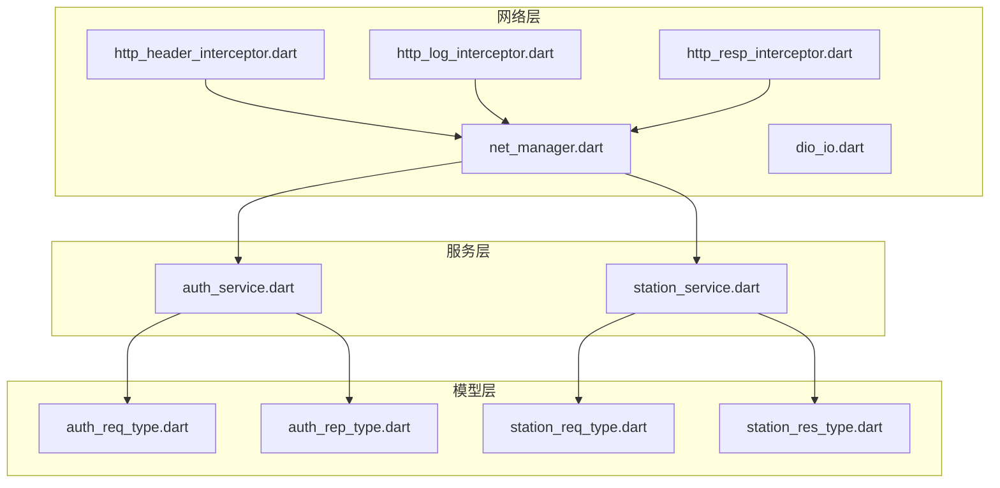
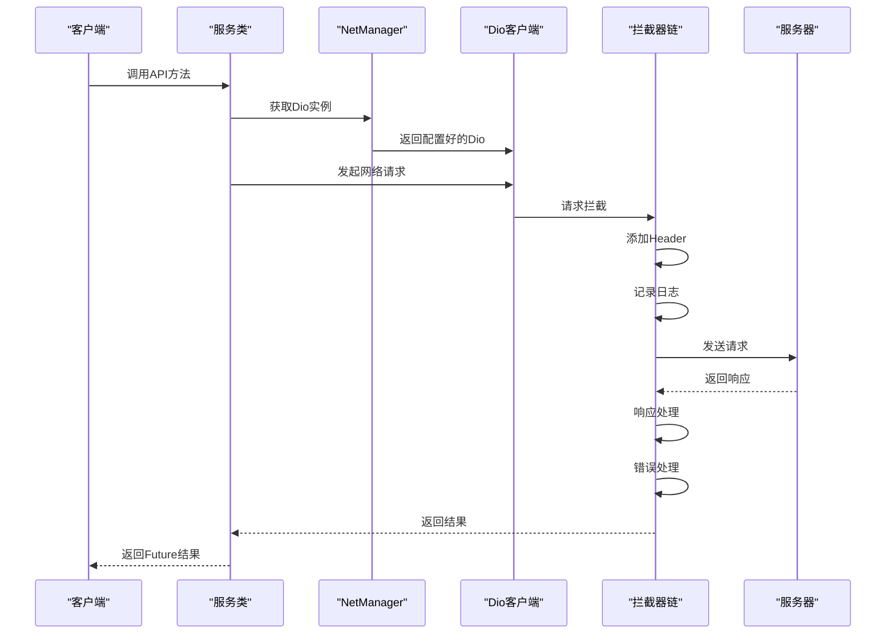
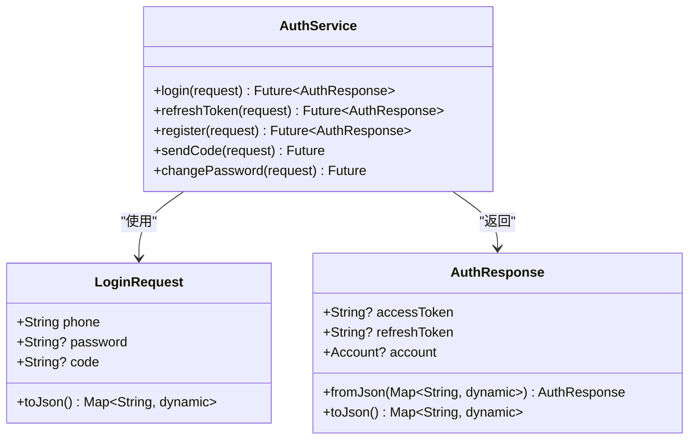
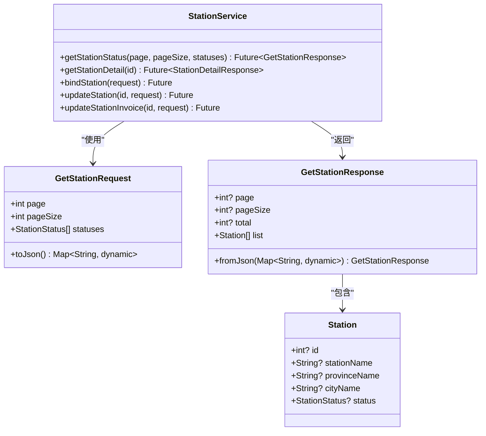
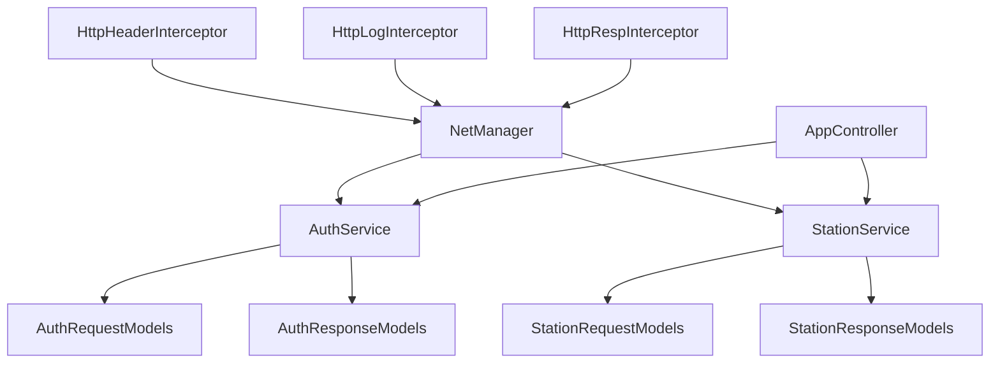
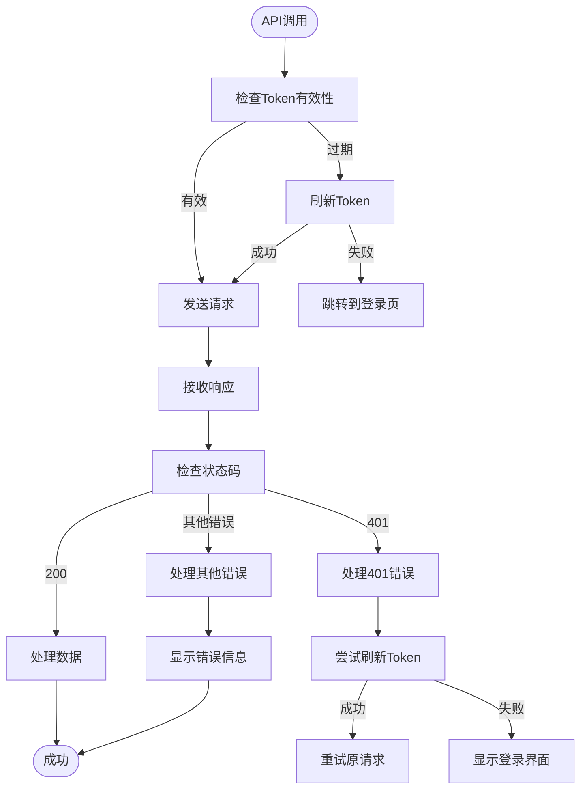

# API服务集成

<cite>
**本文档引用的文件**
- [auth_service.dart](file://lib/global/service/auth_service.dart)
- [station_service.dart](file://lib/global/service/station_service.dart)
- [net_manager.dart](file://lib/net/net_manager.dart)
- [dio_io.dart](file://lib/net/dio_io.dart)
- [http_header_interceptor.dart](file://lib/net/http_header_interceptor.dart)
- [http_log_interceptor.dart](file://lib/net/http_log_interceptor.dart)
- [http_resp_interceptor.dart](file://lib/net/http_resp_interceptor.dart)
- [auth_req_type.dart](file://lib/global/model/auth_req_type.dart)
- [auth_rep_type.dart](file://lib/global/model/auth_rep_type.dart)
- [station_req_type.dart](file://lib/global/model/station_req_type.dart)
- [station_res_type.dart](file://lib/global/model/station_res_type.dart)
- [response.dart](file://lib/net/response.dart)
- [code.dart](file://lib/net/code.dart)
- [login/controller.dart](file://lib/pages/login/controller.dart)
- [station_list/controller.dart](file://lib/pages/station_list/controller.dart)
</cite>

## 目录
1. [简介](#简介)
2. [项目结构](#项目结构)
3. [核心组件](#核心组件)
4. [架构概述](#架构概述)
5. [详细组件分析](#详细组件分析)
6. [依赖分析](#依赖分析)
7. [性能考虑](#性能考虑)
8. [故障排除指南](#故障排除指南)
9. [结论](#结论)

## 简介
本文档详细说明了Retrofit生成的服务类如何与Dio客户端协同工作，重点介绍AuthService、StationService等服务类的注解配置和方法定义。文档涵盖了HTTP方法、路径参数和请求体映射的详细说明，解释了服务实例的获取机制以及如何通过Dio客户端初始化服务代理。同时提供了调用登录、获取加油站列表等典型API接口的代码示例，并说明了异常处理的最佳实践和API版本管理策略。

## 项目结构
项目采用分层架构设计，将网络相关的代码集中管理。核心网络功能位于`lib/net`目录下，包括Dio客户端配置、拦截器和网络管理器。服务类定义在`lib/global/service`目录中，使用Retrofit注解进行API端点定义。数据模型位于`lib/global/model`目录，通过Freezed和JsonSerializable进行序列化处理。这种结构确保了代码的可维护性和可扩展性。

**Diagram sources**
- [net_manager.dart](file://lib/net/net_manager.dart#L1-L88)
- [auth_service.dart](file://lib/global/service/auth_service.dart#L1-L41)
- [station_service.dart](file://lib/global/service/station_service.dart#L1-L48)

**Section sources**
- [net_manager.dart](file://lib/net/net_manager.dart#L1-L88)
- [auth_service.dart](file://lib/global/service/auth_service.dart#L1-L41)

## 核心组件
核心组件包括AuthService和StationService两个主要服务类，它们通过Retrofit注解定义了与后端API的交互接口。AuthService负责用户认证相关的操作，如登录、注册和令牌刷新。StationService则管理加油站相关的业务操作，包括获取加油站列表、详情查询和信息更新。这些服务类通过Dio客户端与后端进行通信，并利用拦截器处理请求和响应的预处理。

**Section sources**
- [auth_service.dart](file://lib/global/service/auth_service.dart#L1-L41)
- [station_service.dart](file://lib/global/service/station_service.dart#L1-L48)

## 架构概述
系统采用基于Dio和Retrofit的网络架构，通过分层设计实现了关注点分离。Dio作为底层HTTP客户端，提供了强大的网络请求功能。Retrofit作为声明式API框架，简化了服务接口的定义。NetManager负责Dio实例的初始化和配置，包括超时设置、拦截器注册等。拦截器链处理请求头添加、日志记录和响应处理等横切关注点。

**Diagram sources**
- [net_manager.dart](file://lib/net/net_manager.dart#L1-L88)
- [auth_service.dart](file://lib/global/service/auth_service.dart#L1-L41)
- [http_header_interceptor.dart](file://lib/net/http_header_interceptor.dart#L1-L56)
- [http_log_interceptor.dart](file://lib/net/http_log_interceptor.dart#L1-L60)
- [http_resp_interceptor.dart](file://lib/net/http_resp_interceptor.dart#L1-L210)

## 详细组件分析
### AuthService分析
AuthService是用户认证服务的核心组件，定义了登录、注册、发送验证码等关键API接口。该服务使用Retrofit注解声明HTTP请求，通过@POST注解定义请求方法和路径。请求参数通过@Body注解映射到请求体中，确保数据的正确序列化和传输。

#### 服务类定义

**Diagram sources**
- [auth_service.dart](file://lib/global/service/auth_service.dart#L1-L41)
- [auth_req_type.dart](file://lib/global/model/auth_req_type.dart#L1-L94)
- [auth_rep_type.dart](file://lib/global/model/auth_rep_type.dart#L1-L46)

**Section sources**
- [auth_service.dart](file://lib/global/service/auth_service.dart#L1-L41)
- [auth_req_type.dart](file://lib/global/model/auth_req_type.dart#L1-L94)

### StationService分析
StationService负责加油站管理相关的API调用，包括获取加油站列表、查询详情和更新信息。该服务使用多种HTTP方法和参数类型，展示了Retrofit的灵活性。GET请求使用@Query注解处理查询参数，PUT请求使用@Path注解处理路径参数，POST请求使用@Body注解处理请求体。

#### 服务类定义

**Diagram sources**
- [station_service.dart](file://lib/global/service/station_service.dart#L1-L48)
- [station_req_type.dart](file://lib/global/model/station_req_type.dart#L1-L83)
- [station_res_type.dart](file://lib/global/model/station_res_type.dart#L1-L164)

**Section sources**
- [station_service.dart](file://lib/global/service/station_service.dart#L1-L48)
- [station_req_type.dart](file://lib/global/model/station_req_type.dart#L1-L83)

## 依赖分析
系统依赖关系清晰，各组件之间通过明确的接口进行交互。NetManager作为核心依赖，为所有服务类提供配置好的Dio实例。拦截器通过Dio的拦截器机制注入，处理横切关注点。服务类依赖于数据模型进行请求和响应的序列化。这种依赖结构确保了代码的可测试性和可维护性。

**Diagram sources**
- [net_manager.dart](file://lib/net/net_manager.dart#L1-L88)
- [auth_service.dart](file://lib/global/service/auth_service.dart#L1-L41)
- [station_service.dart](file://lib/global/service/station_service.dart#L1-L48)
- [http_header_interceptor.dart](file://lib/net/http_header_interceptor.dart#L1-L56)

**Section sources**
- [net_manager.dart](file://lib/net/net_manager.dart#L1-L88)
- [auth_service.dart](file://lib/global/service/auth_service.dart#L1-L41)
- [station_service.dart](file://lib/global/service/station_service.dart#L1-L48)

## 性能考虑
系统在性能方面进行了多项优化。首先，通过配置合理的超时时间（30秒）平衡了用户体验和资源消耗。其次，使用拦截器链处理公共逻辑，避免了代码重复。响应拦截器实现了自动token刷新机制，减少了因认证失效导致的请求失败。日志拦截器在调试模式下记录详细信息，在生产模式下减少日志输出，降低了性能开销。

## 故障排除指南
### 异常处理最佳实践
系统采用分层异常处理策略。DioException在服务调用层被捕获，并转换为应用级错误。HttpRespInterceptor负责处理业务逻辑错误，如token过期（401错误）和权限不足（403错误）。对于token过期情况，系统自动尝试刷新token，失败后引导用户重新登录。

**Diagram sources**
- [http_resp_interceptor.dart](file://lib/net/http_resp_interceptor.dart#L1-L210)
- [auth_service.dart](file://lib/global/service/auth_service.dart#L1-L41)

**Section sources**
- [http_resp_interceptor.dart](file://lib/net/http_resp_interceptor.dart#L1-L210)
- [code.dart](file://lib/net/code.dart#L1-L13)

### API版本管理策略
API版本管理通过集中化配置实现。BaseOptions中的baseUrl由NetManager统一管理，确保所有服务使用一致的API端点。通过环境配置文件可以轻松切换开发、测试和生产环境的API地址。这种集中化管理方式提高了配置的一致性和可维护性，避免了硬编码导致的维护困难。

## 结论
本文档详细介绍了Retrofit与Dio在Flutter项目中的集成方案。通过声明式API定义、拦截器链和集中化配置，实现了高效、可维护的网络通信架构。AuthService和StationService展示了如何使用Retrofit注解定义RESTful API，而NetManager和拦截器则提供了强大的网络功能扩展。建议在实际开发中遵循本文档的最佳实践，确保API调用的一致性和可靠性。