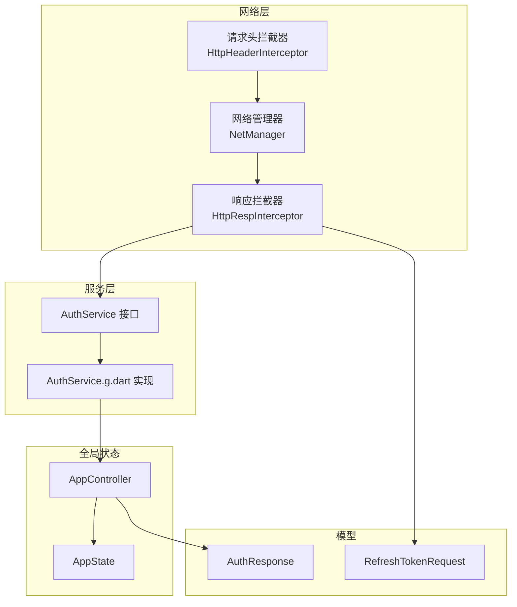
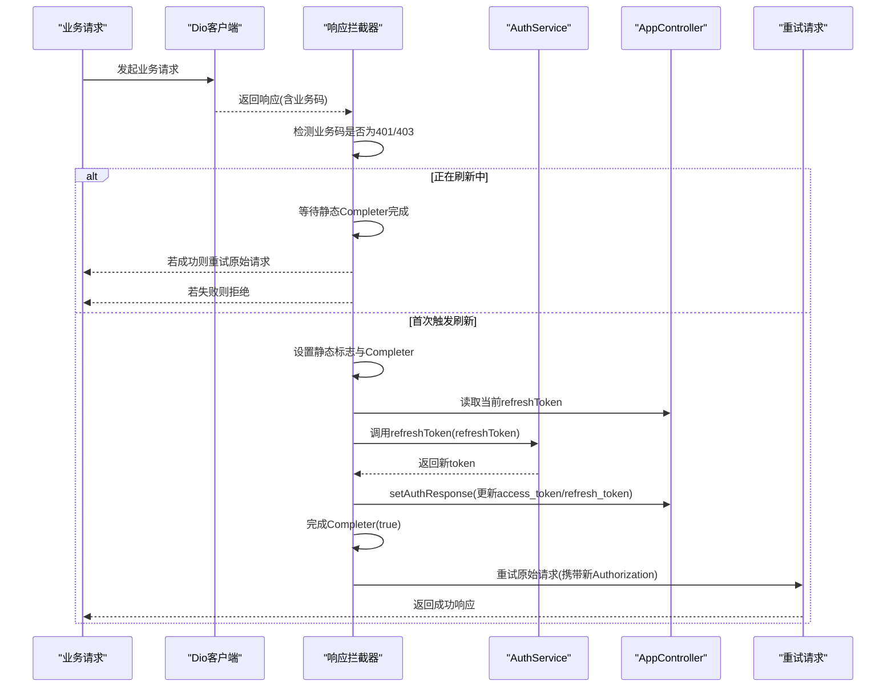
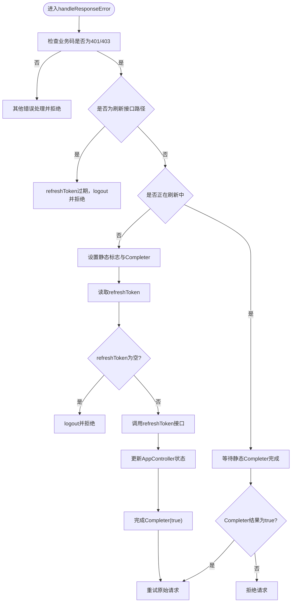
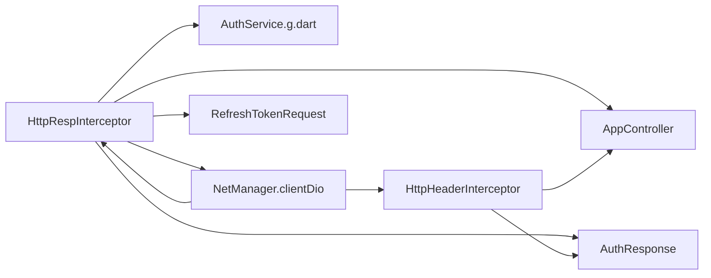

# Token刷新机制

<cite>
**本文引用的文件**
- [http_resp_interceptor.dart](file://lib/net/http_resp_interceptor.dart)
- [auth_service.dart](file://lib/global/service/auth_service.dart)
- [auth_service.g.dart](file://lib/global/service/auth_service.g.dart)
- [app_controller.dart](file://lib/global/app_controller.dart)
- [app_state.dart](file://lib/global/app_state.dart)
- [auth_rep_type.dart](file://lib/global/model/auth_rep_type.dart)
- [auth_req_type.dart](file://lib/global/model/auth_req_type.dart)
- [net_manager.dart](file://lib/net/net_manager.dart)
- [http_header_interceptor.dart](file://lib/net/http_header_interceptor.dart)
</cite>

## 目录
1. [简介](#简介)
2. [项目结构](#项目结构)
3. [核心组件](#核心组件)
4. [架构总览](#架构总览)
5. [详细组件分析](#详细组件分析)
6. [依赖关系分析](#依赖关系分析)
7. [性能与并发特性](#性能与并发特性)
8. [故障排查指南](#故障排查指南)
9. [结论](#结论)

## 简介
本文件围绕基于Completer的“token无感刷新”机制进行深入解析，重点说明：
- 如何通过静态标志位与静态Completer协同，避免多个并发刷新请求；
- 当检测到401/403错误时，系统如何安全调用刷新接口并更新全局认证状态；
- 当刷新接口自身过期时的降级处理流程（清除认证状态并强制用户重新登录）；
- 提供从错误检测、刷新请求、状态更新到原始请求重试的完整时序图，帮助理解高并发场景下的认证续期实现。

## 项目结构
与Token刷新相关的关键模块分布如下：
- 网络层拦截器：响应拦截器负责识别401/403并触发刷新；请求头拦截器负责注入Authorization；
- 服务层：AuthService定义刷新接口，生成的g.dart实现具体调用；
- 全局控制器：AppController维护全局认证状态，提供登录/登出与状态更新能力；
- 状态模型：AuthResponse与RefreshTokenRequest等模型承载token与账号信息。

图表来源
- [http_header_interceptor.dart](file://lib/net/http_header_interceptor.dart#L1-L56)
- [http_resp_interceptor.dart](file://lib/net/http_resp_interceptor.dart#L1-L210)
- [net_manager.dart](file://lib/net/net_manager.dart#L1-L88)
- [auth_service.dart](file://lib/global/service/auth_service.dart#L1-L41)
- [auth_service.g.dart](file://lib/global/service/auth_service.g.dart#L48-L74)
- [app_controller.dart](file://lib/global/app_controller.dart#L1-L146)
- [app_state.dart](file://lib/global/app_state.dart#L1-L23)
- [auth_rep_type.dart](file://lib/global/model/auth_rep_type.dart#L1-L46)
- [auth_req_type.dart](file://lib/global/model/auth_req_type.dart#L61-L71)

章节来源
- [http_header_interceptor.dart](file://lib/net/http_header_interceptor.dart#L1-L56)
- [http_resp_interceptor.dart](file://lib/net/http_resp_interceptor.dart#L1-L210)
- [net_manager.dart](file://lib/net/net_manager.dart#L1-L88)
- [auth_service.dart](file://lib/global/service/auth_service.dart#L1-L41)
- [auth_service.g.dart](file://lib/global/service/auth_service.g.dart#L48-L74)
- [app_controller.dart](file://lib/global/app_controller.dart#L1-L146)
- [app_state.dart](file://lib/global/app_state.dart#L1-L23)
- [auth_rep_type.dart](file://lib/global/model/auth_rep_type.dart#L1-L46)
- [auth_req_type.dart](file://lib/global/model/auth_req_type.dart#L61-L71)

## 核心组件
- 响应拦截器（HttpRespInterceptor）
  - 静态标志位与静态Completer：_isRefreshing与_static Completer<bool> _refreshCompleter，用于串行化并发刷新请求；
  - 错误识别与分支：对401/403进行处理，区分刷新接口自身的过期与普通业务接口的过期；
  - 刷新流程：构造刷新请求、调用AuthService.refreshToken、更新AppController状态、重试原始请求；
  - 降级处理：刷新失败或刷新接口过期时，清理认证状态并提示重新登录。
- 请求头拦截器（HttpHeaderInterceptor）
  - 在非登录接口自动注入Authorization头，确保每次请求携带最新access_token。
- 服务层（AuthService）
  - 定义刷新接口，生成的g.dart实现具体HTTP调用；
  - 通过NetManager提供的Dio实例发起请求。
- 全局控制器（AppController）
  - 维护AppState，提供setAuthResponse与logout方法；
  - 登录成功后根据业务流程路由跳转。
- 模型（AuthResponse、RefreshTokenRequest）
  - 承载access_token、refresh_token与账号信息；
  - 刷新请求体包含refreshToken。

章节来源
- [http_resp_interceptor.dart](file://lib/net/http_resp_interceptor.dart#L1-L210)
- [http_header_interceptor.dart](file://lib/net/http_header_interceptor.dart#L1-L56)
- [auth_service.dart](file://lib/global/service/auth_service.dart#L1-L41)
- [auth_service.g.dart](file://lib/global/service/auth_service.g.dart#L48-L74)
- [app_controller.dart](file://lib/global/app_controller.dart#L1-L146)
- [app_state.dart](file://lib/global/app_state.dart#L1-L23)
- [auth_rep_type.dart](file://lib/global/model/auth_rep_type.dart#L1-L46)
- [auth_req_type.dart](file://lib/global/model/auth_req_type.dart#L61-L71)

## 架构总览
下图展示了从错误检测到请求重试的端到端流程，以及静态标志与Completer在并发场景下的作用。

图表来源
- [http_resp_interceptor.dart](file://lib/net/http_resp_interceptor.dart#L50-L209)
- [auth_service.g.dart](file://lib/global/service/auth_service.g.dart#L48-L74)
- [app_controller.dart](file://lib/global/app_controller.dart#L50-L116)

## 详细组件分析

### 响应拦截器：错误检测与刷新编排
- 静态标志与Completer
  - _isRefreshing：标记是否正在刷新；
  - _refreshCompleter：用于等待并发请求在刷新期间统一等待；
  - 两者均为静态，确保整个进程内仅存在一个刷新序列。
- 错误分支
  - 刷新接口自身返回401/403：判定refreshToken过期，直接logout并拒绝请求；
  - 普通业务接口返回401/403：
    - 若已有刷新在途，则等待Completer结果；
    - 否则启动刷新流程：读取refreshToken、调用refreshToken、更新AppController、完成Completer、重试原始请求。
- 重试机制
  - 重新构造请求选项，更新Authorization头为新access_token；
  - 使用原始Dio实例重新发送请求，并将新响应交由拦截器链继续处理。

图表来源
- [http_resp_interceptor.dart](file://lib/net/http_resp_interceptor.dart#L50-L209)

章节来源
- [http_resp_interceptor.dart](file://lib/net/http_resp_interceptor.dart#L1-L210)

### 请求头拦截器：注入Authorization
- 对非登录接口自动注入Authorization头；
- 保证每次请求携带最新access_token，减少401/403的发生概率；
- 与响应拦截器配合，形成“请求带token—响应遇401/403—刷新—重试”的闭环。

章节来源
- [http_header_interceptor.dart](file://lib/net/http_header_interceptor.dart#L1-L56)

### 服务层：刷新接口与实现
- AuthService定义刷新接口；
- 生成的AuthService.g.dart通过Dio发起HTTP请求，路径为“/auth/refresh-token”，请求体为RefreshTokenRequest；
- 返回AuthResponse，包含新的access_token与refresh_token。

章节来源
- [auth_service.dart](file://lib/global/service/auth_service.dart#L1-L41)
- [auth_service.g.dart](file://lib/global/service/auth_service.g.dart#L48-L74)
- [auth_req_type.dart](file://lib/global/model/auth_req_type.dart#L61-L71)
- [auth_rep_type.dart](file://lib/global/model/auth_rep_type.dart#L1-L46)

### 全局控制器：状态更新与登出
- setAuthResponse：更新全局认证状态（包含access_token、refresh_token、account）；
- logout：清空认证状态并路由至登录页；
- AppController作为状态源，驱动响应拦截器在刷新成功后重试请求。

章节来源
- [app_controller.dart](file://lib/global/app_controller.dart#L50-L116)
- [app_state.dart](file://lib/global/app_state.dart#L1-L23)

## 依赖关系分析
- 响应拦截器依赖：
  - AppController：读取/写入认证状态；
  - AuthService：调用刷新接口；
  - NetManager.clientDio：重试请求时复用Dio实例；
  - 模型：AuthResponse、RefreshTokenRequest。
- 请求头拦截器依赖：
  - AppController：读取access_token；
  - 设备信息：注入UserAgent系列头。
- 网络管理器：
  - 初始化Dio并注册拦截器链（日志、请求头、响应拦截器）。

图表来源
- [http_resp_interceptor.dart](file://lib/net/http_resp_interceptor.dart#L1-L210)
- [http_header_interceptor.dart](file://lib/net/http_header_interceptor.dart#L1-L56)
- [net_manager.dart](file://lib/net/net_manager.dart#L1-L88)
- [auth_service.g.dart](file://lib/global/service/auth_service.g.dart#L48-L74)
- [app_controller.dart](file://lib/global/app_controller.dart#L1-L146)
- [auth_rep_type.dart](file://lib/global/model/auth_rep_type.dart#L1-L46)
- [auth_req_type.dart](file://lib/global/model/auth_req_type.dart#L61-L71)

章节来源
- [http_resp_interceptor.dart](file://lib/net/http_resp_interceptor.dart#L1-L210)
- [http_header_interceptor.dart](file://lib/net/http_header_interceptor.dart#L1-L56)
- [net_manager.dart](file://lib/net/net_manager.dart#L1-L88)

## 性能与并发特性
- 并发控制
  - 静态标志与静态Completer确保同一时刻仅有一个刷新请求在执行；
  - 其他并发请求在刷新期间等待Completer完成，避免重复刷新与竞态条件。
- 重试成本
  - 重试请求时复用原始请求的选项与Dio实例，减少额外开销；
  - 仅在刷新成功后重试，避免无效重试。
- 可靠性
  - 刷新失败或刷新接口过期时，立即logout并拒绝请求，避免状态不一致；
  - 对异常进行日志记录，便于定位问题。

章节来源
- [http_resp_interceptor.dart](file://lib/net/http_resp_interceptor.dart#L50-L209)

## 故障排查指南
- 现象：频繁出现401/403
  - 检查请求头拦截器是否正确注入Authorization；
  - 确认AppController中access_token是否为空或过期；
  - 查看响应拦截器日志，确认是否触发了刷新流程。
- 现象：刷新后仍报401/403
  - 确认刷新接口路径是否为“/auth/refresh-token”；
  - 若刷新接口返回401/403，系统会logout并提示重新登录，属预期行为。
- 现象：并发请求导致重复刷新
  - 检查静态标志与Completer是否按预期工作；
  - 确保所有业务请求均通过同一Dio实例与拦截器链。
- 现象：重试请求失败
  - 检查重试逻辑是否正确更新Authorization头；
  - 确认NetManager.clientDio未被意外销毁。

章节来源
- [http_resp_interceptor.dart](file://lib/net/http_resp_interceptor.dart#L50-L209)
- [http_header_interceptor.dart](file://lib/net/http_header_interceptor.dart#L1-L56)
- [net_manager.dart](file://lib/net/net_manager.dart#L1-L88)

## 结论
该实现通过静态标志与静态Completer有效串行化并发刷新请求，结合响应拦截器的错误识别与重试机制，实现了高并发场景下的“无感”token续期。当刷新接口自身过期时，系统采用降级策略，清除认证状态并强制用户重新登录，保障了系统的安全性与一致性。整体设计简洁可靠，易于扩展与维护。