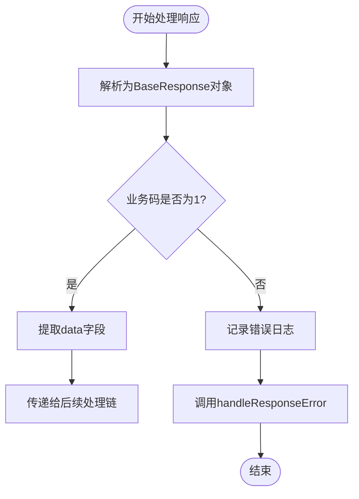
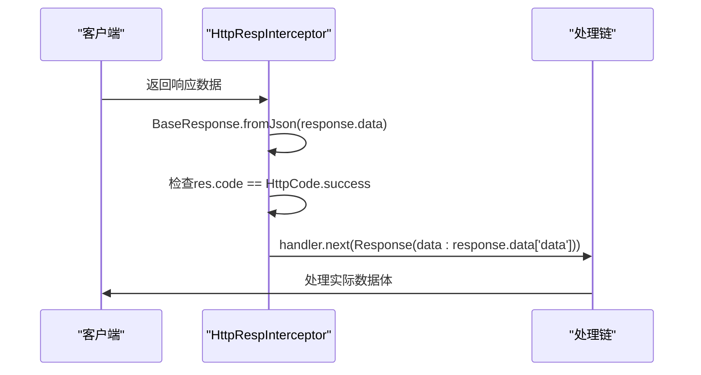
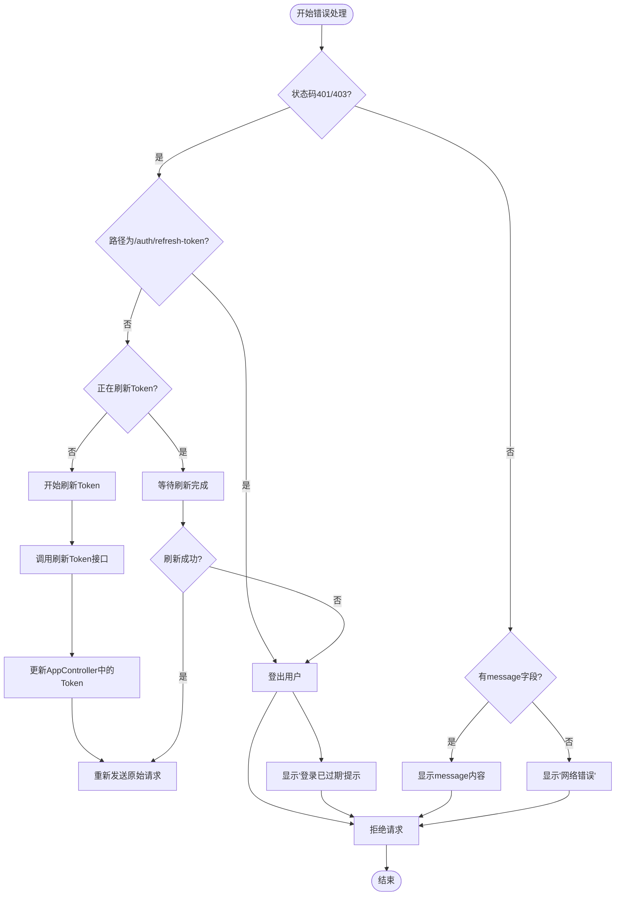
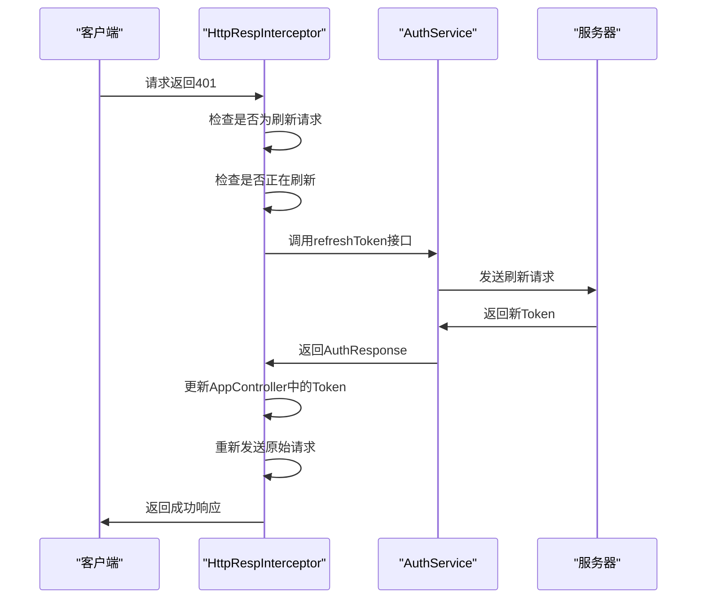
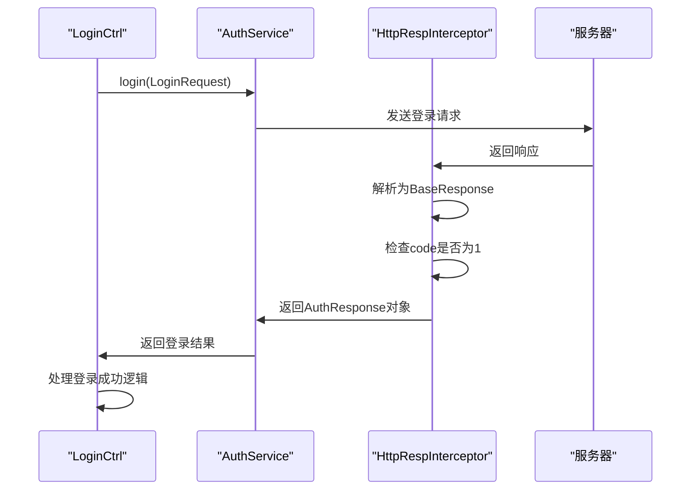

# 响应处理机制

<cite>
**本文档引用文件**  
- [http_resp_interceptor.dart](file://lib/net/http_resp_interceptor.dart)
- [response.dart](file://lib/net/response.dart)
- [code.dart](file://lib/net/code.dart)
- [net_manager.dart](file://lib/net/net_manager.dart)
- [auth_service.dart](file://lib/global/service/auth_service.dart)
- [auth_rep_type.dart](file://lib/global/model/auth_rep_type.dart)
</cite>

## 目录
1. [简介](#简介)
2. [核心处理流程](#核心处理流程)
3. [BaseResponse 统一响应结构](#baseresponse-统一响应结构)
4. [正常响应处理时序](#正常响应处理时序)
5. [错误响应处理流程](#错误响应处理流程)
6. [实际应用示例](#实际应用示例)
7. [总结](#总结)

## 简介
本项目通过 `HttpRespInterceptor` 实现了统一的HTTP响应处理机制，确保前后端交互的数据格式标准化。该机制基于 `BaseResponse` 统一响应结构，对服务器返回的数据进行标准化处理，根据业务状态码判断请求成功与否，并将实际数据体传递给后续处理链。当请求失败时，系统会统一进行错误处理，包括Token自动刷新、错误提示等。

**Section sources**
- [http_resp_interceptor.dart](file://lib/net/http_resp_interceptor.dart#L1-L210)

## 核心处理流程

`HttpRespInterceptor` 的 `onResponse` 方法是整个响应处理的核心，其主要职责是将原始响应数据转换为 `BaseResponse` 对象，并根据业务状态码决定后续处理流程。

处理流程如下：
1. 将原始响应数据解析为 `BaseResponse` 对象
2. 判断业务状态码是否为成功（code=1）
3. 若成功，提取data字段作为实际数据体并传递给后续处理链
4. 若失败，调用 `handleResponseError` 进行错误处理



**Diagram sources**
- [http_resp_interceptor.dart](file://lib/net/http_resp_interceptor.dart#L25-L48)

**Section sources**
- [http_resp_interceptor.dart](file://lib/net/http_resp_interceptor.dart#L25-L48)

## BaseResponse 统一响应结构

`BaseResponse` 类定义了统一的响应数据结构，确保所有API接口返回的数据格式一致，便于前端统一处理。

```dart
class BaseResponse {
  dynamic data;
  int code;
  String? message;
  String? requestId;
  
  BaseResponse(this.data, this.code, this.message, this.requestId);
  
  factory BaseResponse.fromJson(Map<String, dynamic> json) {
    return BaseResponse(
      json['data'],
      json['code'] as int,
      json['message'] as String?,
      json['requestId'] as String?,
    );
  }
}
```

### 设计目的
- **标准化**: 统一所有接口的响应格式，降低前端处理复杂度
- **可维护性**: 集中处理响应逻辑，便于后续修改和扩展
- **错误处理**: 包含完整的错误信息（code、message、requestId），便于问题定位
- **扩展性**: 支持任意类型的数据体（dynamic data），适应不同业务场景

### 前后端交互作用
- **前端**: 无需关心具体接口的返回格式，统一通过 `BaseResponse` 处理
- **后端**: 只需遵循统一的响应结构，无需为每个接口单独定义格式
- **调试**: 通过 `requestId` 可以快速定位问题请求，提高排查效率

```mermaid
erDiagram
BaseResponse {
dynamic data PK
int code
String? message
String? requestId
}
```

**Diagram sources**
- [response.dart](file://lib/net/response.dart#L1-L24)

**Section sources**
- [response.dart](file://lib/net/response.dart#L1-L24)

## 正常响应处理时序

当服务器返回成功响应时，`HttpRespInterceptor` 会提取data字段并传递给后续处理链。



### 实际请求响应示例
```json
{
  "code": 1,
  "message": "操作成功",
  "requestId": "req-123456789",
  "data": {
    "userId": 123,
    "userName": "张三",
    "email": "zhangsan@example.com"
  }
}
```

在上述示例中：
- `code=1` 表示业务成功
- `message` 提供人类可读的成功信息
- `requestId` 用于追踪请求
- `data` 包含实际的用户信息数据体

**Diagram sources**
- [http_resp_interceptor.dart](file://lib/net/http_resp_interceptor.dart#L30-L39)

**Section sources**
- [http_resp_interceptor.dart](file://lib/net/http_resp_interceptor.dart#L30-L39)
- [code.dart](file://lib/net/code.dart#L5)

## 错误响应处理流程

当业务状态码不等于1时，系统会将控制权交给 `handleResponseError` 方法进行错误处理。

### 错误处理机制
1. 记录详细的错误日志，包含路径、状态码、消息和请求ID
2. 根据错误类型进行差异化处理
3. 特殊处理401/403错误（Token过期）
4. 显示友好的错误提示



### Token自动刷新机制
系统实现了Token自动刷新机制，确保用户体验的连续性：



**Diagram sources**
- [http_resp_interceptor.dart](file://lib/net/http_resp_interceptor.dart#L47-L139)

**Section sources**
- [http_resp_interceptor.dart](file://lib/net/http_resp_interceptor.dart#L47-L139)
- [auth_service.dart](file://lib/global/service/auth_service.dart#L19-L20)
- [auth_rep_type.dart](file://lib/global/model/auth_rep_type.dart#L6-L25)

## 实际应用示例

### 登录流程中的响应处理
在用户登录流程中，`HttpRespInterceptor` 确保了响应处理的一致性：



### 服务初始化中的拦截器注册
`HttpRespInterceptor` 在网络管理器初始化时被注册：

```dart
class _NetManager {
  init(String baseUrl) {
    // ... 其他初始化代码
    
    /** 返回 responese 拦截器 */
    dio.interceptors.add(HttpRespInterceptor());
    
    clientDio = dio;
    _isInitialized = true;
  }
}
```

**Section sources**
- [net_manager.dart](file://lib/net/net_manager.dart#L65)
- [login/controller.dart](file://lib/pages/login/controller.dart#L150-L154)

## 总结
`HttpRespInterceptor` 实现了一套完整的响应处理机制，通过 `BaseResponse` 统一响应结构，确保了前后端交互的标准化。该机制具有以下优势：

- **统一性**: 所有接口遵循相同的响应格式
- **自动化**: 自动处理Token刷新，提升用户体验
- **可维护性**: 集中处理响应逻辑，便于维护和扩展
- **可调试性**: 完整的错误信息和日志记录，便于问题排查

开发者在使用时只需关注业务数据体（data字段），无需关心底层的响应处理细节，大大提高了开发效率和代码质量。

**Section sources**
- [http_resp_interceptor.dart](file://lib/net/http_resp_interceptor.dart#L1-L210)
- [response.dart](file://lib/net/response.dart#L1-L24)