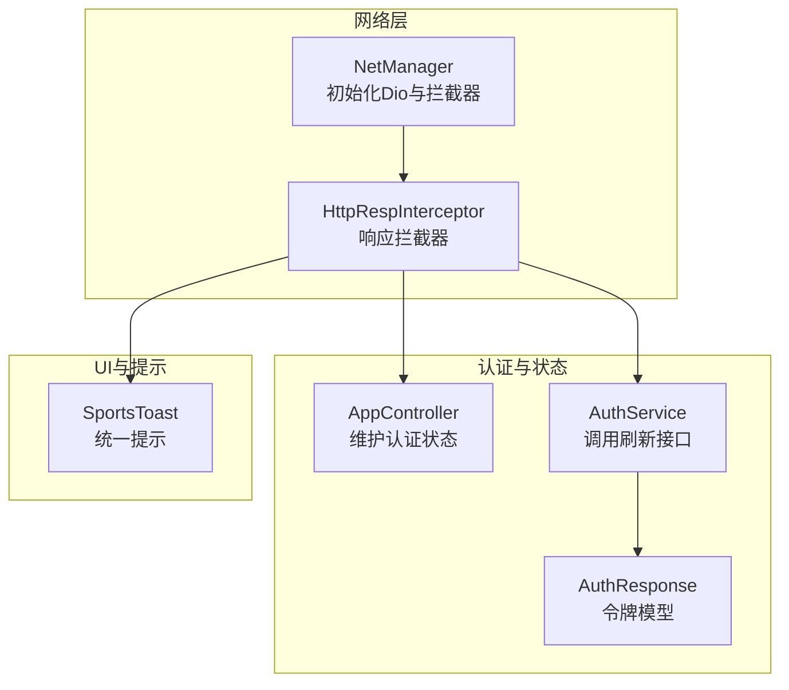
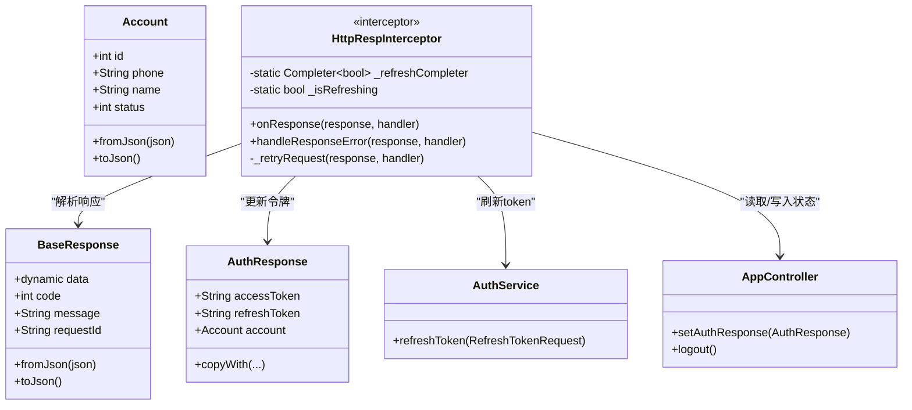
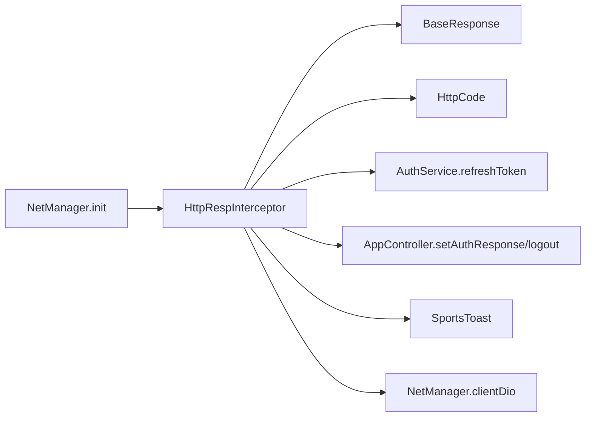

# 响应拦截器

<cite>
**本文引用的文件**
- [http_resp_interceptor.dart](file://lib/net/http_resp_interceptor.dart)
- [response.dart](file://lib/net/response.dart)
- [code.dart](file://lib/net/code.dart)
- [net_manager.dart](file://lib/net/net_manager.dart)
- [auth_service.dart](file://lib/global/service/auth_service.dart)
- [auth_rep_type.dart](file://lib/global/model/auth_rep_type.dart)
- [app_controller.dart](file://lib/global/app_controller.dart)
- [toast.dart](file://lib/widgets/popup/toast.dart)
</cite>

## 目录
1. [简介](#简介)
2. [项目结构](#项目结构)
3. [核心组件](#核心组件)
4. [架构总览](#架构总览)
5. [详细组件分析](#详细组件分析)
6. [依赖关系分析](#依赖关系分析)
7. [性能考量](#性能考量)
8. [故障排查指南](#故障排查指南)
9. [结论](#结论)

## 简介
本文件围绕 HttpRespInterceptor 对服务器响应的统一处理机制进行深入解析，重点覆盖：
- onResponse 如何解析 BaseResponse 数据结构，并在业务成功（code=200）时提取 data 字段交给后续处理。
- handleResponseError 对业务错误码的处理流程，尤其是对 401/403 未授权状态的智能 token 刷新机制。
- 静态 Completer 与 _isRefreshing 标志如何协同工作，避免并发刷新请求。
- 当 refreshToken 过期时，系统如何安全地清除认证状态并引导用户重新登录。
- 错误消息通过 SportsToast 统一提示给用户。
- 完整的 token 刷新与请求重试时序，帮助理解无感认证续期的实现原理。

## 项目结构
该功能位于网络层拦截器模块，与全局应用控制器、认证服务、响应模型等存在紧密耦合。拦截器在 Dio 初始化时被加入到拦截器链中，负责统一处理业务错误与自动刷新。



图表来源
- [net_manager.dart](file://lib/net/net_manager.dart#L58-L66)
- [http_resp_interceptor.dart](file://lib/net/http_resp_interceptor.dart#L15-L21)
- [auth_service.dart](file://lib/global/service/auth_service.dart#L10-L21)
- [auth_rep_type.dart](file://lib/global/model/auth_rep_type.dart#L5-L26)
- [app_controller.dart](file://lib/global/app_controller.dart#L111-L116)
- [toast.dart](file://lib/widgets/popup/toast.dart#L82-L103)

章节来源
- [net_manager.dart](file://lib/net/net_manager.dart#L58-L66)

## 核心组件
- HttpRespInterceptor：基于 Dio 的 InterceptorsWrapper 实现，负责统一解析响应、处理业务错误、触发 token 刷新与重试。
- BaseResponse：通用响应载体，包含 data、code、message、requestId 字段。
- HttpCode：业务错误码常量，包括 success、tokenExpired 等。
- AuthService：提供刷新 token 的接口。
- AppController：维护认证状态（accessToken、refreshToken），并在刷新失败或过期时触发登出。
- SportsToast：统一的 Toast 提示封装。

章节来源
- [http_resp_interceptor.dart](file://lib/net/http_resp_interceptor.dart#L15-L21)
- [response.dart](file://lib/net/response.dart#L1-L24)
- [code.dart](file://lib/net/code.dart#L1-L13)
- [auth_service.dart](file://lib/global/service/auth_service.dart#L10-L21)
- [app_controller.dart](file://lib/global/app_controller.dart#L111-L116)
- [toast.dart](file://lib/widgets/popup/toast.dart#L82-L103)

## 架构总览
拦截器在 Dio 初始化阶段被加入，形成如下处理链：请求发起 → Header 拦截器 → 网络请求 → 响应拦截器 → 上层业务逻辑。响应拦截器根据业务码决定放行、抛错、刷新 token 或重试。

```mermaid
sequenceDiagram
participant Client as "调用方"
participant Dio as "Dio客户端"
participant RespIntc as "HttpRespInterceptor"
participant AuthSvc as "AuthService"
participant AppCtl as "AppController"
participant Toast as "SportsToast"
Client->>Dio : 发起请求
Dio-->>RespIntc : 返回响应
RespIntc->>RespIntc : 解析BaseResponse
alt 成功(code==200)
RespIntc-->>Client : 放行，透传data
else 业务错误
RespIntc->>RespIntc : handleResponseError
opt 401/403
RespIntc->>AppCtl : 读取refreshToken
alt 正在刷新
RespIntc->>RespIntc : 等待Completer完成
alt 刷新成功
RespIntc->>RespIntc : _retryRequest重试
RespIntc-->>Client : 放行新响应
else 刷新失败
RespIntc->>AppCtl : logout()
RespIntc->>Toast : 显示“登录已过期”
RespIntc-->>Client : 拒绝请求
end
else 未在刷新
RespIntc->>AuthSvc : refreshToken(refreshToken)
alt 成功
RespIntc->>AppCtl : setAuthResponse(更新令牌)
RespIntc->>RespIntc : _retryRequest重试
RespIntc-->>Client : 放行新响应
else 失败
RespIntc->>AppCtl : logout()
RespIntc->>Toast : 显示“登录已过期”
RespIntc-->>Client : 拒绝请求
end
end
else 其他错误
RespIntc->>Toast : 显示错误消息
RespIntc-->>Client : 拒绝请求
end
end
```

图表来源
- [http_resp_interceptor.dart](file://lib/net/http_resp_interceptor.dart#L25-L209)
- [auth_service.dart](file://lib/global/service/auth_service.dart#L18-L21)
- [app_controller.dart](file://lib/global/app_controller.dart#L111-L116)
- [toast.dart](file://lib/widgets/popup/toast.dart#L82-L103)

## 详细组件分析

### onResponse：统一解析与放行
- 将响应体反序列化为 BaseResponse。
- 若 code 等于成功值，则构造新的 Response，仅携带 data 字段，交由后续拦截器与上层业务处理。
- 否则记录错误日志并进入 handleResponseError 流程。

章节来源
- [http_resp_interceptor.dart](file://lib/net/http_resp_interceptor.dart#L25-L48)
- [response.dart](file://lib/net/response.dart#L1-L24)
- [code.dart](file://lib/net/code.dart#L1-L13)

### handleResponseError：业务错误与自动刷新
- 识别 401/403 未授权场景，区分两种情况：
  - 刷新 token 请求本身返回 401：说明 refreshToken 已过期，直接触发登出并提示用户重新登录。
  - 普通业务请求返回 401/403：进入自动刷新流程。
- 并发控制：
  - 使用静态 _isRefreshing 与 _refreshCompleter 协作，确保同一时刻仅有一个刷新任务在执行。
  - 若已有刷新任务，当前请求等待 Completer 的 future，成功则重试，失败则直接拒绝。
- 刷新流程：
  - 从 AppController 中获取 refreshToken，若为空则登出并提示。
  - 调用 AuthService.refreshToken，成功后更新 AppController 中的 AuthResponse（保留旧的 refreshToken，替换 accessToken）。
  - 刷新成功后，调用 _retryRequest 重新发送原始请求。
  - 刷新失败：登出并提示。
- 其他错误：
  - 若响应为字符串或包含 message 字段，则通过 SportsToast 提示；否则提示“网络错误”。

章节来源
- [http_resp_interceptor.dart](file://lib/net/http_resp_interceptor.dart#L50-L155)
- [auth_service.dart](file://lib/global/service/auth_service.dart#L18-L21)
- [app_controller.dart](file://lib/global/app_controller.dart#L111-L116)
- [toast.dart](file://lib/widgets/popup/toast.dart#L82-L103)

### _retryRequest：请求重试与头信息更新
- 从 NetManager 获取 Dio 实例，重新构建 Options 并携带原始请求参数。
- 从 AppController 读取最新 accessToken，更新 Authorization 头为 Bearer 方式。
- 重新发起请求，得到新响应后再次进入拦截器链（onResponse），从而实现“无感续期后的二次解析”。

章节来源
- [http_resp_interceptor.dart](file://lib/net/http_resp_interceptor.dart#L157-L209)
- [net_manager.dart](file://lib/net/net_manager.dart#L17-L20)

### 数据结构与模型
- BaseResponse：通用响应载体，包含 data、code、message、requestId。
- AuthResponse：包含 accessToken、refreshToken、account，用于刷新后更新状态。
- HttpCode：业务错误码常量，success、tokenExpired 等。



图表来源
- [response.dart](file://lib/net/response.dart#L1-L24)
- [auth_rep_type.dart](file://lib/global/model/auth_rep_type.dart#L5-L26)
- [http_resp_interceptor.dart](file://lib/net/http_resp_interceptor.dart#L15-L21)
- [auth_service.dart](file://lib/global/service/auth_service.dart#L18-L21)
- [app_controller.dart](file://lib/global/app_controller.dart#L111-L116)

## 依赖关系分析
- 拦截器依赖：
  - BaseResponse：统一响应结构。
  - HttpCode：业务码判断。
  - AuthService：刷新 token。
  - AppController：读取/更新认证状态。
  - SportsToast：错误提示。
  - NetManager：获取 Dio 实例，发起重试请求。
- 初始化位置：
  - 在 NetManager.init 中将 HttpRespInterceptor 加入拦截器链。



图表来源
- [net_manager.dart](file://lib/net/net_manager.dart#L58-L66)
- [http_resp_interceptor.dart](file://lib/net/http_resp_interceptor.dart#L15-L21)

章节来源
- [net_manager.dart](file://lib/net/net_manager.dart#L58-L66)

## 性能考量
- 并发刷新控制：通过静态 _isRefreshing 与 Completer 阻止重复刷新，降低无效请求与资源浪费。
- 重试策略：仅在 401/403 场景触发，避免对正常请求造成额外开销。
- 头部更新：重试前更新 Authorization，避免不必要的鉴权失败重试。
- 日志与异常：拦截器内部记录关键日志，便于定位问题，但需注意生产环境日志级别控制。

## 故障排查指南
- 401/403 未授权但未触发刷新
  - 检查拦截器是否正确加入拦截器链。
  - 确认 AppController 中 refreshToken 是否存在且非空。
  - 观察日志中“正在刷新token，等待刷新完成”的提示，确认并发刷新是否被阻塞。
- 刷新失败后仍显示“登录已过期”
  - 确认 AuthService.refreshToken 接口返回是否符合预期。
  - 检查 AppController.setAuthResponse 是否被调用以及状态是否更新。
- 重试请求失败
  - 确认 NetManager.clientDio 是否已初始化。
  - 检查 _retryRequest 中的请求参数与头信息是否正确设置。
- 错误提示未出现
  - 确认 SportsToast 的上下文与显示逻辑是否正常。

章节来源
- [http_resp_interceptor.dart](file://lib/net/http_resp_interceptor.dart#L71-L155)
- [app_controller.dart](file://lib/global/app_controller.dart#L111-L116)
- [net_manager.dart](file://lib/net/net_manager.dart#L17-L20)
- [toast.dart](file://lib/widgets/popup/toast.dart#L82-L103)

## 结论
HttpRespInterceptor 通过统一解析 BaseResponse、智能识别 401/403 未授权状态、结合静态并发控制与 Completer，实现了无感认证续期与错误统一处理。配合 AppController 的状态更新与 SportsToast 的提示，整体用户体验与可维护性得到显著提升。开发者在扩展业务错误码或调整刷新策略时，应重点关注拦截器链顺序、并发控制与状态一致性。