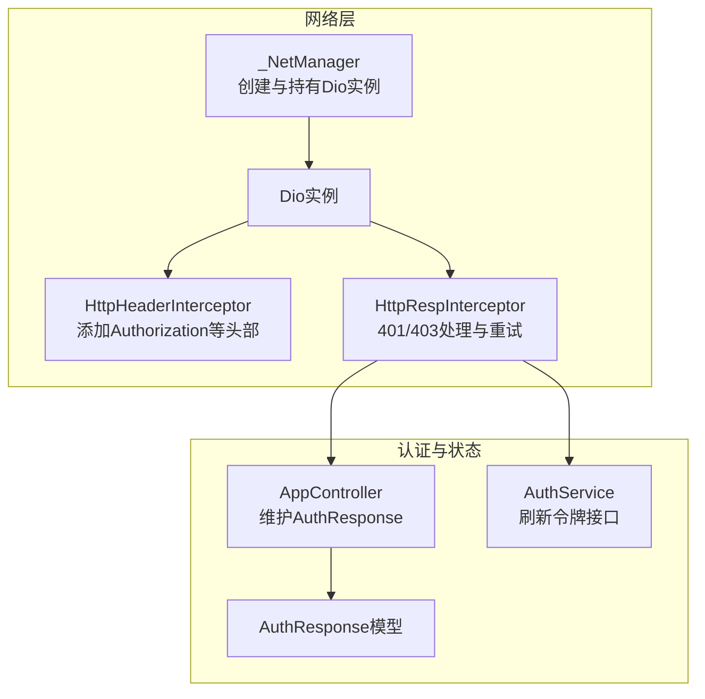
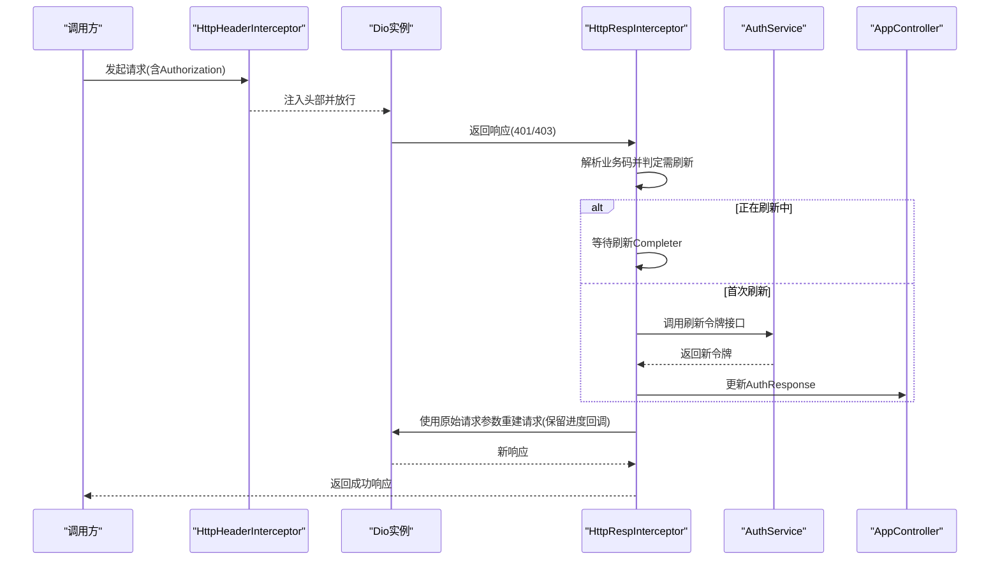
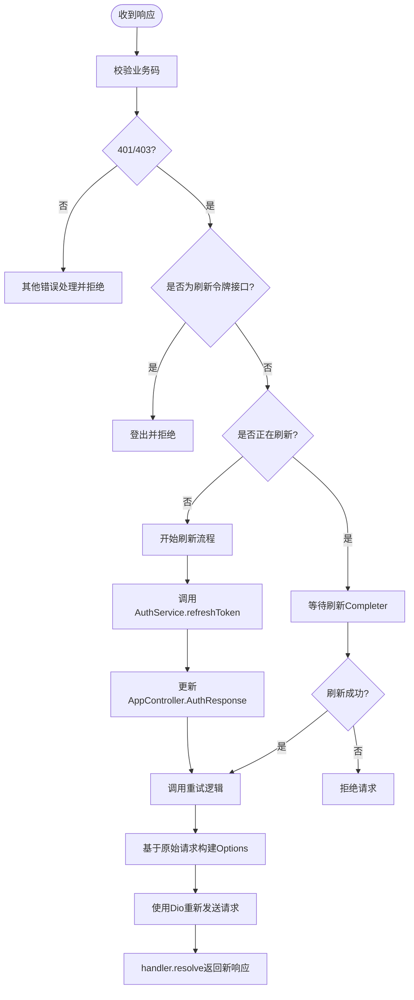
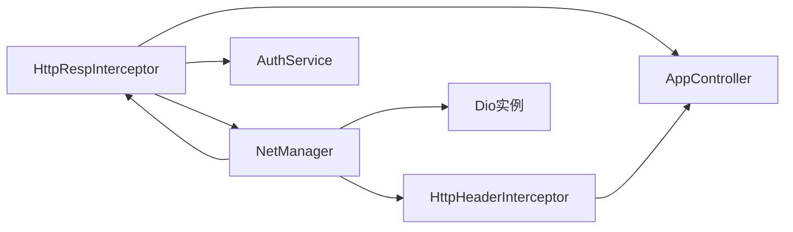

# 请求重试逻辑

<cite>
**本文引用的文件列表**
- [net_manager.dart](file://lib/net/net_manager.dart)
- [dio_io.dart](file://lib/net/dio_io.dart)
- [http_header_interceptor.dart](file://lib/net/http_header_interceptor.dart)
- [http_resp_interceptor.dart](file://lib/net/http_resp_interceptor.dart)
- [auth_service.g.dart](file://lib/global/service/auth_service.g.dart)
- [app_controller.dart](file://lib/global/app_controller.dart)
- [auth_rep_type.dart](file://lib/global/model/auth_rep_type.dart)
- [common_service.dart](file://lib/global/service/common_service.dart)
- [login_controller.dart](file://lib/pages/login/controller.dart)
</cite>

## 目录
1. [简介](#简介)
2. [项目结构与入口](#项目结构与入口)
3. [核心组件](#核心组件)
4. [架构总览](#架构总览)
5. [详细组件分析](#详细组件分析)
6. [依赖关系分析](#依赖关系分析)
7. [性能与可靠性考量](#性能与可靠性考量)
8. [故障排查指南](#故障排查指南)
9. [结论](#结论)
10. [附录：重试流程与抓包建议](#附录重试流程与抓包建议)

## 简介
本文件聚焦于项目中的请求重试机制，尤其是当后端返回401/403等鉴权相关错误时，拦截器如何自动刷新令牌并以“原始请求”的方式重新发送，同时保证上传/下载进度回调的连续性。文档将详细说明：
- 如何从网络管理器获取Dio实例
- 如何更新Authorization头为新令牌
- 如何使用原始请求的method、headers、queryParameters等参数重建请求
- 进度回调onSendProgress/onReceiveProgress的保留机制
- 重试失败时的异常处理与错误传播
- 提供可参考的调用路径与抓包分析建议

## 项目结构与入口
- 网络客户端由网络管理器统一创建与持有，并注入日志、请求头、响应拦截器。
- 响应拦截器负责识别401/403并触发令牌刷新与重试；重试时会从网络管理器获取Dio实例，重建请求并保留进度回调。

图表来源
- [net_manager.dart](file://lib/net/net_manager.dart#L1-L88)
- [http_header_interceptor.dart](file://lib/net/http_header_interceptor.dart#L1-L56)
- [http_resp_interceptor.dart](file://lib/net/http_resp_interceptor.dart#L1-L210)
- [auth_service.g.dart](file://lib/global/service/auth_service.g.dart#L48-L74)
- [app_controller.dart](file://lib/global/app_controller.dart#L1-L146)
- [auth_rep_type.dart](file://lib/global/model/auth_rep_type.dart#L1-L46)

章节来源
- [net_manager.dart](file://lib/net/net_manager.dart#L1-L88)
- [http_header_interceptor.dart](file://lib/net/http_header_interceptor.dart#L1-L56)
- [http_resp_interceptor.dart](file://lib/net/http_resp_interceptor.dart#L1-L210)

## 核心组件
- 网络管理器：负责创建Dio实例、配置超时、代理、拦截器，并对外暴露clientDio。
- 请求头拦截器：在非登录接口上为Authorization头注入Bearer Token。
- 响应拦截器：识别业务错误码，处理401/403，串行化并发刷新，刷新成功后调用重试逻辑。
- 认证服务：封装刷新令牌接口，返回新的令牌信息。
- 应用控制器：保存最新令牌，供重试时更新请求头。
- 公共服务：演示如何通过netManager.clientDio获取Dio实例进行请求。

章节来源
- [net_manager.dart](file://lib/net/net_manager.dart#L1-L88)
- [http_header_interceptor.dart](file://lib/net/http_header_interceptor.dart#L1-L56)
- [http_resp_interceptor.dart](file://lib/net/http_resp_interceptor.dart#L1-L210)
- [auth_service.g.dart](file://lib/global/service/auth_service.g.dart#L48-L74)
- [app_controller.dart](file://lib/global/app_controller.dart#L1-L146)
- [common_service.dart](file://lib/global/service/common_service.dart#L1-L25)

## 架构总览
下图展示从请求发起到重试完成的端到端流程，包括令牌刷新与进度回调保留。

图表来源
- [http_header_interceptor.dart](file://lib/net/http_header_interceptor.dart#L1-L56)
- [http_resp_interceptor.dart](file://lib/net/http_resp_interceptor.dart#L50-L209)
- [auth_service.g.dart](file://lib/global/service/auth_service.g.dart#L48-L74)
- [app_controller.dart](file://lib/global/app_controller.dart#L50-L70)

## 详细组件分析

### 响应拦截器：重试与并发刷新控制
- 并发控制：使用静态Completer与布尔标记，确保同一时刻仅有一个刷新流程在执行，避免重复刷新。
- 401/403分支：若当前请求为刷新令牌接口本身，则判定为登录过期，触发登出并拒绝请求；否则进入刷新流程。
- 刷新流程：从AppController读取refreshToken，调用AuthService刷新，成功后更新AppController中的AuthResponse。
- 重试流程：从网络管理器获取Dio实例，更新Authorization头为新accessToken，使用原始请求的method、headers、queryParameters、data、cancelToken、进度回调等参数重建请求，最后通过handler.resolve返回新响应。

图表来源
- [http_resp_interceptor.dart](file://lib/net/http_resp_interceptor.dart#L50-L209)

章节来源
- [http_resp_interceptor.dart](file://lib/net/http_resp_interceptor.dart#L50-L209)

### 重试方法：_retryRequest的实现要点
- 获取Dio实例：从网络管理器clientDio获取Dio实例，若为空则拒绝请求。
- 更新Authorization头：从AppController读取最新accessToken，拼接Bearer并写回请求头。
- 重建请求参数：使用原始请求的method、headers、queryParameters、data、cancelToken、extra等，确保与原请求一致。
- 保留进度回调：显式传入onSendProgress与onReceiveProgress，保证上传/下载进度连续。
- 异常处理：捕获重试过程中的异常并以DioException形式返回，交由上层处理。

章节来源
- [http_resp_interceptor.dart](file://lib/net/http_resp_interceptor.dart#L157-L209)
- [net_manager.dart](file://lib/net/net_manager.dart#L1-L88)

### 网络管理器：Dio实例的创建与持有
- 创建Dio：通过createDio工厂函数创建Dio实例，设置基础选项（超时、baseUrl、responseType）。
- 初始化拦截器：按顺序添加日志、请求头、响应拦截器。
- 对外暴露：通过netManager.clientDio对外提供Dio实例，供重试逻辑使用。

章节来源
- [dio_io.dart](file://lib/net/dio_io.dart#L1-L23)
- [net_manager.dart](file://lib/net/net_manager.dart#L1-L88)

### 请求头拦截器：Authorization注入与设备信息
- 非登录接口：从AppController读取accessToken，注入Authorization头。
- 设备信息：统一注入设备名称、系统版本、设备ID、应用版本等头部，便于后端审计与统计。

章节来源
- [http_header_interceptor.dart](file://lib/net/http_header_interceptor.dart#L1-L56)
- [app_controller.dart](file://lib/global/app_controller.dart#L1-L146)

### 认证服务：刷新令牌接口
- 通过Retrofit生成的AuthService封装刷新令牌接口，返回AuthResponse。
- 重试逻辑在刷新成功后，会将新accessToken写入AppController，随后在重试时生效。

章节来源
- [auth_service.g.dart](file://lib/global/service/auth_service.g.dart#L48-L74)
- [auth_rep_type.dart](file://lib/global/model/auth_rep_type.dart#L1-L46)

### 进度回调保留机制
- 在重试时，显式将原始请求的onSendProgress与onReceiveProgress传入新请求，确保上传/下载进度回调链路不中断。
- 这一机制保证用户在重试过程中仍能持续看到进度反馈。

章节来源
- [http_resp_interceptor.dart](file://lib/net/http_resp_interceptor.dart#L189-L197)

### 异常处理与错误传播
- 刷新失败：记录日志，登出并拒绝请求，向调用方返回DioException。
- 重试失败：捕获异常并构造DioException，交由上层统一处理。
- 登录页错误：在登录控制器中对DioException进行友好提示，如超时、连接失败、服务器错误等。

章节来源
- [http_resp_interceptor.dart](file://lib/net/http_resp_interceptor.dart#L135-L209)
- [login_controller.dart](file://lib/pages/login/controller.dart#L84-L140)

## 依赖关系分析
- HttpRespInterceptor依赖：
  - 网络管理器：获取Dio实例
  - AppController：读取最新令牌
  - AuthService：刷新令牌
- HttpHeaderInterceptor依赖：
  - AppController：读取accessToken
- NetManager依赖：
  - dio_io：创建Dio实例
  - 各种拦截器：统一装配

图表来源
- [http_resp_interceptor.dart](file://lib/net/http_resp_interceptor.dart#L1-L210)
- [http_header_interceptor.dart](file://lib/net/http_header_interceptor.dart#L1-L56)
- [net_manager.dart](file://lib/net/net_manager.dart#L1-L88)

章节来源
- [http_resp_interceptor.dart](file://lib/net/http_resp_interceptor.dart#L1-L210)
- [http_header_interceptor.dart](file://lib/net/http_header_interceptor.dart#L1-L56)
- [net_manager.dart](file://lib/net/net_manager.dart#L1-L88)

## 性能与可靠性考量
- 并发刷新控制：通过静态Completer与布尔标记避免重复刷新，降低资源消耗与竞态风险。
- 重试参数一致性：严格复用原始请求的method、headers、queryParameters、data、cancelToken、extra等，减少因参数差异导致的额外开销。
- 进度回调保留：避免重试导致的UI卡顿或进度丢失，提升用户体验。
- 错误快速失败：刷新失败或Dio实例为空时立即拒绝，避免无意义的重试循环。

[本节为通用指导，无需列出具体文件来源]

## 故障排查指南
- 症状：重试后仍提示401/403
  - 检查AppController中AuthResponse是否已更新
  - 确认HttpRespInterceptor中Authorization头是否被更新
- 症状：重试后进度回调丢失
  - 确认重试时onSendProgress/onReceiveProgress是否传入
- 症状：刷新失败后一直弹出“登录已过期”
  - 检查AuthService.refreshToken返回值与AppController.setAuthResponse调用
- 症状：Dio实例为空
  - 确认NetManager.init是否已调用且clientDio已赋值

章节来源
- [http_resp_interceptor.dart](file://lib/net/http_resp_interceptor.dart#L157-L209)
- [app_controller.dart](file://lib/global/app_controller.dart#L50-L70)
- [auth_service.g.dart](file://lib/global/service/auth_service.g.dart#L48-L74)
- [net_manager.dart](file://lib/net/net_manager.dart#L1-L88)

## 结论
该重试机制通过响应拦截器在401/403场景下串行化并发刷新、更新令牌并以“原始请求”的方式重新发送，同时保留上传/下载进度回调，确保用户体验与可靠性。其关键点在于：
- 严格的并发控制
- 令牌来源与更新路径清晰
- 重试参数与回调的完整性
- 明确的异常处理与错误传播

[本节为总结，无需列出具体文件来源]

## 附录：重试流程与抓包建议
- 重试流程参考路径
  - 响应拦截器入口：[handleResponseError](file://lib/net/http_resp_interceptor.dart#L50-L155)
  - 刷新与等待：[并发刷新控制与刷新流程](file://lib/net/http_resp_interceptor.dart#L71-L139)
  - 重试实现：[_retryRequest](file://lib/net/http_resp_interceptor.dart#L157-L209)
  - Dio实例来源：[NetManager.clientDio](file://lib/net/net_manager.dart#L1-L88)
  - 头部注入：[HttpHeaderInterceptor](file://lib/net/http_header_interceptor.dart#L1-L56)
  - 刷新接口：[AuthService.refreshToken](file://lib/global/service/auth_service.g.dart#L48-L74)
  - 状态更新：[AppController.setAuthResponse](file://lib/global/app_controller.dart#L50-L70)

- 抓包分析建议
  - 观察401/403响应与后续刷新请求的时序
  - 确认刷新成功后重试请求的Authorization头是否为新令牌
  - 验证上传/下载进度回调在重试前后是否连续
  - 捕获刷新失败与重试失败的异常信息，核对错误码与提示

[本节为实践建议，无需列出具体文件来源]