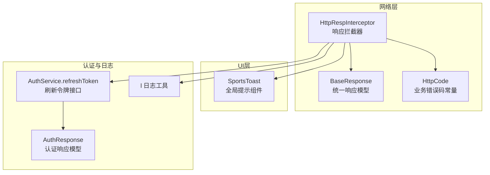
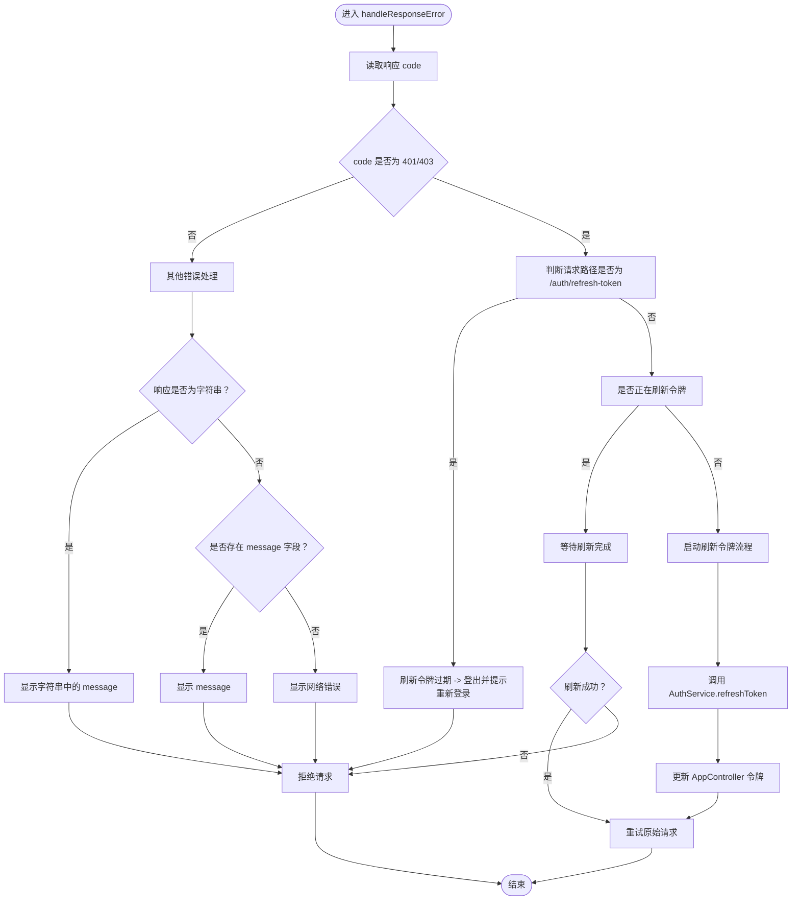
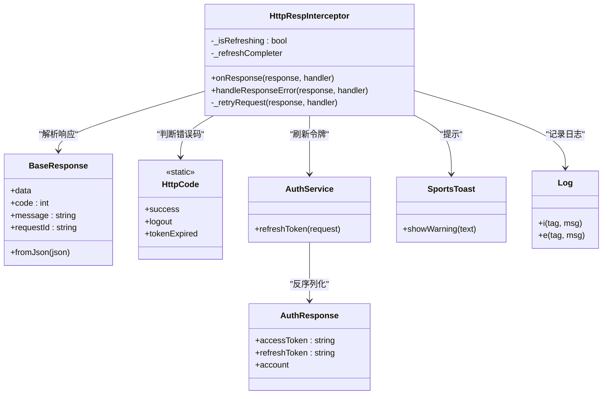

# 错误处理流程

<cite>
**本文引用的文件**
- [http_resp_interceptor.dart](file://lib/net/http_resp_interceptor.dart)
- [code.dart](file://lib/net/code.dart)
- [response.dart](file://lib/net/response.dart)
- [toast.dart](file://lib/widgets/popup/toast.dart)
- [log.dart](file://lib/utils/log.dart)
- [auth_service.g.dart](file://lib/global/service/auth_service.g.dart)
- [auth_rep_type.dart](file://lib/global/model/auth_rep_type.dart)
- [authentication_error_handling_test.dart](file://test/pages/login/authentication_error_handling_test.dart)
</cite>

## 目录
1. [简介](#简介)
2. [项目结构](#项目结构)
3. [核心组件](#核心组件)
4. [架构总览](#架构总览)
5. [详细组件分析](#详细组件分析)
6. [依赖关系分析](#依赖关系分析)
7. [性能考量](#性能考量)
8. [故障排查指南](#故障排查指南)
9. [结论](#结论)
10. [附录](#附录)

## 简介
本文件围绕应用中的错误处理机制展开，重点解析 handleResponseError 方法对业务错误的处理策略，尤其是当响应 code 为 401 或 403 时触发的认证错误处理流程；详细说明对刷新令牌接口的特殊错误识别与处理；解释系统如何通过 SportsToast 组件向用户展示错误消息，以及针对不同错误类型（字符串响应、带 message 字段的响应、无消息响应）的差异化提示策略；描述错误日志记录机制及其在调试中的作用，并提供错误处理的决策流程图与常见错误场景的处理示例，帮助开发者快速定位和解决接口异常问题。

## 项目结构
与错误处理相关的核心模块分布如下：
- 网络层拦截器与响应模型：http_resp_interceptor.dart、response.dart、code.dart
- 错误提示组件：toast.dart
- 日志工具：log.dart
- 认证服务与模型：auth_service.g.dart、auth_rep_type.dart
- 测试用例：authentication_error_handling_test.dart



图表来源
- [http_resp_interceptor.dart](file://lib/net/http_resp_interceptor.dart#L1-L210)
- [response.dart](file://lib/net/response.dart#L1-L25)
- [code.dart](file://lib/net/code.dart#L1-L13)
- [toast.dart](file://lib/widgets/popup/toast.dart#L1-L264)
- [auth_service.g.dart](file://lib/global/service/auth_service.g.dart#L48-L74)
- [auth_rep_type.dart](file://lib/global/model/auth_rep_type.dart#L1-L45)
- [log.dart](file://lib/utils/log.dart#L1-L181)

章节来源
- [http_resp_interceptor.dart](file://lib/net/http_resp_interceptor.dart#L1-L210)
- [response.dart](file://lib/net/response.dart#L1-L25)
- [code.dart](file://lib/net/code.dart#L1-L13)
- [toast.dart](file://lib/widgets/popup/toast.dart#L1-L264)
- [auth_service.g.dart](file://lib/global/service/auth_service.g.dart#L48-L74)
- [auth_rep_type.dart](file://lib/global/model/auth_rep_type.dart#L1-L45)
- [log.dart](file://lib/utils/log.dart#L1-L181)

## 核心组件
- 响应拦截器 HttpRespInterceptor：负责将后端统一响应模型 BaseResponse 解析为业务数据，当 code 非成功时调用 handleResponseError 进行错误处理；对 401/403 的认证错误进行特殊处理，包含刷新令牌、并发刷新控制、重试原始请求等逻辑。
- 统一响应模型 BaseResponse：承载 data、code、message、requestId 字段，拦截器将其转换为业务数据或交由错误处理流程。
- 业务错误码 HttpCode：集中管理业务错误码，如成功、登录失效、token 过期等。
- 错误提示组件 SportsToast：封装警告、成功、错误等提示，统一风格与交互。
- 认证服务 AuthService：提供刷新令牌接口，作为拦截器在认证错误时的恢复手段。
- 日志工具 l：提供多级别日志输出，便于调试与排障。

章节来源
- [http_resp_interceptor.dart](file://lib/net/http_resp_interceptor.dart#L1-L210)
- [response.dart](file://lib/net/response.dart#L1-L25)
- [code.dart](file://lib/net/code.dart#L1-L13)
- [toast.dart](file://lib/widgets/popup/toast.dart#L1-L264)
- [auth_service.g.dart](file://lib/global/service/auth_service.g.dart#L48-L74)
- [log.dart](file://lib/utils/log.dart#L1-L181)

## 架构总览
下图展示了从网络响应到错误处理与用户提示的整体流程，以及认证错误时的刷新令牌与重试机制。

```mermaid
sequenceDiagram
participant Net as "网络请求"
participant RespInt as "HttpRespInterceptor"
participant Model as "BaseResponse"
participant AuthSvc as "AuthService.refreshToken"
participant Toast as "SportsToast"
participant Log as "l 日志工具"
Net->>RespInt : 返回响应
RespInt->>Model : 反序列化为 BaseResponse
alt 成功
RespInt-->>Net : 放行业务数据
else 非成功
RespInt->>RespInt : handleResponseError()
opt 401/403 认证错误
RespInt->>RespInt : 检查是否为 /auth/refresh-token
alt 刷新令牌接口自身返回401
RespInt->>Log : 记录刷新令牌过期
RespInt->>Toast : 显示“登录已过期，请重新登录”
RespInt-->>Net : 拒绝请求
else 正常刷新令牌
RespInt->>AuthSvc : 调用刷新令牌
AuthSvc-->>RespInt : 返回新令牌
RespInt->>RespInt : 更新AppController令牌
RespInt->>RespInt : 重试原始请求
RespInt-->>Net : 放行重试结果
end
else 其他错误
RespInt->>Toast : 根据响应类型显示提示
RespInt-->>Net : 拒绝请求
end
end
```

图表来源
- [http_resp_interceptor.dart](file://lib/net/http_resp_interceptor.dart#L25-L210)
- [auth_service.g.dart](file://lib/global/service/auth_service.g.dart#L48-L74)
- [toast.dart](file://lib/widgets/popup/toast.dart#L1-L264)
- [log.dart](file://lib/utils/log.dart#L1-L181)

## 详细组件分析

### handleResponseError 方法与认证错误处理
该方法在拦截器中被调用，根据响应 code 决定后续处理路径：
- 对于 401/403 的认证错误：
  - 若当前请求路径为 /auth/refresh-token，则判定刷新令牌也已过期，触发登出并提示用户重新登录。
  - 若正在刷新令牌（并发控制），等待刷新完成后再决定重试或拒绝。
  - 否则启动刷新令牌流程：读取 refreshToken、调用 AuthService.refreshToken、更新 AppController 中的令牌、标记刷新完成、重试原始请求。
- 对于其他错误：
  - 若响应为字符串类型，优先使用其中的 message 字段进行提示。
  - 若响应包含 message 字段，使用该字段提示。
  - 否则提示“网络错误”。



图表来源
- [http_resp_interceptor.dart](file://lib/net/http_resp_interceptor.dart#L50-L155)
- [auth_service.g.dart](file://lib/global/service/auth_service.g.dart#L48-L74)

章节来源
- [http_resp_interceptor.dart](file://lib/net/http_resp_interceptor.dart#L50-L155)

### 刷新令牌接口的特殊错误识别与处理
- 当拦截器检测到响应 code 为 401/403 时，会进一步判断请求路径是否为 /auth/refresh-token。
- 若是刷新令牌接口自身返回 401，表示 refreshToken 已过期，此时拦截器会：
  - 记录日志
  - 触发 AppController.logout 清除认证信息
  - 通过 SportsToast 提示“登录已过期，请重新登录”
  - 拒绝本次请求，避免无限循环

章节来源
- [http_resp_interceptor.dart](file://lib/net/http_resp_interceptor.dart#L62-L69)

### SportsToast 组件的差异化提示策略
- 字符串响应：当响应为字符串类型时，优先使用其中的 message 字段进行提示。
- 带 message 字段：若响应对象包含 message 字段，直接使用该字段提示。
- 无消息响应：若既不是字符串也不是包含 message 的对象，则提示“网络错误”。

章节来源
- [http_resp_interceptor.dart](file://lib/net/http_resp_interceptor.dart#L142-L153)
- [toast.dart](file://lib/widgets/popup/toast.dart#L82-L124)

### 错误日志记录机制与调试作用
- 日志工具 l 提供多级别输出（trace、debug、info、warning、error），并在拦截器中广泛使用：
  - 记录业务请求错误详情（路径、code、message、requestId）
  - 记录刷新令牌过程中的关键节点（开始刷新、刷新成功、刷新失败、等待刷新时出错、Dio 实例为空等）
  - 在刷新令牌失败或重试失败时输出错误堆栈，便于定位问题
- 调试建议：
  - 在开发阶段开启日志输出，关注拦截器中的关键日志条目
  - 结合测试用例模拟不同错误场景，观察日志与提示的一致性

章节来源
- [http_resp_interceptor.dart](file://lib/net/http_resp_interceptor.dart#L42-L45)
- [http_resp_interceptor.dart](file://lib/net/http_resp_interceptor.dart#L72-L86)
- [http_resp_interceptor.dart](file://lib/net/http_resp_interceptor.dart#L107-L110)
- [http_resp_interceptor.dart](file://lib/net/http_resp_interceptor.dart#L122-L129)
- [http_resp_interceptor.dart](file://lib/net/http_resp_interceptor.dart#L130-L139)
- [http_resp_interceptor.dart](file://lib/net/http_resp_interceptor.dart#L166-L207)
- [log.dart](file://lib/utils/log.dart#L1-L181)

### 常见错误场景与处理示例
- 场景一：登录接口返回 401
  - 处理：拦截器识别为认证错误，尝试刷新令牌；若刷新成功则重试原请求；若刷新失败则登出并提示重新登录。
- 场景二：刷新令牌接口自身返回 401
  - 处理：判定为 refreshToken 过期，直接登出并提示重新登录。
- 场景三：业务接口返回字符串错误
  - 处理：使用字符串中的 message 提示用户。
- 场景四：业务接口返回对象但无 message
  - 处理：提示“网络错误”。

章节来源
- [http_resp_interceptor.dart](file://lib/net/http_resp_interceptor.dart#L58-L155)
- [authentication_error_handling_test.dart](file://test/pages/login/authentication_error_handling_test.dart#L1-L86)

## 依赖关系分析
- HttpRespInterceptor 依赖：
  - BaseResponse：解析统一响应模型
  - HttpCode：判断业务错误码
  - AuthService.refreshToken：刷新令牌
  - AppController：更新令牌状态
  - SportsToast：错误提示
  - l：日志输出
- AuthService.refreshToken 依赖：
  - AuthResponse：反序列化刷新后的令牌
- 测试用例 authentication_error_handling_test.dart 验证了错误消息显示与按钮状态等行为一致性。



图表来源
- [http_resp_interceptor.dart](file://lib/net/http_resp_interceptor.dart#L1-L210)
- [response.dart](file://lib/net/response.dart#L1-L25)
- [code.dart](file://lib/net/code.dart#L1-L13)
- [auth_service.g.dart](file://lib/global/service/auth_service.g.dart#L48-L74)
- [auth_rep_type.dart](file://lib/global/model/auth_rep_type.dart#L1-L45)
- [toast.dart](file://lib/widgets/popup/toast.dart#L1-L264)
- [log.dart](file://lib/utils/log.dart#L1-L181)

章节来源
- [http_resp_interceptor.dart](file://lib/net/http_resp_interceptor.dart#L1-L210)
- [response.dart](file://lib/net/response.dart#L1-L25)
- [code.dart](file://lib/net/code.dart#L1-L13)
- [auth_service.g.dart](file://lib/global/service/auth_service.g.dart#L48-L74)
- [auth_rep_type.dart](file://lib/global/model/auth_rep_type.dart#L1-L45)
- [toast.dart](file://lib/widgets/popup/toast.dart#L1-L264)
- [log.dart](file://lib/utils/log.dart#L1-L181)

## 性能考量
- 并发刷新控制：通过静态变量与 Completer 控制同一时刻仅有一个刷新请求，避免并发风暴导致的资源争用与重复刷新。
- 重试机制：在刷新成功后重试原始请求，减少用户手动操作成本，提升体验。
- 日志级别：生产环境建议合理配置日志级别，避免过多日志影响性能。

章节来源
- [http_resp_interceptor.dart](file://lib/net/http_resp_interceptor.dart#L18-L21)
- [http_resp_interceptor.dart](file://lib/net/http_resp_interceptor.dart#L71-L87)

## 故障排查指南
- 关键日志定位
  - 业务请求错误详情：包含路径、code、message、requestId，便于快速定位接口与错误原因。
  - 刷新令牌过程：开始刷新、刷新成功、刷新失败、等待刷新时出错、Dio 实例为空等，有助于判断是网络问题还是令牌问题。
- 常见问题与对策
  - 刷新令牌接口返回 401：确认 refreshToken 是否过期或为空，必要时引导用户重新登录。
  - 重试请求失败：检查 Dio 实例是否为空、网络是否可用、新令牌是否正确注入 Authorization。
  - 提示不一致：核对响应类型（字符串 vs 对象）、message 字段是否存在，确保提示策略按预期执行。
- 测试辅助
  - 使用测试用例模拟不同错误类型，验证错误消息显示与按钮状态切换的一致性。

章节来源
- [http_resp_interceptor.dart](file://lib/net/http_resp_interceptor.dart#L42-L45)
- [http_resp_interceptor.dart](file://lib/net/http_resp_interceptor.dart#L72-L86)
- [http_resp_interceptor.dart](file://lib/net/http_resp_interceptor.dart#L107-L110)
- [http_resp_interceptor.dart](file://lib/net/http_resp_interceptor.dart#L122-L129)
- [http_resp_interceptor.dart](file://lib/net/http_resp_interceptor.dart#L130-L139)
- [http_resp_interceptor.dart](file://lib/net/http_resp_interceptor.dart#L166-L207)
- [authentication_error_handling_test.dart](file://test/pages/login/authentication_error_handling_test.dart#L1-L86)

## 结论
本系统的错误处理以 HttpRespInterceptor 为核心，结合统一响应模型与业务错误码，实现了对认证错误（401/403）的精细化处理：在刷新令牌失败或刷新令牌接口自身过期时，能够及时登出并提示用户重新登录；在可恢复的认证错误场景下，通过并发控制与重试机制提升用户体验。SportsToast 提供一致的提示策略，日志工具则为调试与排障提供了可靠依据。整体设计兼顾健壮性与可维护性，适合在复杂业务场景中推广使用。

## 附录
- 术语说明
  - 401/403：HTTP 状态码，此处作为业务错误码使用，表示认证失败或权限不足。
  - 刷新令牌：用于替换过期访问令牌的机制，通常需要携带有效的 refreshToken。
- 相关文件路径
  - [http_resp_interceptor.dart](file://lib/net/http_resp_interceptor.dart)
  - [response.dart](file://lib/net/response.dart)
  - [code.dart](file://lib/net/code.dart)
  - [toast.dart](file://lib/widgets/popup/toast.dart)
  - [log.dart](file://lib/utils/log.dart)
  - [auth_service.g.dart](file://lib/global/service/auth_service.g.dart)
  - [auth_rep_type.dart](file://lib/global/model/auth_rep_type.dart)
  - [authentication_error_handling_test.dart](file://test/pages/login/authentication_error_handling_test.dart)