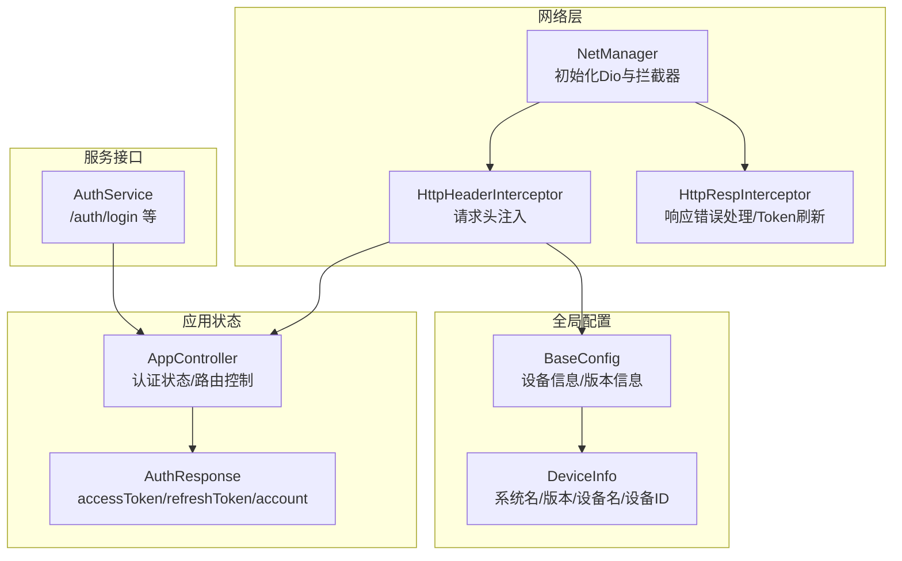
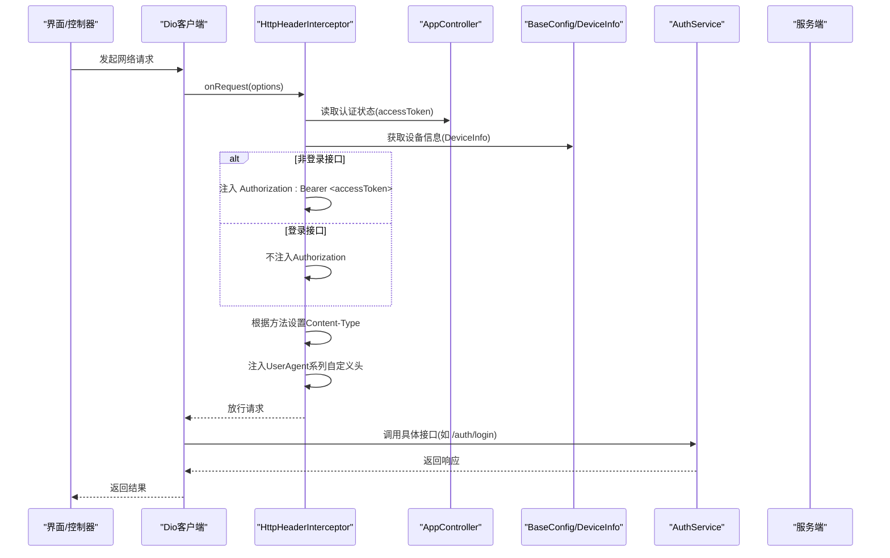
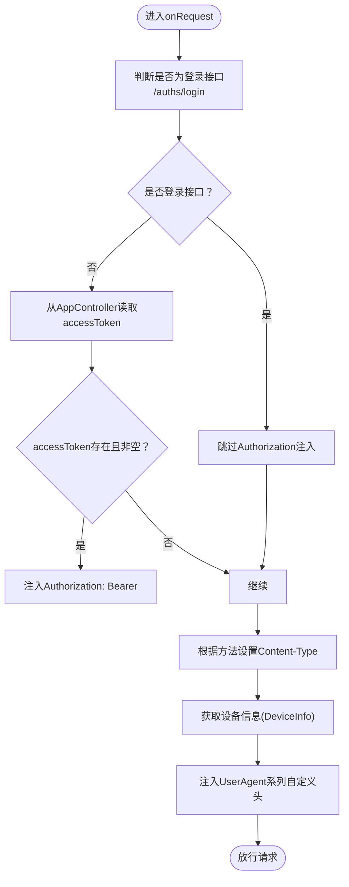
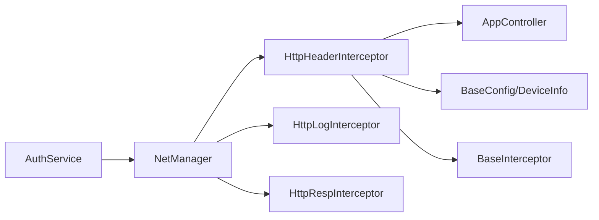

# 头部拦截器

<cite>
**本文引用的文件列表**
- [http_header_interceptor.dart](file://lib/net/http_header_interceptor.dart)
- [base_interceptor.dart](file://lib/net/base_interceptor.dart)
- [net_manager.dart](file://lib/net/net_manager.dart)
- [config.dart](file://lib/config/config.dart)
- [global.dart](file://lib/models/global.dart)
- [app_controller.dart](file://lib/global/app_controller.dart)
- [auth_rep_type.dart](file://lib/global/model/auth_rep_type.dart)
- [auth_service.dart](file://lib/global/service/auth_service.dart)
- [http_resp_interceptor.dart](file://lib/net/http_resp_interceptor.dart)
</cite>

## 目录
1. [简介](#简介)
2. [项目结构](#项目结构)
3. [核心组件](#核心组件)
4. [架构总览](#架构总览)
5. [详细组件分析](#详细组件分析)
6. [依赖关系分析](#依赖关系分析)
7. [性能考量](#性能考量)
8. [故障排查指南](#故障排查指南)
9. [结论](#结论)

## 简介
本文围绕 HttpHeaderInterceptor 如何为每个网络请求自动添加必要的 HTTP 头信息进行深入解析，重点覆盖：
- 从 AppController 的状态中获取用户的 accessToken，并在非登录接口请求中自动注入 Bearer Token 认证头；
- 根据 GET 或 POST 方法设置不同的 Content-Type 头；
- 将设备信息（设备名称、系统版本、设备 ID 等）封装并添加到 UserAgent 相关的自定义头中；
- 登录接口（/auths/login）被排除在认证头添加逻辑之外的实现细节；
- 提供请求头生成的完整流程说明，帮助开发者理解认证与设备追踪的实现机制。

## 项目结构
与头部拦截器相关的关键文件分布如下：
- 网络层拦截器与管理器：http_header_interceptor.dart、base_interceptor.dart、net_manager.dart、http_resp_interceptor.dart
- 全局配置与设备信息：config.dart、models/global.dart
- 应用状态与认证上下文：global/app_controller.dart、global/model/auth_rep_type.dart
- 登录服务与接口路径：global/service/auth_service.dart

图表来源
- [net_manager.dart](file://lib/net/net_manager.dart#L1-L88)
- [http_header_interceptor.dart](file://lib/net/http_header_interceptor.dart#L1-L56)
- [config.dart](file://lib/config/config.dart#L1-L107)
- [global.dart](file://lib/models/global.dart#L1-L34)
- [app_controller.dart](file://lib/global/app_controller.dart#L1-L146)
- [auth_rep_type.dart](file://lib/global/model/auth_rep_type.dart#L1-L45)
- [auth_service.dart](file://lib/global/service/auth_service.dart#L1-L40)

章节来源
- [net_manager.dart](file://lib/net/net_manager.dart#L1-L88)
- [http_header_interceptor.dart](file://lib/net/http_header_interceptor.dart#L1-L56)
- [config.dart](file://lib/config/config.dart#L1-L107)
- [global.dart](file://lib/models/global.dart#L1-L34)
- [app_controller.dart](file://lib/global/app_controller.dart#L1-L146)
- [auth_rep_type.dart](file://lib/global/model/auth_rep_type.dart#L1-L45)
- [auth_service.dart](file://lib/global/service/auth_service.dart#L1-L40)

## 核心组件
- HttpHeaderInterceptor：负责在每次请求前注入必要的请求头，包括 Content-Type、Authorization（Bearer Token）、以及设备信息相关的 UserAgent 自定义头。
- BaseInterceptor：Dio 拦截器基类，提供统一的拦截器包装能力。
- NetManager：负责创建 Dio 实例并注册拦截器（含 HttpHeaderInterceptor、HttpLogInterceptor、HttpRespInterceptor）。
- BaseConfig：提供设备信息、应用版本等全局配置；DeviceInfo 定义设备字段。
- AppController：维护认证状态（AuthResponse），并在登录成功后写入 accessToken/refreshToken。
- AuthService：定义认证相关接口（如 /auth/login），用于登录流程触发并获取认证响应。

章节来源
- [http_header_interceptor.dart](file://lib/net/http_header_interceptor.dart#L1-L56)
- [base_interceptor.dart](file://lib/net/base_interceptor.dart#L1-L8)
- [net_manager.dart](file://lib/net/net_manager.dart#L1-L88)
- [config.dart](file://lib/config/config.dart#L1-L107)
- [global.dart](file://lib/models/global.dart#L1-L34)
- [app_controller.dart](file://lib/global/app_controller.dart#L1-L146)
- [auth_service.dart](file://lib/global/service/auth_service.dart#L1-L40)

## 架构总览
下图展示了请求从发起到拦截器处理再到服务端的整体流程，重点标注了认证头注入与设备头注入的位置。

图表来源
- [http_header_interceptor.dart](file://lib/net/http_header_interceptor.dart#L16-L55)
- [app_controller.dart](file://lib/global/app_controller.dart#L50-L71)
- [config.dart](file://lib/config/config.dart#L1-L107)
- [auth_service.dart](file://lib/global/service/auth_service.dart#L1-L40)

## 详细组件分析

### HttpHeaderInterceptor：请求头注入与认证逻辑
- 登录接口排除逻辑
  - 当请求路径等于 "/auths/login" 或以 "/auths/login" 结尾时，拦截器判定为登录接口，不注入 Authorization 头，避免登录请求携带 Bearer Token。
  - 参考路径：[http_header_interceptor.dart](file://lib/net/http_header_interceptor.dart#L21-L24)
- 认证头注入
  - 从 AppController 的状态中读取 AuthResponse，并获取 accessToken。
  - 若 accessToken 存在且非空，则在非登录接口中注入 Authorization: Bearer <accessToken>。
  - 参考路径：[http_header_interceptor.dart](file://lib/net/http_header_interceptor.dart#L24-L42)、[app_controller.dart](file://lib/global/app_controller.dart#L50-L52)
- Content-Type 设置
  - GET 请求：设置 Content-Type 为 application/x-www-form-urlencoded。
  - POST 请求：设置 Content-Type 为 application/json;charset=UTF-8。
  - 参考路径：[http_header_interceptor.dart](file://lib/net/http_header_interceptor.dart#L31-L35)
- 设备信息注入（UserAgent 相关自定义头）
  - 从 BaseConfig 或构造函数注入的 deviceInfo 获取设备信息，分别注入以下自定义头：
    - UserAgent-deviceName：设备名称（已进行 URL 编码）
    - UserAgent-systemName：系统名称
    - UserAgent-systemVersion：系统版本
    - UserAgent-deviceId：设备唯一标识
    - UserAgent-appVersion：应用版本（来自 BaseConfig.appVersion）
    - UserAgent-appType：固定值 App
  - 参考路径：[http_header_interceptor.dart](file://lib/net/http_header_interceptor.dart#L44-L51)、[config.dart](file://lib/config/config.dart#L31-L31)、[global.dart](file://lib/models/global.dart#L1-L34)

图表来源
- [http_header_interceptor.dart](file://lib/net/http_header_interceptor.dart#L16-L55)
- [app_controller.dart](file://lib/global/app_controller.dart#L50-L52)
- [config.dart](file://lib/config/config.dart#L31-L31)
- [global.dart](file://lib/models/global.dart#L1-L34)

章节来源
- [http_header_interceptor.dart](file://lib/net/http_header_interceptor.dart#L16-L55)
- [app_controller.dart](file://lib/global/app_controller.dart#L50-L52)
- [config.dart](file://lib/config/config.dart#L31-L31)
- [global.dart](file://lib/models/global.dart#L1-L34)

### NetManager：拦截器注册与Dio初始化
- NetManager 在初始化时向 Dio 注册多个拦截器，其中包含 HttpHeaderInterceptor，确保所有请求都会经过头部注入逻辑。
- 参考路径：[net_manager.dart](file://lib/net/net_manager.dart#L59-L66)

章节来源
- [net_manager.dart](file://lib/net/net_manager.dart#L59-L66)

### BaseInterceptor：拦截器基类
- BaseInterceptor 是 Dio InterceptorsWrapper 的子类，提供统一的拦截器包装能力，便于扩展更多拦截器。
- 参考路径：[base_interceptor.dart](file://lib/net/base_interceptor.dart#L1-L8)

章节来源
- [base_interceptor.dart](file://lib/net/base_interceptor.dart#L1-L8)

### BaseConfig 与 DeviceInfo：设备与版本信息
- BaseConfig 提供设备信息（DeviceInfo）与应用版本（appVersion），用于在请求头中注入 UserAgent 相关字段。
- DeviceInfo 字段包括系统名称、系统版本、设备名称、设备唯一标识等。
- 参考路径：[config.dart](file://lib/config/config.dart#L1-L107)、[global.dart](file://lib/models/global.dart#L1-L34)

章节来源
- [config.dart](file://lib/config/config.dart#L1-L107)
- [global.dart](file://lib/models/global.dart#L1-L34)

### AppController：认证状态与登录成功处理
- AppController 维护 AppState，其中包含 AuthResponse（包含 accessToken、refreshToken、account）。
- 登录成功后通过 loginSucessProcess 写入认证响应，后续请求拦截器可读取该状态注入 Authorization。
- 参考路径：[app_controller.dart](file://lib/global/app_controller.dart#L50-L71)、[auth_rep_type.dart](file://lib/global/model/auth_rep_type.dart#L1-L45)

章节来源
- [app_controller.dart](file://lib/global/app_controller.dart#L50-L71)
- [auth_rep_type.dart](file://lib/global/model/auth_rep_type.dart#L1-L45)

### AuthService：登录接口与路径约定
- AuthService 定义了 /auth/login 等认证相关接口，登录成功后会得到包含 accessToken/refreshToken 的响应。
- 登录接口路径与拦截器的登录接口判定保持一致，确保登录请求不会被注入 Authorization。
- 参考路径：[auth_service.dart](file://lib/global/service/auth_service.dart#L1-L40)

章节来源
- [auth_service.dart](file://lib/global/service/auth_service.dart#L1-L40)

### HttpRespInterceptor：响应错误处理与Token刷新
- HttpRespInterceptor 在收到 401/403 等认证错误时，会尝试刷新 token 并重试原请求；刷新成功后会更新 Authorization 头。
- 参考路径：[http_resp_interceptor.dart](file://lib/net/http_resp_interceptor.dart#L50-L180)

章节来源
- [http_resp_interceptor.dart](file://lib/net/http_resp_interceptor.dart#L50-L180)

## 依赖关系分析
- HttpHeaderInterceptor 依赖：
  - AppController：读取认证状态（accessToken）
  - BaseConfig/DeviceInfo：读取设备信息与应用版本
  - BaseInterceptor：继承拦截器基类
- NetManager 依赖：
  - 注册 HttpHeaderInterceptor、HttpLogInterceptor、HttpRespInterceptor
- AuthService 依赖：
  - 与登录接口路径约定一致，保证登录请求不注入 Authorization

图表来源
- [http_header_interceptor.dart](file://lib/net/http_header_interceptor.dart#L1-L56)
- [base_interceptor.dart](file://lib/net/base_interceptor.dart#L1-L8)
- [net_manager.dart](file://lib/net/net_manager.dart#L59-L66)
- [config.dart](file://lib/config/config.dart#L1-L107)
- [global.dart](file://lib/models/global.dart#L1-L34)
- [app_controller.dart](file://lib/global/app_controller.dart#L50-L71)
- [auth_service.dart](file://lib/global/service/auth_service.dart#L1-L40)

章节来源
- [http_header_interceptor.dart](file://lib/net/http_header_interceptor.dart#L1-L56)
- [base_interceptor.dart](file://lib/net/base_interceptor.dart#L1-L8)
- [net_manager.dart](file://lib/net/net_manager.dart#L59-L66)
- [config.dart](file://lib/config/config.dart#L1-L107)
- [global.dart](file://lib/models/global.dart#L1-L34)
- [app_controller.dart](file://lib/global/app_controller.dart#L50-L71)
- [auth_service.dart](file://lib/global/service/auth_service.dart#L1-L40)

## 性能考量
- 头部注入逻辑为轻量级操作，仅涉及状态读取与字典赋值，对请求延迟影响极小。
- 对于 GET 请求使用 application/x-www-form-urlencoded，POST 使用 application/json;charset=UTF-8，有助于服务端正确解析请求体，减少不必要的解析开销。
- 设备信息来源于 BaseConfig，建议在应用启动时完成初始化，避免在请求路径上重复获取设备信息。

## 故障排查指南
- 未注入 Authorization
  - 检查 AppController 是否已写入有效的 accessToken；确认 loginSucessProcess 已被调用。
  - 参考路径：[app_controller.dart](file://lib/global/app_controller.dart#L50-L71)
- 登录接口仍携带 Authorization
  - 确认请求路径是否为 "/auths/login" 或以 "/auths/login" 结尾；拦截器对登录接口明确排除 Authorization 注入。
  - 参考路径：[http_header_interceptor.dart](file://lib/net/http_header_interceptor.dart#L21-L24)
- Content-Type 不符合预期
  - 确认请求方法为 GET 或 POST；GET 使用 application/x-www-form-urlencoded，POST 使用 application/json;charset=UTF-8。
  - 参考路径：[http_header_interceptor.dart](file://lib/net/http_header_interceptor.dart#L31-L35)
- 设备头缺失或异常
  - 检查 BaseConfig 是否已完成设备信息初始化；确认 DeviceInfo 字段有效；UserAgent-appVersion 来源于 BaseConfig.appVersion。
  - 参考路径：[config.dart](file://lib/config/config.dart#L1-L107)、[global.dart](file://lib/models/global.dart#L1-L34)
- 401/403 后未自动刷新 Token
  - 检查 HttpRespInterceptor 的刷新逻辑与 AuthService 的 /auth/refresh-token 接口；确认 refreshToken 存在且有效。
  - 参考路径：[http_resp_interceptor.dart](file://lib/net/http_resp_interceptor.dart#L50-L180)、[auth_service.dart](file://lib/global/service/auth_service.dart#L1-L40)

章节来源
- [app_controller.dart](file://lib/global/app_controller.dart#L50-L71)
- [http_header_interceptor.dart](file://lib/net/http_header_interceptor.dart#L21-L35)
- [config.dart](file://lib/config/config.dart#L1-L107)
- [global.dart](file://lib/models/global.dart#L1-L34)
- [http_resp_interceptor.dart](file://lib/net/http_resp_interceptor.dart#L50-L180)
- [auth_service.dart](file://lib/global/service/auth_service.dart#L1-L40)

## 结论
HttpHeaderInterceptor 通过统一的拦截器机制，在请求发出前完成认证头与设备头的注入，并针对登录接口进行特殊排除，确保登录流程的正确性与安全性。结合 NetManager 的拦截器注册、AppController 的认证状态管理以及 AuthService 的接口路径约定，形成了完整的认证与设备追踪链路。开发者在新增或修改请求头策略时，应遵循现有拦截器模式，确保一致性与可维护性。