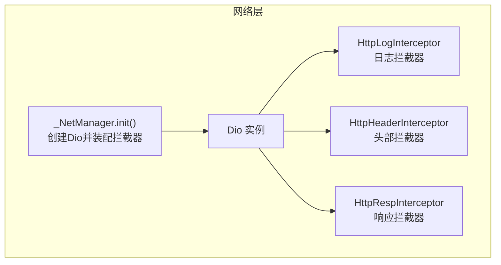
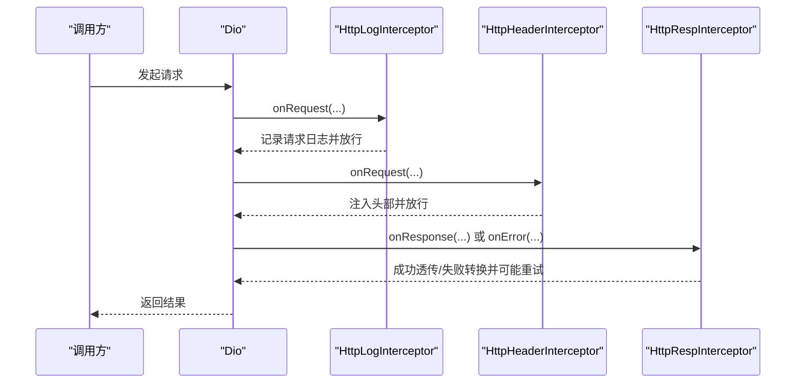
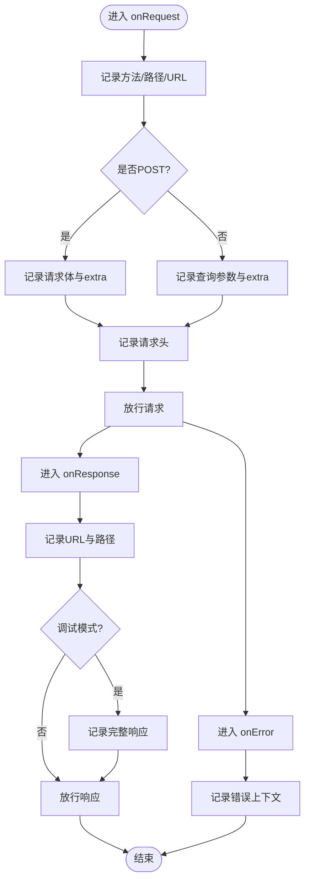
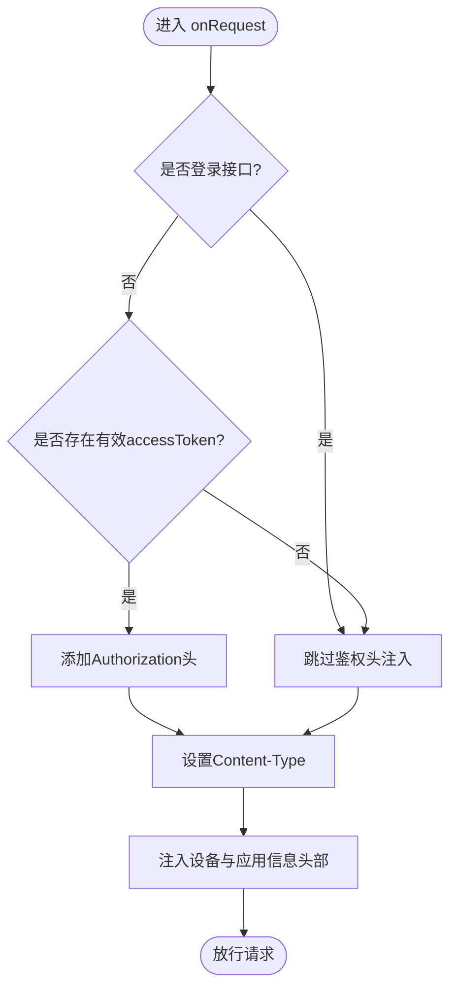
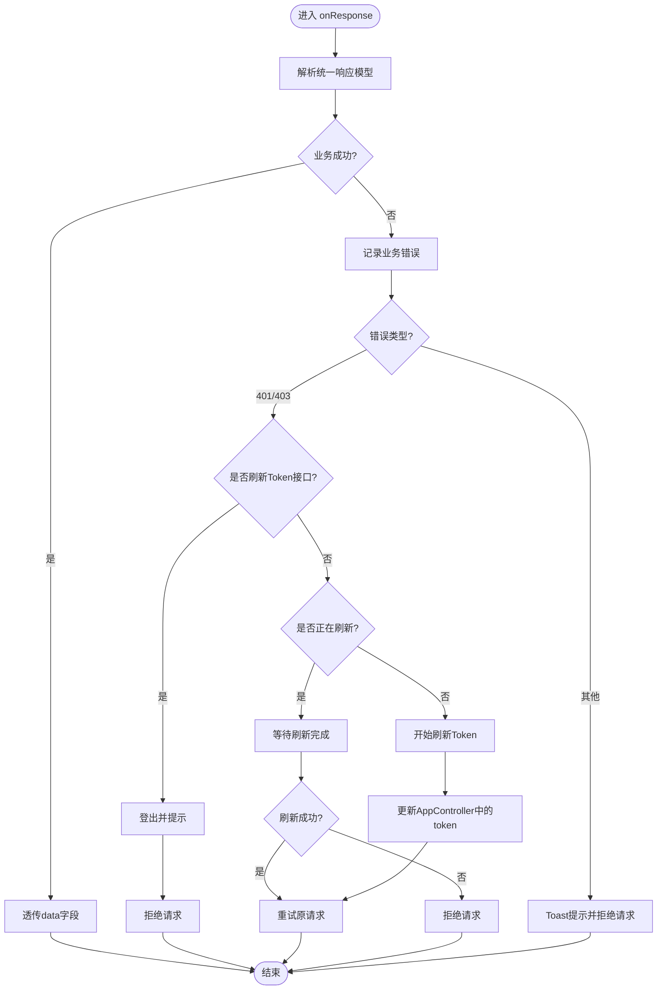
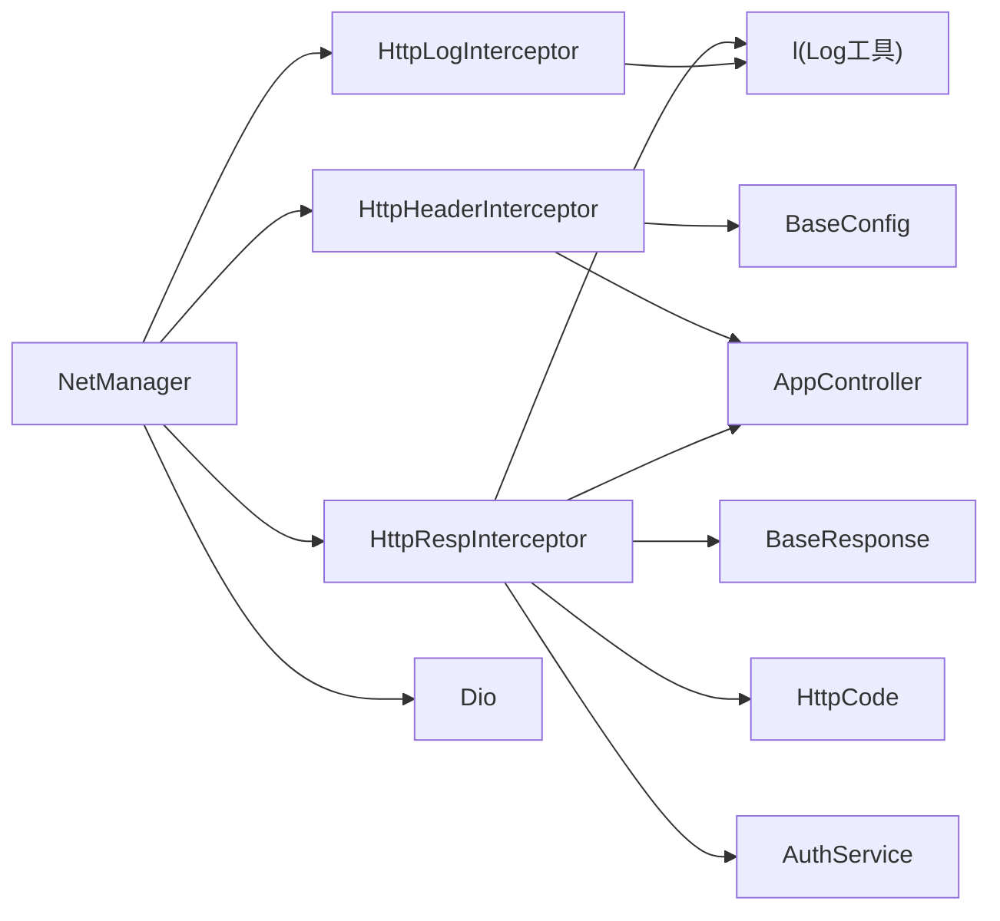

# 拦截器链

<cite>
**本文引用的文件列表**
- [base_interceptor.dart](file://lib/net/base_interceptor.dart)
- [http_log_interceptor.dart](file://lib/net/http_log_interceptor.dart)
- [http_header_interceptor.dart](file://lib/net/http_header_interceptor.dart)
- [http_resp_interceptor.dart](file://lib/net/http_resp_interceptor.dart)
- [net_manager.dart](file://lib/net/net_manager.dart)
- [response.dart](file://lib/net/response.dart)
- [code.dart](file://lib/net/code.dart)
- [config.dart](file://lib/config/config.dart)
- [log.dart](file://lib/utils/log.dart)
- [app_controller.dart](file://lib/global/app_controller.dart)
- [auth_service.dart](file://lib/global/service/auth_service.dart)
- [dio_io.dart](file://lib/net/dio_io.dart)
</cite>

## 目录
1. [简介](#简介)
2. [项目结构与入口](#项目结构与入口)
3. [核心组件总览](#核心组件总览)
4. [架构概览](#架构概览)
5. [详细组件分析](#详细组件分析)
6. [依赖关系分析](#依赖关系分析)
7. [性能与可靠性考量](#性能与可靠性考量)
8. [故障排查指南](#故障排查指南)
9. [结论](#结论)

## 简介
本文件系统性解析该Flutter应用网络层的拦截器链设计，重点覆盖：
- HttpLogInterceptor 的请求/响应日志记录策略，包含 GET/POST 参数、头部信息与调试模式下的完整响应展示
- HttpHeaderInterceptor 的认证令牌注入与公共头部处理（Content-Type、User-Agent等）
- HttpRespInterceptor 的统一响应处理、业务错误码解析、异常转换与Token刷新机制
- BaseInterceptor 作为基类提供的标签与日志能力
- 拦截器执行顺序与请求/响应完整生命周期示例

## 项目结构与入口
网络层由 NetManager 统一初始化，按固定顺序装配拦截器，并通过全局单例对外提供 Dio 客户端。

图表来源
- [net_manager.dart](file://lib/net/net_manager.dart#L30-L66)
- [http_log_interceptor.dart](file://lib/net/http_log_interceptor.dart#L1-L60)
- [http_header_interceptor.dart](file://lib/net/http_header_interceptor.dart#L1-L56)
- [http_resp_interceptor.dart](file://lib/net/http_resp_interceptor.dart#L1-L210)

章节来源
- [net_manager.dart](file://lib/net/net_manager.dart#L30-L66)

## 核心组件总览
- BaseInterceptor：所有拦截器的基类，提供统一的 tag 字段，便于日志区分与追踪
- HttpLogInterceptor：在请求前记录方法、路径、URL、查询参数或请求体、头部；在响应时记录URL与路径；调试模式下输出完整响应对象；错误时记录错误上下文
- HttpHeaderInterceptor：根据请求方法设置 Content-Type；在非登录接口自动附加 Authorization；注入设备信息与应用版本等通用头部
- HttpRespInterceptor：解析统一响应模型，识别业务成功与失败；对401/403触发Token刷新；刷新成功后重试原请求；其他错误统一转换为DioException并提示Toast

章节来源
- [base_interceptor.dart](file://lib/net/base_interceptor.dart#L1-L8)
- [http_log_interceptor.dart](file://lib/net/http_log_interceptor.dart#L1-L60)
- [http_header_interceptor.dart](file://lib/net/http_header_interceptor.dart#L1-L56)
- [http_resp_interceptor.dart](file://lib/net/http_resp_interceptor.dart#L1-L210)

## 架构概览
拦截器装配顺序严格固定：日志 → 头部 → 响应。该顺序确保：
- 日志拦截器最先捕获原始请求与响应，便于定位问题
- 头部拦截器在请求发出前完成鉴权与通用头部注入
- 响应拦截器最后统一处理业务逻辑与异常

图表来源
- [net_manager.dart](file://lib/net/net_manager.dart#L58-L66)
- [http_log_interceptor.dart](file://lib/net/http_log_interceptor.dart#L10-L33)
- [http_header_interceptor.dart](file://lib/net/http_header_interceptor.dart#L16-L54)
- [http_resp_interceptor.dart](file://lib/net/http_resp_interceptor.dart#L25-L49)

## 详细组件分析

### BaseInterceptor 基类
- 提供 tag 字段，用于日志标识与分类
- 所有拦截器均继承自该基类，保证日志一致性

章节来源
- [base_interceptor.dart](file://lib/net/base_interceptor.dart#L1-L8)

### HttpLogInterceptor：请求/响应日志与调试输出
- 请求阶段
  - 记录方法、路径、完整URL
  - GET：记录查询参数与额外信息
  - POST：记录请求体与额外信息
  - 记录请求头
- 响应阶段
  - 记录响应URL与路径
  - 调试模式下输出完整响应对象
- 错误阶段
  - 记录路径、URL、状态码、消息等

图表来源
- [http_log_interceptor.dart](file://lib/net/http_log_interceptor.dart#L10-L59)
- [config.dart](file://lib/config/config.dart#L35-L36)
- [log.dart](file://lib/utils/log.dart#L1-L182)

章节来源
- [http_log_interceptor.dart](file://lib/net/http_log_interceptor.dart#L10-L59)
- [config.dart](file://lib/config/config.dart#L35-L36)
- [log.dart](file://lib/utils/log.dart#L1-L182)

### HttpHeaderInterceptor：认证与通用头部注入
- Content-Type 自动设置
  - GET：application/x-www-form-urlencoded
  - POST：application/json;charset=UTF-8
- 鉴权头注入
  - 非登录接口且存在有效accessToken时，注入 Authorization: Bearer ...
  - 登录接口不注入上述三个头部
- 设备与应用信息头部
  - UserAgent-deviceName、UserAgent-systemName、UserAgent-systemVersion、UserAgent-deviceId、UserAgent-appVersion、UserAgent-appType
  - 应用版本来源于全局配置

图表来源
- [http_header_interceptor.dart](file://lib/net/http_header_interceptor.dart#L16-L54)
- [config.dart](file://lib/config/config.dart#L29-L31)
- [app_controller.dart](file://lib/global/app_controller.dart#L111-L116)

章节来源
- [http_header_interceptor.dart](file://lib/net/http_header_interceptor.dart#L16-L54)
- [config.dart](file://lib/config/config.dart#L29-L31)
- [app_controller.dart](file://lib/global/app_controller.dart#L111-L116)

### HttpRespInterceptor：统一响应处理与Token刷新
- 响应解析
  - 使用统一响应模型解析响应数据
  - 成功码：透传 data 字段
  - 失败码：记录业务错误并转换为DioException
- 401/403 处理
  - 若为刷新Token接口自身返回401，则判定refreshToken过期，触发登出并提示
  - 并发刷新控制：使用静态Completer确保同一时刻仅一次刷新
  - 刷新成功后重试原请求；刷新失败则拒绝请求
- 其他错误
  - 将字符串message或默认“网络错误”提示Toast并拒绝请求

图表来源
- [http_resp_interceptor.dart](file://lib/net/http_resp_interceptor.dart#L25-L209)
- [response.dart](file://lib/net/response.dart#L1-L25)
- [code.dart](file://lib/net/code.dart#L1-L13)
- [auth_service.dart](file://lib/global/service/auth_service.dart#L1-L41)
- [app_controller.dart](file://lib/global/app_controller.dart#L111-L116)

章节来源
- [http_resp_interceptor.dart](file://lib/net/http_resp_interceptor.dart#L25-L209)
- [response.dart](file://lib/net/response.dart#L1-L25)
- [code.dart](file://lib/net/code.dart#L1-L13)
- [auth_service.dart](file://lib/global/service/auth_service.dart#L1-L41)
- [app_controller.dart](file://lib/global/app_controller.dart#L111-L116)

### 拦截器执行顺序与生命周期
- 顺序：HttpLogInterceptor → HttpHeaderInterceptor → HttpRespInterceptor
- 生命周期：
  - 请求阶段：日志拦截器先记录请求信息，再由头部拦截器注入必要头部，最后到达业务层
  - 响应阶段：业务层返回后，响应拦截器统一处理业务错误与异常转换；调试模式下日志拦截器记录完整响应
  - 错误阶段：日志拦截器记录错误上下文；响应拦截器进行401/403处理与重试

章节来源
- [net_manager.dart](file://lib/net/net_manager.dart#L58-L66)
- [http_log_interceptor.dart](file://lib/net/http_log_interceptor.dart#L10-L59)
- [http_header_interceptor.dart](file://lib/net/http_header_interceptor.dart#L16-L54)
- [http_resp_interceptor.dart](file://lib/net/http_resp_interceptor.dart#L25-L209)

## 依赖关系分析
- NetManager 负责创建Dio并装配拦截器，是网络层唯一入口
- HttpHeaderInterceptor 依赖全局配置与AppController以获取认证信息与设备信息
- HttpRespInterceptor 依赖统一响应模型、错误码常量、AuthService刷新Token、AppController登出、Toast提示与日志工具
- HttpLogInterceptor 依赖日志工具与调试开关
- Dio 实例通过工厂函数创建，支持可选的withCredentials与代理配置

图表来源
- [net_manager.dart](file://lib/net/net_manager.dart#L30-L66)
- [http_header_interceptor.dart](file://lib/net/http_header_interceptor.dart#L1-L56)
- [http_resp_interceptor.dart](file://lib/net/http_resp_interceptor.dart#L1-L210)
- [http_log_interceptor.dart](file://lib/net/http_log_interceptor.dart#L1-L60)
- [config.dart](file://lib/config/config.dart#L1-L108)
- [app_controller.dart](file://lib/global/app_controller.dart#L1-L146)
- [auth_service.dart](file://lib/global/service/auth_service.dart#L1-L41)
- [response.dart](file://lib/net/response.dart#L1-L25)
- [code.dart](file://lib/net/code.dart#L1-L13)
- [log.dart](file://lib/utils/log.dart#L1-L182)
- [dio_io.dart](file://lib/net/dio_io.dart#L1-L23)

章节来源
- [net_manager.dart](file://lib/net/net_manager.dart#L30-L66)
- [http_header_interceptor.dart](file://lib/net/http_header_interceptor.dart#L1-L56)
- [http_resp_interceptor.dart](file://lib/net/http_resp_interceptor.dart#L1-L210)
- [http_log_interceptor.dart](file://lib/net/http_log_interceptor.dart#L1-L60)
- [config.dart](file://lib/config/config.dart#L1-L108)
- [app_controller.dart](file://lib/global/app_controller.dart#L1-L146)
- [auth_service.dart](file://lib/global/service/auth_service.dart#L1-L41)
- [response.dart](file://lib/net/response.dart#L1-L25)
- [code.dart](file://lib/net/code.dart#L1-L13)
- [log.dart](file://lib/utils/log.dart#L1-L182)
- [dio_io.dart](file://lib/net/dio_io.dart#L1-L23)

## 性能与可靠性考量
- 日志级别与输出
  - HttpLogInterceptor 使用调试开关控制完整响应输出，避免在生产环境产生大量冗余日志
- Token刷新并发控制
  - 使用静态Completer与布尔标记避免并发刷新，减少重复请求与资源浪费
- 请求重试
  - 刷新成功后重试原请求，提升用户体验；失败时及时登出并提示，避免无效重试
- 头部注入成本
  - Content-Type与设备信息头部注入为常量时间操作，对性能影响极小
- 超时与重试
  - NetManager 设置统一超时与重试次数，有助于在网络波动时提升成功率

章节来源
- [http_log_interceptor.dart](file://lib/net/http_log_interceptor.dart#L41-L46)
- [http_resp_interceptor.dart](file://lib/net/http_resp_interceptor.dart#L18-L22)
- [net_manager.dart](file://lib/net/net_manager.dart#L11-L16)

## 故障排查指南
- 请求未带鉴权头
  - 检查是否命中登录接口路径判断；确认AppController中accessToken是否有效
- Content-Type 不正确导致后端解析失败
  - 确认请求方法与Content-Type映射；检查是否被外部修改
- 401/403频繁出现
  - 观察是否正在刷新Token；确认refreshToken是否过期；查看刷新流程日志
- 响应未按预期透传
  - 检查统一响应模型字段命名与业务码；确认业务码常量定义
- 日志过多或缺失
  - 调整调试开关；确认日志工具启用状态

章节来源
- [http_header_interceptor.dart](file://lib/net/http_header_interceptor.dart#L21-L42)
- [http_resp_interceptor.dart](file://lib/net/http_resp_interceptor.dart#L58-L155)
- [response.dart](file://lib/net/response.dart#L1-L25)
- [code.dart](file://lib/net/code.dart#L1-L13)
- [config.dart](file://lib/config/config.dart#L35-L36)
- [log.dart](file://lib/utils/log.dart#L1-L182)

## 结论
该拦截器链通过严格的装配顺序与职责划分，实现了：
- 清晰的请求/响应日志与调试输出
- 自动化的认证与通用头部注入
- 统一的业务错误处理与Token刷新机制
- 良好的并发控制与重试策略

建议在后续迭代中：
- 对日志输出进行分级与脱敏处理，避免敏感信息泄露
- 对Token刷新失败场景增加更细粒度的降级策略
- 对常见错误类型补充统一的错误码映射与用户提示文案