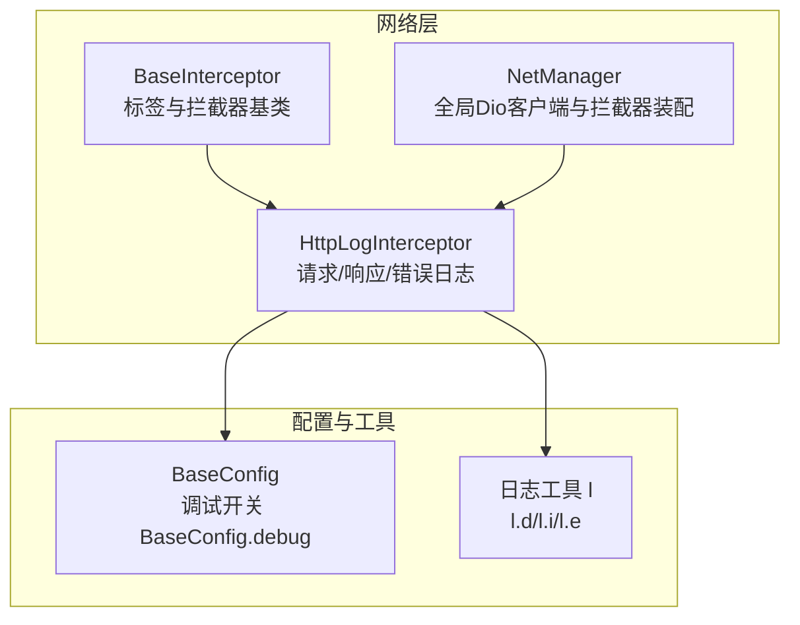
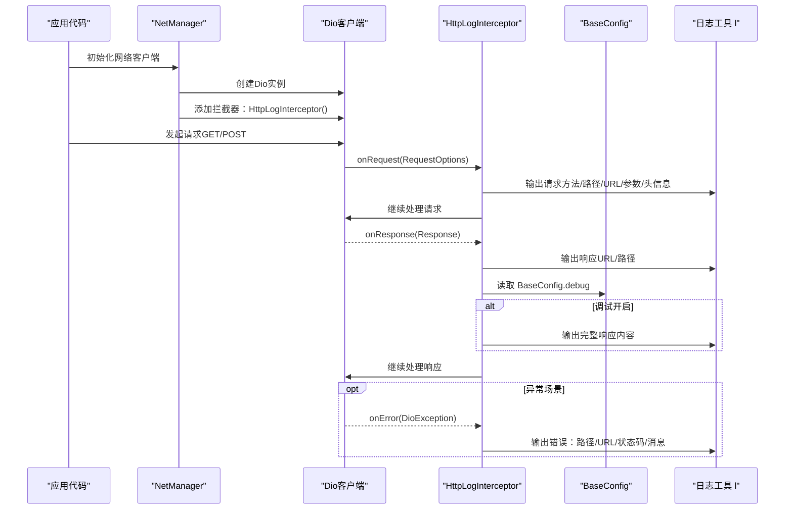
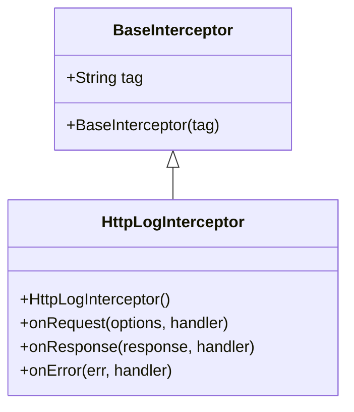
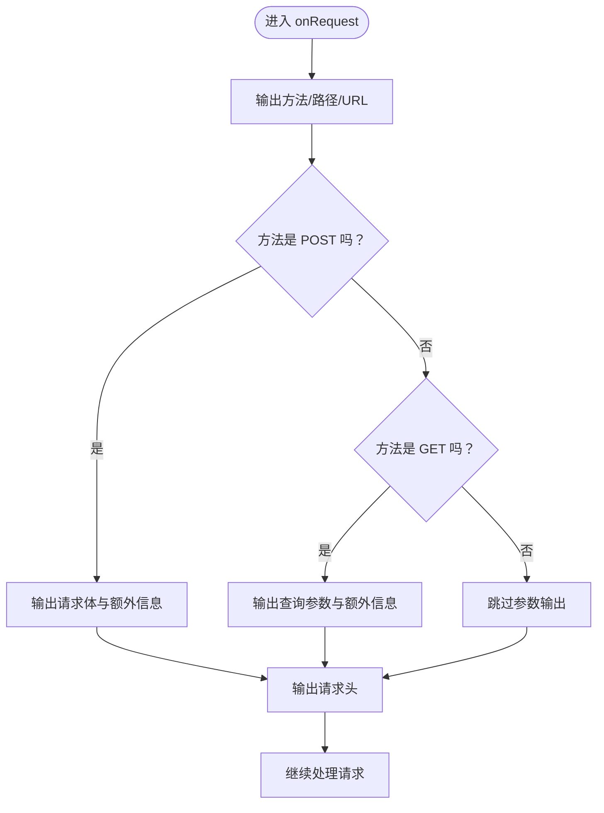
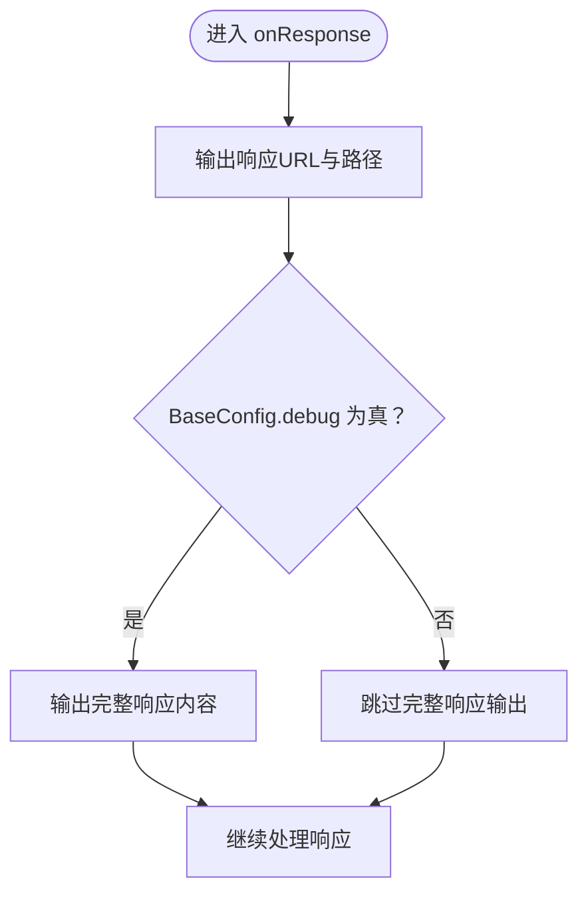
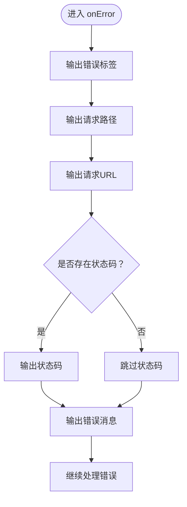
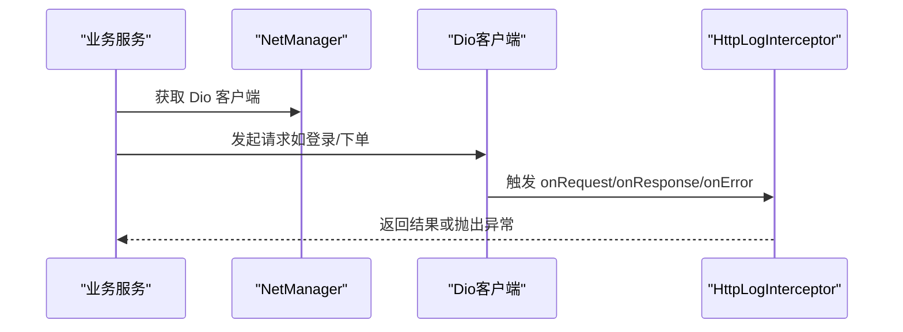
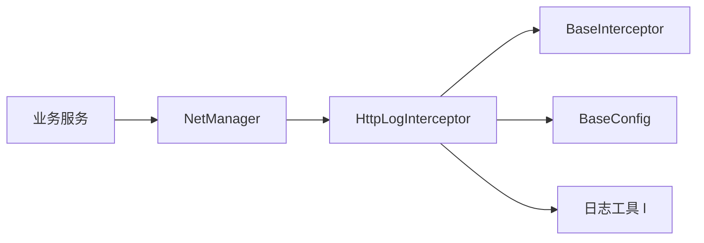

# 日志拦截器

<cite>
**本文引用的文件**
- [http_log_interceptor.dart](file://lib/net/http_log_interceptor.dart)
- [base_interceptor.dart](file://lib/net/base_interceptor.dart)
- [net_manager.dart](file://lib/net/net_manager.dart)
- [config.dart](file://lib/config/config.dart)
- [log.dart](file://lib/utils/log.dart)
- [auth_service.dart](file://lib/global/service/auth_service.dart)
- [oil_order_service.g.dart](file://lib/pages/main_oil_pay/service/oil_order_service.g.dart)
</cite>

## 目录
1. [简介](#简介)
2. [项目结构](#项目结构)
3. [核心组件](#核心组件)
4. [架构总览](#架构总览)
5. [详细组件分析](#详细组件分析)
6. [依赖关系分析](#依赖关系分析)
7. [性能考量](#性能考量)
8. [故障排查指南](#故障排查指南)
9. [结论](#结论)
10. [附录](#附录)

## 简介
本文深入解析 HttpLogInterceptor 的实现机制，重点说明其在请求阶段如何记录 HTTP 方法、路径、URL、查询参数（GET 请求）或请求体（POST 请求）以及请求头信息；在响应阶段如何依据 BaseConfig.debug 决定是否输出完整响应内容；onError 方法如何捕获并格式化网络异常（包含请求路径、状态码与错误消息）。同时，文档解释该拦截器与 BaseInterceptor 的继承关系及标签功能的使用方式，帮助开发者通过日志快速定位网络请求问题。

## 项目结构
HttpLogInterceptor 位于网络层模块中，作为 Dio 拦截器链的一部分被统一注册到全局网络客户端。其直接依赖：
- BaseInterceptor：提供通用拦截器包装能力与标签字段
- BaseConfig：提供调试开关 BaseConfig.debug
- utils/log：提供统一日志输出接口 l.d/l.i/l.e 等

图表来源
- [http_log_interceptor.dart](file://lib/net/http_log_interceptor.dart#L1-L60)
- [base_interceptor.dart](file://lib/net/base_interceptor.dart#L1-L8)
- [net_manager.dart](file://lib/net/net_manager.dart#L58-L60)
- [config.dart](file://lib/config/config.dart#L35-L36)
- [log.dart](file://lib/utils/log.dart#L1-L182)

章节来源
- [http_log_interceptor.dart](file://lib/net/http_log_interceptor.dart#L1-L60)
- [base_interceptor.dart](file://lib/net/base_interceptor.dart#L1-L8)
- [net_manager.dart](file://lib/net/net_manager.dart#L58-L60)
- [config.dart](file://lib/config/config.dart#L35-L36)
- [log.dart](file://lib/utils/log.dart#L1-L182)

## 核心组件
- HttpLogInterceptor：继承自 BaseInterceptor，负责在请求、响应、错误三个阶段输出结构化日志，并使用统一标签“http_log”进行区分。
- BaseInterceptor：提供 tag 字段，便于日志分组与过滤。
- NetManager：在初始化时向 Dio 客户端注册 HttpLogInterceptor，确保所有网络请求均经过该日志拦截器。
- BaseConfig：提供调试开关 BaseConfig.debug，影响响应阶段是否输出完整响应内容。
- 日志工具 l：封装 logger，提供 d/i/e 等级别输出，支持条件打印与文件写入等能力。

章节来源
- [http_log_interceptor.dart](file://lib/net/http_log_interceptor.dart#L1-L60)
- [base_interceptor.dart](file://lib/net/base_interceptor.dart#L1-L8)
- [net_manager.dart](file://lib/net/net_manager.dart#L58-L60)
- [config.dart](file://lib/config/config.dart#L35-L36)
- [log.dart](file://lib/utils/log.dart#L1-L182)

## 架构总览
下图展示了 HttpLogInterceptor 在 Dio 拦截器链中的位置与职责边界，以及与 NetManager、BaseConfig、日志工具的交互关系。

图表来源
- [net_manager.dart](file://lib/net/net_manager.dart#L58-L60)
- [http_log_interceptor.dart](file://lib/net/http_log_interceptor.dart#L10-L59)
- [config.dart](file://lib/config/config.dart#L35-L36)
- [log.dart](file://lib/utils/log.dart#L1-L182)

## 详细组件分析

### HttpLogInterceptor 类关系与职责
- 继承关系：HttpLogInterceptor -> BaseInterceptor -> InterceptorsWrapper
- 标签功能：构造函数传入 tag='http_log'，用于日志分组与过滤
- 生命周期钩子：
  - onRequest：记录请求方法、路径、URL、查询参数或请求体、请求头
  - onResponse：记录响应 URL/路径；当 BaseConfig.debug 为真时输出完整响应
  - onError：记录请求路径、URL、状态码与错误消息

图表来源
- [base_interceptor.dart](file://lib/net/base_interceptor.dart#L1-L8)
- [http_log_interceptor.dart](file://lib/net/http_log_interceptor.dart#L1-L60)

章节来源
- [http_log_interceptor.dart](file://lib/net/http_log_interceptor.dart#L1-L60)
- [base_interceptor.dart](file://lib/net/base_interceptor.dart#L1-L8)

### 请求阶段日志流程
- 记录项：
  - HTTP 方法、路径、完整 URL
  - GET 请求：输出查询参数与额外信息
  - POST 请求：输出请求体与额外信息
  - 请求头信息
- 流程图如下：

图表来源
- [http_log_interceptor.dart](file://lib/net/http_log_interceptor.dart#L10-L33)

章节来源
- [http_log_interceptor.dart](file://lib/net/http_log_interceptor.dart#L10-L33)

### 响应阶段日志流程
- 记录项：
  - 响应对应的 URL 与路径
  - 当 BaseConfig.debug 为真时，输出完整响应对象
- 流程图如下：

图表来源
- [http_log_interceptor.dart](file://lib/net/http_log_interceptor.dart#L35-L49)
- [config.dart](file://lib/config/config.dart#L35-L36)

章节来源
- [http_log_interceptor.dart](file://lib/net/http_log_interceptor.dart#L35-L49)
- [config.dart](file://lib/config/config.dart#L35-L36)

### 错误阶段日志流程
- 记录项：
  - 错误标签“服务器请求错误：”
  - 请求路径、URL、状态码（若存在）、错误消息
- 流程图如下：

图表来源
- [http_log_interceptor.dart](file://lib/net/http_log_interceptor.dart#L51-L58)

章节来源
- [http_log_interceptor.dart](file://lib/net/http_log_interceptor.dart#L51-L58)

### 实际使用与集成点
- 全局注册：NetManager 在初始化时向 Dio 客户端添加 HttpLogInterceptor，确保所有请求均被记录。
- 服务层使用：业务服务通过全局 Dio 客户端发起请求，例如 AuthService 与油品订单服务生成器等。

图表来源
- [net_manager.dart](file://lib/net/net_manager.dart#L58-L60)
- [auth_service.dart](file://lib/global/service/auth_service.dart#L38-L41)
- [oil_order_service.g.dart](file://lib/pages/main_oil_pay/service/oil_order_service.g.dart#L50-L68)

章节来源
- [net_manager.dart](file://lib/net/net_manager.dart#L58-L60)
- [auth_service.dart](file://lib/global/service/auth_service.dart#L38-L41)
- [oil_order_service.g.dart](file://lib/pages/main_oil_pay/service/oil_order_service.g.dart#L50-L68)

## 依赖关系分析
- HttpLogInterceptor 依赖：
  - BaseInterceptor：继承关系提供标签与拦截器框架
  - BaseConfig：读取调试开关以控制响应日志详尽程度
  - 日志工具 l：统一输出接口，支持多级别与条件打印
- NetManager 依赖：
  - 将 HttpLogInterceptor 注册到 Dio 客户端，形成拦截器链
- 业务服务依赖：
  - 通过全局 Dio 客户端发起请求，自动触发日志拦截器

图表来源
- [http_log_interceptor.dart](file://lib/net/http_log_interceptor.dart#L1-L60)
- [base_interceptor.dart](file://lib/net/base_interceptor.dart#L1-L8)
- [config.dart](file://lib/config/config.dart#L35-L36)
- [log.dart](file://lib/utils/log.dart#L1-L182)
- [net_manager.dart](file://lib/net/net_manager.dart#L58-L60)

章节来源
- [http_log_interceptor.dart](file://lib/net/http_log_interceptor.dart#L1-L60)
- [base_interceptor.dart](file://lib/net/base_interceptor.dart#L1-L8)
- [config.dart](file://lib/config/config.dart#L35-L36)
- [log.dart](file://lib/utils/log.dart#L1-L182)
- [net_manager.dart](file://lib/net/net_manager.dart#L58-L60)

## 性能考量
- 日志输出成本：请求/响应/错误阶段均会进行字符串拼接与日志输出，建议在生产环境关闭完整响应输出（BaseConfig.debug=false），仅保留必要字段，降低 I/O 与序列化开销。
- 条件输出：通过 BaseConfig.debug 控制响应完整内容输出，避免在非调试模式下输出大量冗余日志。
- 标签分组：使用统一标签“http_log”便于日志系统筛选与聚合，减少无关日志干扰。

## 故障排查指南
- 如何定位请求问题：
  - 查看请求阶段日志，确认方法、路径、URL、查询参数或请求体是否符合预期
  - 关注请求头是否包含必要的鉴权信息
- 如何定位响应问题：
  - 若 BaseConfig.debug 为真，可查看完整响应对象，核对状态码与响应体结构
  - 若为假，仅查看 URL/路径与状态码，结合业务逻辑判断
- 如何定位网络异常：
  - onError 输出包含请求路径、URL、状态码与错误消息，优先检查这些字段
  - 结合业务服务调用栈与 Dio 请求选项，复现并定位问题

章节来源
- [http_log_interceptor.dart](file://lib/net/http_log_interceptor.dart#L10-L59)
- [config.dart](file://lib/config/config.dart#L35-L36)

## 结论
HttpLogInterceptor 通过在请求、响应、错误三个阶段输出结构化日志，配合 BaseConfig.debug 的条件控制与统一标签“http_log”，为开发者提供了高效、可追踪的网络诊断能力。在开发与测试环境中启用完整响应输出，有助于快速定位问题；在生产环境中谨慎控制日志量，避免性能与隐私风险。

## 附录

### 日志输出示例（描述性说明）
- GET 请求示例
  - 请求阶段：输出方法、路径、URL、查询参数与请求头
  - 响应阶段：输出 URL/路径；若 BaseConfig.debug 为真，输出完整响应
- POST 请求示例
  - 请求阶段：输出方法、路径、URL、请求体与请求头
  - 响应阶段：输出 URL/路径；若 BaseConfig.debug 为真，输出完整响应
- 错误示例
  - onError：输出“服务器请求错误：”标签，以及请求路径、URL、状态码与错误消息

章节来源
- [http_log_interceptor.dart](file://lib/net/http_log_interceptor.dart#L10-L59)
- [config.dart](file://lib/config/config.dart#L35-L36)