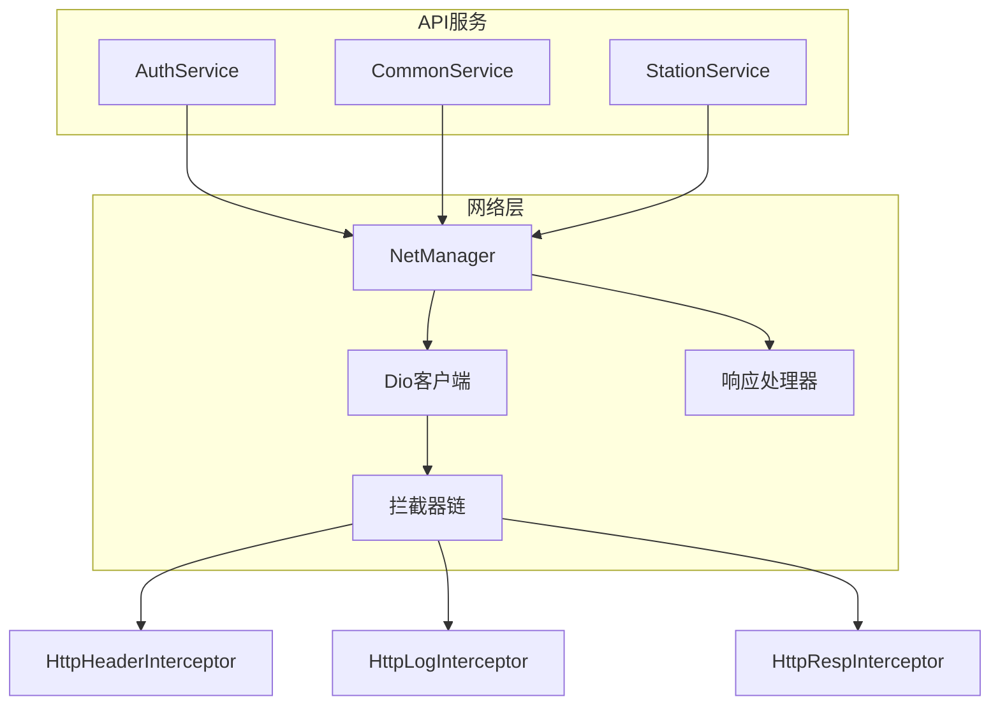
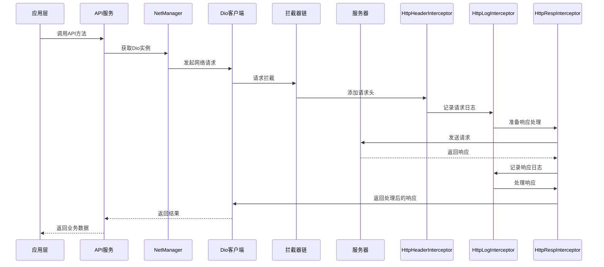
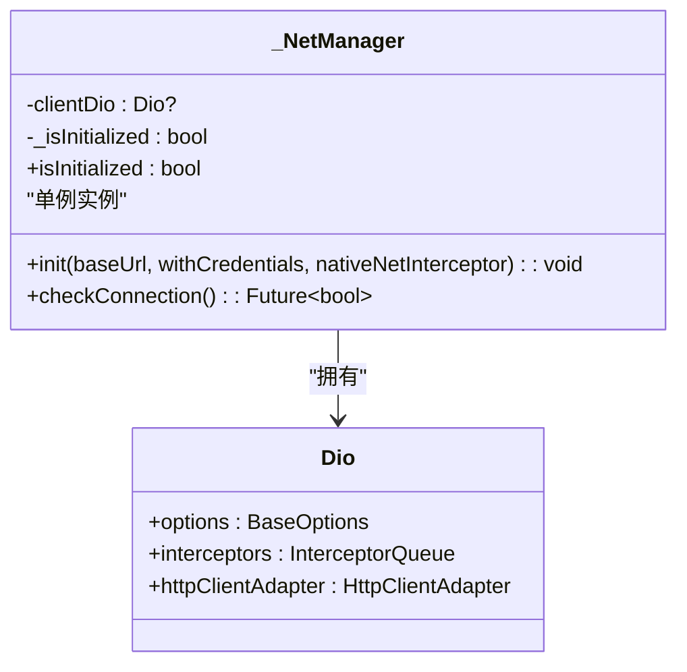
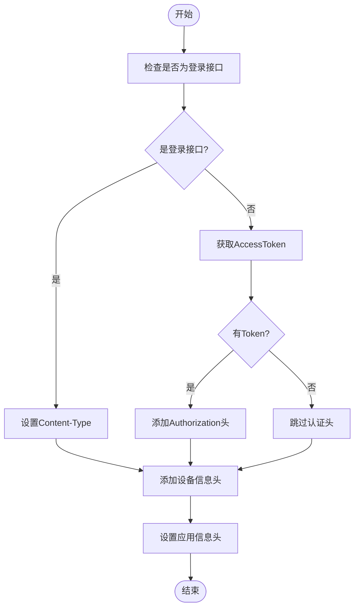
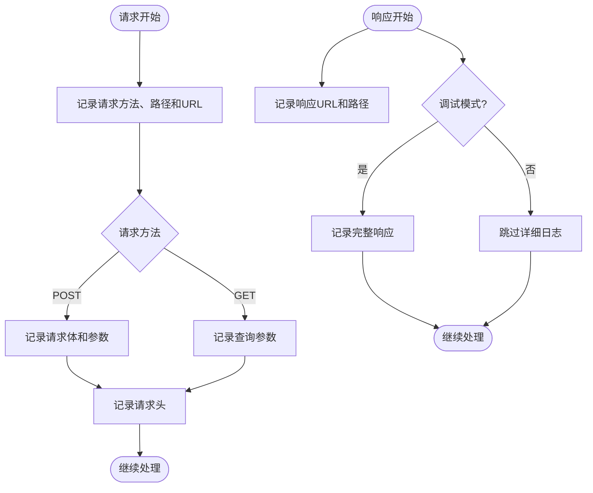
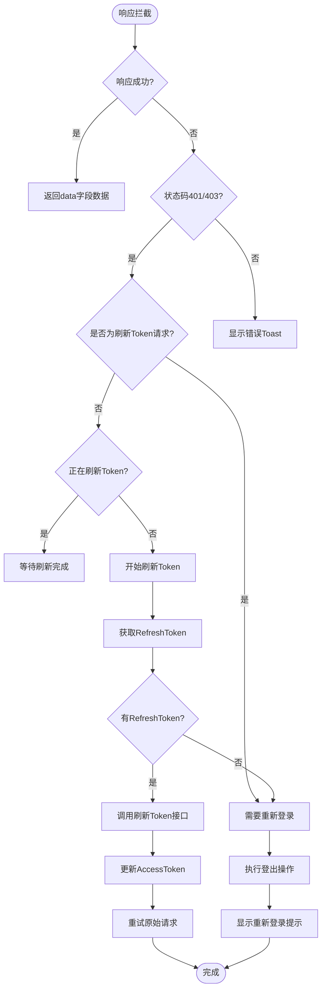
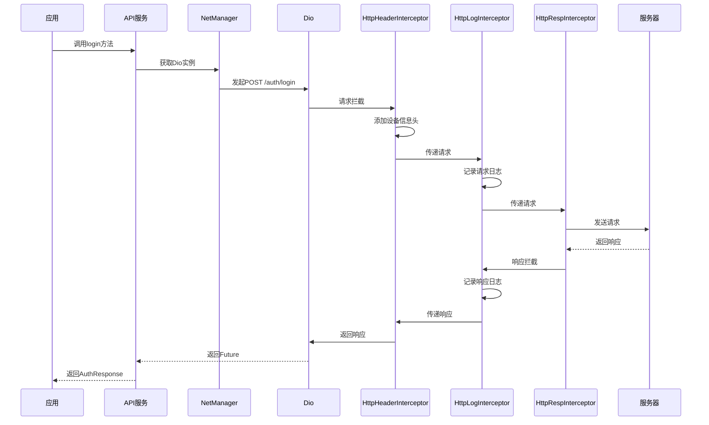
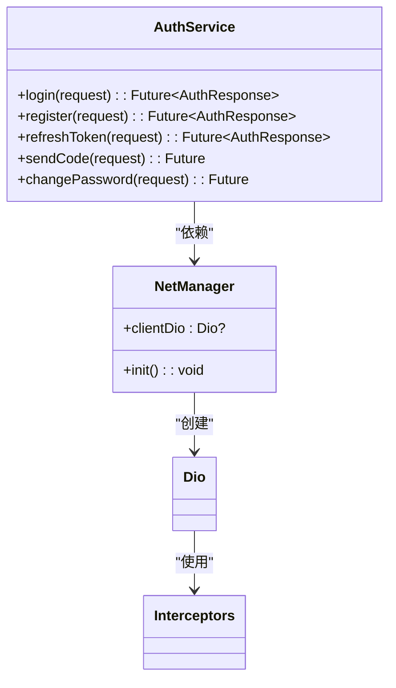
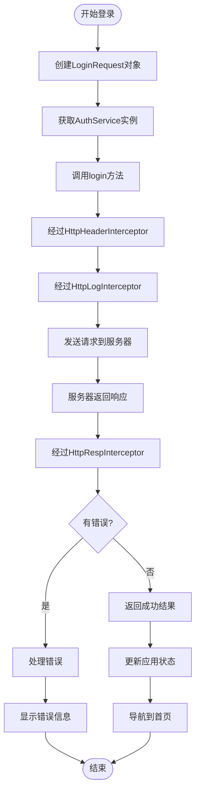
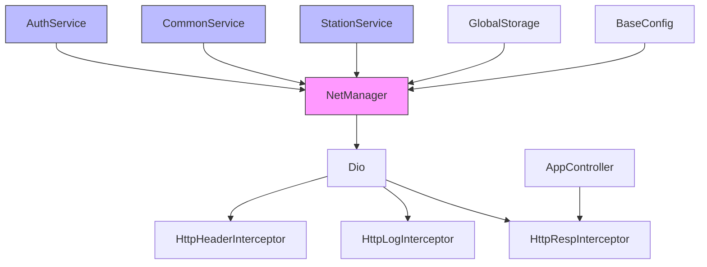

# 网络层

<cite>
**本文档引用文件**  
- [net_manager.dart](file://lib/net/net_manager.dart)
- [dio_io.dart](file://lib/net/dio_io.dart)
- [http_header_interceptor.dart](file://lib/net/http_header_interceptor.dart)
- [http_log_interceptor.dart](file://lib/net/http_log_interceptor.dart)
- [http_resp_interceptor.dart](file://lib/net/http_resp_interceptor.dart)
- [base_interceptor.dart](file://lib/net/base_interceptor.dart)
- [response.dart](file://lib/net/response.dart)
- [code.dart](file://lib/net/code.dart)
- [auth_service.dart](file://lib/global/service/auth_service.dart)
- [app_controller.dart](file://lib/global/app_controller.dart)
- [common_service.dart](file://lib/global/service/common_service.dart)
- [station_service.dart](file://lib/global/service/station_service.dart)
- [address.dart](file://lib/config/address.dart)
- [login/controller.dart](file://lib/pages/login/controller.dart)
- [auth_req_type.dart](file://lib/global/model/auth_req_type.dart)
</cite>

## 目录
1. [项目结构](#项目结构)
2. [核心组件](#核心组件)
3. [架构概述](#架构概述)
4. [详细组件分析](#详细组件分析)
5. [依赖分析](#依赖分析)
6. [性能考虑](#性能考虑)
7. [故障排除指南](#故障排除指南)

## 项目结构

油品业务App的网络层主要位于`lib/net/`目录下，包含Dio客户端管理、拦截器链、响应处理等核心功能。网络层与`lib/global/service/`目录下的Retrofit风格API服务集成，通过统一的NetManager进行管理。



**图示来源**  
- [net_manager.dart](file://lib/net/net_manager.dart#L1-L87)
- [http_header_interceptor.dart](file://lib/net/http_header_interceptor.dart#L1-L56)
- [http_log_interceptor.dart](file://lib/net/http_log_interceptor.dart#L1-L60)
- [http_resp_interceptor.dart](file://lib/net/http_resp_interceptor.dart#L1-L210)

**本节来源**  
- [lib/net/](file://lib/net/)
- [lib/global/service/](file://lib/global/service/)

## 核心组件

网络层的核心组件包括NetManager（网络管理器）、Dio客户端、拦截器链和API服务。NetManager负责Dio客户端的初始化和配置，拦截器链处理请求和响应的各个阶段，API服务通过Retrofit生成具体的网络请求方法。

**本节来源**  
- [net_manager.dart](file://lib/net/net_manager.dart#L1-L87)
- [auth_service.dart](file://lib/global/service/auth_service.dart#L1-L40)

## 架构概述

油品业务App的网络层采用分层架构设计，基于Dio库构建，通过拦截器模式实现请求和响应的统一处理。整个网络请求流程包括Dio客户端初始化、拦截器链处理、API服务调用和响应解析等阶段。



**图示来源**  
- [net_manager.dart](file://lib/net/net_manager.dart#L1-L87)
- [http_header_interceptor.dart](file://lib/net/http_header_interceptor.dart#L1-L56)
- [http_log_interceptor.dart](file://lib/net/http_log_interceptor.dart#L1-L60)
- [http_resp_interceptor.dart](file://lib/net/http_resp_interceptor.dart#L1-L210)

## 详细组件分析

### NetManager实现分析

NetManager是网络层的核心管理器，负责Dio客户端的初始化、配置和生命周期管理。它采用单例模式，确保整个应用使用同一个Dio实例。

#### Dio客户端初始化与配置

NetManager通过`init`方法初始化Dio客户端，配置超时时间、基础URL和拦截器链。Dio客户端的超时时间设置为30秒，包括连接、接收和发送超时。



**图示来源**  
- [net_manager.dart](file://lib/net/net_manager.dart#L21-L87)
- [dio_io.dart](file://lib/net/dio_io.dart#L4-L13)

**本节来源**  
- [net_manager.dart](file://lib/net/net_manager.dart#L1-L87)
- [dio_io.dart](file://lib/net/dio_io.dart#L1-L22)

#### 代理设置

NetManager支持代理设置，通过读取`GlobalStorage.proxyUri`配置来设置HTTP代理。如果配置了代理地址，会创建自定义的HttpClient并设置代理规则。

```dart
final proxyUri = GlobalStorage.proxyUri;
if (proxyUri.isNotEmpty) {
  (dio.httpClientAdapter as IOHttpClientAdapter).createHttpClient = () {
    final client = HttpClient();
    client.badCertificateCallback = (cert, host, port) => true;
    client.findProxy = (uri) => "PROXY $proxyUri";
    return client;
  };
}
```

**本节来源**  
- [net_manager.dart](file://lib/net/net_manager.dart#L47-L56)

### 拦截器链设计

网络层采用拦截器链模式，通过多个拦截器处理请求和响应的不同阶段。拦截器链包括HttpHeaderInterceptor、HttpLogInterceptor和HttpRespInterceptor三个主要拦截器。

#### HttpHeaderInterceptor分析

HttpHeaderInterceptor负责为每个请求添加必要的请求头，包括认证Token和设备信息。对于非登录接口，会自动添加Bearer Token认证头。



**图示来源**  
- [http_header_interceptor.dart](file://lib/net/http_header_interceptor.dart#L8-L56)

**本节来源**  
- [http_header_interceptor.dart](file://lib/net/http_header_interceptor.dart#L1-L56)
- [app_controller.dart](file://lib/global/app_controller.dart#L50-L52)

#### HttpLogInterceptor分析

HttpLogInterceptor负责记录网络请求和响应的日志，便于调试和问题排查。在调试模式下，会输出详细的请求和响应信息。



**图示来源**  
- [http_log_interceptor.dart](file://lib/net/http_log_interceptor.dart#L7-L60)

**本节来源**  
- [http_log_interceptor.dart](file://lib/net/http_log_interceptor.dart#L1-L60)
- [utils/log.dart](file://lib/utils/log.dart)

#### HttpRespInterceptor分析

HttpRespInterceptor是响应处理的核心拦截器，负责统一处理服务器响应、错误处理和Token刷新机制。它实现了自动Token刷新功能，当检测到401错误时，会自动尝试刷新Token并重试原始请求。



**图示来源**  
- [http_resp_interceptor.dart](file://lib/net/http_resp_interceptor.dart#L16-L210)
- [code.dart](file://lib/net/code.dart#L3-L12)

**本节来源**  
- [http_resp_interceptor.dart](file://lib/net/http_resp_interceptor.dart#L1-L210)
- [code.dart](file://lib/net/code.dart#L1-L13)
- [app_controller.dart](file://lib/global/app_controller.dart#L111-L116)

### 网络请求生命周期

网络请求的完整生命周期从发起请求开始，经过拦截器链处理，到响应解析结束。每个阶段都有明确的职责和处理逻辑。



**图示来源**  
- [net_manager.dart](file://lib/net/net_manager.dart#L1-L87)
- [http_header_interceptor.dart](file://lib/net/http_header_interceptor.dart#L1-L56)
- [http_log_interceptor.dart](file://lib/net/http_log_interceptor.dart#L1-L60)
- [http_resp_interceptor.dart](file://lib/net/http_resp_interceptor.dart#L1-L210)

**本节来源**  
- [net_manager.dart](file://lib/net/net_manager.dart#L1-L87)
- [http_header_interceptor.dart](file://lib/net/http_header_interceptor.dart#L1-L56)
- [http_log_interceptor.dart](file://lib/net/http_log_interceptor.dart#L1-L60)
- [http_resp_interceptor.dart](file://lib/net/http_resp_interceptor.dart#L1-L210)

### API服务集成

网络层通过Retrofit生成的API服务与Dio客户端集成，实现了声明式的API调用方式。每个API服务都通过NetManager获取Dio实例，确保使用统一的网络配置。

#### AuthService集成分析

AuthService是用户认证相关的API服务，定义了登录、注册、刷新Token等接口。它通过NetManager获取Dio实例，确保使用统一的拦截器链和配置。



**图示来源**  
- [auth_service.dart](file://lib/global/service/auth_service.dart#L1-L40)
- [net_manager.dart](file://lib/net/net_manager.dart#L1-L87)

**本节来源**  
- [auth_service.dart](file://lib/global/service/auth_service.dart#L1-L40)
- [net_manager.dart](file://lib/net/net_manager.dart#L1-L87)

#### 服务实例获取方式

API服务实例通过getter方式获取，确保在需要时才创建实例，并且始终使用NetManager中的Dio实例。这种方式实现了延迟初始化和单例模式的结合。

```dart
AuthService get authService => AuthService(netManager.clientDio ?? Dio());
```

**本节来源**  
- [auth_service.dart](file://lib/global/service/auth_service.dart#L40)
- [common_service.dart](file://lib/global/service/common_service.dart#L20-L24)

### API调用示例

以下是一个完整的API调用示例，展示了如何使用AuthService进行用户登录。



**图示来源**  
- [login/controller.dart](file://lib/pages/login/controller.dart#L142-L154)
- [auth_service.dart](file://lib/global/service/auth_service.dart#L16)
- [app_controller.dart](file://lib/global/app_controller.dart#L63-L70)

**本节来源**  
- [login/controller.dart](file://lib/pages/login/controller.dart#L1-L354)
- [auth_req_type.dart](file://lib/global/model/auth_req_type.dart#L44-L59)

## 依赖分析

网络层的依赖关系清晰，采用分层架构设计，各组件职责明确。NetManager作为核心组件，被所有API服务依赖；拦截器链作为Dio的扩展，处理请求和响应的各个阶段。



**图示来源**  
- [net_manager.dart](file://lib/net/net_manager.dart#L1-L87)
- [auth_service.dart](file://lib/global/service/auth_service.dart#L1-L40)
- [common_service.dart](file://lib/global/service/common_service.dart#L1-L24)
- [station_service.dart](file://lib/global/service/station_service.dart#L1-L47)
- [app_controller.dart](file://lib/global/app_controller.dart#L4-L11)

**本节来源**  
- [net_manager.dart](file://lib/net/net_manager.dart#L1-L87)
- [auth_service.dart](file://lib/global/service/auth_service.dart#L1-L40)
- [common_service.dart](file://lib/global/service/common_service.dart#L1-L24)
- [station_service.dart](file://lib/global/service/station_service.dart#L1-L47)

## 性能考虑

网络层在性能方面做了多项优化，包括合理的超时设置、高效的拦截器链设计和自动的Token刷新机制。这些优化确保了网络请求的稳定性和用户体验。

- **超时设置**：连接、接收和发送超时均设置为30秒，平衡了用户体验和网络稳定性
- **拦截器效率**：拦截器链采用责任链模式，每个拦截器只关注特定功能，避免重复处理
- **Token刷新**：自动Token刷新机制减少了用户重新登录的频率，提升了用户体验
- **日志控制**：在生产环境中可以关闭详细日志，减少性能开销

**本节来源**  
- [net_manager.dart](file://lib/net/net_manager.dart#L11-L15)
- [http_log_interceptor.dart](file://lib/net/http_log_interceptor.dart#L41-L46)

## 故障排除指南

### 常见问题及解决方案

1. **网络请求超时**
   - 检查网络连接是否正常
   - 确认服务器地址配置正确
   - 检查是否有代理设置影响网络连接

2. **401错误（认证失效）**
   - 确认AccessToken是否已过期
   - 检查RefreshToken是否有效
   - 确认HttpRespInterceptor的Token刷新逻辑是否正常工作

3. **请求头缺失**
   - 检查HttpHeaderInterceptor是否正确添加了必要的请求头
   - 确认设备信息是否正确获取
   - 验证Content-Type是否根据请求方法正确设置

4. **响应解析失败**
   - 检查服务器返回的数据格式是否符合预期
   - 确认BaseResponse的fromJson方法是否能正确解析数据
   - 验证HttpRespInterceptor的响应处理逻辑

**本节来源**  
- [http_resp_interceptor.dart](file://lib/net/http_resp_interceptor.dart#L50-L154)
- [http_header_interceptor.dart](file://lib/net/http_header_interceptor.dart#L16-L54)
- [response.dart](file://lib/net/response.dart#L9-L16)