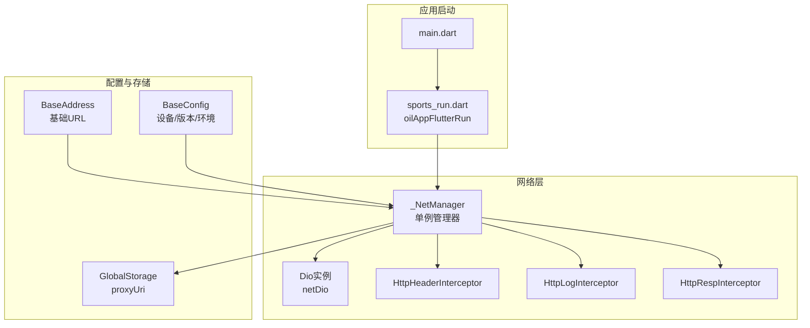
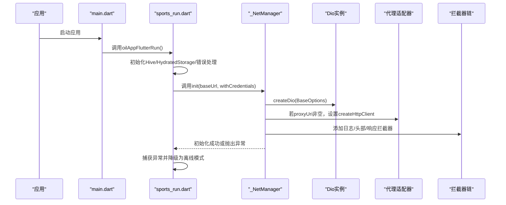
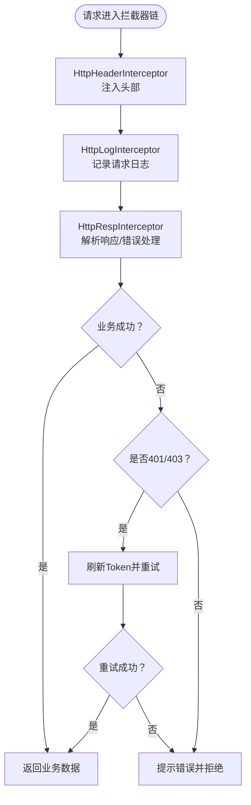
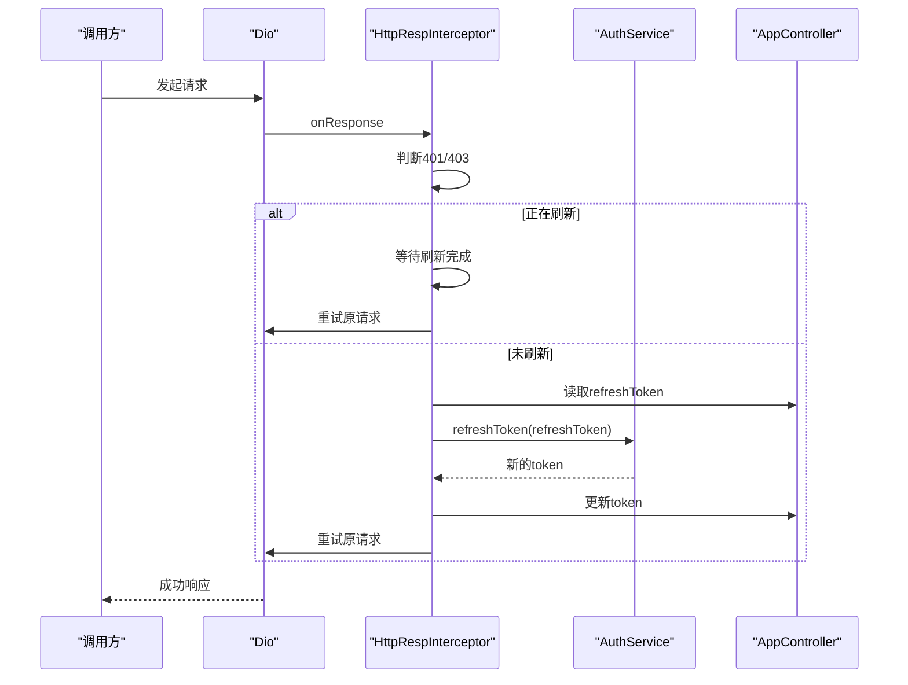
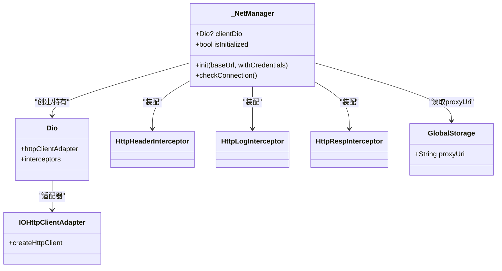

# 网络管理器

<cite>
**本文引用的文件**
- [net_manager.dart](file://lib/net/net_manager.dart)
- [dio_io.dart](file://lib/net/dio_io.dart)
- [http_header_interceptor.dart](file://lib/net/http_header_interceptor.dart)
- [http_log_interceptor.dart](file://lib/net/http_log_interceptor.dart)
- [http_resp_interceptor.dart](file://lib/net/http_resp_interceptor.dart)
- [base_interceptor.dart](file://lib/net/base_interceptor.dart)
- [storage.dart](file://lib/global/storage.dart)
- [address.dart](file://lib/config/address.dart)
- [config.dart](file://lib/config/config.dart)
- [sports_run.dart](file://lib/sports_run.dart)
- [main.dart](file://lib/main.dart)
- [auth_rep_type.dart](file://lib/global/model/auth_rep_type.dart)
</cite>

## 目录
1. [简介](#简介)
2. [项目结构](#项目结构)
3. [核心组件](#核心组件)
4. [架构总览](#架构总览)
5. [详细组件分析](#详细组件分析)
6. [依赖关系分析](#依赖关系分析)
7. [性能考量](#性能考量)
8. [故障排查指南](#故障排查指南)
9. [结论](#结论)
10. [附录](#附录)

## 简介
本文件围绕网络管理器（NetManager）进行系统化技术文档整理，重点覆盖：
- 单例模式实现的_netManager实例与全局Dio客户端（netDio）的初始化流程
- init方法对Dio客户端的超时时间（连接、接收、发送均为30秒）、基础URL与凭据设置的配置
- 代理配置机制：通过GlobalStorage.proxyUri动态设置HTTP代理，并处理SSL证书验证
- 网络连接状态检查功能（checkConnection）的实现逻辑
- 应用启动时初始化网络层的完整示例与异常处理策略
- 结合实际代码说明Dio客户端创建流程与配置参数的最佳实践

## 项目结构
网络层相关代码集中在lib/net目录，配合全局存储与地址配置：
- lib/net/net_manager.dart：网络管理器单例、Dio初始化、代理与拦截器装配、连接状态检查
- lib/net/dio_io.dart：Dio实例工厂方法
- lib/net/http_header_interceptor.dart：统一请求头注入（含鉴权、设备信息等）
- lib/net/http_log_interceptor.dart：请求/响应日志与错误日志
- lib/net/http_resp_interceptor.dart：业务响应解析、错误处理与Token刷新重试
- lib/global/storage.dart：全局存储（含proxyUri）
- lib/config/address.dart：环境域名与基础路径
- lib/config/config.dart：基础配置（设备信息、版本信息、环境变量）
- lib/sports_run.dart：应用启动流程，包含网络初始化与异常降级
- lib/main.dart：入口文件，触发基础配置初始化

图表来源
- [net_manager.dart](file://lib/net/net_manager.dart#L1-L87)
- [dio_io.dart](file://lib/net/dio_io.dart#L1-L22)
- [http_header_interceptor.dart](file://lib/net/http_header_interceptor.dart#L1-L56)
- [http_log_interceptor.dart](file://lib/net/http_log_interceptor.dart#L1-L60)
- [http_resp_interceptor.dart](file://lib/net/http_resp_interceptor.dart#L1-L210)
- [storage.dart](file://lib/global/storage.dart#L1-L34)
- [address.dart](file://lib/config/address.dart#L1-L40)
- [config.dart](file://lib/config/config.dart#L1-L108)
- [sports_run.dart](file://lib/sports_run.dart#L1-L117)
- [main.dart](file://lib/main.dart#L1-L22)

章节来源
- [net_manager.dart](file://lib/net/net_manager.dart#L1-L87)
- [address.dart](file://lib/config/address.dart#L1-L40)
- [storage.dart](file://lib/global/storage.dart#L1-L34)
- [sports_run.dart](file://lib/sports_run.dart#L1-L117)
- [main.dart](file://lib/main.dart#L1-L22)

## 核心组件
- 单例管理器：_NetManager负责创建与持有Dio实例，提供初始化与连接状态检查能力
- 全局Dio：通过netManager.clientDio暴露给全局使用
- 拦截器体系：请求头注入、日志记录、响应解析与错误处理
- 代理与证书：基于GlobalStorage.proxyUri动态配置HTTP代理与SSL证书回调
- 启动流程：在应用启动阶段安全地初始化网络层，失败时降级为离线模式

章节来源
- [net_manager.dart](file://lib/net/net_manager.dart#L1-L87)
- [http_header_interceptor.dart](file://lib/net/http_header_interceptor.dart#L1-L56)
- [http_log_interceptor.dart](file://lib/net/http_log_interceptor.dart#L1-L60)
- [http_resp_interceptor.dart](file://lib/net/http_resp_interceptor.dart#L1-L210)
- [storage.dart](file://lib/global/storage.dart#L1-L34)
- [sports_run.dart](file://lib/sports_run.dart#L1-L117)

## 架构总览
下图展示了从应用启动到网络初始化的关键交互与职责划分。

图表来源
- [sports_run.dart](file://lib/sports_run.dart#L58-L75)
- [net_manager.dart](file://lib/net/net_manager.dart#L30-L77)
- [dio_io.dart](file://lib/net/dio_io.dart#L1-L22)
- [storage.dart](file://lib/global/storage.dart#L16-L20)

## 详细组件分析

### 单例模式与全局Dio客户端
- 单例实现：通过final netManager = _NetManager()创建全局唯一实例；对外仅暴露clientDio与isInitialized
- 全局Dio：通过final netDio = netManager.clientDio在模块间共享Dio实例
- 初始化状态：_isInitialized用于标记初始化结果，供checkConnection判断

章节来源
- [net_manager.dart](file://lib/net/net_manager.dart#L17-L29)

### init方法：Dio客户端配置与装配
- 超时时间：连接、发送、接收均设置为30秒
- 基础URL：由外部传入的baseUrl决定
- 响应类型：默认JSON
- 凭据设置：withCredentials控制跨域请求是否携带凭据
- 拦截器装配：按顺序添加日志、头部、响应拦截器
- 初始化成功/失败：成功后更新_isInitialized为true；失败时记录错误并抛出

章节来源
- [net_manager.dart](file://lib/net/net_manager.dart#L30-L77)
- [dio_io.dart](file://lib/net/dio_io.dart#L1-L22)

### 代理配置机制与SSL证书处理
- 动态代理：若GlobalStorage.proxyUri非空，则通过IOHttpClientAdapter.createHttpClient自定义HttpClient
- 代理行为：设置findProxy为“PROXY <proxyUri>”，使所有请求走代理
- SSL证书：设置badCertificateCallback始终返回true，绕过证书校验（生产环境需谨慎）

章节来源
- [net_manager.dart](file://lib/net/net_manager.dart#L47-L56)
- [storage.dart](file://lib/global/storage.dart#L16-L20)

### 网络连接状态检查
- checkConnection：当_isInitialized为false或clientDio为空时返回false；否则返回true
- 注意：该方法仅检查初始化状态，不执行实际的连通性探测

章节来源
- [net_manager.dart](file://lib/net/net_manager.dart#L79-L87)

### 拦截器链详解
- HttpHeaderInterceptor：统一注入Content-Type、Authorization、设备信息等头部；登录接口特殊处理
- HttpLogInterceptor：打印请求/响应日志，调试模式下输出更详细内容
- HttpRespInterceptor：解析业务响应、处理401/403自动刷新Token并重试；其他错误弹Toast并拒绝请求

图表来源
- [http_header_interceptor.dart](file://lib/net/http_header_interceptor.dart#L1-L56)
- [http_log_interceptor.dart](file://lib/net/http_log_interceptor.dart#L1-L60)
- [http_resp_interceptor.dart](file://lib/net/http_resp_interceptor.dart#L1-L210)

章节来源
- [http_header_interceptor.dart](file://lib/net/http_header_interceptor.dart#L1-L56)
- [http_log_interceptor.dart](file://lib/net/http_log_interceptor.dart#L1-L60)
- [http_resp_interceptor.dart](file://lib/net/http_resp_interceptor.dart#L1-L210)

### Token刷新与重试流程
- 触发条件：响应码为401或403且非刷新接口自身
- 并发控制：使用静态Completer与标志位保证同一时刻仅一次刷新
- 刷新失败：清理认证信息并提示重新登录
- 重试策略：刷新成功后更新Authorization并重新发起原请求

图表来源
- [http_resp_interceptor.dart](file://lib/net/http_resp_interceptor.dart#L50-L209)
- [auth_rep_type.dart](file://lib/global/model/auth_rep_type.dart#L1-L46)

章节来源
- [http_resp_interceptor.dart](file://lib/net/http_resp_interceptor.dart#L50-L209)
- [auth_rep_type.dart](file://lib/global/model/auth_rep_type.dart#L1-L46)

### 应用启动时的初始化与异常处理
- 启动顺序：main -> oilAppFlutterRun -> 初始化Hive/HydratedStorage/错误处理 -> 初始化GlobalStorage/BaseConfig -> 初始化NetManager
- 异常处理：捕获NetManager.init异常，记录错误并以离线模式继续运行
- 基础URL来源：BaseAddress.baseApiPath提供baseUrl

章节来源
- [main.dart](file://lib/main.dart#L1-L22)
- [sports_run.dart](file://lib/sports_run.dart#L58-L75)
- [address.dart](file://lib/config/address.dart#L21-L23)

## 依赖关系分析
- 组件耦合
  - _NetManager依赖Dio、IOHttpClientAdapter、拦截器、GlobalStorage
  - 拦截器依赖BaseConfig、AppController、BaseResponse等
  - 启动流程依赖BaseAddress与BaseConfig
- 外部依赖
  - Dart IO、Dio、Hive、Flutter Bloc等

图表来源
- [net_manager.dart](file://lib/net/net_manager.dart#L1-L87)
- [http_header_interceptor.dart](file://lib/net/http_header_interceptor.dart#L1-L56)
- [http_log_interceptor.dart](file://lib/net/http_log_interceptor.dart#L1-L60)
- [http_resp_interceptor.dart](file://lib/net/http_resp_interceptor.dart#L1-L210)
- [storage.dart](file://lib/global/storage.dart#L1-L34)

章节来源
- [net_manager.dart](file://lib/net/net_manager.dart#L1-L87)
- [http_header_interceptor.dart](file://lib/net/http_header_interceptor.dart#L1-L56)
- [http_log_interceptor.dart](file://lib/net/http_log_interceptor.dart#L1-L60)
- [http_resp_interceptor.dart](file://lib/net/http_resp_interceptor.dart#L1-L210)
- [storage.dart](file://lib/global/storage.dart#L1-L34)

## 性能考量
- 超时设置：30秒的连接/发送/接收超时适合移动端网络，建议根据业务场景调整
- 拦截器顺序：日志/头部/响应拦截器顺序合理，避免重复解析
- 代理与证书：代理会增加一层网络开销；badCertificateCallback绕过证书校验可能带来安全风险，建议仅在开发/测试环境使用
- Token刷新：并发控制避免风暴请求，但需注意刷新接口自身的稳定性

[本节为通用指导，无需特定文件引用]

## 故障排查指南
- 初始化失败
  - 现象：NetManager.init抛出异常，日志记录“网络管理器初始化失败”
  - 排查：检查baseUrl格式、网络权限、代理配置、证书问题
  - 处理：应用已捕获异常并降级为离线模式
- 代理无效
  - 现象：请求未走代理
  - 排查：确认GlobalStorage.proxyUri已正确写入；代理地址格式是否有效
- 401/403频繁
  - 现象：响应拦截器持续刷新Token并重试
  - 排查：refreshToken是否为空；服务端是否正常；网络是否稳定
- 日志定位
  - 使用HttpLogInterceptor输出的请求/响应信息定位问题

章节来源
- [net_manager.dart](file://lib/net/net_manager.dart#L72-L76)
- [sports_run.dart](file://lib/sports_run.dart#L60-L65)
- [http_log_interceptor.dart](file://lib/net/http_log_interceptor.dart#L1-L60)
- [http_resp_interceptor.dart](file://lib/net/http_resp_interceptor.dart#L140-L155)

## 结论
- NetManager采用单例模式提供全局Dio实例，init方法集中配置超时、基础URL、凭据与拦截器
- 代理与SSL处理通过IOHttpClientAdapter实现，便于在不同环境下灵活切换
- 响应拦截器实现了完善的业务错误处理与Token刷新重试机制
- 启动流程对初始化异常进行了优雅降级，提升用户体验
- 建议在生产环境谨慎使用代理与证书豁免策略，优先通过正规渠道解决网络与证书问题

[本节为总结，无需特定文件引用]

## 附录

### 初始化最佳实践
- 基础URL选择：优先使用BaseAddress提供的环境地址，确保与后端一致
- 凭据设置：跨域请求如需携带Cookie/凭据，withCredentials设为true
- 代理配置：仅在需要抓包/内网穿透时启用；生产环境建议关闭
- 拦截器顺序：保持日志、头部、响应拦截器的默认顺序，避免破坏业务逻辑
- 错误处理：在启动阶段捕获异常并降级，保证应用可用性

章节来源
- [address.dart](file://lib/config/address.dart#L21-L23)
- [net_manager.dart](file://lib/net/net_manager.dart#L30-L77)
- [sports_run.dart](file://lib/sports_run.dart#L58-L75)