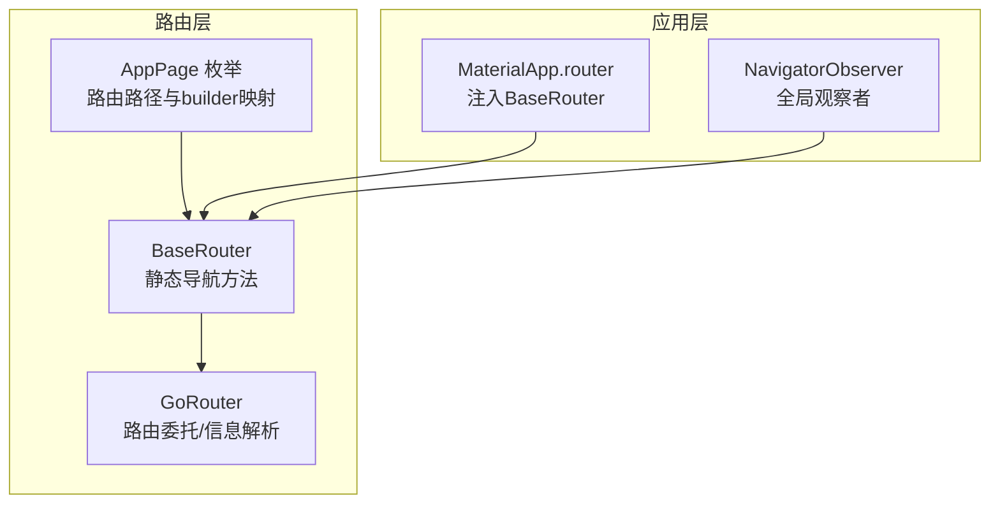
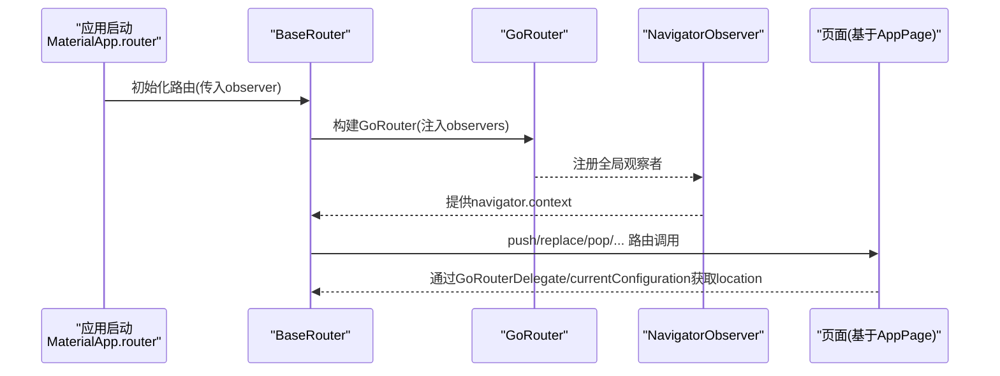
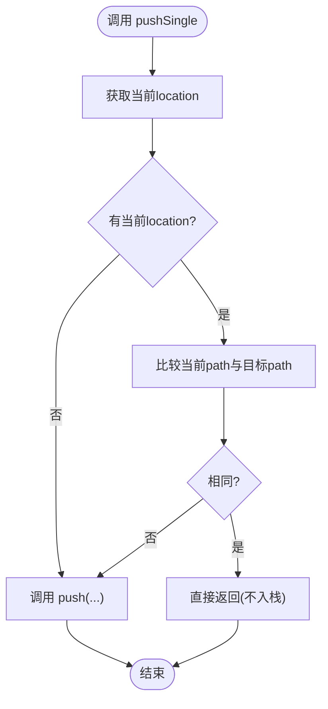
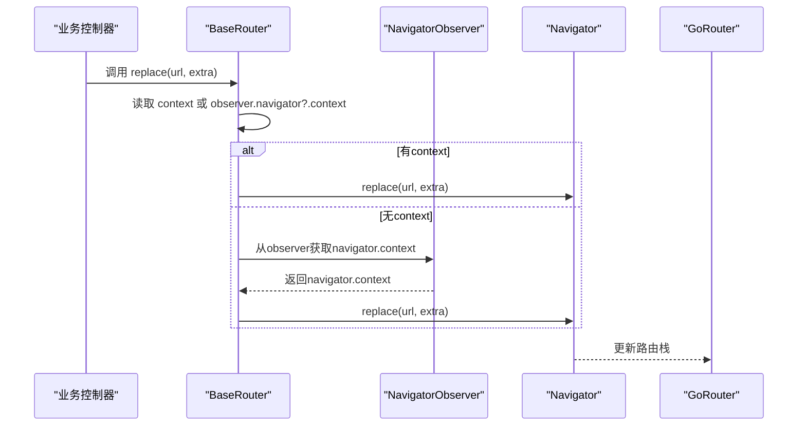
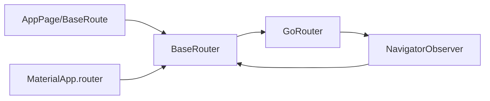

# 导航方法

<cite>
**本文引用的文件**
- [router.dart](file://lib/router/router.dart)
- [routes.dart](file://lib/router/routes.dart)
- [app.dart](file://lib/app.dart)
- [login/controller.dart](file://lib/pages/login/controller.dart)
- [navigation_test.dart](file://test/pages/forgot_password/navigation_test.dart)
- [base_page.dart](file://lib/widgets/common/base_page.dart)
- [use_detached.dart](file://lib/hooks/use_detached.dart)
- [project.md](file://openspec/project.md)
</cite>

## 目录
1. [简介](#简介)
2. [项目结构](#项目结构)
3. [核心组件](#核心组件)
4. [架构总览](#架构总览)
5. [详细组件分析](#详细组件分析)
6. [依赖分析](#依赖分析)
7. [性能考量](#性能考量)
8. [故障排查指南](#故障排查指南)
9. [结论](#结论)
10. [附录](#附录)

## 简介
本文件聚焦于油品业务App中的导航体系，系统性梳理BaseRouter类提供的静态导航方法，包括push、replace、pop、popToRoot、pushSingle以及popUtil等方法的实现原理、使用场景与最佳实践，并解释全局NavigatorObserver如何在无BuildContext的情况下仍能完成页面导航。同时结合业务场景（如登录成功后使用replace跳转主界面、提油成功后使用popToRoot返回首页）说明导航与页面生命周期的交互关系及异常处理机制。

## 项目结构
导航相关的核心代码集中在router目录，路由定义与页面映射在routes.dart中，全局路由配置与导航入口在router.dart中，应用启动时通过app.dart将BaseRouter注入MaterialApp.router。

图表来源
- [router.dart](file://lib/router/router.dart#L1-L227)
- [routes.dart](file://lib/router/routes.dart#L1-L260)
- [app.dart](file://lib/app.dart#L1-L92)

章节来源
- [router.dart](file://lib/router/router.dart#L1-L227)
- [routes.dart](file://lib/router/routes.dart#L1-L260)
- [app.dart](file://lib/app.dart#L1-L92)

## 核心组件
- BaseRouter：封装静态导航方法，统一处理BuildContext缺失的情况，提供push、replace、pop、popToRoot、pushSingle、popUtil等能力，并暴露location、routerDelegate、routeInformationParser等路由上下文访问入口。
- AppPage枚举与BaseRoute：以枚举形式声明所有页面路径与builder/pageBuilder映射，便于集中管理与扩展。
- NavigatorObserver：作为全局观察者，被BaseRouter持有并在初始化时注入GoRouter，使BaseRouter能在无BuildContext时也能获取navigator上下文执行导航。

章节来源
- [router.dart](file://lib/router/router.dart#L1-L227)
- [routes.dart](file://lib/router/routes.dart#L1-L260)

## 架构总览
下图展示BaseRouter与GoRouter、AppPage以及应用启动的关系，以及全局观察者的作用。

图表来源
- [app.dart](file://lib/app.dart#L1-L92)
- [router.dart](file://lib/router/router.dart#L50-L115)
- [router.dart](file://lib/router/router.dart#L127-L227)
- [routes.dart](file://lib/router/routes.dart#L1-L260)

## 详细组件分析

### BaseRouter静态导航方法详解
- push(url, extra, context?)
  - 功能：向当前navigator压入新页面。
  - 实现要点：优先使用传入context；若为空则使用全局observer持有的navigator.context；若仍为空则记录错误日志并返回空Future。
  - 使用场景：从列表进入详情、从表单进入预览等常规跳转。
  - 章节来源
    - [router.dart](file://lib/router/router.dart#L137-L148)

- replace(url, extra, context?)
  - 功能：替换当前页面，不产生历史记录。
  - 实现要点：同push，但调用navigator.replace。
  - 使用场景：登录成功后替换到主页，避免返回键回到登录页。
  - 章节来源
    - [router.dart](file://lib/router/router.dart#L127-L136)
    - [navigation_test.dart](file://test/pages/forgot_password/navigation_test.dart#L87-L96)

- pop<T extends Object?>({context?, result?})
  - 功能：返回上一页，可携带返回结果。
  - 实现要点：先判断canPop，再pop；若无context则记录错误日志。
  - 章节来源
    - [router.dart](file://lib/router/router.dart#L178-L189)

- popToRoot({context?})
  - 功能：连续返回直到根页面。
  - 实现要点：循环调用pop直至canPop为false。
  - 使用场景：提油成功后返回首页，清理中间多层页面。
  - 章节来源
    - [router.dart](file://lib/router/router.dart#L200-L210)

- pushSingle<T>({context?, url, extra?})
  - 功能：避免栈顶重复页面，若当前页面路径与目标路径一致，则直接返回。
  - 实现要点：比较location的path部分；相等则短路返回；否则走push。
  - 使用场景：在首页或详情页重复点击同一菜单项时，避免重复入栈。
  - 章节来源
    - [router.dart](file://lib/router/router.dart#L150-L166)

- popUtil({context?, url})
  - 功能：按名称返回到指定路由（基于GoRouterDelegate.currentConfiguration.routes遍历）。
  - 实现要点：遍历当前路由栈，遇到目标路由名停止pop。
  - 注意：该方法依赖路由name字段，需确保路由定义中name正确。
  - 章节来源
    - [router.dart](file://lib/router/router.dart#L212-L226)

- location
  - 功能：获取当前location字符串，用于pushSingle等路径比较。
  - 实现要点：通过GoRouterDelegate.currentConfiguration计算URI字符串。
  - 章节来源
    - [router.dart](file://lib/router/router.dart#L92-L103)

- routerDelegate、routeInformationParser、routeInformationProvider
  - 功能：对外暴露GoRouter的委托与信息解析器，供MaterialApp.router注入。
  - 章节来源
    - [router.dart](file://lib/router/router.dart#L42-L48)
    - [app.dart](file://lib/app.dart#L81-L84)

- canPop(context?)
  - 功能：查询当前是否可以返回。
  - 实现要点：同其他方法，优先使用全局observer.navigator.context。
  - 章节来源
    - [router.dart](file://lib/router/router.dart#L191-L198)

- popAndPush
  - 功能：pop后再push到目标URL。
  - 实现要点：调用navigator.go。
  - 章节来源
    - [router.dart](file://lib/router/router.dart#L168-L176)

图表来源
- [router.dart](file://lib/router/router.dart#L150-L166)

### 全局NavigatorObserver如何确保无BuildContext也能导航
- BaseRouter在init时创建并注册一个NavigatorObserver实例到GoRouter，随后将该observer保存为静态属性。
- 当需要导航但未传入context时，BaseRouter会优先从observer.navigator?.context获取，从而在无BuildContext的场景下仍可执行导航。
- 该设计使得在业务逻辑层（如控制器、服务）中无需持有Widget树上下文即可完成页面跳转，提升解耦性与可测试性。

图表来源
- [router.dart](file://lib/router/router.dart#L50-L115)
- [router.dart](file://lib/router/router.dart#L127-L136)

章节来源
- [router.dart](file://lib/router/router.dart#L50-L115)
- [router.dart](file://lib/router/router.dart#L127-L136)

### 路由定义与页面映射
- AppPage枚举集中声明所有页面路径与builder/pageBuilder映射，支持按需自定义页面过渡动画。
- BaseRoute是对GoRoute的轻量封装，便于后续扩展与统一管理。

章节来源
- [routes.dart](file://lib/router/routes.dart#L1-L260)

### 业务场景示例
- 登录成功后使用replace跳转主界面
  - 场景说明：登录成功后应替换当前登录页，避免用户通过返回键回到登录页。
  - 实现参考：调用BaseRouter.replace或在页面内使用context.go('/')。
  - 章节来源
    - [login/controller.dart](file://lib/pages/login/controller.dart#L178-L182)
    - [navigation_test.dart](file://test/pages/forgot_password/navigation_test.dart#L87-L96)

- 提油成功后使用popToRoot返回首页
  - 场景说明：提油流程可能包含多个中间页面，完成后一次性返回首页，清理中间栈。
  - 实现参考：调用BaseRouter.popToRoot。
  - 章节来源
    - [router.dart](file://lib/router/router.dart#L200-L210)

### 导航方法与页面生命周期的交互关系
- 页面生命周期：通过BaseState混入WidgetsBindingObserver，监听AppLifecycleState变化，在paused/resumed时分别触发deactivate/activate，在detached时触发dispose，保证页面状态与系统生命周期对齐。
- 导航影响：popToRoot会逐个pop页面，导致对应页面的deactivate/dispose被触发；push/replace不会直接触发页面生命周期，但会创建新页面实例并触发其initState/build等。
- hooks兼容：useDetached提供对hooks场景的生命周期兼容，确保在应用前后台切换或销毁时释放资源。

章节来源
- [base_page.dart](file://lib/widgets/common/base_page.dart#L1-L128)
- [use_detached.dart](file://lib/hooks/use_detached.dart#L1-L52)

## 依赖分析
- BaseRouter依赖GoRouter进行路由委托与导航控制。
- AppPage与BaseRoute共同构成路由表，统一管理页面路径与构建器。
- MaterialApp.router通过注入BaseRouter的routerDelegate、routeInformationParser、routeInformationProvider完成路由接入。
- NavigatorObserver作为全局观察者，贯穿BaseRouter与GoRouter，支撑无BuildContext导航。

图表来源
- [router.dart](file://lib/router/router.dart#L1-L227)
- [routes.dart](file://lib/router/routes.dart#L1-L260)
- [app.dart](file://lib/app.dart#L1-L92)

章节来源
- [router.dart](file://lib/router/router.dart#L1-L227)
- [routes.dart](file://lib/router/routes.dart#L1-L260)
- [app.dart](file://lib/app.dart#L1-L92)

## 性能考量
- pushSingle通过location路径比较避免重复入栈，减少不必要的页面实例化与重建，降低内存占用与渲染压力。
- popToRoot在深层嵌套页面时能快速清理栈，避免长链式返回带来的卡顿。
- 在无BuildContext场景下使用全局observer执行导航，避免频繁传递context带来的耦合与开销。

## 故障排查指南
- 导航失败且无context
  - 现象：BaseRouter记录错误日志并返回空Future/不执行导航。
  - 排查：确认是否在合适的时机调用（如应用启动完成、页面已挂载），或显式传入context；检查observer是否已初始化。
  - 章节来源
    - [router.dart](file://lib/router/router.dart#L127-L136)
    - [router.dart](file://lib/router/router.dart#L137-L148)
    - [router.dart](file://lib/router/router.dart#L178-L189)
    - [router.dart](file://lib/router/router.dart#L200-L210)

- 重复路由注册
  - 现象：注册重复path时记录警告日志。
  - 排查：检查routes列表中是否存在重复path，确保每个页面路径唯一。
  - 章节来源
    - [router.dart](file://lib/router/router.dart#L105-L114)

- 日志与错误处理规范
  - 参考项目规范，使用l.e记录错误，l.d/l.i记录调试与信息日志，便于定位导航失败原因。
  - 章节来源
    - [project.md](file://openspec/project.md#L972-L1020)

## 结论
BaseRouter通过统一的静态导航接口与全局NavigatorObserver，实现了在无BuildContext场景下的可靠导航能力；配合pushSingle、popToRoot等方法，既能避免重复入栈，又能高效返回根页面。结合AppPage与BaseRoute的集中路由管理，以及MaterialApp.router的注入方式，整体导航体系具备良好的扩展性与可维护性。建议在业务中遵循“登录成功replace、深层流程完成后popToRoot”的原则，并在关键节点添加日志以便问题定位。

## 附录
- 最佳实践
  - 在控制器或服务中优先使用BaseRouter静态方法，避免强耦合Widget上下文。
  - 对于重复入口的页面，优先使用pushSingle，减少重复页面实例。
  - 在深层流程完成后使用popToRoot，确保返回首页时栈干净。
  - 对于需要按名称返回的场景，使用popUtil并确保路由name正确。
- 参考文件
  - [router.dart](file://lib/router/router.dart#L1-L227)
  - [routes.dart](file://lib/router/routes.dart#L1-L260)
  - [app.dart](file://lib/app.dart#L1-L92)
  - [login/controller.dart](file://lib/pages/login/controller.dart#L178-L182)
  - [navigation_test.dart](file://test/pages/forgot_password/navigation_test.dart#L87-L110)
  - [base_page.dart](file://lib/widgets/common/base_page.dart#L1-L128)
  - [use_detached.dart](file://lib/hooks/use_detached.dart#L1-L52)
  - [project.md](file://openspec/project.md#L972-L1020)