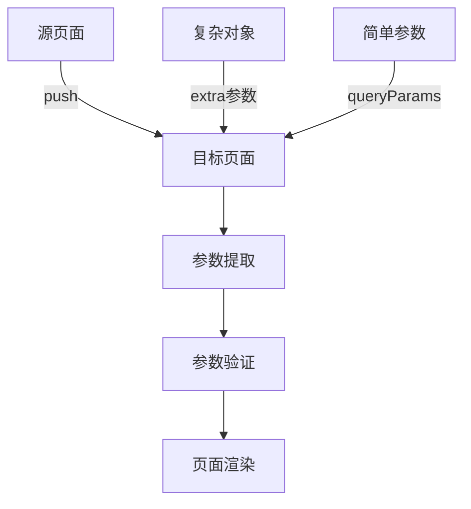
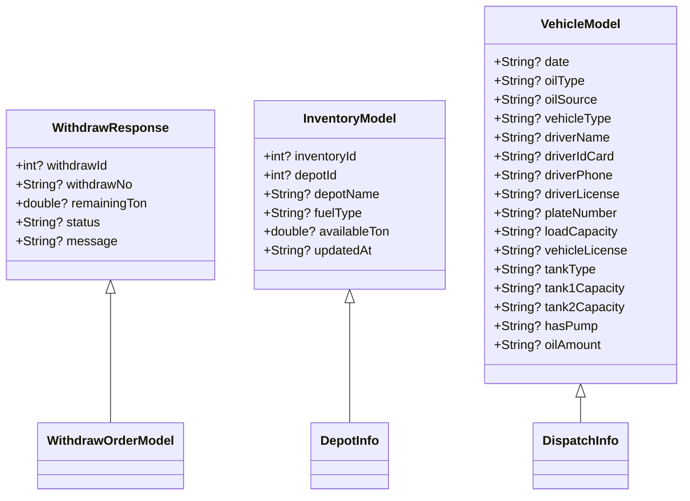
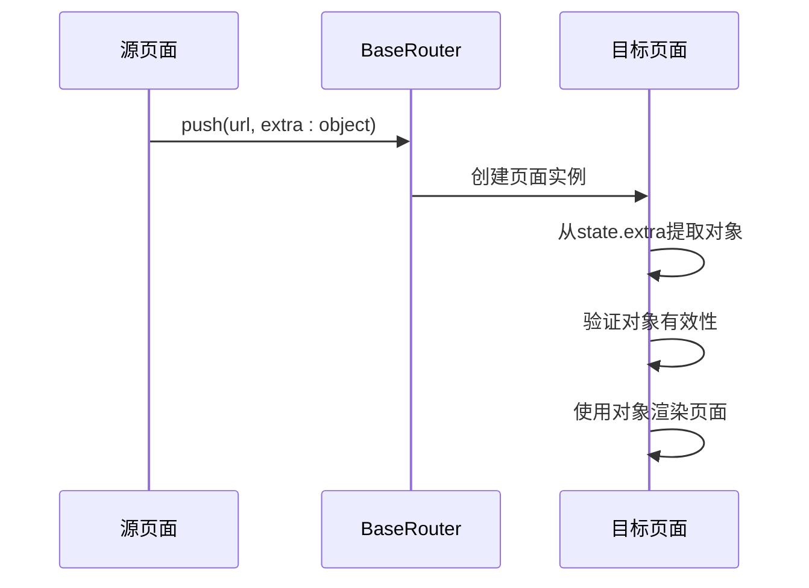
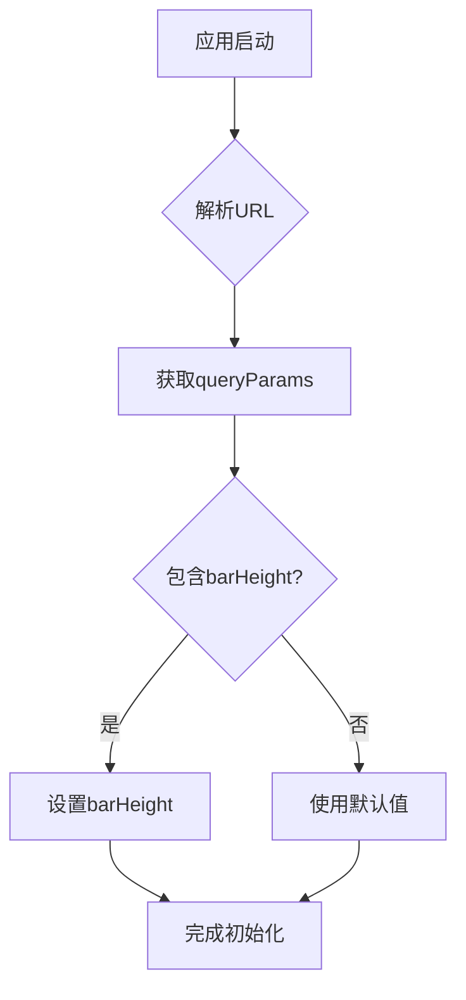
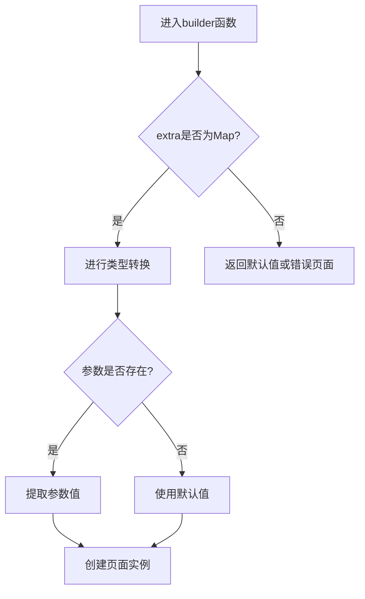
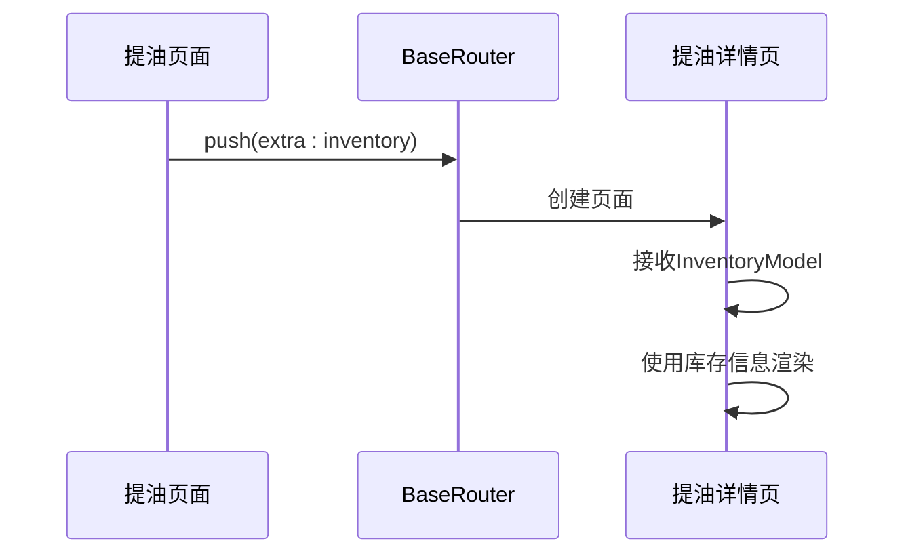
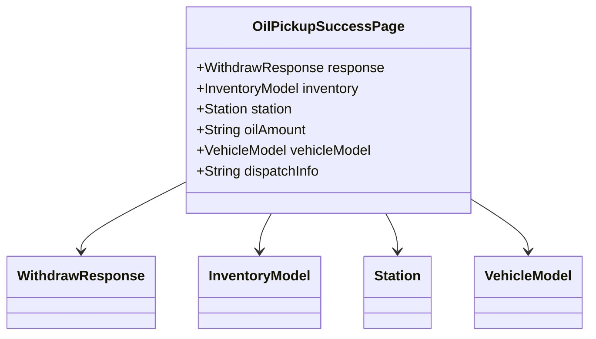
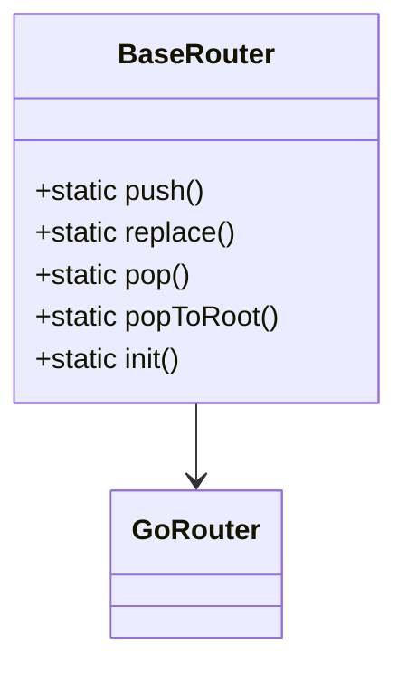
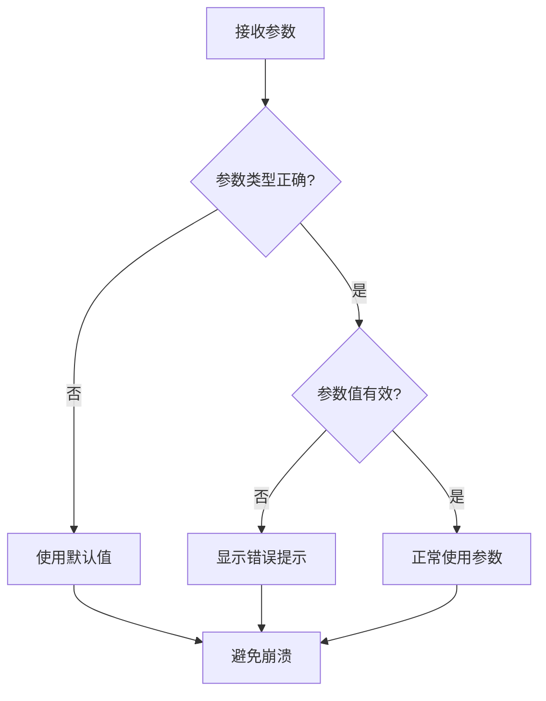
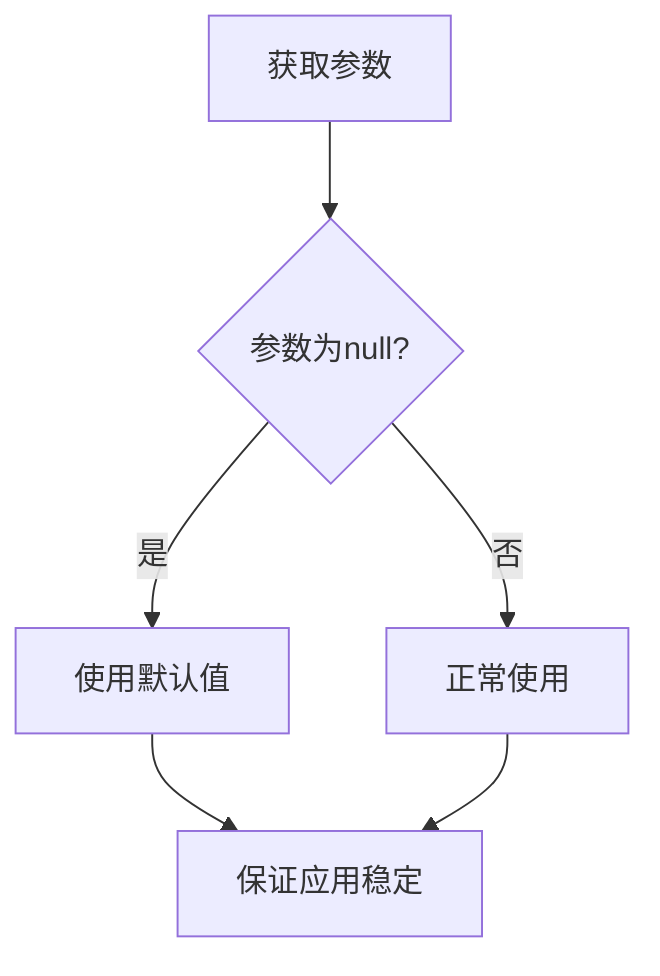

# 路由参数处理

<cite>
**本文档引用的文件**
- [router.dart](file://lib/router/router.dart)
- [routes.dart](file://lib/router/routes.dart)
- [oil_pickup_detail/page.dart](file://lib/pages/oil_pickup_detail/page.dart)
- [pickup_order_detail/page.dart](file://lib/pages/pickup_order_detail/page.dart)
- [oil_pickup_success/page.dart](file://lib/pages/oil_pickup_success/page.dart)
- [oil_pickup/controller.dart](file://lib/pages/oil_pickup/controller.dart)
- [vehicle_model.dart](file://lib/models/vehicle_model.dart)
- [withdraw_data.g.dart](file://lib/pages/oil_pickup/model/withdraw_data.g.dart)
</cite>

## 目录
1. [引言](#引言)
2. [路由参数传递机制](#路由参数传递机制)
3. [extra参数传递复杂对象](#extra参数传递复杂对象)
4. [GoRouterState的queryParams扩展](#gorouterstate的queryparams扩展)
5. [PageRouteBuilder中的参数提取与验证](#pagebuilder中的参数提取与验证)
6. [具体页面参数处理示例](#具体页面参数处理示例)
7. [参数传递最佳实践](#参数传递最佳实践)
8. [常见错误处理方案](#常见错误处理方案)
9. [总结](#总结)

## 引言
油品业务App采用GoRouter作为路由管理工具，通过extra参数在页面间传递复杂对象。本文档详细说明了如何使用extra参数传递WithdrawResponse、InventoryModel和VehicleModel等复杂对象，以及GoRouterState的queryParams扩展如何解析URL查询参数。同时，阐述了在PageRouteBuilder中如何安全地提取和验证传递的参数，包括null值检查和类型转换。

## 路由参数传递机制
油品业务App的路由系统基于GoRouter实现，通过BaseRouter类封装了路由导航功能。该系统支持通过extra参数在页面间传递复杂对象，同时也支持通过URL查询参数传递简单数据。



**Diagram sources**
- [router.dart](file://lib/router/router.dart#L127-L148)
- [routes.dart](file://lib/router/routes.dart#L137-L248)

## extra参数传递复杂对象
在油品业务App中，extra参数被广泛用于在页面间传递复杂对象。这些对象包括WithdrawResponse、InventoryModel和VehicleModel等。

### 复杂对象定义
系统中定义了多个用于数据传递的模型类：



**Diagram sources**
- [withdraw_data.g.dart](file://lib/pages/oil_pickup/model/withdraw_data.g.dart#L106-L122)
- [vehicle_model.dart](file://lib/models/vehicle_model.dart#L1-L117)

### extra参数传递流程
当需要在页面间传递复杂对象时，系统通过BaseRouter的push方法实现：



**Diagram sources**
- [router.dart](file://lib/router/router.dart#L137-L148)
- [routes.dart](file://lib/router/routes.dart#L207-L222)

## GoRouterState的queryParams扩展
系统通过扩展GoRouterState类来提供queryParams属性，用于解析URL查询参数。

### queryParams扩展实现
```dart
extension Compatible on GoRouterState {
  Map<String, String> get queryParams => uri.queryParameters;
}
```

此扩展允许开发者通过state.queryParams直接访问URL查询参数，而无需手动解析URI。

### 查询参数初始化
在应用启动时，系统会从URL查询参数中提取特定配置：



**Diagram sources**
- [router.dart](file://lib/router/router.dart#L83-L88)

## PageBuilder中的参数提取与验证
在PageRouteBuilder中，系统通过builder函数从GoRouterState中提取和验证传递的参数。

### 参数提取模式
系统采用统一的参数提取模式，通过类型转换和null检查确保参数安全：



### null值检查与类型转换
系统在提取参数时严格执行null值检查和类型转换：

```dart
final extra = state.extra as Map<String, dynamic>? ?? {};
final withdrawId = extra['withdrawId'] as int?;
if (withdrawId == null) {
  return const Text('参数缺失：withdrawId');
}
```

**Section sources**
- [routes.dart](file://lib/router/routes.dart#L224-L232)

## 具体页面参数处理示例

### 提油详情页参数处理
提油详情页通过extra参数接收库存信息，实现方式如下：



**Diagram sources**
- [oil_pickup/controller.dart](file://lib/pages/oil_pickup/controller.dart#L77-L83)
- [oil_pickup_detail/page.dart](file://lib/pages/oil_pickup_detail/page.dart#L11-L14)

### 提油订单详情页参数处理
提油订单详情页从extra中获取withdrawId并进行参数验证：

```mermaid
flowchart TD
A[进入pickupOrderDetailPage] --> B{extra是否为Map?}
B --> |是| C[提取withdrawId]
B --> |否| D[创建空Map]
C --> E{withdrawId是否为null?}
E --> |是| F[显示错误页面]
E --> |否| G[创建PickupOrderDetailPage]
F --> H[显示"参数缺失：withdrawId"]
G --> I[加载订单详情]
```

**Diagram sources**
- [routes.dart](file://lib/router/routes.dart#L224-L232)
- [pickup_order_detail/page.dart](file://lib/pages/pickup_order_detail/page.dart#L9-L14)

### 提油成功页参数处理
提油成功页接收多个复杂对象作为参数：



**Diagram sources**
- [oil_pickup_success/page.dart](file://lib/pages/oil_pickup_success/page.dart#L9-L14)

## 参数传递最佳实践

### 统一的路由管理
系统通过BaseRouter类提供统一的路由管理接口：



**Diagram sources**
- [router.dart](file://lib/router/router.dart#L127-L227)

### 类型安全的参数传递
系统采用类型安全的参数传递方式，避免运行时错误：

1. 使用泛型确保返回值类型安全
2. 使用null-aware操作符处理可选参数
3. 在builder函数中进行类型检查和转换

### 参数验证策略
系统实施严格的参数验证策略：



## 常见错误处理方案

### 参数缺失处理
当必要参数缺失时，系统返回友好的错误提示页面：

```dart
if (withdrawId == null) {
  return const Text('参数缺失：withdrawId');
}
```

### 类型转换失败处理
系统使用安全的类型转换方法，避免类型转换异常：

```dart
final extra = state.extra as Map<String, dynamic>? ?? {};
```

### 空值处理
对可能为空的参数进行null检查：



## 总结
油品业务App的路由参数处理系统通过extra参数实现了复杂对象的安全传递，结合GoRouterState的queryParams扩展支持URL查询参数解析。系统在PageRouteBuilder中实施了严格的参数提取和验证机制，包括null值检查和类型转换，确保了应用的稳定性和用户体验。通过统一的路由管理接口和类型安全的参数传递策略，系统提供了可靠、可维护的页面导航解决方案。

**Section sources**
- [router.dart](file://lib/router/router.dart)
- [routes.dart](file://lib/router/routes.dart)