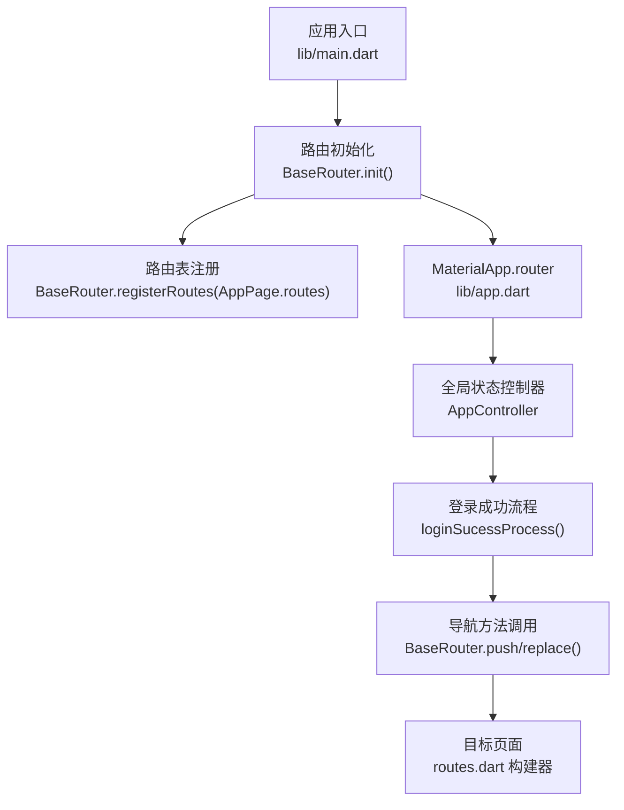
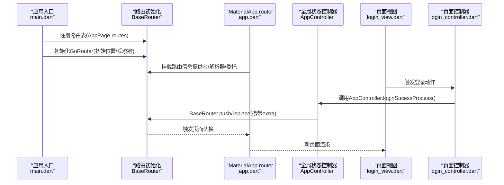
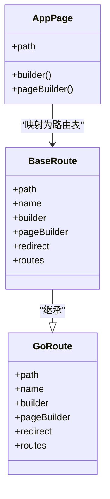
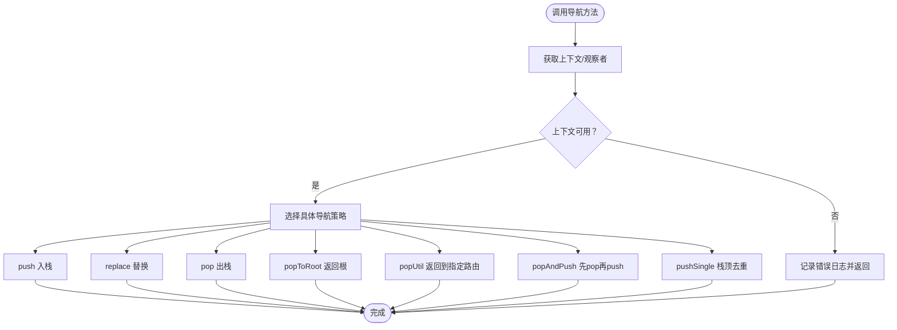
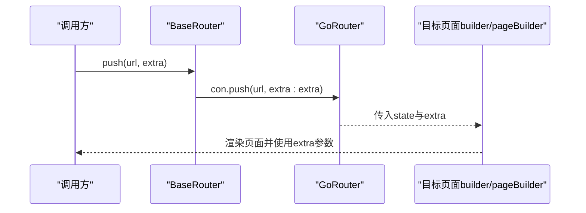
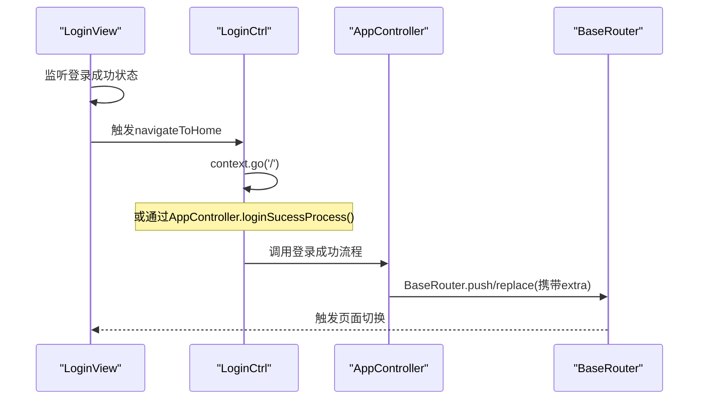
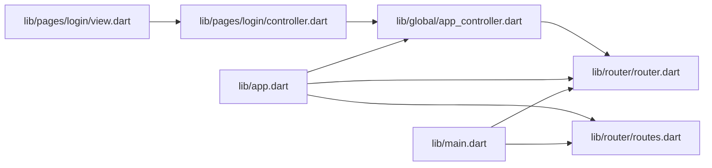

# 路由系统

<cite>
**本文引用的文件**
- [main.dart](file://lib/main.dart)
- [app.dart](file://lib/app.dart)
- [router.dart](file://lib/router/router.dart)
- [routes.dart](file://lib/router/routes.dart)
- [app_controller.dart](file://lib/global/app_controller.dart)
- [login_view.dart](file://lib/pages/login/view.dart)
- [login_controller.dart](file://lib/pages/login/controller.dart)
- [navigation_test.dart](file://test/pages/forgot_password/navigation_test.dart)
</cite>

## 目录
1. [简介](#简介)
2. [项目结构](#项目结构)
3. [核心组件](#核心组件)
4. [架构总览](#架构总览)
5. [详细组件分析](#详细组件分析)
6. [依赖关系分析](#依赖关系分析)
7. [性能考量](#性能考量)
8. [故障排查指南](#故障排查指南)
9. [结论](#结论)
10. [附录](#附录)

## 简介
本文件系统性梳理油品业务App的路由体系，围绕基于GoRouter的路由配置展开，重点说明：
- BaseRouter类如何封装导航方法（push、replace、pop等），并提供全局路由观察者
- BaseRoute对GoRoute的扩展，以及路由表的注册与管理机制
- 路由跳转时的参数传递方式（extra参数）与查询参数处理
- 不同导航场景的使用方法：页面替换（replace）、栈顶去重跳转（pushSingle）、返回根页面（popToRoot）
- 在业务逻辑中进行页面导航的示例与导航前后状态管理
- 路由系统与全局状态（AppController）的集成，如登录后自动跳转主界面的实现

## 项目结构
路由相关的核心文件集中在lib/router目录，并与应用入口、全局状态控制器、页面控制器协同工作：
- 应用入口负责初始化路由表与GoRouter实例
- 路由表定义了所有页面路径与页面构建器
- BaseRouter封装了导航方法与全局观察者
- 全局状态控制器在认证流程中驱动路由跳转
- 页面控制器在交互事件中触发导航

图表来源
- [main.dart](file://lib/main.dart#L8-L21)
- [app.dart](file://lib/app.dart#L40-L90)
- [router.dart](file://lib/router/router.dart#L50-L90)
- [routes.dart](file://lib/router/routes.dart#L120-L170)
- [app_controller.dart](file://lib/global/app_controller.dart#L62-L116)

章节来源
- [main.dart](file://lib/main.dart#L8-L21)
- [app.dart](file://lib/app.dart#L40-L90)

## 核心组件
- BaseRoute：对GoRoute的轻量扩展，承载路由的基础属性（path、name、builder、pageBuilder、redirect、子路由等），便于统一管理与注册。
- BaseRouter：全局路由门面，提供以下能力：
  - 初始化：注册路由表、创建GoRouter实例、注入全局观察者、设置初始位置与错误构建器
  - 路由表管理：注册路由、去重校验、保存当前路由集合
  - 导航方法：push、replace、pop、popToRoot、popUtil、popAndPush、pushSingle、canPop
  - 查询参数与环境参数：解析location、读取barHeight等
  - 全局观察者：通过静态字段暴露NavigatorObserver，供全局弹窗等组件使用
- AppPage枚举与路由表：以枚举定义页面路径，结合PageRoute扩展生成builder/pageBuilder，统一构建页面并支持extra参数透传
- 全局状态控制器AppController：在登录成功后根据站点绑定状态决定跳转路径，并携带extra参数

章节来源
- [router.dart](file://lib/router/router.dart#L9-L21)
- [router.dart](file://lib/router/router.dart#L50-L90)
- [router.dart](file://lib/router/router.dart#L105-L114)
- [router.dart](file://lib/router/router.dart#L127-L227)
- [routes.dart](file://lib/router/routes.dart#L35-L135)
- [routes.dart](file://lib/router/routes.dart#L137-L259)
- [app_controller.dart](file://lib/global/app_controller.dart#L62-L116)

## 架构总览
下图展示了从应用启动到页面导航的关键交互链路，以及全局状态与路由系统的协作关系。

图表来源
- [main.dart](file://lib/main.dart#L8-L21)
- [app.dart](file://lib/app.dart#L40-L90)
- [app_controller.dart](file://lib/global/app_controller.dart#L62-L116)
- [login_view.dart](file://lib/pages/login/view.dart#L32-L45)
- [login_controller.dart](file://lib/pages/login/controller.dart#L142-L182)

## 详细组件分析

### BaseRoute与路由表注册
- BaseRoute继承自GoRoute，保留path/name/builder/pageBuilder/redirect/子路由等关键字段，便于统一管理
- AppPage枚举定义所有页面路径，结合PageRoute扩展生成builder/pageBuilder，统一构建页面
- routes.dart中将AppPage.values映射为BaseRoute列表，形成路由表
- main.dart在应用启动时先注册路由表，再初始化GoRouter

图表来源
- [router.dart](file://lib/router/router.dart#L9-L18)
- [routes.dart](file://lib/router/routes.dart#L35-L135)
- [routes.dart](file://lib/router/routes.dart#L137-L259)

章节来源
- [router.dart](file://lib/router/router.dart#L9-L18)
- [routes.dart](file://lib/router/routes.dart#L35-L135)
- [routes.dart](file://lib/router/routes.dart#L137-L259)
- [main.dart](file://lib/main.dart#L8-L21)

### BaseRouter：全局路由门面与导航方法
- 初始化：注册路由表、创建GoRouter实例、注入全局观察者、设置初始位置、错误构建器、刷新监听器
- 路由表管理：注册路由时进行去重校验；保存当前路由集合
- 导航方法：
  - push：入栈跳转，支持extra参数
  - replace：替换当前栈顶，适合登录成功后替换启动页
  - pop：出栈返回，带canPop判断
  - popToRoot：一次性返回根页面
  - popUtil：按名称返回到指定路由
  - popAndPush：先pop再push
  - pushSingle：若当前栈顶已是同一path，则不重复入栈
- 查询参数与环境参数：解析location，读取barHeight等
- 全局观察者：暴露observer，供全局弹窗等组件使用

图表来源
- [router.dart](file://lib/router/router.dart#L127-L227)

章节来源
- [router.dart](file://lib/router/router.dart#L50-L90)
- [router.dart](file://lib/router/router.dart#L105-L114)
- [router.dart](file://lib/router/router.dart#L127-L227)

### 查询参数与extra参数传递
- 查询参数：通过extension Compatible将GoRouterState的uri.queryParameters暴露为queryParams，便于读取URL查询参数
- extra参数：在push/replace等导航方法中作为可选参数传递，目标页面builder/pageBuilder中可解包使用
- 示例：routes.dart中的builder/pageBuilder展示了如何从state.extra中读取Map或特定类型对象，并传递给页面构造函数

图表来源
- [router.dart](file://lib/router/router.dart#L137-L148)
- [routes.dart](file://lib/router/routes.dart#L137-L259)

章节来源
- [router.dart](file://lib/router/router.dart#L5-L7)
- [routes.dart](file://lib/router/routes.dart#L137-L259)

### 不同导航场景与最佳实践
- 页面替换（replace）：适用于登录成功后替换启动页或登录页，避免返回栈中残留旧页面
- 栈顶去重跳转（pushSingle）：当即将跳转的页面与当前页面path一致时，避免重复入栈
- 返回根页面（popToRoot）：一键清空返回栈，回到首页
- 返回到指定路由（popUtil）：按名称返回到指定路由，常用于Tab切换或固定流程
- popAndPush：先pop再push，适合需要清理中间页面的场景

章节来源
- [router.dart](file://lib/router/router.dart#L127-L227)
- [navigation_test.dart](file://test/pages/forgot_password/navigation_test.dart#L87-L110)

### 业务逻辑中的导航示例与状态管理
- 登录成功后自动跳转主界面：登录页面视图在状态变更后，通过addPostFrameCallback确保在构建完成后执行导航；登录控制器调用全局状态控制器的登录成功流程，AppController根据站点绑定状态决定跳转路径，并携带extra参数
- 页面控制器中的navigateToHome直接使用context.go('/')进行跳转

图表来源
- [login_view.dart](file://lib/pages/login/view.dart#L32-L45)
- [login_controller.dart](file://lib/pages/login/controller.dart#L178-L182)
- [app_controller.dart](file://lib/global/app_controller.dart#L62-L116)
- [router.dart](file://lib/router/router.dart#L127-L227)

章节来源
- [login_view.dart](file://lib/pages/login/view.dart#L32-L45)
- [login_controller.dart](file://lib/pages/login/controller.dart#L142-L182)
- [app_controller.dart](file://lib/global/app_controller.dart#L62-L116)

## 依赖关系分析
- 应用入口依赖路由模块进行初始化，MaterialApp.router挂载BaseRouter提供的路由信息提供者、解析器与委托
- 路由表依赖AppPage枚举与PageRoute扩展，统一生成builder/pageBuilder
- 全局状态控制器在认证流程中调用BaseRouter进行导航，实现登录后自动跳转
- 页面控制器在用户交互后触发导航，通常配合全局状态控制器完成业务闭环

图表来源
- [main.dart](file://lib/main.dart#L8-L21)
- [app.dart](file://lib/app.dart#L40-L90)
- [router.dart](file://lib/router/router.dart#L50-L90)
- [routes.dart](file://lib/router/routes.dart#L120-L170)
- [app_controller.dart](file://lib/global/app_controller.dart#L62-L116)
- [login_view.dart](file://lib/pages/login/view.dart#L32-L45)
- [login_controller.dart](file://lib/pages/login/controller.dart#L142-L182)

章节来源
- [main.dart](file://lib/main.dart#L8-L21)
- [app.dart](file://lib/app.dart#L40-L90)
- [router.dart](file://lib/router/router.dart#L50-L90)
- [routes.dart](file://lib/router/routes.dart#L120-L170)
- [app_controller.dart](file://lib/global/app_controller.dart#L62-L116)
- [login_view.dart](file://lib/pages/login/view.dart#L32-L45)
- [login_controller.dart](file://lib/pages/login/controller.dart#L142-L182)

## 性能考量
- 路由表注册时进行去重校验，避免重复注册导致的运行时开销与潜在冲突
- pushSingle通过比较当前location与目标url的path，避免重复入栈，减少返回栈深度
- BaseRouter在初始化时仅解析一次location并读取barHeight等参数，避免重复计算
- 使用全局观察者与MaterialApp.router委托，确保导航事件统一接入，便于后续扩展统计与埋点

章节来源
- [router.dart](file://lib/router/router.dart#L105-L114)
- [router.dart](file://lib/router/router.dart#L150-L166)
- [router.dart](file://lib/router/router.dart#L75-L90)

## 故障排查指南
- 导航失败日志：BaseRouter在缺少上下文或导航失败时会输出错误日志，便于定位问题
- 测试验证：导航测试覆盖了replace不增加历史记录、多次返回等行为，可用于回归验证
- 常见问题：
  - 上下文为空：确保在正确时机调用导航（如在构建完成后使用addPostFrameCallback）
  - 重复注册路由：检查路由表是否重复注册同一path
  - 返回栈异常：确认popToRoot/popUtil的使用场景与目标路由名称

章节来源
- [router.dart](file://lib/router/router.dart#L127-L227)
- [navigation_test.dart](file://test/pages/forgot_password/navigation_test.dart#L87-L110)

## 结论
该路由系统以BaseRouter为核心门面，结合BaseRoute与AppPage路由表，实现了：
- 统一的导航方法封装与全局观察者
- 明确的路由表注册与去重校验
- 灵活的extra参数与查询参数处理
- 与全局状态控制器的紧密集成，支撑登录后自动跳转等业务流程

通过上述设计，系统在保证可维护性的同时，提供了清晰的导航语义与良好的用户体验。

## 附录
- 路由初始化顺序建议：先注册路由表，再初始化GoRouter，最后挂载到MaterialApp.router
- 参数传递建议：优先使用extra传递强类型参数；使用查询参数时通过Compatible扩展读取
- 场景化导航选择：根据业务需求选择push/replace/pushSingle/popToRoot等策略，避免不必要的返回栈深度