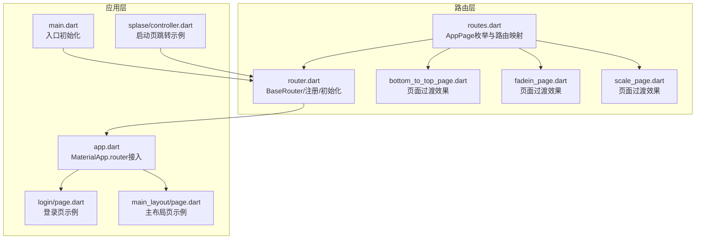
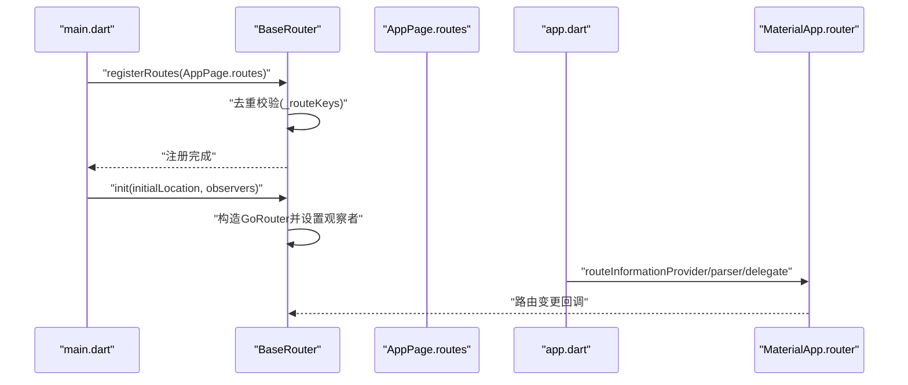
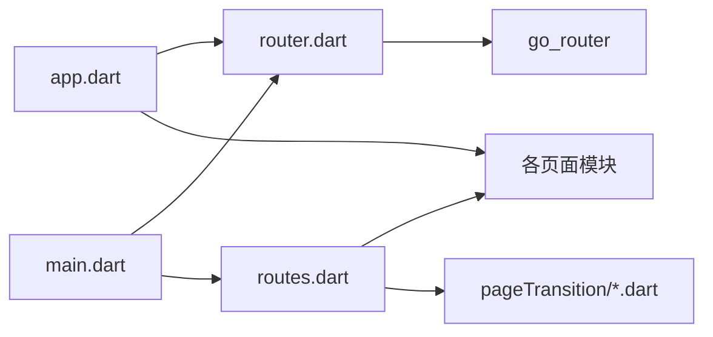
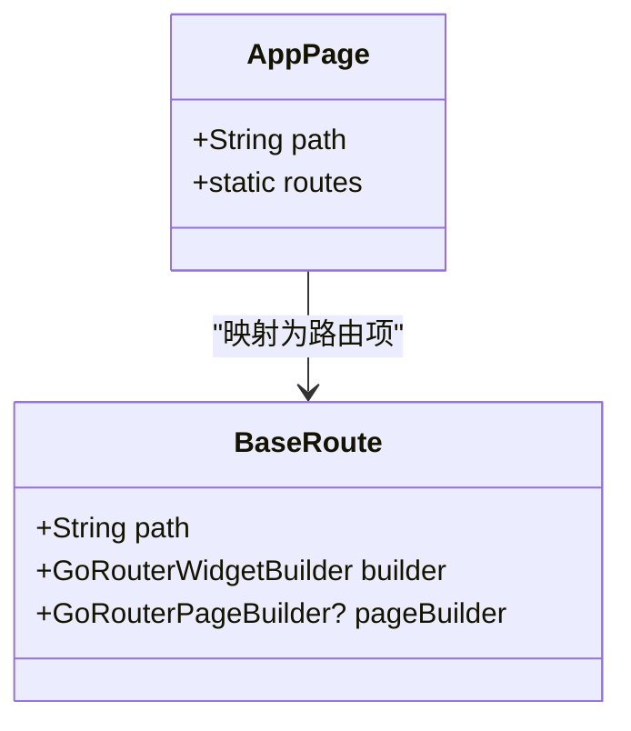
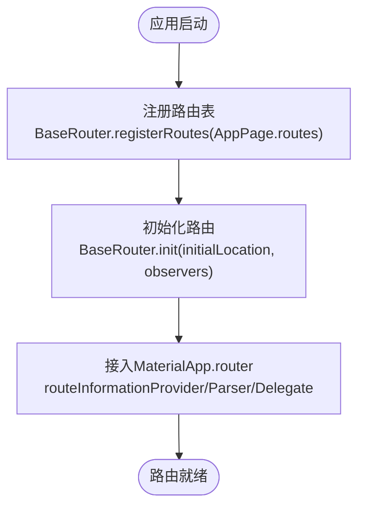

# 路由配置

<cite>
**本文引用的文件**
- [lib/main.dart](file://lib/main.dart)
- [lib/app.dart](file://lib/app.dart)
- [lib/router/routes.dart](file://lib/router/routes.dart)
- [lib/router/router.dart](file://lib/router/router.dart)
- [lib/router/pageTransition/bottom_to_top_page.dart](file://lib/router/pageTransition/bottom_to_top_page.dart)
- [lib/router/pageTransition/fadein_page.dart](file://lib/router/pageTransition/fadein_page.dart)
- [lib/router/pageTransition/scale_page.dart](file://lib/router/pageTransition/scale_page.dart)
- [lib/pages/login/page.dart](file://lib/pages/login/page.dart)
- [lib/pages/main_layout/page.dart](file://lib/pages/main_layout/page.dart)
- [lib/pages/splase/controller.dart](file://lib/pages/splase/controller.dart)
</cite>

## 目录
1. [简介](#简介)
2. [项目结构](#项目结构)
3. [核心组件](#核心组件)
4. [架构总览](#架构总览)
5. [详细组件分析](#详细组件分析)
6. [依赖关系分析](#依赖关系分析)
7. [性能考量](#性能考量)
8. [故障排查指南](#故障排查指南)
9. [结论](#结论)
10. [附录](#附录)

## 简介
本文件面向油品业务App的路由配置，系统性说明以下内容：
- AppPage枚举如何统一定义应用内所有路由路径
- routes静态字段如何通过BaseRoute封装路由配置
- builder与pageBuilder扩展方法如何为每个页面提供构建逻辑与页面转换效果
- 路由表注册机制，包括BaseRouter.registerRoutes如何防止重复路由注册
- 路由初始化流程，包括BaseRouter.init的参数配置与全局路由观察者的设置
- 示例：如何添加新页面路由并配置自定义页面转换动画

## 项目结构
与路由相关的核心文件分布如下：
- 路由定义与页面映射：lib/router/routes.dart
- 路由容器与注册、初始化：lib/router/router.dart
- 页面转换效果：lib/router/pageTransition/*.dart
- 应用入口与路由接入：lib/main.dart、lib/app.dart
- 典型页面示例：lib/pages/login/page.dart、lib/pages/main_layout/page.dart
- 启动页控制跳转示例：lib/pages/splase/controller.dart

图表来源
- [lib/router/routes.dart](file://lib/router/routes.dart#L35-L135)
- [lib/router/router.dart](file://lib/router/router.dart#L20-L120)
- [lib/router/pageTransition/bottom_to_top_page.dart](file://lib/router/pageTransition/bottom_to_top_page.dart#L1-L28)
- [lib/router/pageTransition/fadein_page.dart](file://lib/router/pageTransition/fadein_page.dart#L1-L28)
- [lib/router/pageTransition/scale_page.dart](file://lib/router/pageTransition/scale_page.dart#L1-L28)
- [lib/main.dart](file://lib/main.dart#L8-L21)
- [lib/app.dart](file://lib/app.dart#L44-L84)
- [lib/pages/login/page.dart](file://lib/pages/login/page.dart#L1-L28)
- [lib/pages/main_layout/page.dart](file://lib/pages/main_layout/page.dart#L1-L31)
- [lib/pages/splase/controller.dart](file://lib/pages/splase/controller.dart#L21-L39)

章节来源
- [lib/router/routes.dart](file://lib/router/routes.dart#L35-L135)
- [lib/router/router.dart](file://lib/router/router.dart#L20-L120)
- [lib/main.dart](file://lib/main.dart#L8-L21)
- [lib/app.dart](file://lib/app.dart#L44-L84)

## 核心组件
- AppPage枚举：集中声明所有路由路径，作为路由表的“键”
- routes静态字段：将AppPage.values映射为BaseRoute列表
- PageRoute扩展：为每个AppPage提供builder与可选的pageBuilder
- BaseRoute：对GoRoute的轻量封装，承载path、builder、pageBuilder等
- BaseRouter：全局路由容器，负责注册、初始化、导航操作与全局观察者

章节来源
- [lib/router/routes.dart](file://lib/router/routes.dart#L35-L135)
- [lib/router/router.dart](file://lib/router/router.dart#L9-L18)

## 架构总览
整体流程：
- 应用启动时，main.dart调用BaseRouter.registerRoutes(AppPage.routes)注册路由
- 再调用BaseRouter.init完成GoRouter实例化，并注入全局观察者
- app.dart将MaterialApp.router与BaseRouter的路由信息解析器、委托、信息提供器对接
- 页面通过AppPage.path进行跳转，必要时使用pageBuilder配置页面过渡动画

图表来源
- [lib/main.dart](file://lib/main.dart#L8-L21)
- [lib/router/router.dart](file://lib/router/router.dart#L50-L90)
- [lib/app.dart](file://lib/app.dart#L44-L84)

## 详细组件分析

### AppPage枚举与路由映射
- AppPage以常量形式定义所有路由路径，如"/payOrderList"、"/login"、"/"等
- routes静态字段遍历AppPage.values，生成BaseRoute列表，统一注入path、builder、pageBuilder
- builder扩展根据AppPage分支返回对应页面的构建函数
- pageBuilder扩展针对特定页面（如登录页）返回自定义过渡动画包装的页面

章节来源
- [lib/router/routes.dart](file://lib/router/routes.dart#L35-L135)
- [lib/router/routes.dart](file://lib/router/routes.dart#L137-L259)

### BaseRoute与BaseRouter
- BaseRoute继承自GoRoute，仅做轻量封装，便于统一管理
- BaseRouter提供：
  - 全局观察者observer，用于统一导航事件监听
  - registerRoutes：注册路由列表，内部以_set去重，避免重复注册
  - init：构造GoRouter，注入initialLocation、observers、navigatorKey等
  - 多种导航辅助方法：push、replace、pop、popToRoot、popUtil等
  - 全局参数读取：从当前location解析查询参数，支持barHeight等

章节来源
- [lib/router/router.dart](file://lib/router/router.dart#L9-L18)
- [lib/router/router.dart](file://lib/router/router.dart#L20-L120)
- [lib/router/router.dart](file://lib/router/router.dart#L105-L114)
- [lib/router/router.dart](file://lib/router/router.dart#L50-L90)

### 页面转换效果与pageBuilder
- pageBuilder扩展为AppPage提供可选的页面过渡包装
- 当前示例：登录页使用bottom_to_top_page.dart提供的SlideTransition
- 其他可用过渡：fadein_page.dart（FadeTransition）、scale_page.dart（ScaleTransition）

章节来源
- [lib/router/routes.dart](file://lib/router/routes.dart#L251-L259)
- [lib/router/pageTransition/bottom_to_top_page.dart](file://lib/router/pageTransition/bottom_to_top_page.dart#L1-L28)
- [lib/router/pageTransition/fadein_page.dart](file://lib/router/pageTransition/fadein_page.dart#L1-L28)
- [lib/router/pageTransition/scale_page.dart](file://lib/router/pageTransition/scale_page.dart#L1-L28)

### 路由初始化流程与全局观察者
- main.dart中先注册AppPage.routes，再调用BaseRouter.init，传入initialLocation与observers
- app.dart将MaterialApp.router与BaseRouter的routeInformationProvider、routeInformationParser、routerDelegate对接
- BaseRouter.init会为导航器添加全局观察者，便于统一处理导航事件
- 初始化完成后，BaseRouter会从location解析查询参数，例如barHeight

章节来源
- [lib/main.dart](file://lib/main.dart#L8-L21)
- [lib/app.dart](file://lib/app.dart#L44-L84)
- [lib/router/router.dart](file://lib/router/router.dart#L50-L90)

### 添加新页面路由与自定义页面转换动画示例
- 新增AppPage条目：在AppPage中新增一个枚举值，指定path
- 注册路由：无需手动new BaseRoute，routes静态字段会自动映射
- 配置页面构建：在PageRoute扩展的builder分支中返回新页面
- 配置页面过渡：在PageRoute扩展的pageBuilder分支中返回自定义过渡包装
- 使用示例：启动页控制器在鉴权后调用BaseRouter.replace跳转到登录页

章节来源
- [lib/router/routes.dart](file://lib/router/routes.dart#L35-L135)
- [lib/router/routes.dart](file://lib/router/routes.dart#L137-L259)
- [lib/pages/splase/controller.dart](file://lib/pages/splase/controller.dart#L21-L39)

## 依赖关系分析
- routes.dart依赖各页面模块与页面过渡模块
- router.dart依赖go_router与日志工具
- app.dart依赖BaseRouter并将其路由信息接入MaterialApp.router
- main.dart负责初始化路由表与GoRouter

图表来源
- [lib/router/routes.dart](file://lib/router/routes.dart#L1-L34)
- [lib/router/router.dart](file://lib/router/router.dart#L1-L18)
- [lib/app.dart](file://lib/app.dart#L44-L84)
- [lib/main.dart](file://lib/main.dart#L8-L21)

## 性能考量
- 路由注册去重：BaseRouter.registerRoutes通过_set记录已注册path，避免重复注册带来的开销与潜在问题
- 过渡动画：页面过渡使用CustomTransitionPage，建议仅对必要页面启用，避免过度动画影响首屏渲染
- 初始位置：通过BaseRouter.init的initialLocation设置启动页，减少首屏跳转抖动
- 观察者链路：全局观察者仅在需要时使用，避免不必要的监听

[本节为通用指导，不直接分析具体文件]

## 故障排查指南
- 重复注册路由：若出现重复路由提示，检查是否多次调用registerRoutes或存在同path的路由
- 页面未显示：确认AppPage.routes已被注册，且AppPage.path与页面构建逻辑一致
- 页面过渡无效：确认pageBuilder返回的是CustomTransitionPage包装，且目标页面在PageRoute扩展中配置了pageBuilder
- 跳转失败：检查BaseRouter.init是否已调用，确保MaterialApp.router已接入BaseRouter的委托与解析器

章节来源
- [lib/router/router.dart](file://lib/router/router.dart#L105-L114)
- [lib/router/routes.dart](file://lib/router/routes.dart#L251-L259)
- [lib/app.dart](file://lib/app.dart#L44-L84)

## 结论
该路由体系通过AppPage统一管理路由路径，routes静态字段与PageRoute扩展将页面构建与过渡动画解耦，BaseRouter提供注册、初始化与导航辅助能力，并通过全局观察者实现统一的导航事件处理。整体设计清晰、可扩展性强，便于新增页面与定制页面过渡效果。

[本节为总结性内容，不直接分析具体文件]

## 附录

### 类图：AppPage与BaseRoute的关系

图表来源
- [lib/router/routes.dart](file://lib/router/routes.dart#L35-L135)
- [lib/router/router.dart](file://lib/router/router.dart#L9-L18)

### 流程图：路由注册与初始化

图表来源
- [lib/main.dart](file://lib/main.dart#L8-L21)
- [lib/app.dart](file://lib/app.dart#L44-L84)
- [lib/router/router.dart](file://lib/router/router.dart#L50-L90)