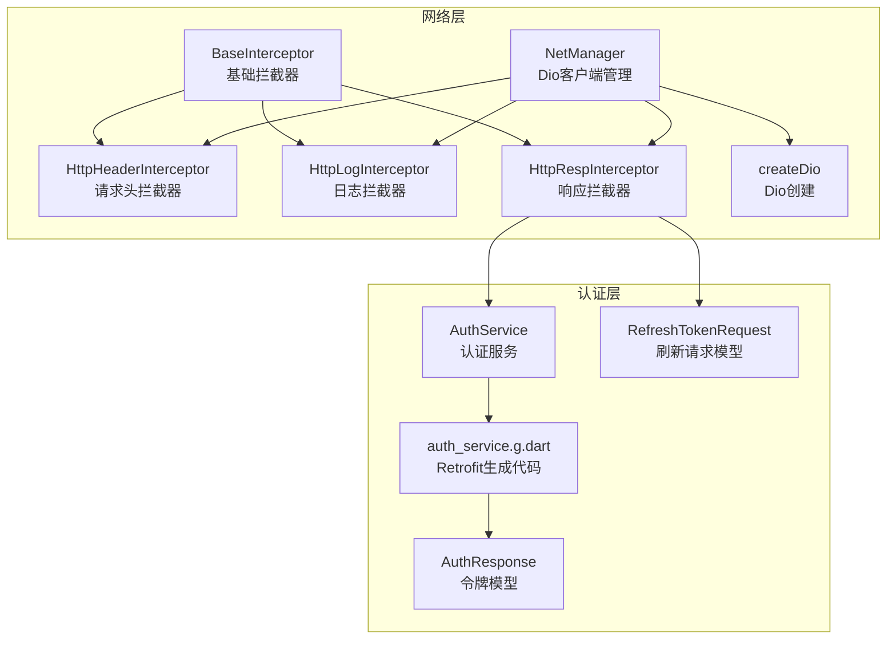
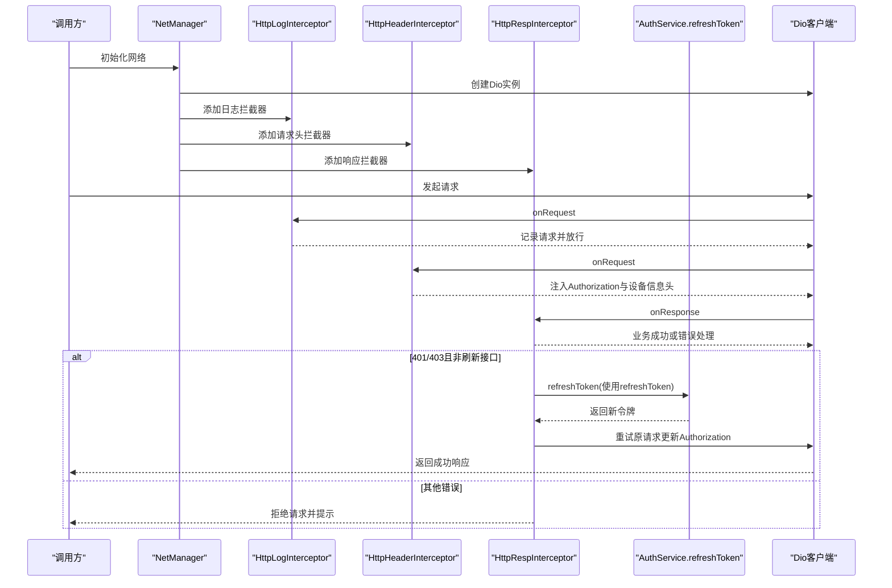
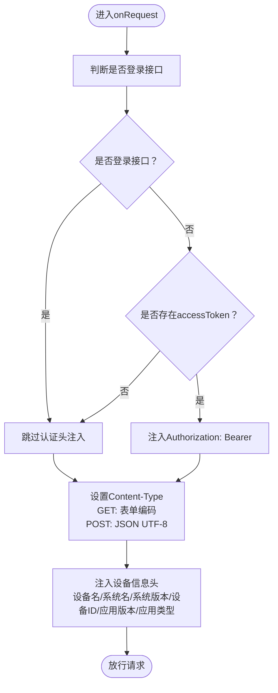
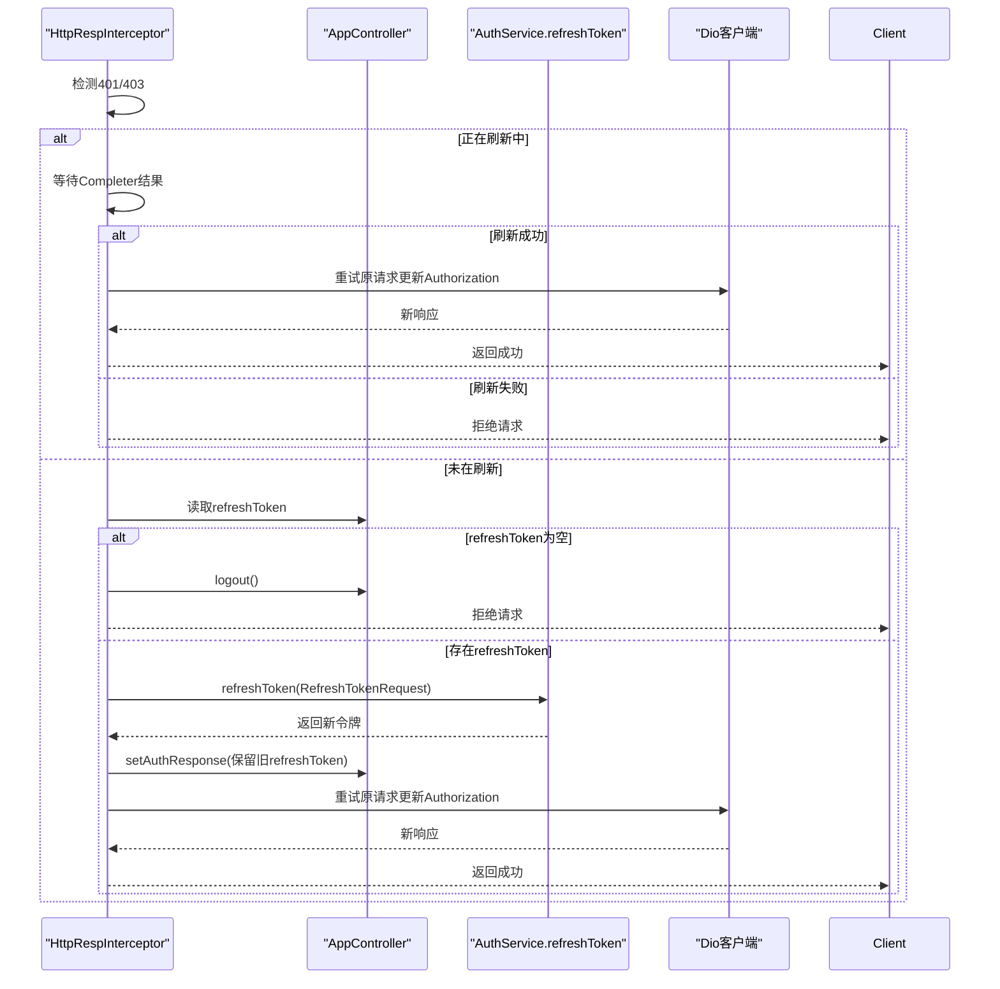
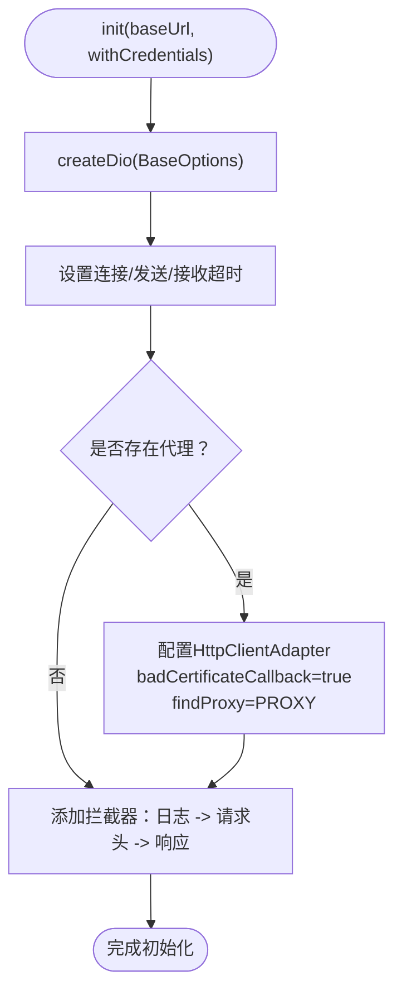
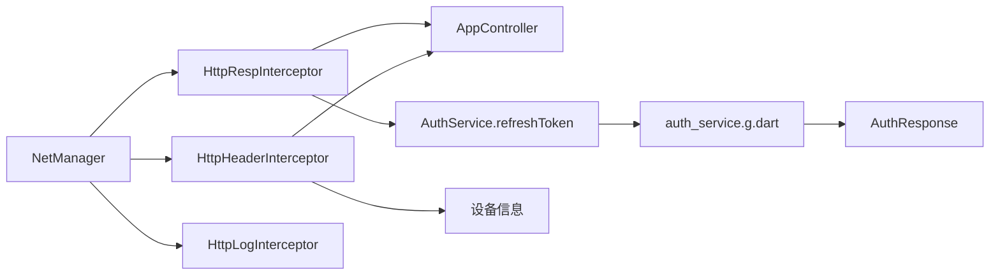

# API通信安全

<cite>
**本文引用的文件**
- [lib/net/base_interceptor.dart](file://lib/net/base_interceptor.dart)
- [lib/net/http_header_interceptor.dart](file://lib/net/http_header_interceptor.dart)
- [lib/net/http_log_interceptor.dart](file://lib/net/http_log_interceptor.dart)
- [lib/net/http_resp_interceptor.dart](file://lib/net/http_resp_interceptor.dart)
- [lib/net/net_manager.dart](file://lib/net/net_manager.dart)
- [lib/net/dio_io.dart](file://lib/net/dio_io.dart)
- [lib/global/service/auth_service.dart](file://lib/global/service/auth_service.dart)
- [lib/global/service/auth_service.g.dart](file://lib/global/service/auth_service.g.dart)
- [lib/global/model/auth_rep_type.dart](file://lib/global/model/auth_rep_type.dart)
- [lib/global/model/auth_req_type.dart](file://lib/global/model/auth_req_type.dart)
</cite>

## 目录
1. [引言](#引言)
2. [项目结构](#项目结构)
3. [核心组件](#核心组件)
4. [架构总览](#架构总览)
5. [详细组件分析](#详细组件分析)
6. [依赖关系分析](#依赖关系分析)
7. [性能考虑](#性能考虑)
8. [故障排查指南](#故障排查指南)
9. [结论](#结论)

## 引言
本文件聚焦于项目中的API通信安全机制，系统性解析拦截器链如何保障会话安全与连续性，覆盖以下关键点：
- BaseInterceptor作为拦截器基类的设计思路
- HttpHeaderInterceptor对请求头的安全处理策略（认证头注入、设备信息头、登录接口豁免）
- 基于HttpRespInterceptor的Token过期检测与无感刷新流程
- NetManager中Dio客户端的安全配置（超时、代理与证书策略）
- 拦截器链构建顺序与对请求/响应的安全增强作用
- Token失效等异常场景的应对策略

## 项目结构
围绕网络层与认证相关的关键文件组织如下：
- 网络层拦截器：基础拦截器、请求头拦截器、日志拦截器、响应拦截器
- 客户端管理：NetManager负责Dio实例初始化与拦截器装配
- 认证服务：AuthService定义refreshToken接口，配合响应拦截器实现无感刷新
- 数据模型：AuthResponse与RefreshTokenRequest承载令牌与账户信息

图表来源
- [lib/net/base_interceptor.dart](file://lib/net/base_interceptor.dart#L1-L8)
- [lib/net/http_header_interceptor.dart](file://lib/net/http_header_interceptor.dart#L1-L56)
- [lib/net/http_log_interceptor.dart](file://lib/net/http_log_interceptor.dart#L1-L60)
- [lib/net/http_resp_interceptor.dart](file://lib/net/http_resp_interceptor.dart#L1-L210)
- [lib/net/net_manager.dart](file://lib/net/net_manager.dart#L1-L88)
- [lib/net/dio_io.dart](file://lib/net/dio_io.dart#L1-L23)
- [lib/global/service/auth_service.dart](file://lib/global/service/auth_service.dart#L1-L41)
- [lib/global/service/auth_service.g.dart](file://lib/global/service/auth_service.g.dart#L48-L74)
- [lib/global/model/auth_rep_type.dart](file://lib/global/model/auth_rep_type.dart#L1-L46)
- [lib/global/model/auth_req_type.dart](file://lib/global/model/auth_req_type.dart#L61-L71)

章节来源
- [lib/net/base_interceptor.dart](file://lib/net/base_interceptor.dart#L1-L8)
- [lib/net/net_manager.dart](file://lib/net/net_manager.dart#L1-L88)

## 核心组件
- BaseInterceptor：所有拦截器的基类，统一tag标识，便于日志与调试
- HttpHeaderInterceptor：在请求前注入Authorization头、设备信息头；对登录接口豁免非必要头
- HttpLogInterceptor：记录请求方法、路径、参数与响应摘要，支持调试模式输出完整响应
- HttpRespInterceptor：统一业务错误处理、401/403检测、并发刷新控制、无感重试
- NetManager：集中初始化Dio、超时配置、代理与证书策略、拦截器装配
- AuthService：通过Retrofit声明refreshToken接口，供响应拦截器调用以刷新令牌

章节来源
- [lib/net/base_interceptor.dart](file://lib/net/base_interceptor.dart#L1-L8)
- [lib/net/http_header_interceptor.dart](file://lib/net/http_header_interceptor.dart#L1-L56)
- [lib/net/http_log_interceptor.dart](file://lib/net/http_log_interceptor.dart#L1-L60)
- [lib/net/http_resp_interceptor.dart](file://lib/net/http_resp_interceptor.dart#L1-L210)
- [lib/net/net_manager.dart](file://lib/net/net_manager.dart#L1-L88)
- [lib/global/service/auth_service.dart](file://lib/global/service/auth_service.dart#L1-L41)

## 架构总览
下图展示了拦截器链的构建顺序与交互关系，以及认证刷新流程在响应拦截器中的体现。

图表来源
- [lib/net/net_manager.dart](file://lib/net/net_manager.dart#L59-L66)
- [lib/net/http_log_interceptor.dart](file://lib/net/http_log_interceptor.dart#L10-L33)
- [lib/net/http_header_interceptor.dart](file://lib/net/http_header_interceptor.dart#L16-L54)
- [lib/net/http_resp_interceptor.dart](file://lib/net/http_resp_interceptor.dart#L25-L209)
- [lib/global/service/auth_service.dart](file://lib/global/service/auth_service.dart#L18-L20)
- [lib/global/service/auth_service.g.dart](file://lib/global/service/auth_service.g.dart#L48-L74)

## 详细组件分析

### BaseInterceptor：拦截器基类
- 设计要点
  - 统一tag标识，便于日志追踪
  - 继承自InterceptorsWrapper，遵循Dio拦截器规范
- 作用
  - 为具体拦截器提供一致的基类能力，避免重复样板代码

章节来源
- [lib/net/base_interceptor.dart](file://lib/net/base_interceptor.dart#L1-L8)

### HttpHeaderInterceptor：请求头安全处理
- 认证头注入
  - 在非登录接口上，从应用状态读取accessToken并注入Authorization头
  - 登录接口路径匹配时豁免注入，避免循环依赖或无效认证
- 内容类型与编码
  - GET请求设置Content-Type为表单编码
  - POST请求设置Content-Type为JSON UTF-8
- 设备信息头
  - 注入设备名称、系统名称、系统版本、设备ID、应用版本、应用类型等头
  - 设备信息来源于全局配置或传入参数，必要时进行URL安全编码
- 防重放与安全头
  - 当前实现未显式添加一次性nonce或时间戳头
  - 可通过扩展在请求头中加入随机值与时间戳，并在服务端校验
- 自定义安全头
  - 可在现有基础上增加签名头、平台标识、渠道信息等

图表来源
- [lib/net/http_header_interceptor.dart](file://lib/net/http_header_interceptor.dart#L16-L54)

章节来源
- [lib/net/http_header_interceptor.dart](file://lib/net/http_header_interceptor.dart#L1-L56)

### HttpLogInterceptor：请求/响应日志
- onRequest：记录方法、路径、完整URL、查询参数或请求体、额外信息与头部
- onResponse：记录URL与路径；在调试模式下输出响应摘要
- onError：记录错误路径、URL、状态码与消息
- 价值
  - 便于定位问题、审计请求行为
  - 注意生产环境关闭详细响应输出，避免敏感信息泄露

章节来源
- [lib/net/http_log_interceptor.dart](file://lib/net/http_log_interceptor.dart#L1-L60)

### HttpRespInterceptor：Token过期检测与无感刷新
- 业务成功判定
  - 解析BaseResponse，当code为成功时，仅透传data部分
- 错误处理
  - 记录业务错误详情，构造DioException
  - 对401/403进行特殊处理：触发刷新流程
- 并发刷新控制
  - 使用静态Completer与布尔标记，确保同一时刻仅有一个刷新请求
  - 正在刷新时，排队等待刷新结果，成功后重试原请求
- 刷新流程
  - 从应用状态读取refreshToken，若为空则直接登出并拒绝请求
  - 调用AuthService.refreshToken接口，接收新令牌
  - 更新应用状态中的AuthResponse（保留旧refreshToken），随后重试原请求
  - 若刷新失败，清空认证信息并提示重新登录
- 重试机制
  - 重新发送请求时，更新Authorization头为新令牌
  - 保持原请求的方法、头、查询参数、取消令牌与进度回调

图表来源
- [lib/net/http_resp_interceptor.dart](file://lib/net/http_resp_interceptor.dart#L25-L209)
- [lib/global/service/auth_service.dart](file://lib/global/service/auth_service.dart#L18-L20)
- [lib/global/service/auth_service.g.dart](file://lib/global/service/auth_service.g.dart#L48-L74)
- [lib/global/model/auth_req_type.dart](file://lib/global/model/auth_req_type.dart#L61-L71)

章节来源
- [lib/net/http_resp_interceptor.dart](file://lib/net/http_resp_interceptor.dart#L1-L210)
- [lib/global/service/auth_service.dart](file://lib/global/service/auth_service.dart#L1-L41)
- [lib/global/service/auth_service.g.dart](file://lib/global/service/auth_service.g.dart#L48-L74)
- [lib/global/model/auth_req_type.dart](file://lib/global/model/auth_req_type.dart#L61-L71)

### NetManager：Dio客户端安全配置
- 超时控制
  - 连接、发送、接收均设置为固定毫秒数，统一超时策略
- 重试次数
  - 提供常量定义，可在适配层按需启用
- 代理与证书策略
  - 支持通过全局存储读取代理地址，动态配置HttpClientAdapter
  - 在存在代理时，设置badCertificateCallback为true，允许自定义证书处理
- 拦截器装配
  - 严格顺序：日志 -> 请求头 -> 响应
  - 保证日志先于请求头记录，响应拦截器最后处理，确保错误与刷新逻辑在最末层生效

图表来源
- [lib/net/net_manager.dart](file://lib/net/net_manager.dart#L30-L66)
- [lib/net/dio_io.dart](file://lib/net/dio_io.dart#L1-L23)

章节来源
- [lib/net/net_manager.dart](file://lib/net/net_manager.dart#L1-L88)
- [lib/net/dio_io.dart](file://lib/net/dio_io.dart#L1-L23)

### 认证服务与模型
- AuthService.refreshToken
  - Retrofit声明POST /auth/refresh-token，入参为RefreshTokenRequest
  - 生成代码负责组装请求选项、序列化与反序列化
- AuthResponse
  - 包含accessToken、refreshToken与账户信息
  - 提供copyWith以便在刷新后保留refreshToken并更新accessToken
- RefreshTokenRequest
  - 仅包含refreshToken字段，用于服务端验证与签发新令牌

章节来源
- [lib/global/service/auth_service.dart](file://lib/global/service/auth_service.dart#L1-L41)
- [lib/global/service/auth_service.g.dart](file://lib/global/service/auth_service.g.dart#L48-L74)
- [lib/global/model/auth_rep_type.dart](file://lib/global/model/auth_rep_type.dart#L1-L46)
- [lib/global/model/auth_req_type.dart](file://lib/global/model/auth_req_type.dart#L61-L71)

## 依赖关系分析
- 组件耦合
  - HttpRespInterceptor依赖AppController状态与AuthService，形成认证刷新闭环
  - HttpHeaderInterceptor依赖AppController状态与设备信息，确保每次请求携带最新令牌与设备信息
  - NetManager集中装配拦截器，降低上层调用复杂度
- 外部依赖
  - Dio与Retrofit用于HTTP请求与接口声明
  - Flutter Bloc用于状态管理（AppController）
- 潜在风险
  - 并发刷新的Completer与静态标记需确保线程安全与异常清理
  - 代理与证书策略在生产环境需谨慎评估安全性

图表来源
- [lib/net/http_resp_interceptor.dart](file://lib/net/http_resp_interceptor.dart#L25-L209)
- [lib/net/http_header_interceptor.dart](file://lib/net/http_header_interceptor.dart#L16-L54)
- [lib/net/net_manager.dart](file://lib/net/net_manager.dart#L59-L66)
- [lib/global/service/auth_service.dart](file://lib/global/service/auth_service.dart#L18-L20)
- [lib/global/service/auth_service.g.dart](file://lib/global/service/auth_service.g.dart#L48-L74)
- [lib/global/model/auth_rep_type.dart](file://lib/global/model/auth_rep_type.dart#L1-L46)

## 性能考虑
- 拦截器链顺序
  - 日志在前可记录完整上下文，但可能带来额外I/O；建议生产环境减少详细响应输出
- 并发刷新
  - 使用Completer与布尔标记避免重复刷新，降低网络压力
- 超时与重试
  - 固定超时有助于快速失败，重试次数需结合业务与网络状况权衡
- 代理与证书
  - 代理可能引入额外延迟；证书策略在开发阶段可放宽，生产阶段应收紧

## 故障排查指南
- 401/403频繁出现
  - 检查AppController中refreshToken是否为空或过期
  - 确认HttpRespInterceptor是否正确捕获并触发刷新
  - 观察日志拦截器输出，确认Authorization头是否被正确注入
- 刷新失败
  - 查看响应拦截器日志，确认refreshToken接口返回状态
  - 确保AuthService.refreshToken生成代码正确映射到服务端接口
- 代理导致证书错误
  - 检查NetManager代理配置与证书回调策略
  - 生产环境建议移除badCertificateCallback为true的配置
- 请求头缺失
  - 确认登录接口路径匹配规则是否覆盖实际路径
  - 检查设备信息是否正确传入或从全局配置读取

章节来源
- [lib/net/http_resp_interceptor.dart](file://lib/net/http_resp_interceptor.dart#L49-L155)
- [lib/net/http_header_interceptor.dart](file://lib/net/http_header_interceptor.dart#L16-L54)
- [lib/net/net_manager.dart](file://lib/net/net_manager.dart#L47-L66)
- [lib/global/service/auth_service.g.dart](file://lib/global/service/auth_service.g.dart#L48-L74)

## 结论
本项目通过“日志-请求头-响应”的拦截器链实现了完善的API通信安全与会话连续性保障：
- 请求头拦截器确保每次请求携带最新令牌与设备信息，登录接口豁免非必要头
- 响应拦截器统一处理业务错误与401/403，采用并发控制与无感重试机制实现Token自动刷新
- NetManager集中管理Dio客户端，提供超时、代理与证书策略配置
- AuthService与模型支撑刷新流程，确保令牌生命周期管理清晰可控

建议后续增强方向：
- 在请求头中加入一次性nonce与时间戳，提升防重放能力
- 在生产环境收紧证书校验策略，避免代理带来的安全风险
- 将拦截器链顺序与策略抽象为配置项，便于不同环境差异化部署