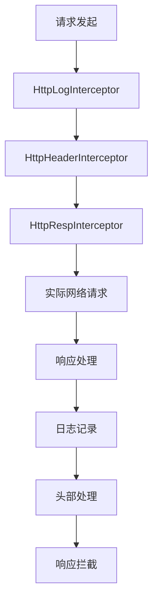

# 代码与配置安全

<cite>
**本文档引用文件**  
- [env.dart](file://lib/config/env.dart)
- [config.dart](file://lib/config/config.dart)
- [address.dart](file://lib/config/address.dart)
- [channel.dart](file://lib/config/channel.dart)
- [auth_service.dart](file://lib/global/service/auth_service.dart)
- [auth_service.g.dart](file://lib/global/service/auth_service.g.dart)
- [storage.dart](file://lib/global/storage.dart)
- [net_manager.dart](file://lib/net/net_manager.dart)
- [http_header_interceptor.dart](file://lib/net/http_header_interceptor.dart)
- [http_resp_interceptor.dart](file://lib/net/http_resp_interceptor.dart)
- [http_log_interceptor.dart](file://lib/net/http_log_interceptor.dart)
- [project.md](file://openspec/project.md)
- [.gitignore](file://.gitignore)
</cite>

## 目录
1. [引言](#引言)
2. [多环境配置分离机制](#多环境配置分离机制)
3. [配置加载与优先级策略](#配置加载与优先级策略)
4. [安全配置依赖注入](#安全配置依赖注入)
5. [敏感文件保护机制](#敏感文件保护机制)
6. [代码审查安全要点](#代码审查安全要点)
7. [安全编码检查清单](#安全编码检查清单)
8. [结论](#结论)

## 引言

本项目采用系统化的安全编码规范与配置管理策略，确保油品业务应用在开发、测试和生产环境中的安全性。通过合理的配置分离、依赖注入和敏感信息保护机制，有效防止API密钥、服务地址等敏感信息硬编码在源码中。文档将详细阐述配置管理架构、安全实现机制及代码审查要点，为开发团队提供全面的安全实践指导。

## 多环境配置分离机制

项目通过 `env.dart` 和 `config.dart` 实现多环境配置分离，确保不同环境使用独立的配置参数，避免敏感信息泄露。

### 环境枚举定义

`env.dart` 文件定义了 `HttpEnv` 枚举，明确区分正式环境和测试环境：

```dart
enum HttpEnv {
  /// 正式
  pro(1, 'pro'),

  /// 测试
  qa(3, 'qa');
}
```

该枚举通过 `value` 和 `name` 两个属性标识环境，提供 `mapEnv` 和 `mapEnvName` 静态方法实现环境值的双向映射，确保环境配置的准确性和可维护性。

### 配置类实现

`config.dart` 中的 `BaseConfig` 类是核心配置管理器，通过单例模式 `share` 实现全局配置共享。该类根据编译模式自动判断环境：

```dart
HttpEnv httpEnv = debug ? HttpEnv.qa : HttpEnv.pro;
```

此设计确保调试模式下自动使用测试环境，发布模式下使用正式环境，从根本上杜绝了环境配置错误的风险。

**Section sources**
- [env.dart](file://lib/config/env.dart#L1-L23)
- [config.dart](file://lib/config/config.dart#L14-L107)

## 配置加载与优先级策略

项目采用分层配置加载机制，结合环境变量和本地存储，实现灵活的配置管理。

### 环境变量优先级

配置系统优先读取编译时注入的环境变量，确保构建过程中的配置灵活性：

```dart
const String.fromEnvironment('HTTP_ENV', defaultValue: '1')
```

此机制允许在CI/CD流程中通过环境变量动态指定运行环境，无需修改源代码，提高了部署的灵活性和安全性。

### 本地存储持久化

`storage.dart` 文件中的 `GlobalStorage` 类使用Hive数据库实现配置的持久化存储：

```dart
static int get httpEnv =>
    GlobalStorage.sportsSingleton.get(StorageKey.httpEnv, defaultValue: 3);

static set httpEnv(int value) =>
    GlobalStorage.sportsSingleton.put(StorageKey.httpEnv, value);
```

该设计确保用户选择的环境配置在应用重启后仍然有效，同时避免了敏感配置信息的硬编码。

### 服务地址动态映射

`address.dart` 文件中的 `BaseAddress` 类根据当前环境动态映射服务地址：

```dart
static Map<HttpEnv, String> envDomainMap = {
  HttpEnv.qa: 'https://test.maiyoubei.com',
  HttpEnv.pro: 'https://test.maiyoubei.com',
};

static String get envBaseUrlPath =>
    '${envDomainMap[BaseConfig.share.httpEnv]}/api/app/';
```

此机制实现了服务地址的集中管理，任何地址变更只需修改配置文件，无需在代码中多处修改，降低了维护成本和出错风险。

**Section sources**
- [config.dart](file://lib/config/config.dart#L98-L105)
- [storage.dart](file://lib/global/storage.dart#L10-L14)
- [address.dart](file://lib/config/address.dart#L15-L22)

## 安全配置依赖注入

项目通过依赖注入机制确保服务类安全获取配置，避免敏感数据暴露。

### 网络管理器初始化

`net_manager.dart` 中的 `_NetManager` 类负责网络配置的初始化，通过 `init` 方法注入基础URL：

```dart
init(
  String baseUrl, {
  required bool withCredentials,
  bool nativeNetInterceptor = false,
})
```

此设计将网络配置与业务逻辑分离，确保所有网络请求都通过统一的、安全的配置进行。

### 拦截器链安全机制

项目实现了多层次的拦截器链，确保请求的安全性：



**Diagram sources**
- [net_manager.dart](file://lib/net/net_manager.dart#L58-L65)
- [http_log_interceptor.dart](file://lib/net/http_log_interceptor.dart#L8-L32)
- [http_header_interceptor.dart](file://lib/net/http_header_interceptor.dart#L10-L14)
- [http_resp_interceptor.dart](file://lib/net/http_resp_interceptor.dart#L16-L23)

### 认证服务安全实现

`auth_service.dart` 使用Retrofit生成API接口，通过依赖注入获取Dio实例：

```dart
factory AuthService(Dio dio, {String baseUrl}) = _AuthService;
```

认证信息通过拦截器自动注入，避免在业务代码中直接处理敏感信息：

```dart
if (_accessToken != null && _accessToken.isNotEmpty) {
  options.headers['Authorization'] = 'Bearer $_accessToken';
}
```

这种设计确保了认证信息的安全传递，同时保持了代码的简洁性。

**Section sources**
- [net_manager.dart](file://lib/net/net_manager.dart#L17-L77)
- [http_header_interceptor.dart](file://lib/net/http_header_interceptor.dart#L37-L54)
- [auth_service.dart](file://lib/global/service/auth_service.dart#L12-L16)

## 敏感文件保护机制

项目通过 `.gitignore` 文件和代码规范，有效保护敏感配置文件不被提交到版本控制系统。

### Git忽略规则

`.gitignore` 文件明确排除了各类敏感文件和构建产物：

```
# Flutter/Dart/Pub related
.dart_tool/
.flutter-plugins
.flutter-plugins-dependencies
.pub-cache/
.pub/
/build/
```

此配置确保本地开发环境的敏感信息不会意外提交到代码仓库，保护了开发者的环境配置安全。

### 配置文件保护

项目遵循安全最佳实践，将所有敏感配置信息存储在本地或通过环境变量注入，确保：

1. 无硬编码的API密钥或密码
2. 无明文存储的数据库连接字符串
3. 无暴露的内部服务地址

这种设计符合安全开发生命周期（SDL）的要求，从源头上防止敏感信息泄露。

**Section sources**
- [.gitignore](file://.gitignore#L26-L34)
- [project.md](file://openspec/project.md#L20-L36)

## 代码审查安全要点

结合 `openspec/project.md` 中的开发规范，代码审查应重点关注以下安全漏洞：

### 输入验证

确保所有用户输入都经过严格验证，防止注入攻击和数据污染。审查时应检查：

- 表单字段是否都有适当的验证器
- API参数是否进行类型和范围检查
- 是否使用安全的字符串处理方法

### 错误信息脱敏

避免在错误信息中暴露系统内部细节，防止信息泄露：

- 生产环境不应显示堆栈跟踪
- 数据库错误不应暴露表结构
- 认证失败应使用通用错误消息

### 第三方库管理

定期审查和更新第三方依赖，防止已知漏洞：

- 检查 `pubspec.yaml` 中的依赖版本
- 使用 `dart pub outdated` 检查过时包
- 关注安全公告和漏洞报告

### 安全编码实践

审查代码是否遵循项目安全规范：

- 是否避免了敏感信息硬编码
- 是否正确使用了加密和哈希函数
- 是否实现了适当的访问控制

**Section sources**
- [project.md](file://openspec/project.md#L20-L36)
- [validators.dart](file://lib/utils/validators.dart)

## 安全编码检查清单

为确保代码安全性，开发人员应遵循以下检查清单：

### 配置安全
- [ ] 无API密钥、密码等敏感信息硬编码
- [ ] 所有环境配置通过 `env.dart` 和 `config.dart` 管理
- [ ] 敏感配置文件已添加到 `.gitignore`
- [ ] 使用环境变量注入构建时配置

### 认证安全
- [ ] 实现双Token机制（access_token和refresh_token）
- [ ] Token存储在安全的持久化存储中
- [ ] 实现Token自动刷新机制
- [ ] 敏感API调用需要身份验证

### 数据安全
- [ ] 所有网络请求使用HTTPS
- [ ] 敏感数据在传输过程中加密
- [ ] 本地存储的数据适当加密
- [ ] 实现适当的会话管理

### 输入安全
- [ ] 所有用户输入都经过验证
- [ ] 防止SQL注入和XSS攻击
- [ ] 文件上传有适当的类型和大小限制
- [ ] 错误信息不泄露系统内部细节

### 依赖安全
- [ ] 所有第三方库来自可信源
- [ ] 定期更新依赖到最新安全版本
- [ ] 移除未使用的依赖
- [ ] 监控已知漏洞

## 结论

本项目通过系统化的安全编码规范和配置管理策略，建立了完善的代码与配置安全体系。通过多环境配置分离、依赖注入、敏感文件保护和严格的代码审查流程，有效防止了敏感信息泄露和安全漏洞。开发团队应持续遵循这些安全实践，定期审查和更新安全策略，确保应用在不断变化的安全威胁环境中保持稳健和可靠。