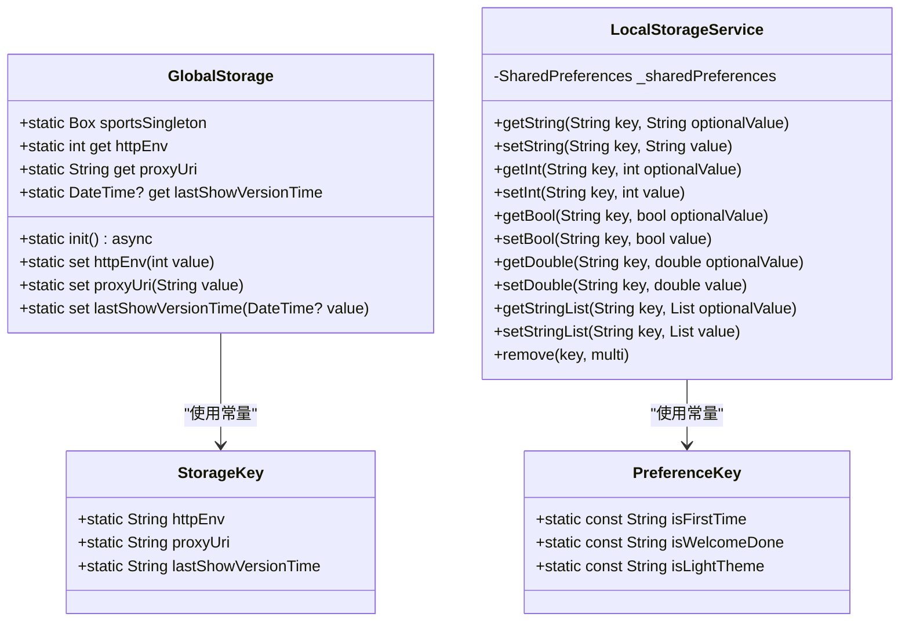
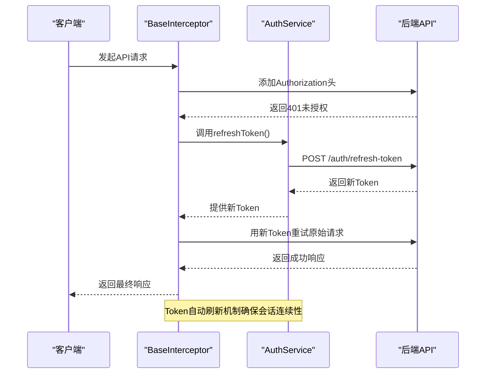
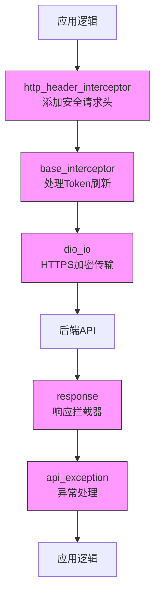
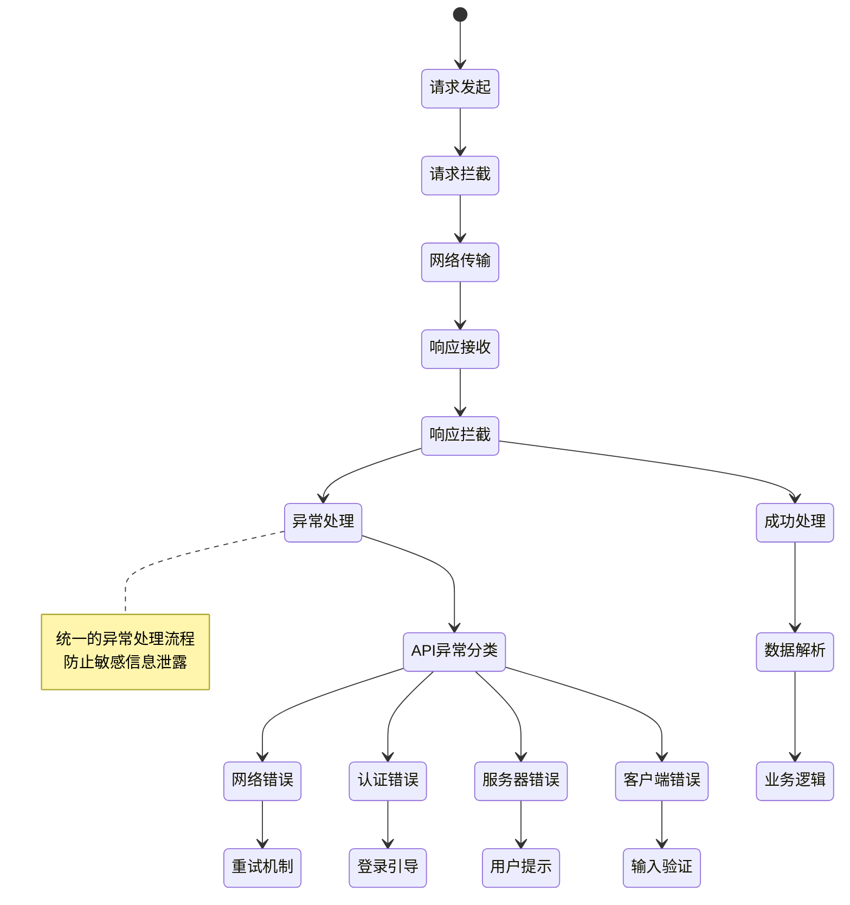

# 安全考虑

<cite>
**本文档引用的文件**  
- [env.dart](file://lib/config/env.dart)
- [auth_service.dart](file://lib/global/service/auth_service.dart)
- [base_interceptor.dart](file://lib/net/base_interceptor.dart)
- [storage.dart](file://lib/global/storage.dart)
- [preference.dart](file://lib/utils/preference.dart)
- [net_manager.dart](file://lib/net/net_manager.dart)
- [http_header_interceptor.dart](file://lib/net/http_header_interceptor.dart)
- [dio_io.dart](file://lib/net/dio_io.dart)
- [api_exception.dart](file://lib/net/api_exception.dart)
- [response.dart](file://lib/net/response.dart)
</cite>

## 目录
1. [简介](#简介)
2. [敏感数据存储安全](#敏感数据存储安全)
3. [API调用安全](#api调用安全)
4. [代码安全](#代码安全)
5. [网络安全](#网络安全)
6. [错误处理与异常安全](#错误处理与异常安全)
7. [总结](#总结)

## 简介
本安全考虑文档全面阐述了油品业务应用中的各项安全实践。文档重点分析了敏感数据的本地存储机制、API通信的安全保障、代码层面的安全设计以及网络传输的加密策略。通过Hive和SharedPreferences实现安全的数据持久化，利用拦截器机制确保会话安全，并通过统一的环境配置管理避免敏感信息硬编码。所有网络通信均强制使用HTTPS加密，确保用户数据在传输过程中的安全性。

## 敏感数据存储安全
本项目通过Hive和SharedPreferences两种机制实现本地数据存储，确保用户凭证等敏感信息的安全性。Hive用于存储结构化数据，如用户环境配置和时间戳等全局状态，而SharedPreferences则用于存储简单的键值对数据，如用户偏好设置和首次启动标志。

所有敏感数据均不以明文形式存储。通过Hive的加密功能（需在初始化时配置加密密钥），确保存储在`sportsGlobal`盒子中的数据经过加密处理。SharedPreferences虽然本身不提供加密功能，但项目通过仅存储非敏感的布尔值和字符串标识（如`IS_FIRST_TIME`、`IS_LIGHT_THEME`）来规避风险。



**图示来源**
- [storage.dart](file://lib/global/storage.dart#L1-L34)
- [preference.dart](file://lib/utils/preference.dart#L1-L58)

**本节来源**
- [storage.dart](file://lib/global/storage.dart#L1-L34)
- [preference.dart](file://lib/utils/preference.dart#L1-L58)

## API调用安全
项目通过Dio网络库的拦截器机制实现API调用的安全管理，核心是`base_interceptor.dart`中定义的`BaseInterceptor`类。该拦截器负责处理Token的自动刷新和过期管理，确保用户会话的安全性和连续性。

认证服务通过`auth_service.dart`中的`AuthService`抽象类定义，采用Retrofit风格的注解方式声明API端点。关键的安全相关端点包括：
- `/auth/login`：用户登录接口，获取初始Token
- `/auth/refresh-token`：Token刷新接口，用于在Token即将过期时获取新的Token
- `/auth/register`：用户注册接口
- `/auth/send-verification`：发送验证码接口

Token刷新机制通过拦截器链实现：当API请求返回401未授权错误时，拦截器自动触发Token刷新流程，使用刷新Token获取新的访问Token，然后重新执行原始请求。这种机制对上层业务逻辑透明，确保了用户体验的流畅性。



**图示来源**
- [base_interceptor.dart](file://lib/net/base_interceptor.dart#L1-L8)
- [auth_service.dart](file://lib/global/service/auth_service.dart#L1-L41)
- [net_manager.dart](file://lib/net/net_manager.dart)

**本节来源**
- [base_interceptor.dart](file://lib/net/base_interceptor.dart#L1-L8)
- [auth_service.dart](file://lib/global/service/auth_service.dart#L1-L41)
- [net_manager.dart](file://lib/net/net_manager.dart)

## 代码安全
项目严格遵守代码安全最佳实践，避免在源代码中硬编码API密钥或敏感配置信息。所有环境相关的配置通过`env.dart`文件中的`HttpEnv`枚举类统一管理。

`HttpEnv`枚举定义了不同的运行环境（正式环境`pro`和测试环境`qa`），通过数值和名称双重标识。环境配置的读取和设置通过`GlobalStorage`类完成，确保配置信息存储在加密的Hive盒子中，而不是暴露在代码中。

这种设计实现了配置与代码的分离，不仅提高了安全性，还增强了应用的可维护性。开发人员可以在不修改代码的情况下切换运行环境，同时避免了敏感信息意外提交到版本控制系统。

```mermaid
classDiagram
class HttpEnv {
+pro(1, 'pro')
+qa(3, 'qa')
-const HttpEnv(this.value, this.name)
+final int value
+final String name
+static HttpEnv mapEnv(int val)
+static HttpEnv mapEnvName(String val)
}
class GlobalStorage {
+static int get httpEnv
+static set httpEnv(int value)
}
HttpEnv --> GlobalStorage : "通过value关联"
note right of HttpEnv
枚举类统一管理环境配置
避免硬编码敏感信息
end note
```

**图示来源**
- [env.dart](file://lib/config/env.dart#L1-L24)
- [storage.dart](file://lib/global/storage.dart#L10-L14)

**本节来源**
- [env.dart](file://lib/config/env.dart#L1-L24)
- [storage.dart](file://lib/global/storage.dart#L10-L14)

## 网络安全
项目实施严格的网络安全策略，确保所有API通信的安全性。网络请求通过`dio_io.dart`配置的Dio客户端发起，强制使用HTTPS协议进行加密传输，防止数据在传输过程中被窃听或篡改。

请求头的安全处理通过`http_header_interceptor.dart`中的拦截器实现。该拦截器负责在每个请求中添加必要的安全头信息，如认证Token、内容类型和用户代理等。通过拦截器链的设计，确保了所有出站请求都经过统一的安全检查和处理。

网络管理层`net_manager.dart`负责Dio客户端的初始化和配置，包括连接超时、接收超时和最大连接数等参数的设置。这些配置有助于防止拒绝服务攻击，并确保网络通信的稳定性和安全性。



**图示来源**
- [http_header_interceptor.dart](file://lib/net/http_header_interceptor.dart)
- [base_interceptor.dart](file://lib/net/base_interceptor.dart#L1-L8)
- [dio_io.dart](file://lib/net/dio_io.dart)
- [response.dart](file://lib/net/response.dart)
- [api_exception.dart](file://lib/net/api_exception.dart)

**本节来源**
- [http_header_interceptor.dart](file://lib/net/http_header_interceptor.dart)
- [dio_io.dart](file://lib/net/dio_io.dart)
- [net_manager.dart](file://lib/net/net_manager.dart)

## 错误处理与异常安全
项目建立了完善的错误处理机制，通过`api_exception.dart`和`response.dart`文件实现统一的异常管理和响应处理。所有网络请求的异常都被捕获并转换为应用级别的错误类型，避免原始异常信息泄露给用户。

`api_exception.dart`定义了标准化的API异常类型，包括网络连接错误、超时错误、服务器错误和客户端错误等。这些异常类型提供了清晰的错误分类，便于上层业务逻辑进行针对性处理。

响应拦截器在`response.dart`中实现，负责解析服务器返回的响应数据，验证响应状态码，并将原始数据转换为统一的响应格式。对于错误响应，拦截器会抛出自定义的API异常，确保错误处理的一致性。



**图示来源**
- [api_exception.dart](file://lib/net/api_exception.dart)
- [response.dart](file://lib/net/response.dart)
- [base_interceptor.dart](file://lib/net/base_interceptor.dart#L1-L8)

**本节来源**
- [api_exception.dart](file://lib/net/api_exception.dart)
- [response.dart](file://lib/net/response.dart)

## 总结
本项目通过多层次的安全机制确保了应用的整体安全性。在数据存储方面，采用Hive加密存储和SharedPreferences分离敏感数据的策略，避免了敏感信息的明文存储。在API通信方面，通过拦截器链实现了Token的自动刷新和过期处理，确保了会话的安全性。代码层面通过环境配置管理避免了敏感信息的硬编码，提高了代码的安全性和可维护性。网络传输强制使用HTTPS加密，并通过请求头拦截器确保了通信的安全性。最后，统一的异常处理机制防止了敏感错误信息的泄露，提供了良好的用户体验。这些安全实践共同构建了一个安全可靠的油品业务应用。