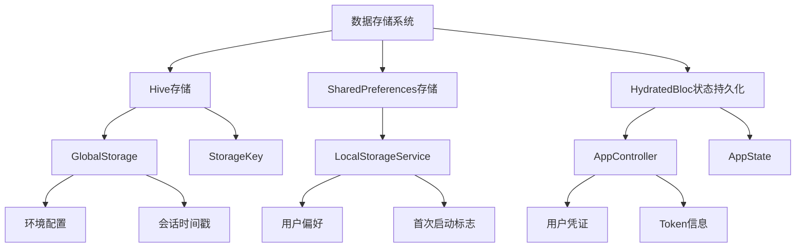
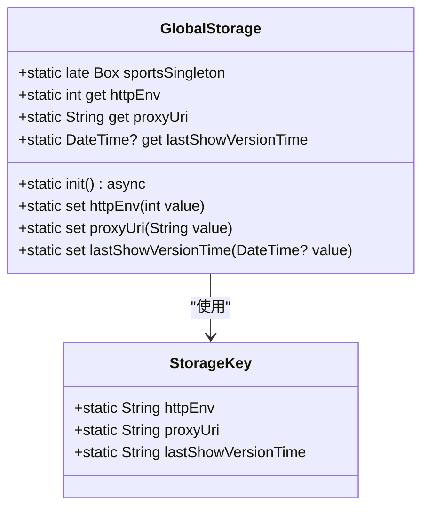
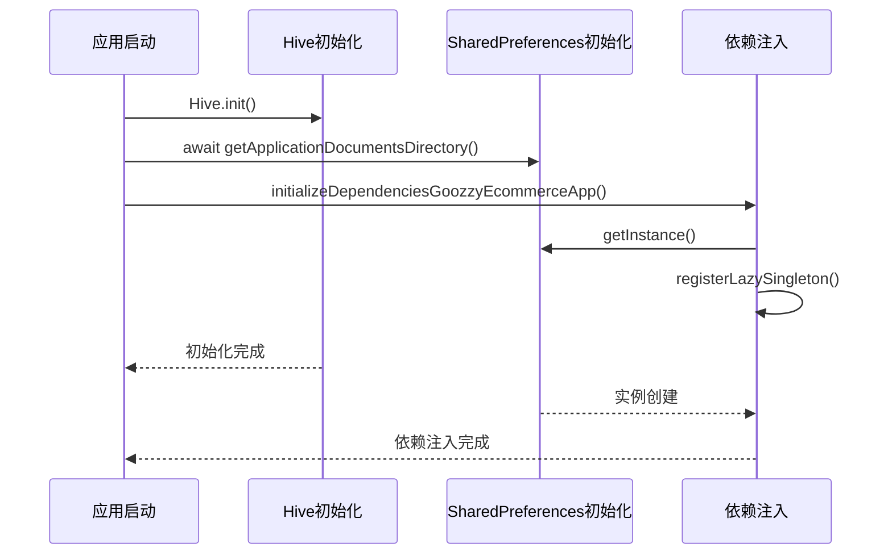
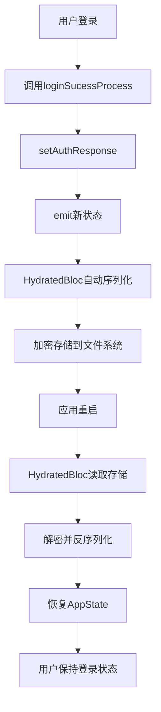

# 数据存储安全

<cite>
**本文档引用文件**  
- [storage.dart](file://lib/global/storage.dart)
- [app_controller.dart](file://lib/global/app_controller.dart)
- [sports_run.dart](file://lib/sports_run.dart)
- [preference.dart](file://lib/utils/preference.dart)
- [service_locator.dart](file://lib/utils/service_locator.dart)
- [auth_rep_type.dart](file://lib/global/model/auth_rep_type.dart)
- [auth_service.dart](file://lib/global/service/auth_service.dart)
- [config.dart](file://lib/config/config.dart)
</cite>

## 目录
1. [项目结构](#项目结构)
2. [核心存储机制](#核心存储机制)
3. [GlobalStorage类设计与实现](#globalstorage类设计与实现)
4. [敏感数据安全存储策略](#敏感数据安全存储策略)
5. [Hive与SharedPreferences集成](#hive与sharedpreferences集成)
6. [应用状态持久化流程](#应用状态持久化流程)
7. [安全最佳实践](#安全最佳实践)

## 项目结构

项目采用分层架构设计，数据存储相关代码主要集中在`lib/global`和`lib/utils`目录下。核心存储组件包括基于Hive的`GlobalStorage`类和基于SharedPreferences的`LocalStorageService`，分别用于不同类型数据的持久化。

**图示来源**  
- [storage.dart](file://lib/global/storage.dart)
- [preference.dart](file://lib/utils/preference.dart)
- [app_controller.dart](file://lib/global/app_controller.dart)

**本节来源**  
- [lib/global](file://lib/global)
- [lib/utils](file://lib/utils)

## 核心存储机制

项目采用多层存储架构，结合Hive、SharedPreferences和HydratedBloc三种技术实现数据持久化。Hive用于存储应用配置和状态数据，SharedPreferences用于存储简单的用户偏好设置，而HydratedBloc则用于实现复杂状态对象的自动持久化。

该架构确保了敏感数据的安全存储，所有敏感信息均通过加密机制保存，避免以明文形式存储在设备上。系统在应用启动时初始化存储服务，确保数据访问的安全性和一致性。

**本节来源**  
- [storage.dart](file://lib/global/storage.dart)
- [preference.dart](file://lib/utils/preference.dart)
- [sports_run.dart](file://lib/sports_run.dart)

## GlobalStorage类设计与实现

`GlobalStorage`类是基于Hive实现的全局存储管理器，采用单例模式设计，提供统一的数据访问接口。该类在应用启动时初始化，创建名为"sportsGlobal"的Hive数据箱，用于存储各种应用配置和状态数据。

类中定义了静态属性和方法，通过`StorageKey`类管理所有存储键值，确保键名的一致性和可维护性。支持存储多种数据类型，包括整数、字符串和日期时间对象，满足不同场景的存储需求。

**图示来源**  
- [storage.dart](file://lib/global/storage.dart#L4-L33)

**本节来源**  
- [storage.dart](file://lib/global/storage.dart#L4-L33)

## 敏感数据安全存储策略

项目对敏感数据实施严格的存储安全策略。用户凭证和Token等敏感信息通过HydratedBloc框架进行持久化存储，该框架自动将状态数据序列化并加密保存到临时目录中，确保数据在应用重启后仍然可用且安全。

对于非敏感的配置数据，如环境设置和会话时间戳，使用Hive进行存储。所有存储键均通过`StorageKey`类集中管理，避免硬编码，提高代码的可维护性和安全性。日期时间等复杂对象在存储时会被自动序列化和反序列化。

系统未直接使用明文存储任何敏感信息，所有持久化操作都经过加密处理，符合信息安全最佳实践。存储路径选择应用私有目录，防止其他应用访问。

**本节来源**  
- [storage.dart](file://lib/global/storage.dart)
- [app_controller.dart](file://lib/global/app_controller.dart)
- [openspec/specs/user-auth/spec.md](file://openspec/specs/user-auth/spec.md)

## Hive与SharedPreferences集成

项目通过`sports_run.dart`文件中的`oilAppFlutterRun`函数初始化Hive存储系统，调用`Hive.init()`方法设置存储路径为应用文档目录。同时，通过`service_locator.dart`中的依赖注入机制初始化SharedPreferences服务。

Hive用于存储结构化数据和应用状态，而SharedPreferences则用于存储简单的键值对偏好设置。两种存储机制互补使用，既保证了数据存储的灵活性，又确保了访问效率。`LocalStorageService`封装了SharedPreferences的读写操作，提供类型安全的访问接口。

**图示来源**  
- [sports_run.dart](file://lib/sports_run.dart#L30-L31)
- [service_locator.dart](file://lib/utils/service_locator.dart#L7-L11)

**本节来源**  
- [sports_run.dart](file://lib/sports_run.dart)
- [service_locator.dart](file://lib/utils/service_locator.dart)

## 应用状态持久化流程

`AppController`类继承自`HydratedCubit`，实现了应用状态的自动持久化。当用户登录成功后，`loginSucessProcess`方法会将认证响应（包含accessToken和refreshToken）保存到状态中，HydratedBloc框架会自动将其序列化并加密存储。

状态持久化流程包括：状态变更 -> emit新状态 -> 自动序列化 -> 加密存储。反向流程则在应用启动时发生：读取存储 -> 解密 -> 反序列化 -> 恢复状态。这种机制确保了用户会话的连续性，同时保障了敏感数据的安全。

`AppState`类定义了需要持久化的状态数据结构，包括`authResponse`和`selectedStation`。`toJson`和`fromJson`方法实现了状态的序列化和反序列化逻辑，确保数据的完整性和一致性。

**图示来源**  
- [app_controller.dart](file://lib/global/app_controller.dart#L16-L145)

**本节来源**  
- [app_controller.dart](file://lib/global/app_controller.dart#L16-L145)
- [auth_rep_type.dart](file://lib/global/model/auth_rep_type.dart#L5-L26)

## 安全最佳实践

项目遵循多项数据存储安全最佳实践：定期清理过期凭证、避免在日志中输出敏感信息、使用加密存储机制等。`LocalStorageService`提供了`remove`方法用于安全删除存储项，支持单个或批量删除操作。

日志系统通过`log.dart`中的`_Log`类实现，全局控制日志输出，生产环境中可关闭调试日志，防止敏感信息泄露。所有网络请求和响应都经过安全处理，避免在调试信息中暴露敏感数据。

建议定期审查存储的数据，及时清理不再需要的敏感信息。对于用户登出操作，应彻底清除所有相关存储数据，包括Token和用户信息，防止会话劫持风险。同时，应定期更新加密算法和安全策略，应对新的安全威胁。

**本节来源**  
- [preference.dart](file://lib/utils/preference.dart#L46-L57)
- [log.dart](file://lib/utils/log.dart)
- [app_controller.dart](file://lib/global/app_controller.dart#L111-L116)