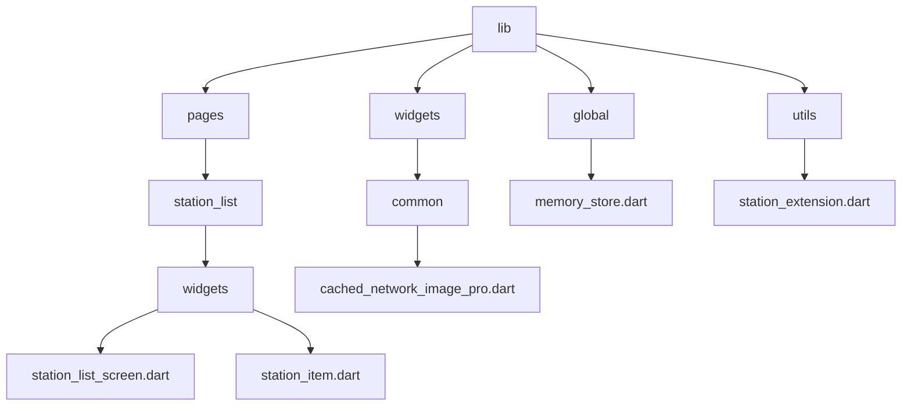
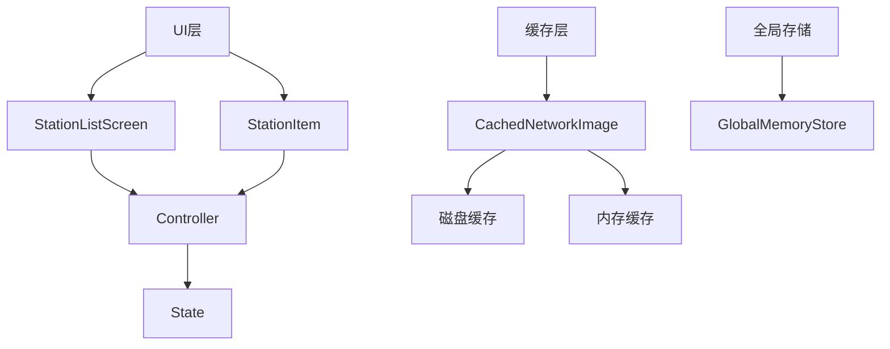
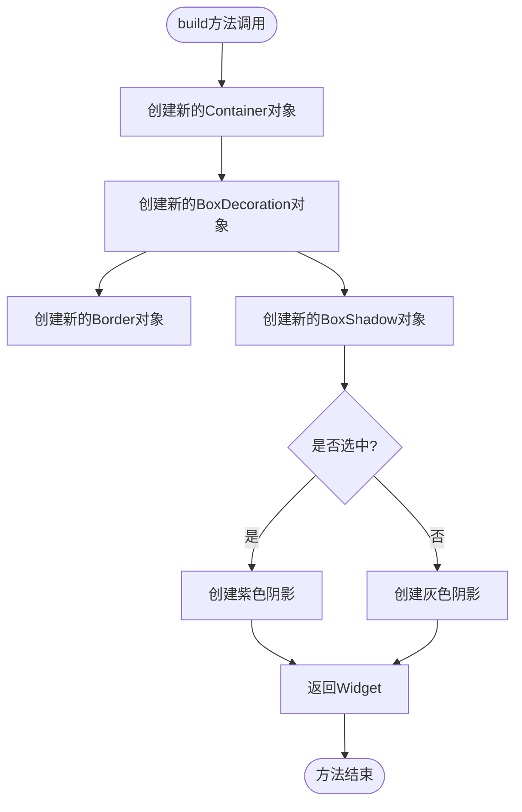
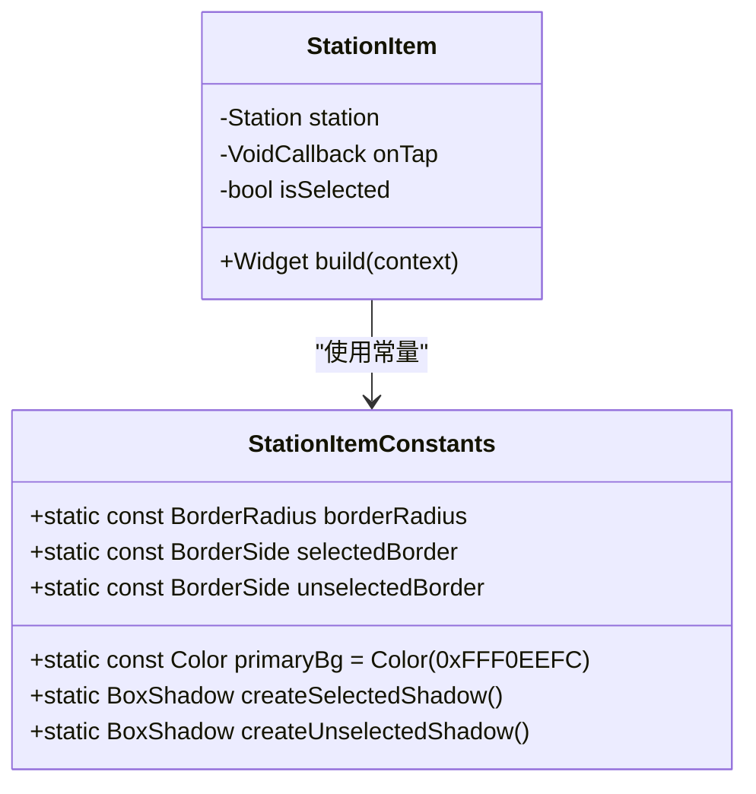
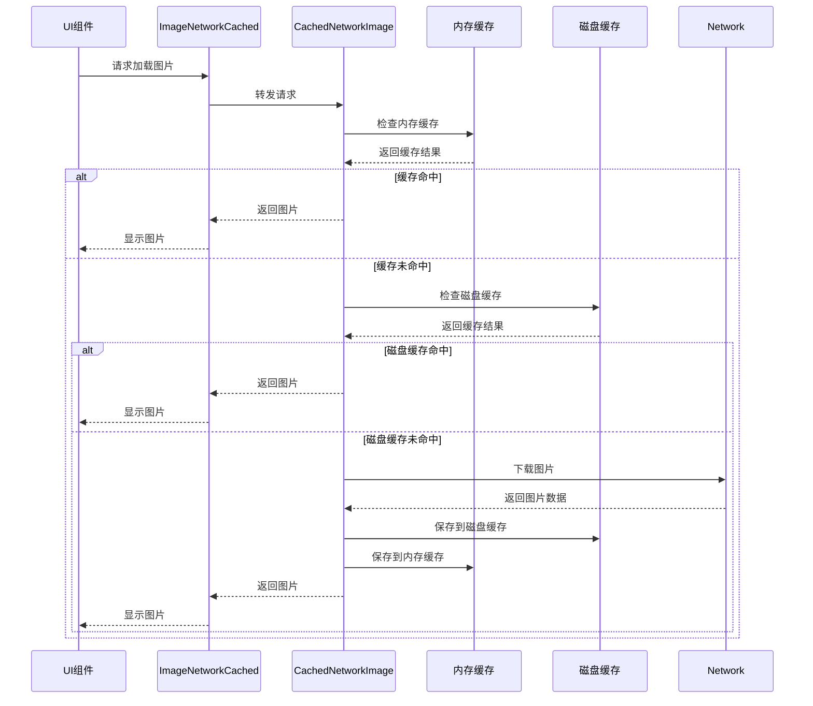
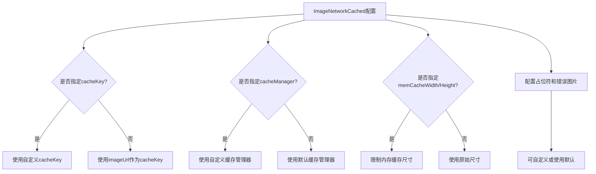
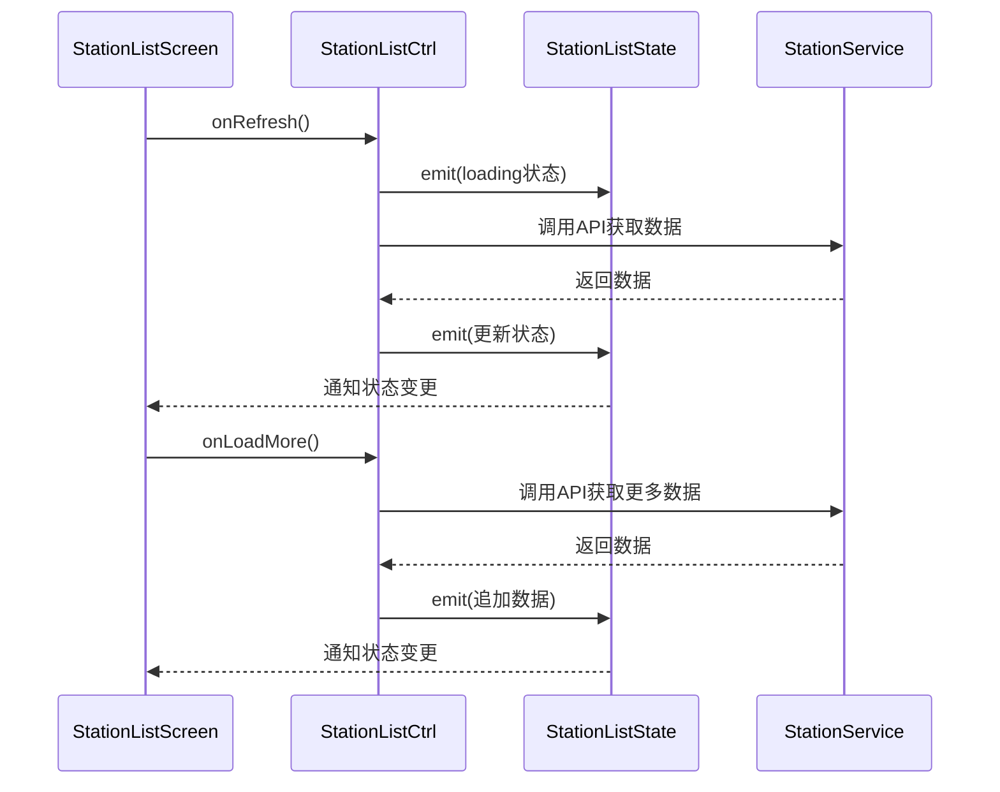
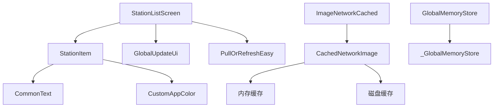

# 内存管理

<cite>
**本文档引用的文件**   
- [station_list_screen.dart](file://lib/pages/station_list/widgets/station_list_screen.dart)
- [station_item.dart](file://lib/pages/station_list/widgets/station_item.dart)
- [cached_network_image_pro.dart](file://lib/widgets/common/cached_network_image_pro.dart)
- [memory_store.dart](file://lib/global/memory_store.dart)
- [station_extension.dart](file://lib/utils/station_extension.dart)
- [controller.dart](file://lib/pages/station_list/controller.dart)
- [state.dart](file://lib/pages/station_list/state.dart)
- [analysis_options.yaml](file://analysis_options.yaml)
- [sports_run.dart](file://lib/sports_run.dart)
- [main.dart](file://lib/main.dart)
</cite>

## 目录
1. [简介](#简介)
2. [项目结构](#项目结构)
3. [核心组件](#核心组件)
4. [架构概述](#架构概述)
5. [详细组件分析](#详细组件分析)
6. [依赖分析](#依赖分析)
7. [性能考虑](#性能考虑)
8. [故障排除指南](#故障排除指南)
9. [结论](#结论)

## 简介
本文档旨在深入探讨Flutter应用中的内存管理优化策略，重点关注减少内存消耗的实践方法。通过分析station_list_screen.dart中StationItem的重复实例化问题，展示如何通过提取常量和优化状态管理来改善内存使用。文档将详细介绍final变量在防止重复实例化中的关键作用，以及如何利用Dart的垃圾回收机制进行内存优化。同时，分析CachedNetworkImage组件的缓存策略对内存的影响，包括cacheKey和cacheManager的合理配置。最后，提供内存泄漏检测方法和Flutter内存分析工具的使用指南，帮助开发者识别和解决潜在的内存问题。

## 项目结构
本项目采用典型的Flutter应用结构，主要功能模块按页面组织在lib/pages目录下。内存管理相关的核心组件分布在widgets和global目录中，其中station_list模块作为分析重点，展示了列表项重复实例化导致的内存问题。项目使用BLoC模式进行状态管理，通过controller和state文件分离业务逻辑与UI状态。

**图示来源**
- [station_list_screen.dart](file://lib/pages/station_list/widgets/station_list_screen.dart#L1-L191)
- [station_item.dart](file://lib/pages/station_list/widgets/station_item.dart#L1-L119)
- [cached_network_image_pro.dart](file://lib/widgets/common/cached_network_image_pro.dart#L1-L141)

**本节来源**
- [station_list_screen.dart](file://lib/pages/station_list/widgets/station_list_screen.dart#L1-L191)
- [station_item.dart](file://lib/pages/station_list/widgets/station_item.dart#L1-L119)

## 核心组件
核心内存管理组件包括StationItem列表项、CachedNetworkImagePro图片缓存组件和GlobalMemoryStore全局内存存储。StationItem在build方法中存在重复创建对象的问题，是内存优化的主要关注点。CachedNetworkImagePro封装了网络图片的缓存逻辑，直接影响内存使用效率。GlobalMemoryStore实现了单例模式，用于保存临时数据，避免了不必要的对象重复创建。

**本节来源**
- [station_item.dart](file://lib/pages/station_list/widgets/station_item.dart#L1-L119)
- [cached_network_image_pro.dart](file://lib/widgets/common/cached_network_image_pro.dart#L1-L141)
- [memory_store.dart](file://lib/global/memory_store.dart#L1-L17)

## 架构概述
应用采用分层架构，UI层与业务逻辑层分离。在内存管理方面，通过BLoC模式实现状态管理，减少不必要的UI重建。图片加载使用第三方缓存库cached_network_image，结合自定义的ImageNetworkCached组件实现高效的内存和磁盘缓存。全局状态通过单例模式的GlobalMemoryStore管理，确保数据的一致性和内存效率。

**图示来源**
- [station_list_screen.dart](file://lib/pages/station_list/widgets/station_list_screen.dart#L1-L191)
- [controller.dart](file://lib/pages/station_list/controller.dart#L1-L110)
- [state.dart](file://lib/pages/station_list/state.dart#L1-L44)
- [cached_network_image_pro.dart](file://lib/widgets/common/cached_network_image_pro.dart#L1-L141)

## 详细组件分析

### StationItem组件分析
StationItem组件作为列表项，在station_list_screen中被频繁创建。当前实现中，每个StationItem实例在build时都会创建新的Container、BoxDecoration和BoxShadow对象，导致大量临时对象的生成，增加垃圾回收压力。

#### 对象重复实例化问题

**图示来源**
- [station_item.dart](file://lib/pages/station_list/widgets/station_item.dart#L20-L118)

#### 优化策略：常量提取
通过将不变的样式属性提取为静态常量，避免在每次build时创建新对象：

**图示来源**
- [station_item.dart](file://lib/pages/station_list/widgets/station_item.dart#L8-L119)

**本节来源**
- [station_item.dart](file://lib/pages/station_list/widgets/station_item.dart#L1-L119)
- [station_extension.dart](file://lib/utils/station_extension.dart#L1-L24)

### 图片缓存组件分析
ImageNetworkCached组件封装了cached_network_image的功能，提供了更灵活的配置选项。该组件直接影响应用的内存使用，特别是在列表中显示大量网络图片时。

#### 缓存策略分析

**图示来源**
- [cached_network_image_pro.dart](file://lib/widgets/common/cached_network_image_pro.dart#L10-L141)

#### 缓存配置优化

**图示来源**
- [cached_network_image_pro.dart](file://lib/widgets/common/cached_network_image_pro.dart#L10-L141)

**本节来源**
- [cached_network_image_pro.dart](file://lib/widgets/common/cached_network_image_pro.dart#L1-L141)

### 状态管理分析
应用使用BLoC模式进行状态管理，通过StationListCtrl和StationListState实现业务逻辑与UI的分离。这种模式有助于减少不必要的UI重建，从而降低内存消耗。

#### 状态管理流程

**图示来源**
- [controller.dart](file://lib/pages/station_list/controller.dart#L13-L110)
- [state.dart](file://lib/pages/station_list/state.dart#L3-L44)

**本节来源**
- [controller.dart](file://lib/pages/station_list/controller.dart#L1-L110)
- [state.dart](file://lib/pages/station_list/state.dart#L1-L44)

## 依赖分析
项目依赖关系清晰，各组件职责分明。StationListScreen依赖StationItem组件显示列表项，同时通过GlobalUpdateUi依赖全局应用状态。图片缓存组件依赖cached_network_image库实现核心功能，而全局内存存储采用单例模式确保全局唯一性。

**图示来源**
- [station_list_screen.dart](file://lib/pages/station_list/widgets/station_list_screen.dart#L1-L191)
- [station_item.dart](file://lib/pages/station_list/widgets/station_item.dart#L1-L119)
- [cached_network_image_pro.dart](file://lib/widgets/common/cached_network_image_pro.dart#L1-L141)
- [memory_store.dart](file://lib/global/memory_store.dart#L1-L17)

**本节来源**
- [station_list_screen.dart](file://lib/pages/station_list/widgets/station_list_screen.dart#L1-L191)
- [station_item.dart](file://lib/pages/station_list/widgets/station_item.dart#L1-L119)
- [cached_network_image_pro.dart](file://lib/widgets/common/cached_network_image_pro.dart#L1-L141)

## 性能考虑
在Flutter应用中，避免在build方法中创建新对象是关键的性能优化策略。每次创建新对象都会增加垃圾回收的负担，可能导致UI卡顿。通过使用final变量和提取常量，可以显著减少对象创建次数。对于列表项组件，应确保不变的样式属性被缓存或声明为静态常量。图片缓存方面，合理配置memCacheWidth和memCacheHeight可以控制内存使用，避免大图片占用过多内存。使用自定义cacheKey可以实现更精确的缓存控制，而自定义cacheManager则允许实现特定的缓存策略。

## 故障排除指南
内存泄漏检测是性能优化的重要环节。项目中已集成UME调试工具，在调试模式下启用MemoryInfoPage和Performance插件，可以实时监控内存使用情况。通过分析堆栈信息，可以识别出持有对象引用的根源，从而解决内存泄漏问题。对于列表性能问题，应检查是否在build方法中创建了不必要的对象，并确保使用const构造函数创建不可变小部件。使用Flutter DevTools的内存面板可以深入分析内存分配情况，识别内存热点。

**本节来源**
- [sports_run.dart](file://lib/sports_run.dart#L82-L116)
- [analysis_options.yaml](file://analysis_options.yaml#L162-L175)

## 结论
有效的内存管理是Flutter应用性能优化的核心。通过避免在build方法中创建新对象、合理使用final变量和常量、优化图片缓存策略以及正确管理应用状态，可以显著减少内存消耗。StationItem组件的优化案例表明，简单的代码重构就能带来明显的性能提升。建议开发者遵循Dart的最佳实践，利用分析工具持续监控内存使用，确保应用的流畅性和稳定性。