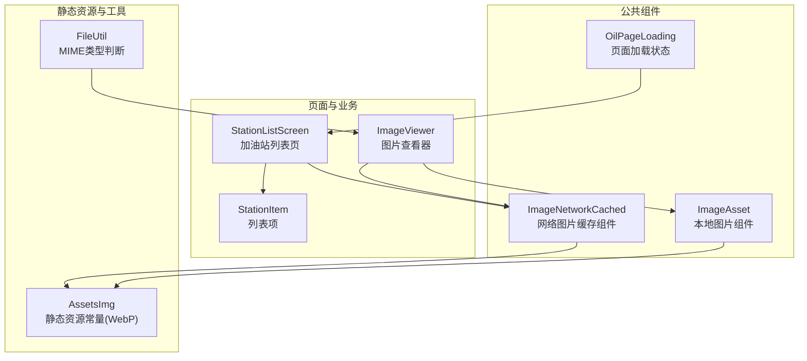
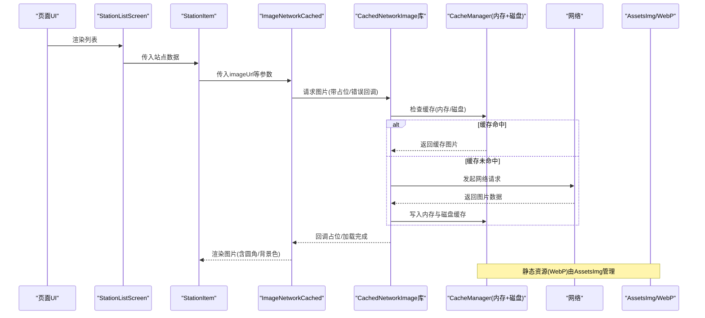
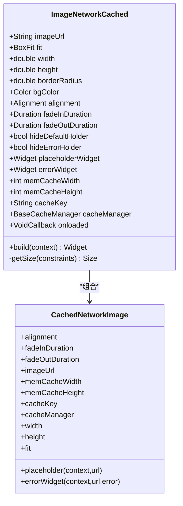
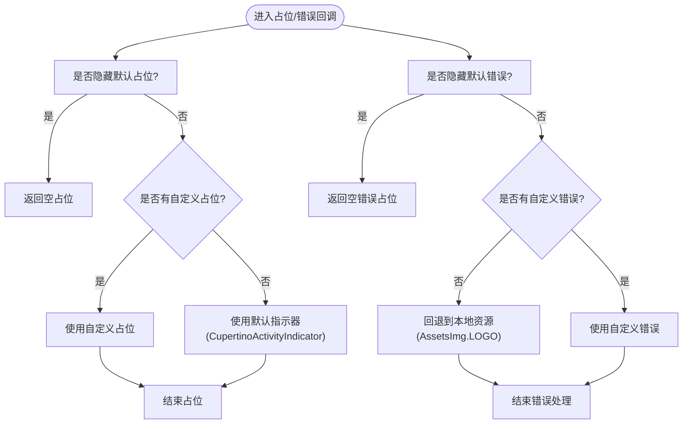
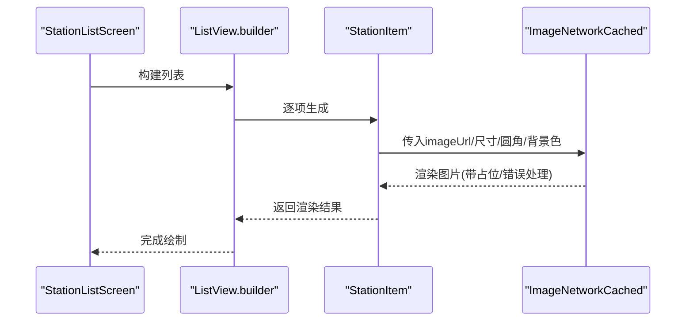
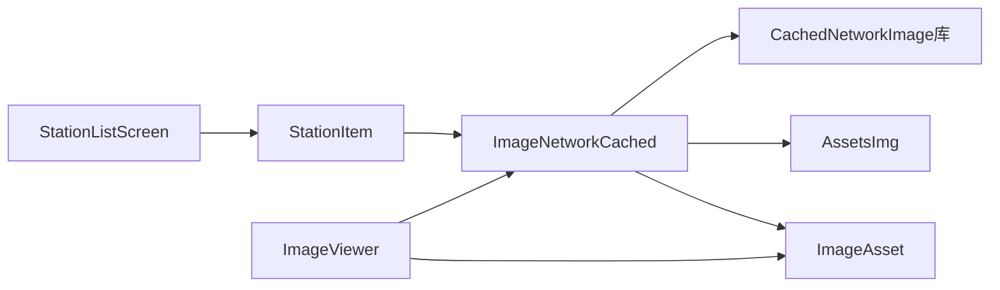

# 图片性能优化

<cite>
**本文引用的文件**
- [cached_network_image_pro.dart](file://lib/widgets/common/cached_network_image_pro.dart)
- [img.dart](file://lib/static/img.dart)
- [image_asset_pro.dart](file://lib/widgets/common/image_asset_pro.dart)
- [file_util.dart](file://lib/utils/file_util.dart)
- [station_list_screen.dart](file://lib/pages/station_list/widgets/station_list_screen.dart)
- [station_item.dart](file://lib/pages/station_list/widgets/station_item.dart)
- [image_viewer.dart](file://lib/pages/pay_order_detail/widgets/image_viewer.dart)
- [page_loading.dart](file://lib/widgets/common/page_loading.dart)
</cite>

## 目录
1. [简介](#简介)
2. [项目结构](#项目结构)
3. [核心组件](#核心组件)
4. [架构总览](#架构总览)
5. [组件详解](#组件详解)
6. [依赖关系分析](#依赖关系分析)
7. [性能考量](#性能考量)
8. [故障排查指南](#故障排查指南)
9. [结论](#结论)
10. [附录](#附录)

## 简介
本文件聚焦于项目中的图片性能优化实践，系统梳理并解析了网络图片缓存、占位与错误处理、WebP格式优势、内存缓存尺寸控制等关键点。重点围绕 ImageNetworkCached 组件（基于 cached_network_image 库）的实现机制展开，说明其如何实现内存与磁盘双重缓存；解释 gaplessPlayback 的替代方案与体验优化；阐述 memCacheWidth/memCacheHeight 对内存占用的优化；并通过加油站列表页面的实际应用，展示从加载到渲染的完整流程与最佳实践。

## 项目结构
与图片性能相关的核心文件分布如下：
- 公共网络图片组件：lib/widgets/common/cached_network_image_pro.dart
- 静态资源常量：lib/static/img.dart（包含 WebP 资源）
- 本地图片组件：lib/widgets/common/image_asset_pro.dart
- 文件类型工具：lib/utils/file_util.dart（MIME 类型判断）
- 加油站列表页面：lib/pages/station_list/widgets/station_list_screen.dart、lib/pages/station_list/widgets/station_item.dart
- 图片查看器（含加载与错误构建）：lib/pages/pay_order_detail/widgets/image_viewer.dart
- 页面级加载状态组件：lib/widgets/common/page_loading.dart

图表来源
- [cached_network_image_pro.dart](file://lib/widgets/common/cached_network_image_pro.dart#L1-L141)
- [image_asset_pro.dart](file://lib/widgets/common/image_asset_pro.dart#L1-L51)
- [img.dart](file://lib/static/img.dart#L1-L19)
- [station_list_screen.dart](file://lib/pages/station_list/widgets/station_list_screen.dart#L1-L191)
- [station_item.dart](file://lib/pages/station_list/widgets/station_item.dart#L1-L119)
- [image_viewer.dart](file://lib/pages/pay_order_detail/widgets/image_viewer.dart#L80-L162)
- [page_loading.dart](file://lib/widgets/common/page_loading.dart#L1-L149)

章节来源
- [cached_network_image_pro.dart](file://lib/widgets/common/cached_network_image_pro.dart#L1-L141)
- [station_list_screen.dart](file://lib/pages/station_list/widgets/station_list_screen.dart#L1-L191)

## 核心组件
- ImageNetworkCached：封装 cached_network_image，提供占位、错误处理、内存缓存尺寸控制、背景色、圆角裁剪等能力，支持自定义缓存键与缓存管理器。
- ImageAsset：封装本地资源图片，支持圆角与尺寸控制。
- AssetsImg：集中管理静态资源路径，包含多张 WebP 图片。
- FileUtil：根据文件扩展名或 MIME 判断图片类型，辅助上传与资源识别。
- ImageViewer：在图片查看场景中提供 loadingBuilder 与 errorBuilder，增强加载与错误体验。
- OilPageLoading：页面级加载状态容器，统一处理加载、错误与空状态。

章节来源
- [cached_network_image_pro.dart](file://lib/widgets/common/cached_network_image_pro.dart#L1-L141)
- [image_asset_pro.dart](file://lib/widgets/common/image_asset_pro.dart#L1-L51)
- [img.dart](file://lib/static/img.dart#L1-L19)
- [file_util.dart](file://lib/utils/file_util.dart#L1-L43)
- [image_viewer.dart](file://lib/pages/pay_order_detail/widgets/image_viewer.dart#L80-L162)
- [page_loading.dart](file://lib/widgets/common/page_loading.dart#L1-L149)

## 架构总览
下图展示了图片加载从页面到组件再到缓存与资源的整体流程。

图表来源
- [station_list_screen.dart](file://lib/pages/station_list/widgets/station_list_screen.dart#L110-L131)
- [station_item.dart](file://lib/pages/station_list/widgets/station_item.dart#L1-L119)
- [cached_network_image_pro.dart](file://lib/widgets/common/cached_network_image_pro.dart#L56-L113)
- [img.dart](file://lib/static/img.dart#L1-L19)

## 组件详解

### ImageNetworkCached 组件解析
- 双重缓存机制
  - 通过传入 BaseCacheManager 或 cacheKey，结合 cached_network_image 的默认缓存策略，实现内存与磁盘双重缓存。
  - 支持自定义缓存管理器，便于隔离不同业务域的缓存空间。
- 占位与错误处理
  - 占位：默认提供 CupertinoActivityIndicator，可隐藏默认占位或自定义 placeholderWidget。
  - 错误：默认回退到本地资源（AssetsImg.LOGO），可隐藏默认错误占位或自定义 errorWidget。
- 圆角与背景
  - 通过 ClipRRect 与 Container 的 bgColor 实现圆角与背景色，避免闪烁时的白块突显。
- 内存缓存尺寸控制
  - memCacheWidth/memCacheHeight 控制内存缓存的像素尺寸，降低内存占用，提高缓存命中率与渲染效率。
- 加载动画
  - fadeInDuration/fadeOutDuration 控制图片淡入淡出时长，改善视觉过渡。

图表来源
- [cached_network_image_pro.dart](file://lib/widgets/common/cached_network_image_pro.dart#L10-L113)

章节来源
- [cached_network_image_pro.dart](file://lib/widgets/common/cached_network_image_pro.dart#L1-L141)

### 加载与错误构建流程
- 占位逻辑：当 hideDefaultHolder 为 false 时，优先使用自定义 placeholderWidget；否则使用默认指示器。
- 错误逻辑：当 hideErrorHolder 为 false 时，优先使用自定义 errorWidget；否则回退到本地资源（AssetsImg.LOGO）。
- 尺寸计算：在 LayoutBuilder 中根据约束计算占位尺寸，避免布局抖动。

图表来源
- [cached_network_image_pro.dart](file://lib/widgets/common/cached_network_image_pro.dart#L71-L106)

章节来源
- [cached_network_image_pro.dart](file://lib/widgets/common/cached_network_image_pro.dart#L71-L106)

### 加油站列表中的图片加载实践
- 列表渲染：StationListScreen 使用 ListView.builder 渲染 StationItem。
- 图片组件：在列表项中使用 ImageNetworkCached 传入网络图片地址，设置合适的宽高与圆角。
- 性能要点：通过 memCacheWidth/memCacheHeight 控制内存缓存尺寸；通过 bgColor 与 ClipRRect 减少闪烁；通过占位与错误处理提升体验。

图表来源
- [station_list_screen.dart](file://lib/pages/station_list/widgets/station_list_screen.dart#L110-L131)
- [station_item.dart](file://lib/pages/station_list/widgets/station_item.dart#L1-L119)
- [cached_network_image_pro.dart](file://lib/widgets/common/cached_network_image_pro.dart#L56-L113)

章节来源
- [station_list_screen.dart](file://lib/pages/station_list/widgets/station_list_screen.dart#L110-L131)
- [station_item.dart](file://lib/pages/station_list/widgets/station_item.dart#L1-L119)

### WebP 格式的优势与应用
- 优势：WebP 在同等画质下通常比 JPEG/PNG 更小，显著降低网络传输与存储成本，提升加载速度。
- 应用：AssetsImg 中多处使用 WebP 资源（如 LOGO、空状态等），配合 ImageAsset 统一加载入口，确保一致的渲染与缓存行为。

章节来源
- [img.dart](file://lib/static/img.dart#L1-L19)
- [image_asset_pro.dart](file://lib/widgets/common/image_asset_pro.dart#L1-L51)

### MIME 类型与图片识别
- FileUtil 提供根据扩展名或 MIME 判断图片类型的能力，有助于上传与资源识别的一致性。

章节来源
- [file_util.dart](file://lib/utils/file_util.dart#L1-L43)

### gaplessPlayback 的替代与体验优化
- 项目中未直接使用 gaplessPlayback 属性。但通过以下方式达到类似体验：
  - 使用 fadeInDuration/fadeOutDuration 控制淡入淡出，避免图片“闪现”。
  - 使用 bgColor 与 ClipRRect 提前填充背景，减少布局抖动与闪烁。
  - 占位与错误处理统一，保证在加载与失败时的视觉一致性。

章节来源
- [cached_network_image_pro.dart](file://lib/widgets/common/cached_network_image_pro.dart#L56-L113)

## 依赖关系分析
- ImageNetworkCached 依赖 cached_network_image 与 flutter_cache_manager 实现缓存；依赖 AssetsImg 与 ImageAsset 提供本地回退。
- 页面层通过 StationListScreen 与 StationItem 使用 ImageNetworkCached，形成“页面-组件-缓存”的清晰分层。
- ImageViewer 在图片查看场景中提供 loadingBuilder 与 errorBuilder，补充了占位与错误处理的体验。

图表来源
- [station_list_screen.dart](file://lib/pages/station_list/widgets/station_list_screen.dart#L110-L131)
- [station_item.dart](file://lib/pages/station_list/widgets/station_item.dart#L1-L119)
- [cached_network_image_pro.dart](file://lib/widgets/common/cached_network_image_pro.dart#L1-L141)
- [image_asset_pro.dart](file://lib/widgets/common/image_asset_pro.dart#L1-L51)
- [image_viewer.dart](file://lib/pages/pay_order_detail/widgets/image_viewer.dart#L80-L162)

章节来源
- [station_list_screen.dart](file://lib/pages/station_list/widgets/station_list_screen.dart#L110-L131)
- [station_item.dart](file://lib/pages/station_list/widgets/station_item.dart#L1-L119)
- [cached_network_image_pro.dart](file://lib/widgets/common/cached_network_image_pro.dart#L1-L141)
- [image_asset_pro.dart](file://lib/widgets/common/image_asset_pro.dart#L1-L51)
- [image_viewer.dart](file://lib/pages/pay_order_detail/widgets/image_viewer.dart#L80-L162)

## 性能考量
- 内存缓存尺寸控制
  - 合理设置 memCacheWidth/memCacheHeight，避免过大导致内存压力，过小导致频繁解码与缓存失效。
  - 建议按设备屏幕密度与列表滚动频率进行权衡配置。
- 缓存键与缓存管理器
  - 对于多业务域图片，建议使用独立 BaseCacheManager 或 cacheKey，避免互相污染。
- 占位与错误处理
  - 使用统一的占位与错误样式，减少布局抖动与闪烁，提升感知性能。
- WebP 与资源管理
  - 优先使用 WebP，结合 AssetsImg 统一管理，确保资源路径与缓存策略一致。
- 列表渲染
  - 在列表中尽量固定图片尺寸，避免频繁测量与重绘；使用合适的 fit 与 alignment，减少额外布局开销。

[本节为通用性能建议，不直接分析具体文件]

## 故障排查指南
- 图片不显示或一直显示占位
  - 检查 imageUrl 是否有效；确认缓存键 cacheKey 是否正确；必要时更换 BaseCacheManager。
  - 查看占位与错误回调是否被隐藏（hideDefaultHolder/hideErrorHolder）。
- 图片闪烁或白块明显
  - 调整 bgColor 与 ClipRRect 圆角，确保背景色与容器一致。
  - 适当增大 fadeInDuration，使过渡更自然。
- 加载缓慢或内存占用过高
  - 降低 memCacheWidth/memCacheHeight；检查是否同时缓存了过多尺寸。
  - 确认网络图片尺寸与显示尺寸匹配，避免过度放大。
- 错误回退不符合预期
  - 检查 errorWidget 是否被设置；若未设置，将回退到本地资源（AssetsImg.LOGO）。
- 页面级加载状态
  - 使用 OilPageLoading 统一处理加载、错误与空状态，避免重复逻辑。

章节来源
- [cached_network_image_pro.dart](file://lib/widgets/common/cached_network_image_pro.dart#L56-L113)
- [page_loading.dart](file://lib/widgets/common/page_loading.dart#L1-L149)

## 结论
通过 ImageNetworkCached 组件与缓存策略、占位与错误处理、WebP 资源管理、内存缓存尺寸控制等手段，项目实现了稳定高效的网络图片加载体验。在加油站列表等高频场景中，这些实践有效降低了闪烁、提升了首屏速度与整体流畅度。建议在新业务中复用该组件与策略，持续优化缓存键与尺寸配置，以获得更好的性能与用户体验。

[本节为总结性内容，不直接分析具体文件]

## 附录
- 关键参数速览
  - memCacheWidth/memCacheHeight：控制内存缓存像素尺寸，平衡内存与命中率。
  - cacheKey/cacheManager：控制缓存键与缓存空间，避免互相污染。
  - bgColor/ClipRRect：减少闪烁与布局抖动。
  - fadeInDuration/fadeOutDuration：优化视觉过渡。
  - placeholderWidget/errorWidget：统一占位与错误样式，提升一致性。

[本节为概览性内容，不直接分析具体文件]