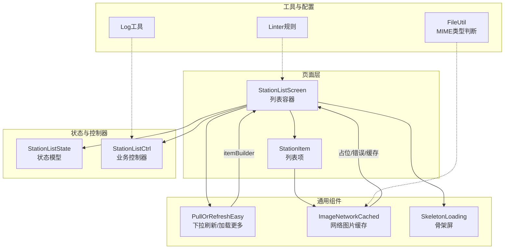
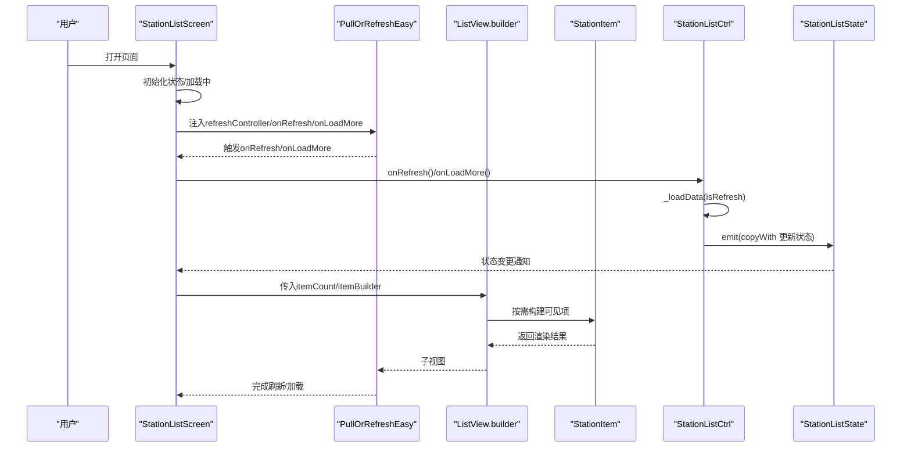
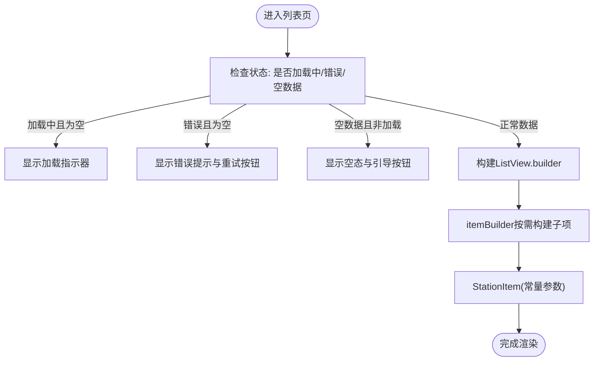
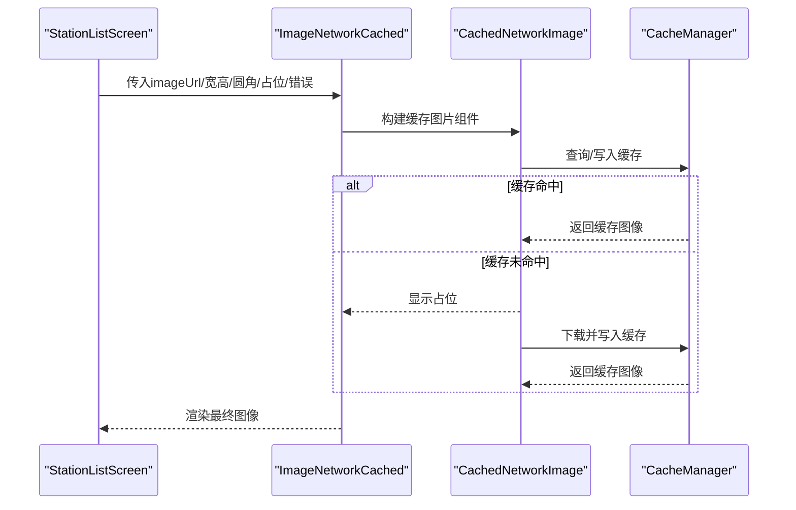
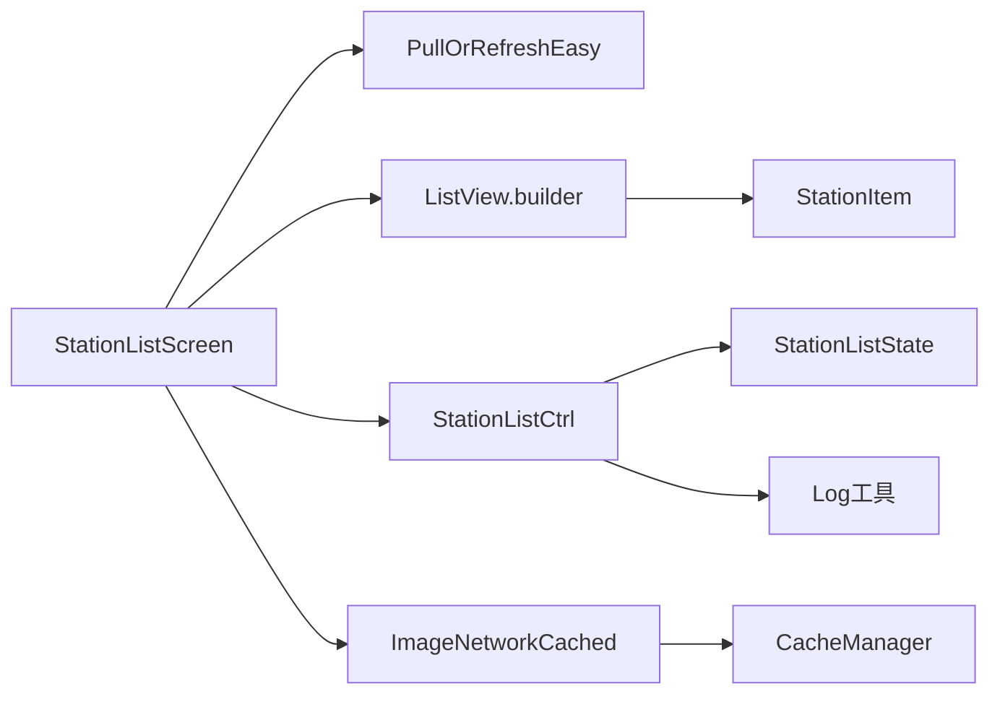

# 性能优化

<cite>
**本文档引用的文件**
- [station_list_screen.dart](file://lib/pages/station_list/widgets/station_list_screen.dart)
- [station_item.dart](file://lib/pages/station_list/widgets/station_item.dart)
- [controller.dart](file://lib/pages/station_list/controller.dart)
- [state.dart](file://lib/pages/station_list/state.dart)
- [cached_network_image_pro.dart](file://lib/widgets/common/cached_network_image_pro.dart)
- [pull_refresh_easy.dart](file://lib/widgets/common/pull_refresh_easy.dart)
- [skeleton_loading.dart](file://lib/widgets/common/skeleton_loading.dart)
- [file_util.dart](file://lib/utils/file_util.dart)
- [log.dart](file://lib/utils/log.dart)
- [sports_run.dart](file://lib/sports_run.dart)
- [analysis_options.yaml](file://analysis_options.yaml)
</cite>

## 目录
1. [引言](#引言)
2. [项目结构](#项目结构)
3. [核心组件](#核心组件)
4. [架构总览](#架构总览)
5. [详细组件分析](#详细组件分析)
6. [依赖关系分析](#依赖关系分析)
7. [性能考量](#性能考量)
8. [故障排查指南](#故障排查指南)
9. [结论](#结论)

## 引言
本文件聚焦于本项目的性能优化实践，围绕UI渲染优化、图片性能优化与内存优化三大主题，结合station_list页面的实现，系统梳理可落地的优化策略与最佳实践，帮助开发者在保证功能正确性的前提下，持续提升应用的流畅度与用户体验。

## 项目结构
本项目采用按功能域分层的组织方式，页面级逻辑位于lib/pages，通用UI组件位于lib/widgets，工具与配置位于lib/utils等。针对性能优化，我们重点关注以下模块：
- 列表渲染：station_list页面的ListView.builder、下拉刷新与加载更多
- 图片加载：网络图片缓存与占位、骨架屏过渡
- 内存与构建：const构造函数、final变量、避免在build中创建新对象

图表来源
- [station_list_screen.dart](file://lib/pages/station_list/widgets/station_list_screen.dart#L1-L191)
- [station_item.dart](file://lib/pages/station_list/widgets/station_item.dart#L1-L119)
- [controller.dart](file://lib/pages/station_list/controller.dart#L1-L110)
- [state.dart](file://lib/pages/station_list/state.dart#L1-L44)
- [pull_refresh_easy.dart](file://lib/widgets/common/pull_refresh_easy.dart#L1-L102)
- [cached_network_image_pro.dart](file://lib/widgets/common/cached_network_image_pro.dart#L1-L141)
- [skeleton_loading.dart](file://lib/widgets/common/skeleton_loading.dart#L1-L144)
- [file_util.dart](file://lib/utils/file_util.dart#L1-L43)
- [log.dart](file://lib/utils/log.dart#L1-L182)
- [analysis_options.yaml](file://analysis_options.yaml#L162-L175)

章节来源
- [station_list_screen.dart](file://lib/pages/station_list/widgets/station_list_screen.dart#L1-L191)
- [controller.dart](file://lib/pages/station_list/controller.dart#L1-L110)
- [state.dart](file://lib/pages/station_list/state.dart#L1-L44)

## 核心组件
- 列表容器与渲染：使用ListView.builder实现懒加载，避免一次性构建全部子项，降低内存占用与首帧压力。
- 下拉刷新与加载更多：通过PullOrRefreshEasy封装EasyRefresh，支持上拉加载更多与下拉刷新，配合控制器完成分页加载。
- 列表项：StationItem采用const构造函数接收不可变数据，减少不必要的重建。
- 图片缓存：ImageNetworkCached基于cached_network_image实现网络图片缓存、占位与错误兜底，并支持memCacheWidth/height等参数控制内存缓存尺寸。
- 骨架屏：SkeletonLoading在数据未就绪时提供平滑过渡，避免闪烁与布局抖动。
- 状态模型：StationListState以不可变方式承载列表数据与分页状态，配合copyWith进行状态更新，避免重复分配。

章节来源
- [station_list_screen.dart](file://lib/pages/station_list/widgets/station_list_screen.dart#L103-L138)
- [station_item.dart](file://lib/pages/station_list/widgets/station_item.dart#L8-L18)
- [pull_refresh_easy.dart](file://lib/widgets/common/pull_refresh_easy.dart#L1-L102)
- [cached_network_image_pro.dart](file://lib/widgets/common/cached_network_image_pro.dart#L1-L141)
- [skeleton_loading.dart](file://lib/widgets/common/skeleton_loading.dart#L1-L144)
- [state.dart](file://lib/pages/station_list/state.dart#L1-L44)

## 架构总览
下面以“station_list页面”的交互流程为例，展示从用户操作到数据渲染的关键链路，以及各组件在其中的职责与优化点。

图表来源
- [station_list_screen.dart](file://lib/pages/station_list/widgets/station_list_screen.dart#L103-L138)
- [pull_refresh_easy.dart](file://lib/widgets/common/pull_refresh_easy.dart#L36-L101)
- [controller.dart](file://lib/pages/station_list/controller.dart#L24-L83)
- [state.dart](file://lib/pages/station_list/state.dart#L24-L44)

## 详细组件分析

### UI渲染优化：ListView.builder与懒加载
- 懒加载实现
  - 使用ListView.builder仅在需要时构建子项，避免一次性渲染大量子树，显著降低内存峰值与首帧耗时。
  - 通过itemCount与itemBuilder传入当前数据长度与构建回调，确保滚动过程中的高效复用。
- 列表项不可变
  - StationItem采用const构造函数接收不可变数据，减少因属性变化导致的重建。
- 选择态与点击反馈
  - 通过isSelected与onTap控制选中态样式与交互，避免在build中创建新的回调闭包，降低GC压力。

图表来源
- [station_list_screen.dart](file://lib/pages/station_list/widgets/station_list_screen.dart#L50-L138)
- [station_item.dart](file://lib/pages/station_list/widgets/station_item.dart#L8-L18)

章节来源
- [station_list_screen.dart](file://lib/pages/station_list/widgets/station_list_screen.dart#L103-L138)
- [station_item.dart](file://lib/pages/station_list/widgets/station_item.dart#L8-L18)

### 嵌套滚动与布局优化建议
- 关于shrinkWrap与NeverScrollableScrollPhysics
  - 本仓库中未发现直接使用shrinkWrap: true与NeverScrollableScrollPhysics的示例。若存在嵌套滚动场景，建议：
    - 在内部可滚动区域使用shrinkWrap: true，避免父容器计算滚动范围。
    - 对于不需要滚动的子区域，使用NeverScrollableScrollPhysics禁用滚动，减少布局与绘制开销。
  - 注意：过度使用shrinkWrap会增加布局成本，应在必要时谨慎使用。

[本节为通用指导，不直接分析具体文件，故无章节来源]

### 图片性能优化：缓存、占位与无闪动加载
- 缓存策略
  - 使用ImageNetworkCached封装CachedNetworkImage，支持memCacheWidth/height控制内存缓存尺寸，避免重复解码与内存膨胀。
  - 支持cacheKey与自定义cacheManager，便于多处复用同一URL的缓存。
- 占位与错误兜底
  - 占位与错误组件可自定义，避免默认占位导致的布局抖动；错误时回退到本地占位图，提升稳定性。
- 无闪烁加载
  - 通过fadeInDuration/fadeOutDuration控制淡入淡出动画时长，配合占位与缓存，减少图片加载过程中的闪烁感。

图表来源
- [cached_network_image_pro.dart](file://lib/widgets/common/cached_network_image_pro.dart#L1-L141)

章节来源
- [cached_network_image_pro.dart](file://lib/widgets/common/cached_network_image_pro.dart#L1-L141)

### 骨架屏与占位：平滑过渡体验
- SkeletonLoading提供渐变光效的占位动画，适合在数据未就绪时使用，避免白屏与布局抖动。
- 可组合在图片、卡片等组件外层，作为统一的加载占位方案。

章节来源
- [skeleton_loading.dart](file://lib/widgets/common/skeleton_loading.dart#L1-L144)

### 内存优化：避免在build中创建新对象
- const构造函数
  - 列表项StationItem使用const构造函数接收不可变参数，减少对象创建与重建。
- final变量与不可变状态
  - 分页状态StationListState以不可变方式承载数据，配合copyWith进行状态更新，避免重复分配。
- Linter规则
  - analysis_options.yaml中包含prefer_const_declarations、prefer_const_literals_to_create_immutables等规则，鼓励使用const与final，降低运行时开销。

章节来源
- [station_item.dart](file://lib/pages/station_list/widgets/station_item.dart#L8-L18)
- [state.dart](file://lib/pages/station_list/state.dart#L1-L44)
- [analysis_options.yaml](file://analysis_options.yaml#L162-L175)

### WebP与资源体积优化
- MIME类型判断
  - file_util.dart提供根据文件扩展名判断MIME类型的能力，便于在上传或预览时选择合适的图片格式。
- 建议
  - 在服务端或资源侧优先提供WebP格式，以减小图片体积；前端可通过占位与缓存策略进一步优化加载体验。

章节来源
- [file_util.dart](file://lib/utils/file_util.dart#L1-L43)

## 依赖关系分析
- 页面与控制器
  - StationListScreen依赖PullOrRefreshEasy与ListView.builder，控制器负责分页加载与状态更新。
- 图片组件
  - ImageNetworkCached依赖cached_network_image与flutter_cache_manager，提供缓存与占位能力。
- 日志与调试
  - 控制器在异常时记录日志，便于定位性能问题与错误原因。

图表来源
- [station_list_screen.dart](file://lib/pages/station_list/widgets/station_list_screen.dart#L103-L138)
- [pull_refresh_easy.dart](file://lib/widgets/common/pull_refresh_easy.dart#L1-L102)
- [controller.dart](file://lib/pages/station_list/controller.dart#L1-L110)
- [state.dart](file://lib/pages/station_list/state.dart#L1-L44)
- [cached_network_image_pro.dart](file://lib/widgets/common/cached_network_image_pro.dart#L1-L141)
- [log.dart](file://lib/utils/log.dart#L1-L182)

## 性能考量
- 列表渲染
  - 使用ListView.builder进行懒加载，避免一次性渲染大量子项。
  - 列表项采用const构造函数，减少重建与GC压力。
- 图片加载
  - 合理设置memCacheWidth/height，避免过大内存占用。
  - 使用占位与缓存，减少闪烁与重复下载。
- 状态管理
  - 使用不可变状态与copyWith，降低状态变更带来的重绘范围。
- 调试与监控
  - 在开发模式下可启用性能面板与内存面板，观察渲染帧率与内存曲线；生产环境保留必要的日志采集。

[本节为通用指导，不直接分析具体文件，故无章节来源]

## 故障排查指南
- 列表卡顿或掉帧
  - 检查是否在itemBuilder中创建了新的对象或闭包；确保列表项使用const构造函数。
  - 确认ListView.builder的itemCount与数据源一致，避免频繁重建。
- 图片加载闪烁
  - 检查占位与错误组件是否正确配置；适当调整fadeInDuration/fadeOutDuration。
  - 确认缓存键cacheKey与URL一致，避免重复下载。
- 加载失败
  - 查看控制器日志输出，确认请求参数与分页逻辑；在失败时正确调用finishRefresh/finishLoad并更新状态。

章节来源
- [controller.dart](file://lib/pages/station_list/controller.dart#L24-L83)
- [log.dart](file://lib/utils/log.dart#L1-L182)

## 结论
通过在station_list页面中应用ListView.builder懒加载、const构造函数、图片缓存与骨架屏等策略，能够有效降低内存占用、减少布局抖动与闪烁，提升滚动流畅度与整体用户体验。同时，借助不可变状态与Linter规则，可在开发阶段就规避常见的性能陷阱。建议在后续页面中推广这些实践，并结合日志与性能面板持续监控与优化。