# 架构规范

<cite>
**本文档引用文件**  
- [app.dart](file://lib/app.dart)
- [main.dart](file://lib/main.dart)
- [app_controller.dart](file://lib/global/app_controller.dart)
- [base_page.dart](file://lib/widgets/common/base_page.dart)
- [page.dart](file://lib/pages/login/page.dart)
- [controller.dart](file://lib/pages/login/controller.dart)
- [state.dart](file://lib/pages/login/state.dart)
- [view.dart](file://lib/pages/login/view.dart)
- [app_state.dart](file://lib/global/app_state.dart)
- [router.dart](file://lib/router/router.dart)
- [common_button.dart](file://lib/widgets/base/button/common_button.dart)
- [common_textformfield.dart](file://lib/widgets/base/textfield/common_textformfield.dart)
- [unified_login_screen.dart](file://lib/pages/login/widgets/unified_login_screen.dart)
</cite>

## 目录
1. [项目结构](#项目结构)
2. [Feature-first架构模式](#feature-first架构模式)
3. 核心目录职责划分
   - [pages/目录](#pages目录)
   - [widgets/目录](#widgets目录)
   - [global/目录](#global目录)
   - [net/目录](#net目录)
4. 页面标准四件套实现
   - [page.dart实现](#pagedart实现)
   - [controller.dart实现](#controllerdart实现)
   - [state.dart实现](#statedart实现)
   - [view.dart实现](#viewdart实现)
5. 全局状态管理
   - [AppController实现](#appcontroller实现)
   - [HydratedCubit持久化](#hydratedcubit持久化)
6. 公共组件组织
   - [base/目录组织](#basedirectory-组织)
   - [feature-specific widgets复用](#feature-specific-widgets复用)

## 项目结构

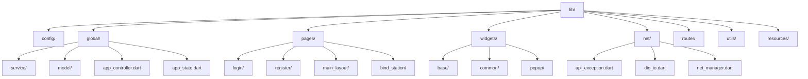

**Diagram sources**
- [lib/pages/](file://lib/pages/)
- [lib/widgets/](file://lib/widgets/)
- [lib/global/](file://lib/global/)
- [lib/net/](file://lib/net/)

**Section sources**
- [lib/](file://lib/)

## Feature-first架构模式

本项目采用Feature-first架构模式，以业务功能为单位组织代码结构。每个功能模块（如登录、注册、主布局等）在`pages/`目录下拥有独立的子目录，包含该功能所需的所有代码文件。

这种架构模式的核心优势在于：
- **高内聚**：同一功能的所有代码集中存放，便于维护和理解
- **低耦合**：功能模块之间相互独立，减少代码依赖
- **可复用**：公共组件和工具类集中管理，便于跨功能复用
- **易测试**：功能模块独立，便于编写单元测试和集成测试

项目通过`scripts/pageTemplate/`目录下的模板文件自动生成新页面的四件套文件，确保架构一致性。

**Section sources**
- [scripts/pageTemplate/](file://scripts/pageTemplate/)

## 核心目录职责划分

### pages目录

`pages/`目录存放所有页面级功能模块，每个功能模块以独立子目录形式存在。目录结构遵循Feature-first原则，每个子目录包含该功能的完整实现。

每个页面模块通常包含以下文件：
- `page.dart`：页面入口，继承`BasePage`
- `controller.dart`：业务逻辑控制器
- `state.dart`：不可变状态定义
- `view.dart`：UI视图组件
- `widgets/`：页面专用组件

以`login/`模块为例，其结构完整体现了页面标准四件套的设计模式。

**Section sources**
- [lib/pages/](file://lib/pages/)

### widgets目录

`widgets/`目录存放所有可复用的UI组件，分为三个子目录：

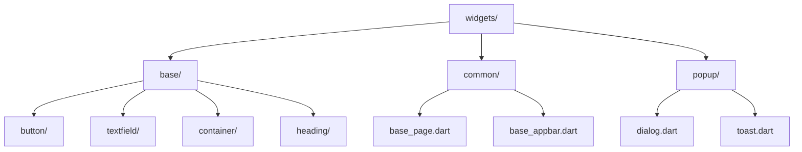

**Diagram sources**
- [lib/widgets/](file://lib/widgets/)

**Section sources**
- [lib/widgets/](file://lib/widgets/)

#### base/目录组织

`widgets/base/`目录存放基础UI组件，这些组件具有高度可配置性，可在多个功能模块中复用。主要包含：

- **button/**：按钮组件，如`common_button.dart`
- **textfield/**：输入框组件，如`common_textformfield.dart`
- **container/**：容器组件
- **heading/**：标题组件
- **topbar/**：顶部导航栏组件

这些基础组件通过参数化设计实现高度可定制，例如`CommonButton`组件支持自定义颜色、尺寸、圆角、阴影等属性。

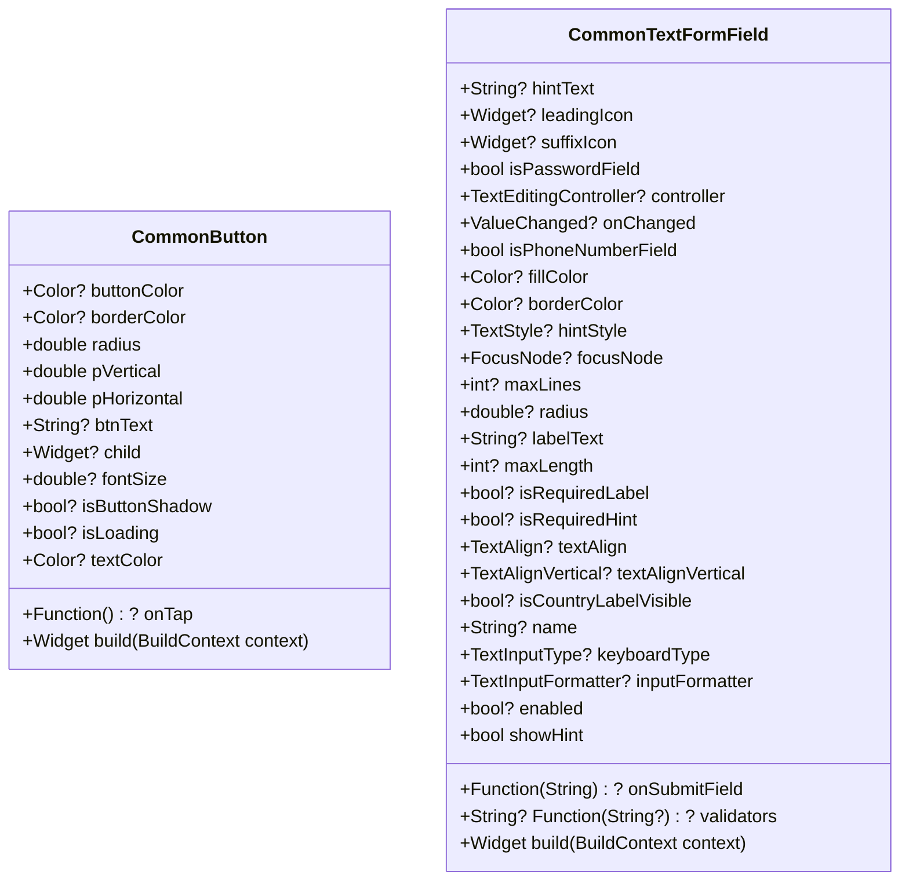

**Diagram sources**
- [lib/widgets/base/button/common_button.dart](file://lib/widgets/base/button/common_button.dart)
- [lib/widgets/base/textfield/common_textformfield.dart](file://lib/widgets/base/textfield/common_textformfield.dart)

**Section sources**
- [lib/widgets/base/](file://lib/widgets/base/)

### global目录

`global/`目录存放全局共享的代码和资源，主要包括：

- **app_controller.dart**：全局状态管理控制器
- **app_state.dart**：全局状态数据模型
- **service/**：全局网络服务
- **model/**：全局数据模型
- **enum/**：全局枚举类型
- **events/**：全局事件定义

`AppController`作为全局状态管理的核心，使用`HydratedCubit`实现状态持久化，确保应用重启后用户登录状态等关键数据得以保留。

**Section sources**
- [lib/global/](file://lib/global/)

### net目录

`net/`目录存放网络相关的核心组件，构建了完整的网络通信基础设施：

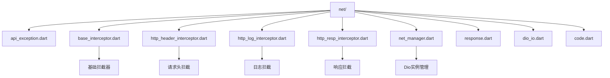

**Diagram sources**
- [lib/net/](file://lib/net/)

**Section sources**
- [lib/net/](file://lib/net/)

## 页面标准四件套实现

### page.dart实现

`page.dart`文件是页面的入口点，负责页面的初始化和组件树构建。所有页面均继承`BasePage`抽象类，确保统一的生命周期管理。

以`login/page.dart`为例，其实现方式如下：

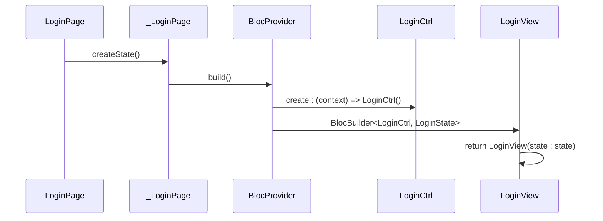

**Diagram sources**
- [lib/pages/login/page.dart](file://lib/pages/login/page.dart)
- [lib/widgets/common/base_page.dart](file://lib/widgets/common/base_page.dart)

**Section sources**
- [lib/pages/login/page.dart](file://lib/pages/login/page.dart)

### controller.dart实现

`controller.dart`文件负责管理页面的业务逻辑，使用`Cubit`模式实现状态管理。`LoginCtrl`类继承`Cubit<LoginState>`，封装了登录功能的所有业务逻辑。

核心职责包括：
- 表单验证和提交处理
- 网络请求调用
- 状态变更管理
- 错误处理和用户反馈
- 导航控制

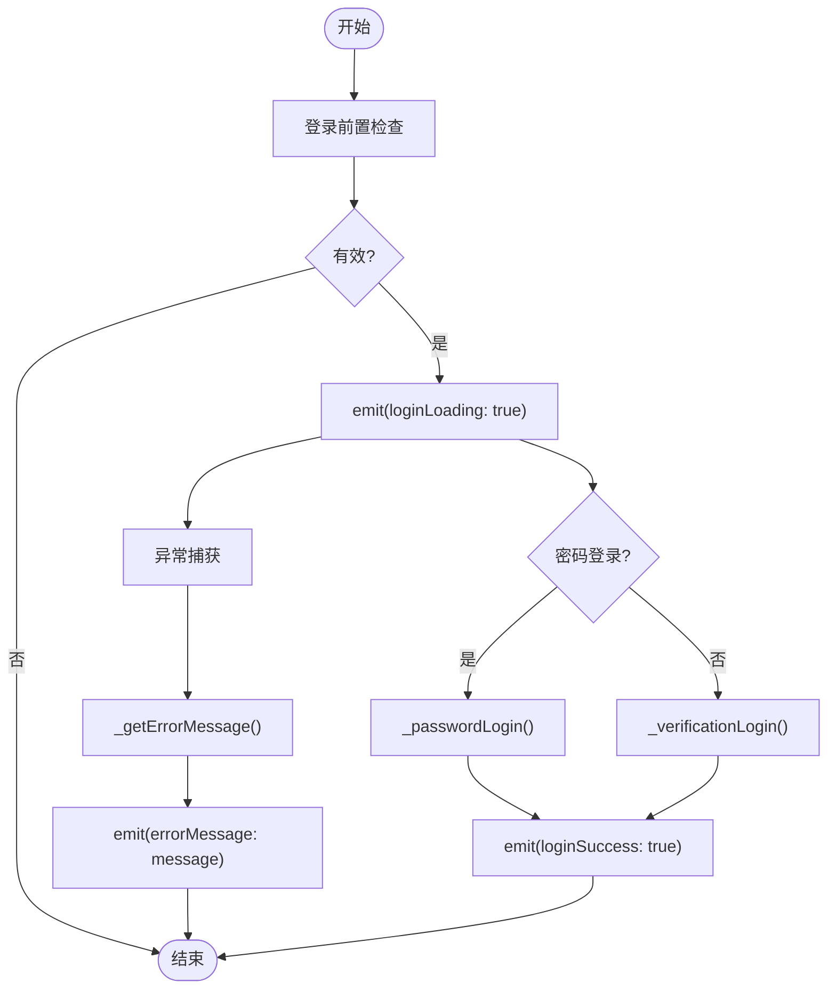

**Diagram sources**
- [lib/pages/login/controller.dart](file://lib/pages/login/controller.dart)

**Section sources**
- [lib/pages/login/controller.dart](file://lib/pages/login/controller.dart)

### state.dart实现

`state.dart`文件定义页面的不可变状态，遵循函数式编程原则，确保状态变更的可预测性。`LoginState`类使用`copyWith`模式实现状态更新。

状态设计特点：
- 所有属性均为`final`，确保不可变性
- 提供`copyWith`方法创建新状态实例
- 使用哨兵对象`_undefined`区分未传值和传`null`的情况
- 包含所有UI所需的状态数据

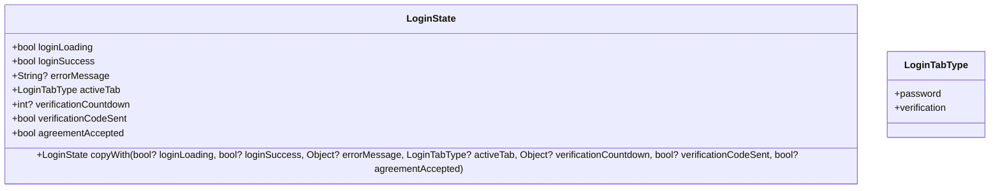

**Diagram sources**
- [lib/pages/login/state.dart](file://lib/pages/login/state.dart)

**Section sources**
- [lib/pages/login/state.dart](file://lib/pages/login/state.dart)

### view.dart实现

`view.dart`文件负责UI视图的构建和渲染，使用`BlocBuilder`监听状态变化并更新UI。`LoginView`通过`BlocListener`处理登录成功后的导航。

核心实现机制：
- 使用`BlocListener`处理一次性事件（如导航）
- 使用`BlocBuilder`构建响应式UI
- 通过`context.read<LoginCtrl>()`获取控制器实例
- 将复杂的UI拆分为多个小组件

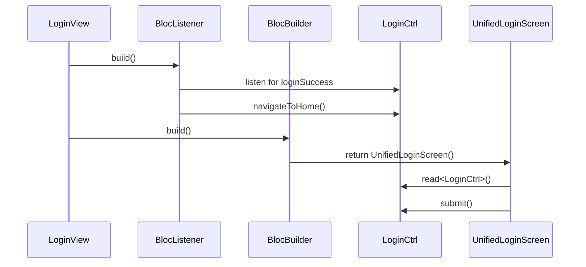

**Diagram sources**
- [lib/pages/login/view.dart](file://lib/pages/login/view.dart)
- [lib/pages/login/widgets/unified_login_screen.dart](file://lib/pages/login/widgets/unified_login_screen.dart)

**Section sources**
- [lib/pages/login/view.dart](file://lib/pages/login/view.dart)

## 全局状态管理

### AppController实现

`AppController`是全局状态管理的核心，继承`HydratedCubit<AppState>`，负责管理应用级别的共享状态。其主要职责包括：

- 用户认证信息管理
- 当前选中加油站管理
- 应用生命周期监听
- 登录后流程控制
- 用户登出处理

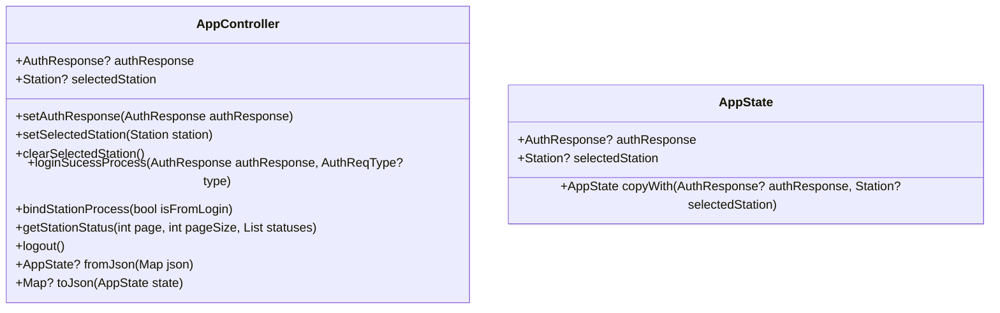

**Diagram sources**
- [lib/global/app_controller.dart](file://lib/global/app_controller.dart)
- [lib/global/app_state.dart](file://lib/global/app_state.dart)

**Section sources**
- [lib/global/app_controller.dart](file://lib/global/app_controller.dart)

### HydratedCubit持久化

`AppController`通过`HydratedCubit`实现状态持久化，确保应用重启后关键状态得以保留。持久化机制通过`fromJson`和`toJson`方法实现状态的序列化和反序列化。

持久化流程：
1. 应用启动时，从本地存储读取状态
2. 状态数据反序列化为`AppState`对象
3. 应用运行期间，状态变更自动保存到本地存储
4. 应用关闭时，当前状态已持久化

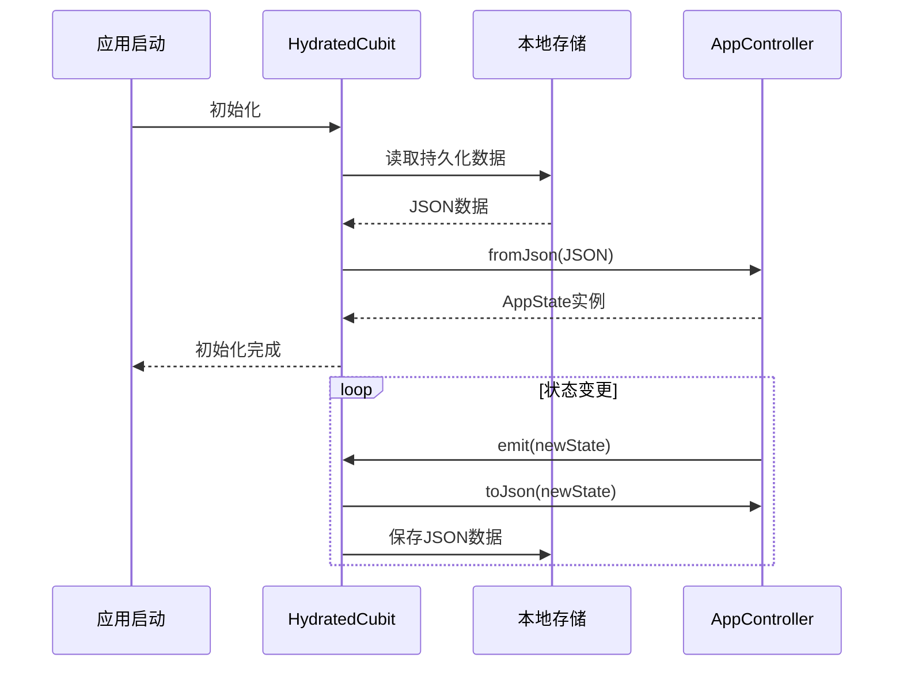

**Diagram sources**
- [lib/global/app_controller.dart](file://lib/global/app_controller.dart)

**Section sources**
- [lib/global/app_controller.dart](file://lib/global/app_controller.dart)

## 公共组件组织

### base/目录组织

`widgets/base/`目录采用分类组织方式，将基础组件按功能类型分组。这种组织方式提高了组件的可发现性和可维护性。

组件设计原则：
- **高内聚**：同类组件集中存放
- **低耦合**：组件间依赖最小化
- **可配置**：通过参数实现高度定制
- **语义化**：组件命名清晰表达用途

目录结构：
- `button/`：所有按钮类组件
- `textfield/`：所有输入框类组件  
- `container/`：容器类组件
- `heading/`：标题类组件
- `topbar/`：顶部导航栏组件

**Section sources**
- [lib/widgets/base/](file://lib/widgets/base/)

### feature-specific widgets复用

除了基础组件外，项目还支持页面内组件复用。以`login/`模块为例，其`widgets/`子目录存放了该页面专用的组件：

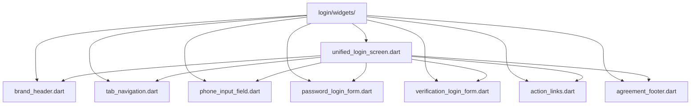

这种设计模式的优势：
- **页面内复用**：复杂UI拆分为可复用的小组件
- **逻辑隔离**：页面专用组件与基础组件分离
- **维护性好**：组件变更影响范围明确
- **测试方便**：可独立测试页面组件

**Diagram sources**
- [lib/pages/login/widgets/](file://lib/pages/login/widgets/)

**Section sources**
- [lib/pages/login/widgets/](file://lib/pages/login/widgets/)