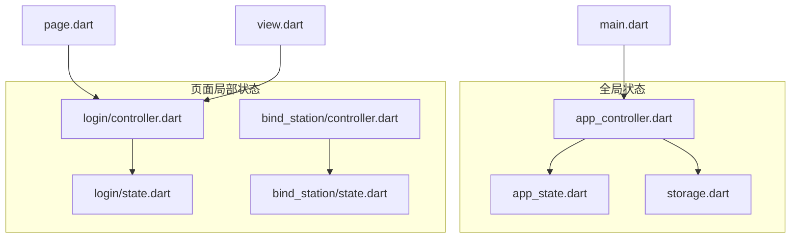
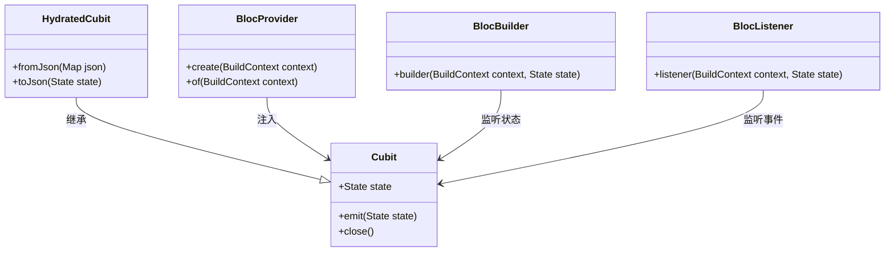
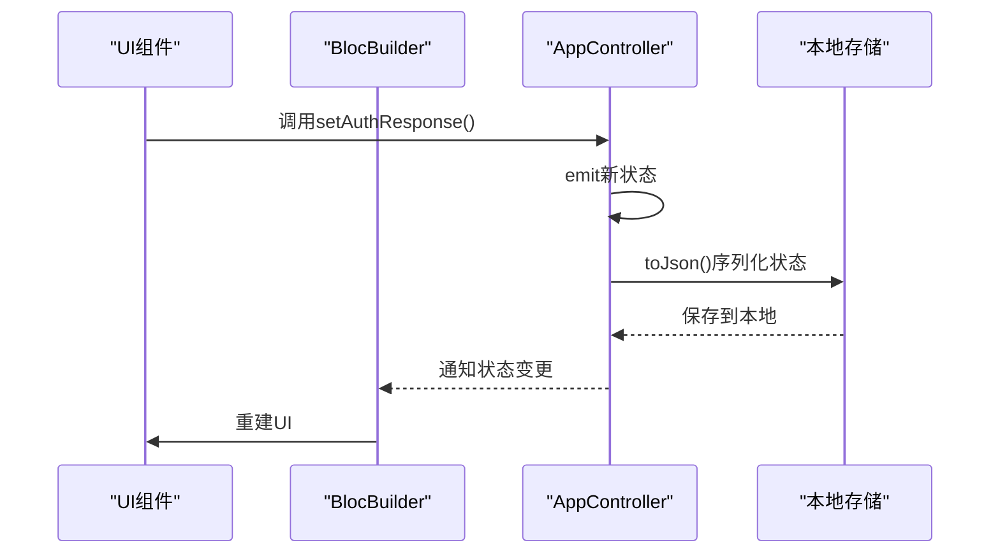

# 状态管理规范

<cite>
**本文档引用文件**  
- [app_controller.dart](file://lib/global/app_controller.dart)
- [app_state.dart](file://lib/global/app_state.dart)
- [login/controller.dart](file://lib/pages/login/controller.dart)
- [login/state.dart](file://lib/pages/login/state.dart)
- [login/page.dart](file://lib/pages/login/page.dart)
- [login/view.dart](file://lib/pages/login/view.dart)
- [global_update_ui.dart](file://lib/widgets/common/global_update_ui.dart)
- [project.md](file://openspec/project.md)
</cite>

## 目录
1. [项目结构](#项目结构)
2. [核心状态管理组件](#核心状态管理组件)
3. [局部状态管理 - Cubit实现](#局部状态管理---cubit实现)
4. [全局状态管理 - HydratedCubit实现](#全局状态管理---hydratedcubit实现)
5. [状态持久化机制](#状态持久化机制)
6. [状态注入与UI响应](#状态注入与ui响应)
7. [最佳实践与常见陷阱](#最佳实践与常见陷阱)

## 项目结构

本项目采用功能优先（Feature-first）的组织结构，按功能模块组织代码。状态管理相关的文件主要分布在`lib/global/`目录下，用于全局状态管理，以及各个页面模块中的`controller.dart`和`state.dart`文件用于局部状态管理。



**Diagram sources**
- [project.md](file://openspec/project.md#L39-L94)

**Section sources**
- [project.md](file://openspec/project.md#L39-L94)

## 核心状态管理组件

项目中使用BLOC模式进行状态管理，主要包含以下核心组件：

1. **Cubit**：用于管理页面局部状态，适用于简单场景如表单页面
2. **HydratedCubit**：用于管理需要持久化的全局状态
3. **BlocProvider**：用于在Widget树中注入状态管理器
4. **BlocBuilder**：用于响应状态变化并重建UI
5. **BlocListener**：用于监听副作用（如显示Toast、导航等）



**Diagram sources**
- [app_controller.dart](file://lib/global/app_controller.dart#L16-L17)
- [login/controller.dart](file://lib/pages/login/controller.dart#L15-L16)

**Section sources**
- [project.md](file://openspec/project.md#L105-L110)

## 局部状态管理 - Cubit实现

以登录页面为例，展示局部状态管理如何通过Cubit实现。

### LoginCtrl状态管理器

`LoginCtrl`继承自`Cubit<LoginState>`，负责管理登录页面的局部状态。其主要职责包括：

- 管理登录表单的状态（如加载状态、错误信息、当前激活的标签等）
- 处理用户输入和表单验证
- 调用API服务进行登录操作
- 发出状态变更通知

```dart
class LoginCtrl extends Cubit<LoginState> {
  LoginCtrl() : super(LoginState(loginLoading: false));
  
  submit() async {
    if (!loginPrecheck()) return;
    emit(state.copyWith(loginLoading: true));
    // 业务逻辑
  }
}
```

### LoginState状态定义

`LoginState`类定义了登录页面的所有状态属性，包括：

- `loginLoading`：是否正在登录
- `loginSuccess`：登录是否成功
- `errorMessage`：错误信息
- `activeTab`：当前激活的标签（密码登录/验证码登录）
- `verificationCountdown`：验证码倒计时
- `verificationCodeSent`：验证码是否已发送
- `agreementAccepted`：是否同意用户协议

状态类遵循不可变原则，通过`copyWith`方法创建新的状态实例。

**Section sources**
- [login/controller.dart](file://lib/pages/login/controller.dart#L15-L354)
- [login/state.dart](file://lib/pages/login/state.dart#L1-L62)

## 全局状态管理 - HydratedCubit实现

全局状态管理通过`AppController`类实现，该类继承自`HydratedCubit<AppState>`，实现了状态的持久化存储。

### AppController实现

`AppController`作为全局状态管理器，负责管理应用级别的共享状态。其主要特点包括：

- 继承`HydratedCubit`实现状态持久化
- 实现`fromJson`和`toJson`方法进行状态序列化和反序列化
- 管理应用生命周期事件
- 提供全局状态变更的方法



**Diagram sources**
- [app_controller.dart](file://lib/global/app_controller.dart#L16-L145)

### AppState状态定义

`AppState`类存储了应用的全局数据，主要包括：

- `authResponse`：用户认证信息，包含访问令牌、刷新令牌和账户信息
- `selectedStation`：选中的加油站信息

```dart
class AppState {
  AuthResponse? authResponse;
  Station? selectedStation;
  
  AppState({this.authResponse, this.selectedStation});
  
  AppState copyWith({
    AuthResponse? authResponse,
    Station? selectedStation,
  }) {
    return AppState(
      authResponse: authResponse ?? this.authResponse,
      selectedStation: selectedStation ?? this.selectedStation,
    );
  }
}
```

**Section sources**
- [app_controller.dart](file://lib/global/app_controller.dart#L16-L145)
- [app_state.dart](file://lib/global/app_state.dart#L1-L23)

## 状态持久化机制

### HydratedCubit持久化原理

`HydratedCubit`通过`hydrated_bloc`库实现状态持久化，其工作原理如下：

1. 应用启动时，从本地存储读取序列化的状态数据
2. 调用`fromJson`方法将JSON数据反序列化为`AppState`对象
3. 将反序列化的状态作为初始状态
4. 当状态变更时，调用`toJson`方法将状态序列化为JSON
5. 将序列化的JSON数据保存到本地存储

### fromJson和toJson实现

`AppController`中实现了`fromJson`和`toJson`方法，用于状态的序列化和反序列化：

```dart
@override
AppState? fromJson(Map<String, dynamic> json) {
  return AppState(
    authResponse: json['authResponse'] != null
        ? AuthResponse.fromJson(json['authResponse'])
        : null,
    selectedStation: json['selectedStation'] != null
        ? Station.fromJson(json['selectedStation'] as Map<String, dynamic>)
        : null,
  );
}

@override
Map<String, dynamic>? toJson(AppState state) {
  return {
    'authResponse': state.authResponse?.toJson(),
    'selectedStation': state.selectedStation?.toJson(),
  };
}
```

### 持久化初始化

在应用启动时，通过`sports_run.dart`文件中的`oilAppFlutterRun`函数初始化`HydratedBloc`的存储：

```dart
HydratedBloc.storage = await HydratedStorage.build(
  storageDirectory: kIsWeb
      ? HydratedStorageDirectory.web
      : HydratedStorageDirectory((await getTemporaryDirectory()).path),
);
```

**Section sources**
- [app_controller.dart](file://lib/global/app_controller.dart#L125-L142)
- [sports_run.dart](file://lib/sports_run.dart#L32-L35)

## 状态注入与UI响应

### BlocProvider状态注入

`BlocProvider`用于在Widget树中注入状态管理器，使其在子Widget中可用。在登录页面的`page.dart`文件中，通过`BlocProvider`创建并注入`LoginCtrl`：

```dart
BlocProvider(
  create: (BuildContext context) => LoginCtrl(),
  child: BlocBuilder<LoginCtrl, LoginState>(builder: (context, state) {
    return LoginView(state: state);
  }),
)
```

### BlocBuilder UI响应

`BlocBuilder`用于监听状态变化并重建UI。当`LoginCtrl`的状态发生变化时，`BlocBuilder`会自动重建其子Widget：

```dart
BlocBuilder<LoginCtrl, LoginState>(builder: (context, state) {
  return LoginView(state: state);
})
```

### BlocListener副作用处理

`BlocListener`用于监听状态变化并执行副作用操作，如导航、显示Toast等。在登录页面的`view.dart`文件中，使用`BlocListener`监听登录成功事件并进行页面导航：

```dart
BlocListener<LoginCtrl, LoginState>(
  listener: (context, state) {
    if (state.loginSuccess) {
      WidgetsBinding.instance.addPostFrameCallback((_) {
        if (mounted) {
          ctrl.navigateToHome(context);
        }
      });
    }
  },
  child: const UnifiedLoginScreen(),
)
```

### 全局状态更新组件

项目中定义了`GlobalUpdateUi`组件，用于简化全局状态的监听和更新：

```dart
class GlobalUpdateUi extends StatelessWidget {
  final Function(BuildContext context, AppController ctrl) builder;
  
  @override
  Widget build(BuildContext context) {
    final _globalCtrl = context.read<AppController>();
    
    return BlocBuilder<AppController, AppState>(builder: (_, state) {
      return builder(context, _globalCtrl);
    });
  }
}
```

**Section sources**
- [login/page.dart](file://lib/pages/login/page.dart#L20-L26)
- [login/view.dart](file://lib/pages/login/view.dart#L32-L43)
- [global_update_ui.dart](file://lib/widgets/common/global_update_ui.dart#L1-L19)

## 最佳实践与常见陷阱

### 最佳实践

1. **状态不可变性**：始终通过`copyWith`方法创建新的状态实例，而不是直接修改现有状态
2. **单一职责**：每个Cubit只负责管理一个特定功能模块的状态
3. **状态分离**：将全局状态和局部状态分离管理，避免状态混乱
4. **错误处理**：在状态管理器中统一处理API调用的错误，并通过状态暴露给UI层
5. **资源清理**：在`close`方法中清理定时器、控制器等资源，避免内存泄漏

### 常见陷阱

1. **避免在构建期间导航**：使用`WidgetsBinding.instance.addPostFrameCallback`避免在Widget构建期间进行页面导航
2. **避免重复创建Cubit**：确保在正确的Widget层级使用`BlocProvider`，避免不必要的状态管理器创建
3. **避免过度使用全局状态**：只有真正需要跨页面共享的状态才应该放入全局状态管理器
4. **注意状态序列化**：确保所有存储在`AppState`中的对象都实现了`toJson`和`fromJson`方法
5. **避免在状态中存储函数**：状态对象应该是纯数据，不应包含函数或闭包

**Section sources**
- [project.md](file://openspec/project.md#L129-L143)
- [login/controller.dart](file://lib/pages/login/controller.dart#L35-L40)
- [login/view.dart](file://lib/pages/login/view.dart#L35-L38)