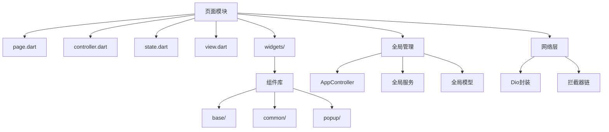
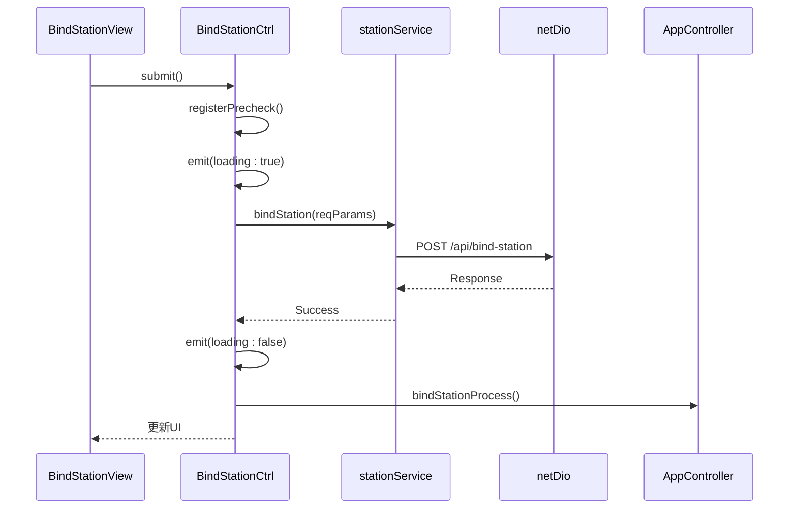
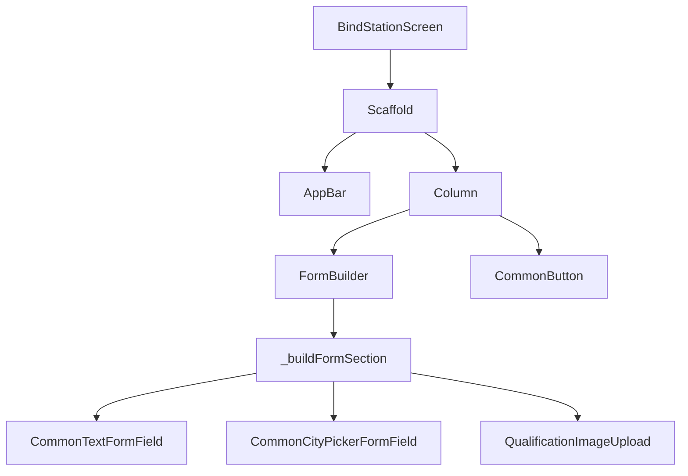
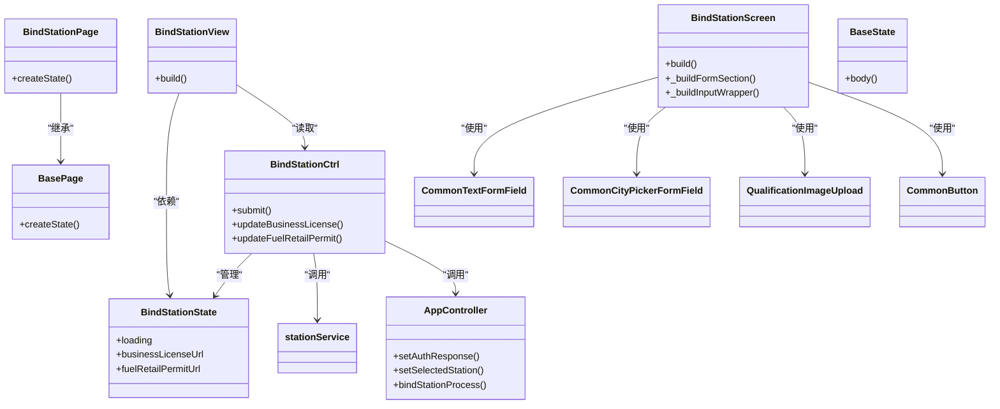

# 目录结构规范

<cite>
**本文档引用的文件**  
- [main.dart](file://lib/main.dart)
- [page.dart](file://lib/pages/bind_station/page.dart)
- [controller.dart](file://lib/pages/bind_station/controller.dart)
- [state.dart](file://lib/pages/bind_station/state.dart)
- [view.dart](file://lib/pages/bind_station/view.dart)
- [app_controller.dart](file://lib/global/app_controller.dart)
- [base_page.dart](file://lib/widgets/common/base_page.dart)
- [net_manager.dart](file://lib/net/net_manager.dart)
- [router.dart](file://lib/router/router.dart)
- [common_text.dart](file://lib/widgets/base/text/common_text.dart)
- [base_appbar.dart](file://lib/widgets/common/base_appbar.dart)
- [loading.dart](file://lib/widgets/popup/loading.dart)
- [bind_station_screen.dart](file://lib/pages/bind_station/widgets/bind_station_screen.dart)
- [station_req_type.dart](file://lib/global/model/station_req_type.dart)
</cite>

## 目录结构

本项目采用“功能优先（Feature-first）”的架构模式，将代码按功能模块组织，提高可维护性和团队协作效率。核心目录包括 `lib/pages/`、`lib/widgets/`、`lib/global/` 和 `lib/net/`。

### pages/ 目录：功能模块化组织

`pages/` 目录按照功能模块进行组织，每个功能模块包含四个核心文件和一个 `widgets/` 子目录，形成标准化的“四件套”结构：

- `page.dart`：定义页面路由与入口
- `controller.dart`：处理业务逻辑
- `state.dart`：管理页面状态
- `view.dart`：构建视图结构
- `widgets/`：存放该页面专用的UI组件

以 `bind_station` 模块为例，其结构如下：
```
lib/pages/bind_station/
├── controller.dart
├── page.dart
├── state.dart
├── view.dart
└── widgets/
    └── bind_station_screen.dart
```

这种结构实现了高内聚、低耦合的设计原则，使得每个功能模块独立完整，便于团队并行开发和后期维护。

**Section sources**
- [page.dart](file://lib/pages/bind_station/page.dart#L1-L32)
- [controller.dart](file://lib/pages/bind_station/controller.dart#L1-L100)
- [state.dart](file://lib/pages/bind_station/state.dart#L1-L24)
- [view.dart](file://lib/pages/bind_station/view.dart#L1-L21)

### widgets/ 目录：组件分层复用

`widgets/` 目录分为三个层级，实现组件的分层管理和高效复用：

#### base/：基础组件
位于 `lib/widgets/base/`，提供最底层的UI原子组件，如按钮、文本、输入框等。这些组件封装了样式和行为，确保全应用风格统一。

例如 `common_text.dart` 定义了统一的文本样式：
```dart
class CommonText extends StatelessWidget {
  final String text;
  final Color? textColor;
  final double? fontSize;
  // ...
}
```

**Section sources**
- [common_text.dart](file://lib/widgets/base/text/common_text.dart#L1-L56)

#### common/：通用组件
位于 `lib/widgets/common/`，由基础组件组合而成，用于多个页面的公共UI元素，如 `BasePage`、`BaseAppBar` 等。

`BasePage` 提供了页面生命周期管理和初始化逻辑：
```dart
abstract class BasePage extends StatefulWidget { }
abstract class BaseState<Page extends BasePage> extends State<Page> with WidgetsBindingObserver { }
```

**Section sources**
- [base_page.dart](file://lib/widgets/common/base_page.dart#L1-L160)
- [base_appbar.dart](file://lib/widgets/common/base_appbar.dart#L1-L109)

#### popup/：弹窗组件
位于 `lib/widgets/popup/`，封装了加载框、对话框、Toast等交互式组件。

`SportsLoading` 封装了统一的加载提示：
```dart
class SportsLoading {
  static void show({BuildContext? context, String? msg});
  static void dismiss({BuildContext? context});
}
```

**Section sources**
- [loading.dart](file://lib/widgets/popup/loading.dart#L1-L79)

### global/ 目录：全局状态与服务

`lib/global/` 目录存放全局共享的状态、服务和模型。

#### AppController：全局状态管理
使用 `HydratedCubit` 实现全局状态持久化管理，管理用户认证信息和选中加油站等全局状态。

```dart
class AppController extends HydratedCubit<AppState> with WidgetsBindingObserver {
  void setAuthResponse(AuthResponse authResponse);
  void setSelectedStation(Station station);
  void clearSelectedStation();
  // ...
}
```

`AppController` 还负责登录后流程、绑定加油站流程等全局业务逻辑的调度。

**Section sources**
- [app_controller.dart](file://lib/global/app_controller.dart#L1-L146)

#### 服务与模型
- `service/`：封装全局API服务，如 `auth_service.dart`、`station_service.dart`
- `model/`：定义数据模型和请求/响应类型，如 `auth_rep_type.dart`、`station_req_type.dart`

**Section sources**
- [station_req_type.dart](file://lib/global/model/station_req_type.dart#L1-L83)

### net/ 目录：网络请求封装

`lib/net/` 目录封装了Dio网络请求和拦截器链，提供统一的网络层管理。

#### NetManager：网络管理器
`net_manager.dart` 初始化Dio实例，并配置超时、代理、拦截器等。

```dart
class _NetManager {
  Dio? clientDio;
  init(String baseUrl, {required bool withCredentials});
  // ...
}
```

#### 拦截器链
- `http_header_interceptor.dart`：自动添加请求头
- `http_log_interceptor.dart`：日志记录
- `http_resp_interceptor.dart`：响应统一处理
- `base_interceptor.dart`：基础拦截逻辑

**Section sources**
- [net_manager.dart](file://lib/net/net_manager.dart#L1-L88)

## 架构概览

本项目采用功能优先的架构模式，通过清晰的目录划分和职责分离，实现了高可维护性和团队协作效率。



**Diagram sources**
- [main.dart](file://lib/main.dart#L1-L22)
- [router.dart](file://lib/router/router.dart#L1-L228)

## 详细组件分析

### 绑定加油站功能分析

以 `bind_station` 模块为例，展示功能模块的完整实现流程。

#### 数据流与状态管理



**Diagram sources**
- [controller.dart](file://lib/pages/bind_station/controller.dart#L1-L100)
- [view.dart](file://lib/pages/bind_station/view.dart#L1-L21)
- [station_service.dart](file://lib/global/service/station_service.dart)
- [net_manager.dart](file://lib/net/net_manager.dart#L1-L88)

#### 视图组件结构



**Diagram sources**
- [bind_station_screen.dart](file://lib/pages/bind_station/widgets/bind_station_screen.dart#L1-L280)
- [common_textformfield.dart](file://lib/widgets/base/textfield/common_textformfield.dart)
- [common_city_picker.dart](file://lib/widgets/base/textfield/common_city_picker.dart)
- [common_button.dart](file://lib/widgets/base/button/common_button.dart)

## 依赖关系分析



**Diagram sources**
- [page.dart](file://lib/pages/bind_station/page.dart#L1-L32)
- [controller.dart](file://lib/pages/bind_station/controller.dart#L1-L100)
- [state.dart](file://lib/pages/bind_station/state.dart#L1-L24)
- [view.dart](file://lib/pages/bind_station/view.dart#L1-L21)
- [bind_station_screen.dart](file://lib/pages/bind_station/widgets/bind_station_screen.dart#L1-L280)
- [app_controller.dart](file://lib/global/app_controller.dart#L1-L146)
- [base_page.dart](file://lib/widgets/common/base_page.dart#L1-L160)

## 实践优势

### 提高代码可维护性
- 功能模块高度内聚，修改不影响其他模块
- 组件分层清晰，便于定位和替换
- 状态管理集中，避免状态混乱

### 提升团队协作效率
- 新成员可快速理解项目结构
- 多人并行开发互不干扰
- 代码风格统一，减少沟通成本

### 增强可测试性
- 业务逻辑与UI分离，便于单元测试
- 服务层独立，可进行模拟测试
- 组件可独立测试，提高测试覆盖率

## 总结

本项目的“功能优先”架构模式通过 `pages/`、`widgets/`、`global/`、`net/` 四大核心目录的合理划分，实现了代码的高度模块化和组件化。每个功能模块的“四件套”结构确保了开发的规范性和一致性，而组件的分层复用机制则大大提升了开发效率和代码质量。这种架构特别适合中大型Flutter项目，能够有效支持团队协作和长期维护。