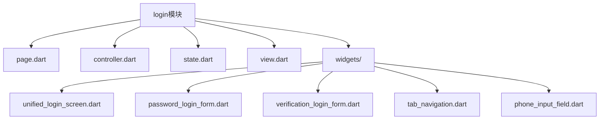
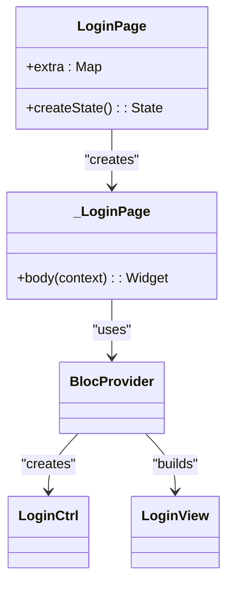
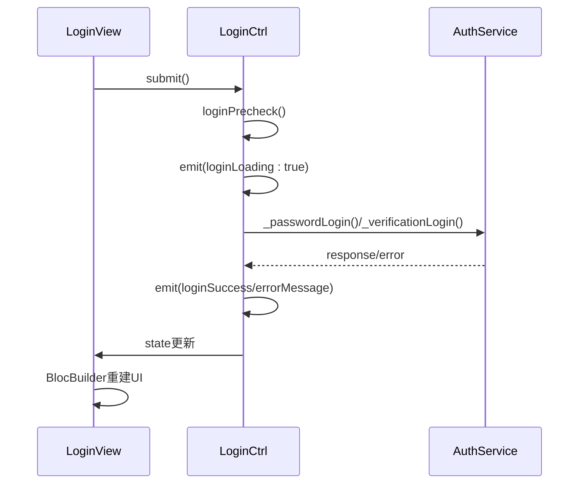
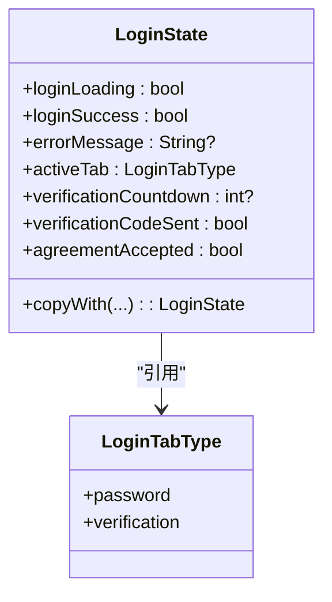
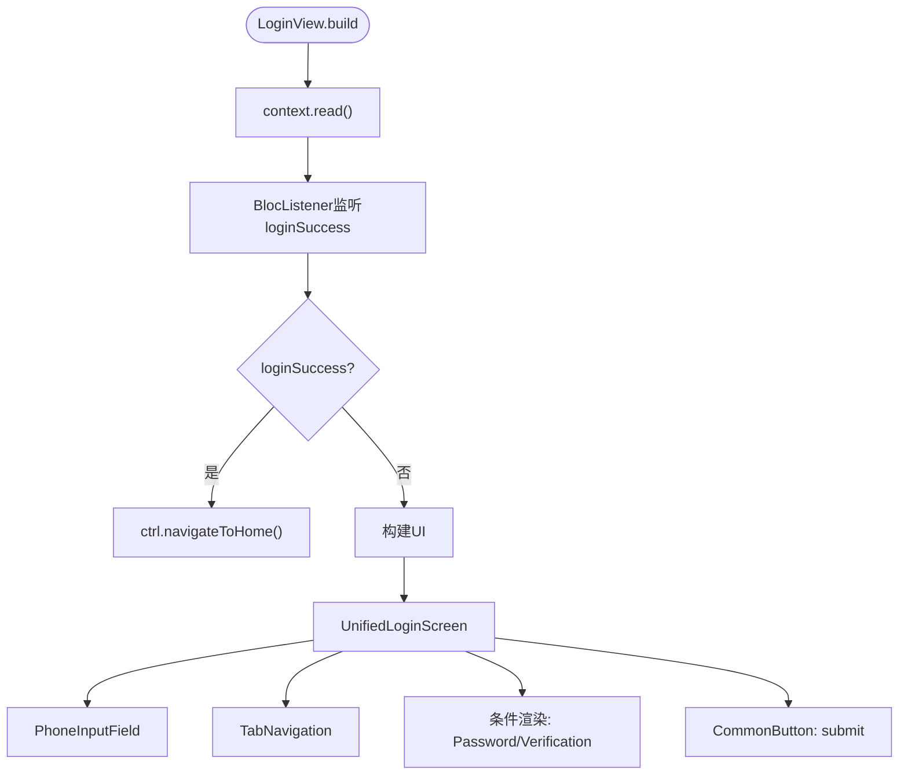
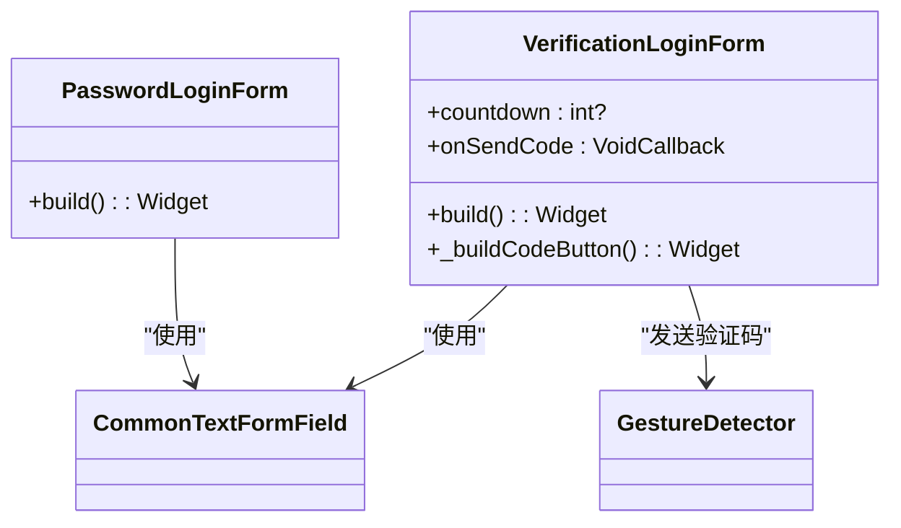

# 页面架构标准

<cite>
**本文档引用文件**  
- [base_page.dart](file://lib/widgets/common/base_page.dart)
- [page.dart](file://lib/pages/login/page.dart)
- [controller.dart](file://lib/pages/login/controller.dart)
- [state.dart](file://lib/pages/login/state.dart)
- [view.dart](file://lib/pages/login/view.dart)
- [unified_login_screen.dart](file://lib/pages/login/widgets/unified_login_screen.dart)
- [password_login_form.dart](file://lib/pages/login/widgets/password_login_form.dart)
- [verification_login_form.dart](file://lib/pages/login/widgets/verification_login_form.dart)
- [tab_navigation.dart](file://lib/pages/login/widgets/tab_navigation.dart)
- [phone_input_field.dart](file://lib/pages/login/widgets/phone_input_field.dart)
- [main_layout/page.dart](file://lib/pages/main_layout/page.dart)
- [main_layout/controller.dart](file://lib/pages/main_layout/controller.dart)
- [main_layout/state.dart](file://lib/pages/main_layout/state.dart)
- [login_button_validation_test.dart](file://test/pages/login/login_button_validation_test.dart)
- [authentication_error_handling_test.dart](file://test/pages/login/authentication_error_handling_test.dart)
</cite>

## 目录
1. [项目结构](#项目结构)
2. [核心组件](#核心组件)
3. [架构概述](#架构概述)
4. [详细组件分析](#详细组件分析)
5. [依赖分析](#依赖分析)
6. [性能考虑](#性能考虑)
7. [故障排除指南](#故障排除指南)
8. [结论](#结论)

## 项目结构

本项目采用模块化架构，每个页面模块包含四件套：`page.dart`、`controller.dart`、`state.dart` 和 `view.dart`。以 `login` 模块为例，其结构位于 `lib/pages/login/` 目录下，包含核心逻辑文件及 `widgets/` 子目录下的UI组件。



**图示来源**
- [page.dart](file://lib/pages/login/page.dart)
- [controller.dart](file://lib/pages/login/controller.dart)
- [state.dart](file://lib/pages/login/state.dart)
- [view.dart](file://lib/pages/login/view.dart)
- [unified_login_screen.dart](file://lib/pages/login/widgets/unified_login_screen.dart)

## 核心组件

页面架构标准四件套实现了MVVM-like模式，通过关注点分离提升代码可维护性与可测试性。`page.dart` 负责页面入口与状态管理注入，`controller.dart` 管理业务逻辑，`state.dart` 定义不可变状态，`view.dart` 响应状态变化并渲染UI。

**组件来源**
- [page.dart](file://lib/pages/login/page.dart#L1-L28)
- [controller.dart](file://lib/pages/login/controller.dart#L1-L354)
- [state.dart](file://lib/pages/login/state.dart#L1-L63)
- [view.dart](file://lib/pages/login/view.dart#L1-L47)

## 架构概述

系统采用基于BLoC模式的MVVM-like架构，通过`BlocProvider`注册Cubit控制器，`BlocBuilder`监听状态变化，实现数据流单向驱动。`BasePage`作为所有页面的基类，提供生命周期管理与初始化能力。

```mermaid
graph LR
Page[Page] --> |继承| BasePage[BasePage]
Page --> |注入| BlocProvider[BlocProvider]
BlocProvider --> |创建| Controller[LoginCtrl]
Controller --> |管理| State[LoginState]
View[LoginView] --> |监听| BlocBuilder[BlocBuilder]
BlocBuilder --> |响应| State
Widgets[Widgets] --> |调用| Controller[context.read<Ctrl>()]
```

**图示来源**
- [base_page.dart](file://lib/widgets/common/base_page.dart#L8-L72)
- [page.dart](file://lib/pages/login/page.dart#L9-L27)
- [controller.dart](file://lib/pages/login/controller.dart#L15-L353)
- [state.dart](file://lib/pages/login/state.dart#L7-L62)
- [view.dart](file://lib/pages/login/view.dart#L8-L46)

## 详细组件分析

### Login模块分析

#### Page组件分析
`LoginPage`继承`BasePage`，在`_LoginPage`中通过`BlocProvider`创建`LoginCtrl`实例，并使用`BlocBuilder`构建`LoginView`，实现状态驱动UI更新。



**图示来源**
- [page.dart](file://lib/pages/login/page.dart#L9-L27)
- [base_page.dart](file://lib/widgets/common/base_page.dart#L8-L72)

#### Controller组件分析
`LoginCtrl`继承`Cubit<LoginState>`，管理登录业务逻辑，包括密码登录、验证码登录、倒计时控制、错误处理等。通过`emit(state.copyWith())`更新状态，确保状态不可变性。



**图示来源**
- [controller.dart](file://lib/pages/login/controller.dart#L15-L353)
- [view.dart](file://lib/pages/login/view.dart#L30-L43)

#### State组件分析
`LoginState`定义登录页面的不可变状态，包含`loginLoading`、`loginSuccess`、`errorMessage`、`activeTab`等字段，并提供`copyWith`方法用于创建新状态实例，确保状态更新的不可变性。



**图示来源**
- [state.dart](file://lib/pages/login/state.dart#L7-L62)

#### View组件分析
`LoginView`通过`context.read<LoginCtrl>()`获取控制器实例，并使用`BlocListener`监听登录成功事件，执行页面跳转。`BlocBuilder`用于响应状态变化，重建UI。



**图示来源**
- [view.dart](file://lib/pages/login/view.dart#L8-L46)
- [unified_login_screen.dart](file://lib/pages/login/widgets/unified_login_screen.dart#L1-L174)

### Widgets组件分析

#### 统一登录屏幕
`UnifiedLoginScreen`整合所有登录UI组件，使用`FormBuilder`管理表单，通过`BlocBuilder`响应Tab切换与倒计时状态，实现动态UI更新。

**组件来源**
- [unified_login_screen.dart](file://lib/pages/login/widgets/unified_login_screen.dart#L1-L174)

#### 表单组件
`PasswordLoginForm`和`VerificationLoginForm`分别实现密码与验证码输入字段，通过`CommonTextFormField`封装输入框样式与验证逻辑。



**图示来源**
- [password_login_form.dart](file://lib/pages/login/widgets/password_login_form.dart#L1-L27)
- [verification_login_form.dart](file://lib/pages/login/widgets/verification_login_form.dart#L1-L78)

#### 导航与输入组件
`TabNavigation`实现标签页切换UI，`PhoneInputField`提供手机号输入框，均通过`BlocBuilder`或`context.read`与控制器交互。

**组件来源**
- [tab_navigation.dart](file://lib/pages/login/widgets/tab_navigation.dart#L1-L74)
- [phone_input_field.dart](file://lib/pages/login/widgets/phone_input_field.dart#L1-L40)

## 依赖分析

项目依赖关系清晰，页面层依赖控制器，控制器依赖服务层，形成单向数据流。`BlocProvider`在页面入口注入控制器，`context.read`在子组件中获取控制器引用。

```mermaid
graph TD
A[login/page.dart] --> B[login/controller.dart]
B --> C[login/state.dart]
A --> D[login/view.dart]
D --> E[login/widgets/]
E --> B : "context.read<LoginCtrl>()"
B --> F[global/service/auth_service.dart]
B --> G[utils/log.dart]
B --> H[shared_preferences]
```

**图示来源**
- [page.dart](file://lib/pages/login/page.dart)
- [controller.dart](file://lib/pages/login/controller.dart)
- [view.dart](file://lib/pages/login/view.dart)
- [unified_login_screen.dart](file://lib/pages/login/widgets/unified_login_screen.dart)

## 性能考虑

架构设计考虑了性能优化：
1. **状态不可变性**：通过`copyWith`避免状态突变，提高UI重建效率。
2. **局部重建**：`BlocBuilder`仅在相关状态变化时重建UI。
3. **资源管理**：`LoginCtrl`在`close()`中取消计时器与控制器，防止内存泄漏。
4. **异步处理**：网络请求与耗时操作均在异步中执行，避免阻塞UI线程。

## 故障排除指南

### 常见问题
1. **状态未更新**：检查是否正确调用`emit(state.copyWith())`而非直接修改状态。
2. **控制器未找到**：确保`BlocProvider`在组件树上方正确注入。
3. **内存泄漏**：在`Cubit`的`close()`方法中清理定时器、订阅等资源。
4. **表单验证失败**：检查`FormBuilder`的`validators`实现与`saveAndValidate()`调用。

**问题来源**
- [controller.dart](file://lib/pages/login/controller.dart#L36-L40)
- [unified_login_screen.dart](file://lib/pages/login/widgets/unified_login_screen.dart#L167-L171)
- [view.dart](file://lib/pages/login/view.dart#L30-L31)

## 结论

本项目通过`page/controller/state/view`四件套实现了清晰的MVVM-like架构，利用BLoC模式实现关注点分离。`BasePage`提供统一生命周期管理，`Cubit`管理业务逻辑，`State`保证状态不可变性，`BlocBuilder`实现响应式UI更新。该架构提高了代码的可测试性（通过单元测试验证逻辑）与可维护性（模块化结构），是Flutter应用的理想架构模式。