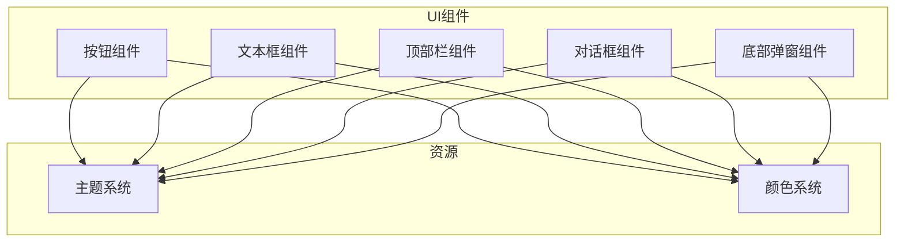
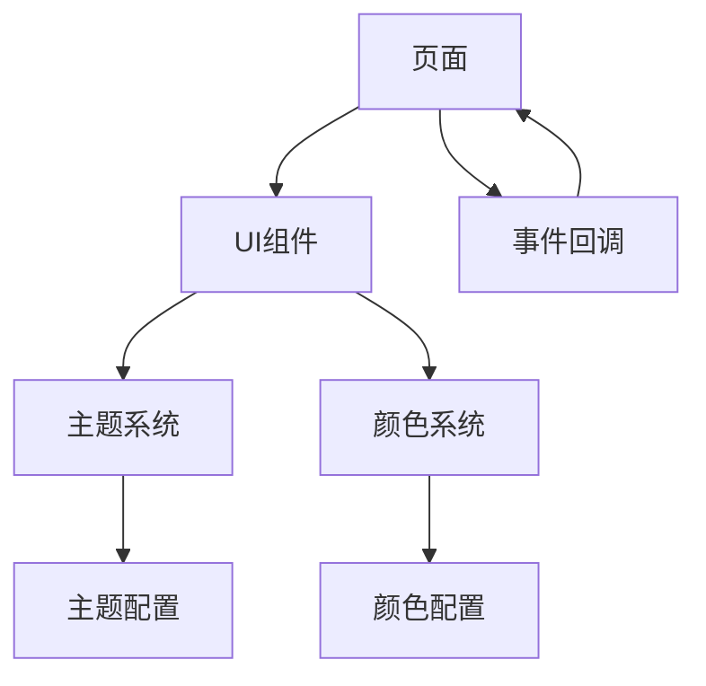
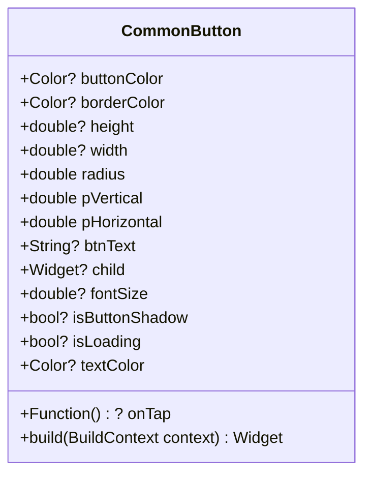
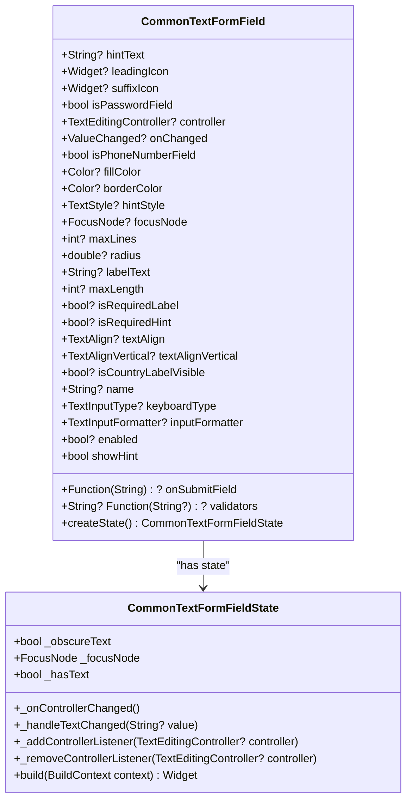
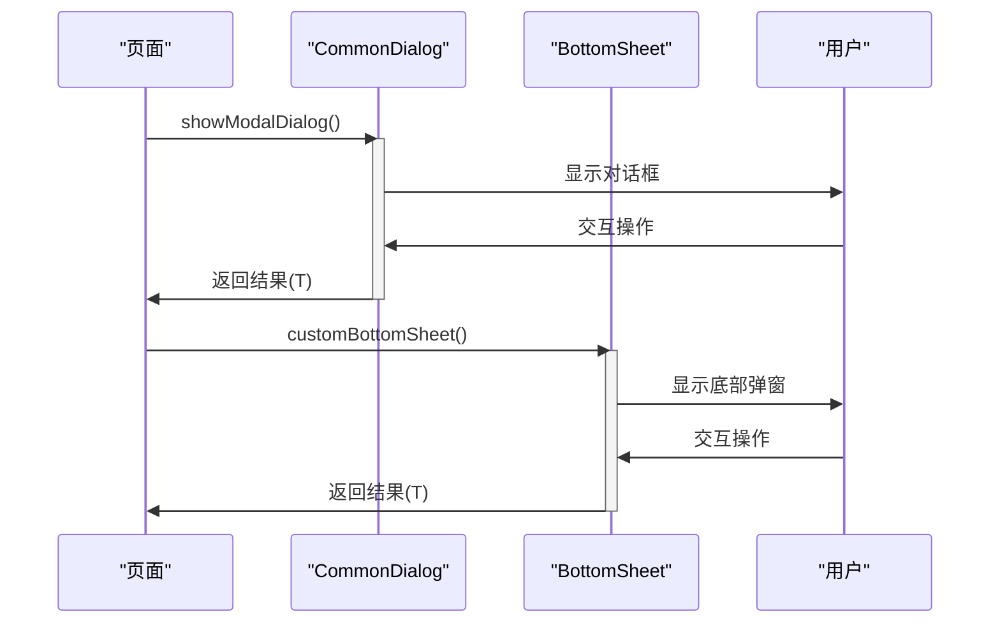
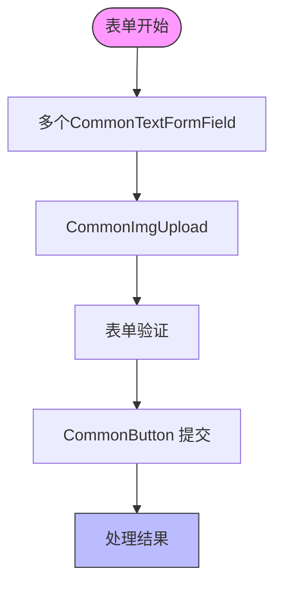
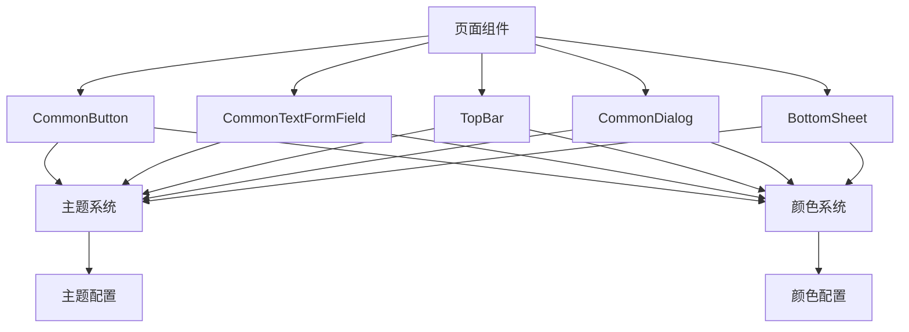

# UI组件库

<cite>
**本文档引用的文件**  
- [common_button.dart](file://lib/widgets/base/button/common_button.dart)
- [common_textformfield.dart](file://lib/widgets/base/textfield/common_textformfield.dart)
- [topbar.dart](file://lib/widgets/base/topbar/topbar.dart)
- [common_dialog.dart](file://lib/widgets/base/alert/common_dialog.dart)
- [bottom_sheet.dart](file://lib/widgets/base/bottom_sheet/bottom_sheet.dart)
- [common_text.dart](file://lib/widgets/base/text/common_text.dart)
- [common_img_upload.dart](file://lib/widgets/base/textfield/common_img_upload.dart)
- [top_bar_click_listener.dart](file://lib/interfaces/top_bar_click_listener.dart)
- [theme.dart](file://lib/resources/theme.dart)
- [colors.dart](file://lib/resources/colors.dart)
</cite>

## 目录
1. [简介](#简介)
2. [项目结构](#项目结构)
3. [核心组件](#核心组件)
4. [架构概述](#架构概述)
5. [详细组件分析](#详细组件分析)
6. [依赖分析](#依赖分析)
7. [性能考虑](#性能考虑)
8. [故障排除指南](#故障排除指南)
9. [结论](#结论)

## 简介
本文档系统化地文档化了基础UI组件库，为每个组件提供详细的属性说明、使用示例和主题适配指南。重点介绍CommonButton的类型、状态和点击反馈机制，详细说明CommonTextFormField的验证、提示文本、图标集成等特性，阐述TopBar的标题、导航按钮和事件回调设计，并解释CommonDialog和BottomSheet的异步交互模式。

## 项目结构
项目采用分层结构组织UI组件，所有基础UI组件位于`lib/widgets/base/`目录下，按功能分类为按钮、文本框、顶部栏、对话框和底部弹窗等。主题和颜色系统独立于`lib/resources/`目录中，确保样式的一致性和可维护性。



**图表来源**  
- [common_button.dart](file://lib/widgets/base/button/common_button.dart)
- [common_textformfield.dart](file://lib/widgets/base/textfield/common_textformfield.dart)
- [topbar.dart](file://lib/widgets/base/topbar/topbar.dart)
- [common_dialog.dart](file://lib/widgets/base/alert/common_dialog.dart)
- [bottom_sheet.dart](file://lib/widgets/base/bottom_sheet/bottom_sheet.dart)
- [theme.dart](file://lib/resources/theme.dart)
- [colors.dart](file://lib/resources/colors.dart)

**章节来源**  
- [common_button.dart](file://lib/widgets/base/button/common_button.dart)
- [common_textformfield.dart](file://lib/widgets/base/textfield/common_textformfield.dart)
- [topbar.dart](file://lib/widgets/base/topbar/topbar.dart)

## 核心组件
本节分析UI组件库中的核心组件，包括按钮、文本框、顶部栏、对话框和底部弹窗。这些组件构成了应用程序的用户界面基础，提供了统一的交互体验和视觉风格。

**章节来源**  
- [common_button.dart](file://lib/widgets/base/button/common_button.dart#L1-L93)
- [common_textformfield.dart](file://lib/widgets/base/textfield/common_textformfield.dart#L1-L361)
- [topbar.dart](file://lib/widgets/base/topbar/topbar.dart#L1-L253)
- [common_dialog.dart](file://lib/widgets/base/alert/common_dialog.dart#L1-L81)
- [bottom_sheet.dart](file://lib/widgets/base/bottom_sheet/bottom_sheet.dart#L1-L132)

## 架构概述
UI组件库采用分层架构设计，将组件实现与主题系统分离。基础组件通过依赖注入方式获取主题和颜色配置，确保在不同主题下的一致性表现。组件间通过定义良好的接口进行通信，如TopBar通过TopBarClickListener接口与页面进行事件交互。



**图表来源**  
- [theme.dart](file://lib/resources/theme.dart#L1-L316)
- [colors.dart](file://lib/resources/colors.dart#L1-L361)
- [top_bar_click_listener.dart](file://lib/interfaces/top_bar_click_listener.dart#L1-L4)

## 详细组件分析
本节对每个关键组件进行深入分析，包括其属性、使用方法和最佳实践。

### CommonButton 分析
CommonButton组件是应用程序中的主要交互元素，支持多种类型和状态。



**图表来源**  
- [common_button.dart](file://lib/widgets/base/button/common_button.dart#L6-L92)

#### 按钮类型与状态
CommonButton支持主按钮、次按钮等多种类型，通过buttonColor属性控制外观。组件具有加载和禁用两种特殊状态：
- **加载状态**：当isLoading设置为true时，显示加载动画替代文本
- **禁用状态**：通过将onTap设置为null实现，视觉上可通过buttonColor调整

#### 点击反馈机制
按钮通过GestureDetector实现点击反馈，onTap回调函数在用户点击时触发。组件自动处理点击区域的视觉反馈，无需额外配置。

**章节来源**  
- [common_button.dart](file://lib/widgets/base/button/common_button.dart#L6-L92)
- [unified_login_screen.dart](file://lib/pages/login/widgets/unified_login_screen.dart#L101-L118)

### CommonTextFormField 分析
CommonTextFormField是功能丰富的文本输入组件，支持验证、提示文本和图标集成。



**图表来源**  
- [common_textformfield.dart](file://lib/widgets/base/textfield/common_textformfield.dart#L11-L360)

#### 验证机制
组件内置强大的验证功能，支持：
- 内置验证器（如必填字段）
- 自定义验证函数
- 实时验证反馈
- 多重验证规则组合

#### 提示文本与图标集成
支持在输入框前后添加图标，并提供灵活的提示文本配置：
- leadingIcon：前置图标，常用于表示输入类型
- suffixIcon：后置图标，可用于操作按钮
- hintText：占位提示文本
- labelText：浮动标签，提升可用性

**章节来源**  
- [common_textformfield.dart](file://lib/widgets/base/textfield/common_textformfield.dart#L11-L360)
- [forgot_password_screen.dart](file://lib/pages/forgot_password/widgets/forgot_password_screen.dart#L121-L230)

### TopBar 分析
TopBar组件负责页面顶部导航和操作，提供一致的用户体验。

```mermaid
classDiagram
class TopBar {
+String? title
+AlignmentGeometry alignment
+String subTitle
+TopBarClickListener clickListener
+bool isShowTitle
+bool isShowProfile
+bool isShowNotification
+bool isShowSearch
+bool isShowCart
+bool isShowSearchField
+bool isShowBack
+bool isShowLike
+Color? topBarColor
+Color textColor
+double height
+bool isShowShadow
+bool? isShowCartCount
+bool? isShowEditProfile
+bool? isBackIconWhite
+build(BuildContext context) Widget
}
class TopBarClickListener {
+onTopBarClick(String name, {String value = ""}) void
}
TopBar --> TopBarClickListener : "depends on"
```

**图表来源**  
- [topbar.dart](file://lib/widgets/base/topbar/topbar.dart#L9-L252)
- [top_bar_click_listener.dart](file://lib/interfaces/top_bar_click_listener.dart#L1-L3)

#### 标题与导航按钮
TopBar支持灵活的标题和导航配置：
- 主标题和副标题
- 返回按钮（可自定义图标颜色）
- 搜索、通知、购物车等快捷操作按钮

#### 事件回调设计
通过TopBarClickListener接口实现事件回调，页面实现该接口以处理用户交互：
- onTopBarClick方法接收操作名称和可选值
- 支持back、search、notification、pay_order_list、edit等操作类型

**章节来源**  
- [topbar.dart](file://lib/widgets/base/topbar/topbar.dart#L9-L252)
- [dashboard_screen.dart](file://lib/pages/main_layout/widgets/dashboard_screen.dart#L52-L146)

### CommonDialog 和 BottomSheet 分析
CommonDialog和BottomSheet提供模态交互，支持异步操作流程。



**图表来源**  
- [common_dialog.dart](file://lib/widgets/base/alert/common_dialog.dart#L9-L80)
- [bottom_sheet.dart](file://lib/widgets/base/bottom_sheet/bottom_sheet.dart#L8-L131)

#### 异步交互模式
两种组件都采用Future<T?>返回类型，支持异步等待用户操作结果：
- CommonDialog：通过showDialog显示，适合重要确认操作
- BottomSheet：通过showModalBottomSheet显示，适合选项选择和表单输入

**章节来源**  
- [common_dialog.dart](file://lib/widgets/base/alert/common_dialog.dart#L9-L80)
- [bottom_sheet.dart](file://lib/widgets/base/bottom_sheet/bottom_sheet.dart#L8-L131)

### 组件组合使用最佳实践
本节介绍如何有效组合使用UI组件，特别是在表单场景中。

#### 表单中输入框与上传组件的集成


**图表来源**  
- [common_textformfield.dart](file://lib/widgets/base/textfield/common_textformfield.dart)
- [common_img_upload.dart](file://lib/widgets/base/textfield/common_img_upload.dart)
- [common_button.dart](file://lib/widgets/base/button/common_button.dart)

在表单中，CommonTextFormField和CommonImgUpload可以无缝集成，通过FormBuilder实现统一的表单管理。CommonImgUpload组件特殊之处在于它既是一个输入框，又是一个图片选择器，点击空白区域可触发图片选择。

**章节来源**  
- [common_textformfield.dart](file://lib/widgets/base/textfield/common_textformfield.dart)
- [common_img_upload.dart](file://lib/widgets/base/textfield/common_img_upload.dart)
- [common_button.dart](file://lib/widgets/base/button/common_button.dart)

### 主题系统全局样式定制
通过主题系统实现全局样式统一管理。

```mermaid
erDiagram
THEME ||--o{ COLORS : "包含"
THEME ||--o{ FONTS : "包含"
THEME ||--o{ SPACERS : "包含"
THEME ||--o{ SHADOWS : "包含"
class Theme {
+Map colors
+Map fonts
+Map spacers
+Map shadows
}
class Colors {
+String primaryColor
+String secondaryColor
+String accentColor
}
class Fonts {
+int fontSize
+int lineHeight
+int fontWeight
}
class Spacers {
+int spacer4
+int spacer8
+int spacer12
}
class Shadows {
+List shadowBase
+List shadowMiddle
+List shadowTop
}
```

**图表来源**  
- [theme.dart](file://lib/resources/theme.dart#L2-L315)
- [colors.dart](file://lib/resources/colors.dart#L3-L360)

#### 主题适配指南
主题系统提供以下定制能力：
- **颜色系统**：通过CustomAppColor类实现亮暗模式适配
- **字体系统**：预定义多种字体大小和样式
- **间距系统**：标准化的间距值，确保布局一致性
- **阴影系统**：不同层级的阴影效果

组件通过CustomAppColor.of(context)获取当前主题配置，自动适应亮暗模式切换。

**章节来源**  
- [theme.dart](file://lib/resources/theme.dart#L2-L315)
- [colors.dart](file://lib/resources/colors.dart#L3-L360)

## 依赖分析
UI组件库的依赖关系清晰，基础组件依赖于主题和颜色系统，而页面组件依赖于UI组件。



**图表来源**  
- [common_button.dart](file://lib/widgets/base/button/common_button.dart)
- [common_textformfield.dart](file://lib/widgets/base/textfield/common_textformfield.dart)
- [topbar.dart](file://lib/widgets/base/topbar/topbar.dart)
- [common_dialog.dart](file://lib/widgets/base/alert/common_dialog.dart)
- [bottom_sheet.dart](file://lib/widgets/base/bottom_sheet/bottom_sheet.dart)
- [theme.dart](file://lib/resources/theme.dart)
- [colors.dart](file://lib/resources/colors.dart)

**章节来源**  
- [common_button.dart](file://lib/widgets/base/button/common_button.dart)
- [common_textformfield.dart](file://lib/widgets/base/textfield/common_textformfield.dart)
- [topbar.dart](file://lib/widgets/base/topbar/topbar.dart)
- [common_dialog.dart](file://lib/widgets/base/alert/common_dialog.dart)
- [bottom_sheet.dart](file://lib/widgets/base/bottom_sheet/bottom_sheet.dart)

## 性能考虑
UI组件库在设计时考虑了性能优化：
- 所有组件均为StatelessWidget或高效管理状态的StatefulWidget
- 避免不必要的重建，通过const构造函数和适当的shouldRebuild优化
- 图片资源使用缓存机制（如CachedNetworkImage）
- 长列表场景使用懒加载和虚拟化

## 故障排除指南
常见问题及解决方案：
- **按钮点击无响应**：检查onTap是否为null，确认组件未处于加载状态
- **文本框验证不工作**：确保使用FormBuilder并正确配置validators属性
- **顶部栏事件未触发**：确认页面实现了TopBarClickListener接口
- **主题颜色不生效**：检查CustomAppColor.of(context)调用上下文

**章节来源**  
- [common_button.dart](file://lib/widgets/base/button/common_button.dart)
- [common_textformfield.dart](file://lib/widgets/base/textfield/common_textformfield.dart)
- [topbar.dart](file://lib/widgets/base/topbar/topbar.dart)
- [colors.dart](file://lib/resources/colors.dart)

## 结论
本文档全面介绍了UI组件库的设计、实现和使用方法。通过系统化的组件设计和主题适配机制，确保了应用程序界面的一致性和可维护性。建议在开发中优先使用这些基础组件，遵循最佳实践以保证用户体验的统一性。