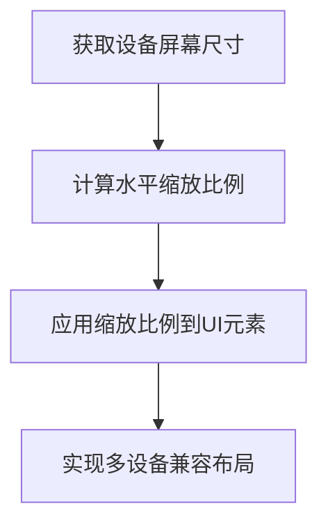
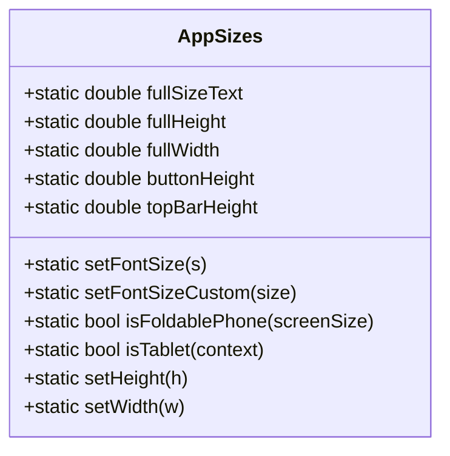
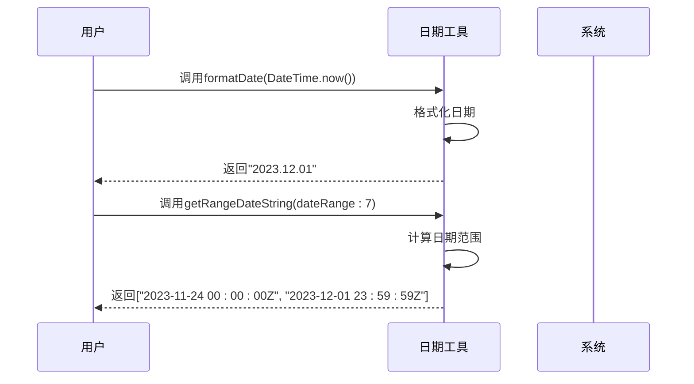
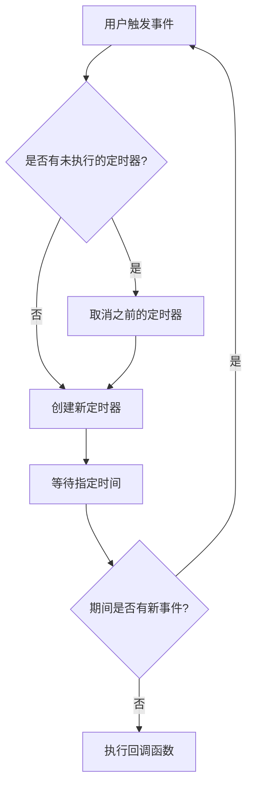
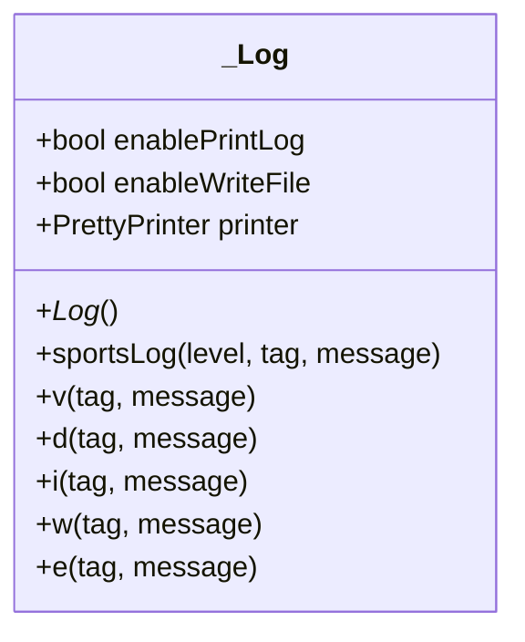
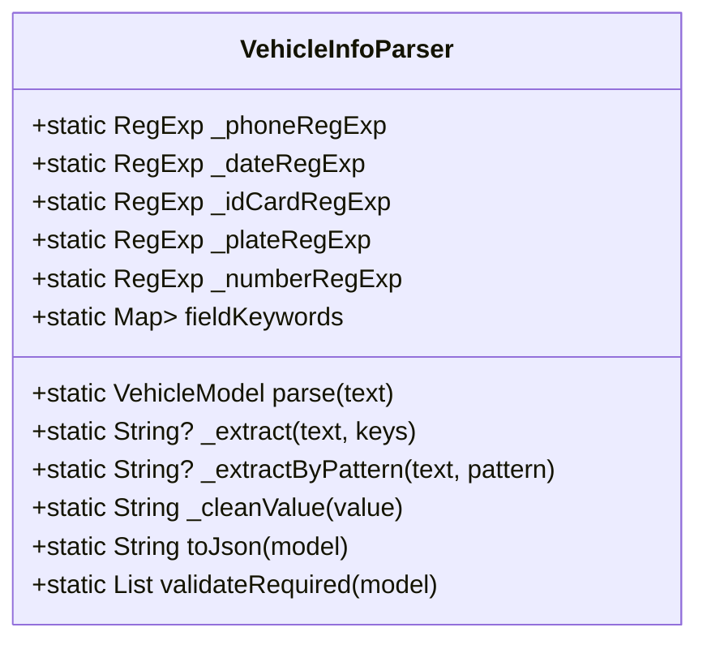
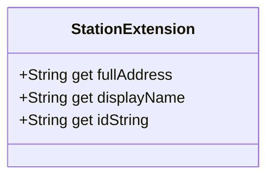

# 工具类

<cite>
**本文档引用的文件**
- [screen.dart](file://lib/utils/screen.dart)
- [sizer_utils.dart](file://lib/utils/sizer_utils.dart)
- [date_util.dart](file://lib/utils/date_util.dart)
- [debouncer.dart](file://lib/utils/debouncer.dart)
- [log.dart](file://lib/utils/log.dart)
- [validators.dart](file://lib/utils/validators.dart)
- [vehicle_info_parser.dart](file://lib/utils/vehicle_info_parser.dart)
- [station_extension.dart](file://lib/utils/station_extension.dart)
- [pt.dart](file://lib/utils/pt.dart)
</cite>

## 目录
1. [简介](#简介)
2. [尺寸适配工具](#尺寸适配工具)
3. [日期处理工具](#日期处理工具)
4. [防抖工具](#防抖工具)
5. [日志工具](#日志工具)
6. [表单验证器](#表单验证器)
7. [车辆信息解析器](#车辆信息解析器)
8. [加油站扩展方法](#加油站扩展方法)
9. [结论](#结论)

## 简介
本项目包含一系列实用的工具类库，旨在提高开发效率和代码质量。这些工具涵盖了从UI适配、日期处理、性能优化到业务逻辑处理的各个方面。通过这些工具，开发者可以更专注于业务功能的实现，而无需重复编写基础代码。本文档将详细介绍这些工具的功能与使用方法。

## 尺寸适配工具

尺寸适配工具主要由`screen.dart`和`sizer_utils.dart`两个文件组成，它们共同实现了多设备兼容的UI布局方案。`screen.dart`提供了基于设计稿的尺寸缩放功能，而`sizer_utils.dart`则利用`flutter_screenutil`库实现了更精细的屏幕适配。

### screen.dart 实现原理

`screen.dart`文件中的`_Screen`类通过MediaQuery获取设备的实际屏幕尺寸，并与设计稿的基准尺寸（375x780）进行比较，计算出水平缩放比例`hRate`。该工具主要考虑宽适配，将16:9的屏幕比例调整为4:3，避免了宽高同时缩放导致的严重变形问题。



**Diagram sources**
- [screen.dart](file://lib/utils/screen.dart#L1-L152)

### sizer_utils.dart 实现原理

`sizer_utils.dart`文件中的`AppSizes`类封装了`flutter_screenutil`的功能，提供了字体、高度和宽度的适配方法。它还特别处理了平板设备和折叠屏手机的适配问题，通过检测屏幕尺寸和长宽比来判断设备类型，并应用不同的缩放因子。



**Diagram sources**
- [sizer_utils.dart](file://lib/utils/sizer_utils.dart#L7-L105)

### 实际布局示例

在实际使用中，开发者可以通过`screen.c()`方法将设计稿中的DP值转换为实际像素值。例如，一个在设计稿中宽度为100DP的按钮，在不同设备上会自动缩放以保持视觉一致性。同时，`pt.dart`文件提供了更便捷的调用方式，通过`pt()`函数可以直接获取适配后的尺寸。

**Section sources**
- [screen.dart](file://lib/utils/screen.dart#L96-L129)
- [sizer_utils.dart](file://lib/utils/sizer_utils.dart#L86-L98)
- [pt.dart](file://lib/utils/pt.dart#L3-L27)

## 日期处理工具

日期处理工具（`date_util.dart`）提供了一系列常用的日期格式化和计算方法，简化了日期相关的开发工作。

### 常用格式化方法

该工具提供了多种日期格式化方法，包括：
- `formatDate`：将DateTime对象格式化为指定格式的字符串，默认格式为"yyyy.MM.dd"
- `formatDateFromMilliSecond`：将时间戳毫秒值转换为格式化的日期字符串，默认格式为"dd.MM.yyyy"
- `buildHHMMSS`：将秒数构建为"00:00:00"格式的时分秒字符串
- `buildMMSS`：将秒数构建为"00:00"格式的分秒字符串

### 日期计算方法

除了格式化功能，该工具还提供了实用的日期计算方法：
- `getRangeDateString`：获取指定天数范围内的日期区间，常用于查询条件的生成



**Diagram sources**
- [date_util.dart](file://lib/utils/date_util.dart#L4-L51)

**Section sources**
- [date_util.dart](file://lib/utils/date_util.dart#L4-L51)

## 防抖工具

防抖工具（`debouncer.dart`）用于控制函数的执行频率，避免在短时间内重复执行，特别适用于搜索、按钮防重复提交等场景。

### 实现原理

`Debouncer`类通过`Timer`实现防抖功能。当`run`方法被调用时，如果之前有未执行的定时器，则先取消它，然后创建一个新的定时器。只有在指定的时间间隔内没有再次调用`run`方法，才会执行传入的回调函数。



### 应用场景

#### 搜索场景
在搜索框输入时，每次输入都会触发搜索请求。使用防抖工具可以避免频繁的网络请求，只有在用户停止输入300毫秒后才执行搜索。

#### 按钮防重复提交
在表单提交或支付等操作中，防止用户快速点击多次导致重复提交。通过防抖工具确保即使用户多次点击，也只会在最后一次点击后的指定时间后执行一次。

**Section sources**
- [debouncer.dart](file://lib/utils/debouncer.dart#L5-L22)

## 日志工具

日志工具（`log.dart`）提供了分级输出和调试开关机制，帮助开发者在开发和生产环境中有效地进行调试和问题排查。

### 分级输出

日志工具支持多种日志级别，包括：
- `v`：跟踪级别，用于详细的信息输出
- `d`：调试级别，用于调试信息
- `i`：信息级别，用于一般信息
- `w`：警告级别，用于警告信息
- `e`：错误级别，用于错误信息

### 调试开关机制

通过`enablePrintLog`属性可以全局控制日志的输出。在生产环境中，可以将此属性设置为`false`来关闭所有日志输出，提高应用性能。同时，`enableWriteFile`属性控制是否将日志写入文件。



**Diagram sources**
- [log.dart](file://lib/utils/log.dart#L10-L182)

**Section sources**
- [log.dart](file://lib/utils/log.dart#L10-L182)

## 表单验证器

表单验证器（`validators.dart`）提供了内置的验证规则和扩展方式，确保用户输入的数据符合要求。

### 内置规则

#### 密码验证器
`PasswordValidator`类提供了完整的密码验证功能：
- 长度校验：8-16位
- 必须包含大写字母
- 必须包含小写字母
- 必须包含数字
- 必须包含特殊字符
- 提供密码强度评估功能

#### 手机号验证器
`PhoneValidator`类用于验证中国大陆手机号：
- 必须以1开头
- 第二位为3-9
- 总长度为11位

```mermaid
flowchart TD
A[用户输入密码] --> B{是否为空?}
B --> |是| C[返回"请输入你的密码"]
B --> |否| D{长度是否为8-16位?}
D --> |否| E[返回"密码长度必须为8-16位"]
D --> |是| F{是否包含大写字母?}
F --> |否| G[返回"密码必须包含大写字母"]
F --> |是| H{是否包含小写字母?}
H --> |否| I[返回"密码必须包含小写字母"]
H --> |是| J{是否包含数字?}
J --> |否| K[返回"密码必须包含数字"]
J --> |是| L{是否包含特殊字符?}
L --> |否| M[返回"密码必须包含特殊字符"]
L --> |是| N[验证通过]
```

**Section sources**
- [validators.dart](file://lib/utils/validators.dart#L2-L82)

## 车辆信息解析器

车辆信息解析器（`vehicle_info_parser.dart`）用于解析用户输入的车辆信息文本，提取出结构化的数据。

### 业务场景用例

在提油业务中，用户可能通过粘贴或手动输入的方式提供车辆信息。这些信息通常包含驾驶员姓名、车牌号、提油吨位等。解析器通过关键词匹配和正则表达式提取这些信息，并转换为`VehicleModel`对象。

### 解析策略

1. **预处理**：在所有已知关键词前添加换行符，解决无分隔符连字的问题
2. **特征提取**：优先使用正则表达式提取强特征字段（如车牌号、手机号、身份证）
3. **关键词匹配**：使用关键词映射表提取其他字段
4. **值清理**：移除单位、首尾标点等



**Diagram sources**
- [vehicle_info_parser.dart](file://lib/utils/vehicle_info_parser.dart#L4-L203)

**Section sources**
- [vehicle_info_parser.dart](file://lib/utils/vehicle_info_parser.dart#L4-L203)

## 加油站扩展方法

加油站扩展方法（`station_extension.dart`）为`Station`类提供了便捷的工具方法，简化了加油站相关数据的处理。

### 业务场景用例

在加油站管理功能中，经常需要获取加油站的完整地址、显示名称等信息。通过扩展方法，可以直接在`Station`对象上调用这些方法，无需在每个使用处重复编写相同的逻辑。

### 扩展方法

#### 获取完整地址
`fullAddress`方法将省、市、区和详细地址拼接成完整的地址字符串，自动过滤空值。

#### 获取显示名称
`displayName`方法安全地获取加油站名称，如果名称为空则返回空字符串。

#### 获取ID字符串
`idString`方法将加油站ID转换为字符串，如果ID为空则返回空字符串。



**Diagram sources**
- [station_extension.dart](file://lib/utils/station_extension.dart#L5-L24)

**Section sources**
- [station_extension.dart](file://lib/utils/station_extension.dart#L5-L24)

## 结论
本文档全面介绍了项目中的各种工具类库，包括尺寸适配、日期处理、防抖、日志、表单验证、车辆信息解析和加油站扩展等功能。这些工具类库通过提供可复用的解决方案，显著提高了开发效率和代码质量。开发者应充分利用这些工具，遵循最佳实践，以构建更加稳定和高效的移动应用。