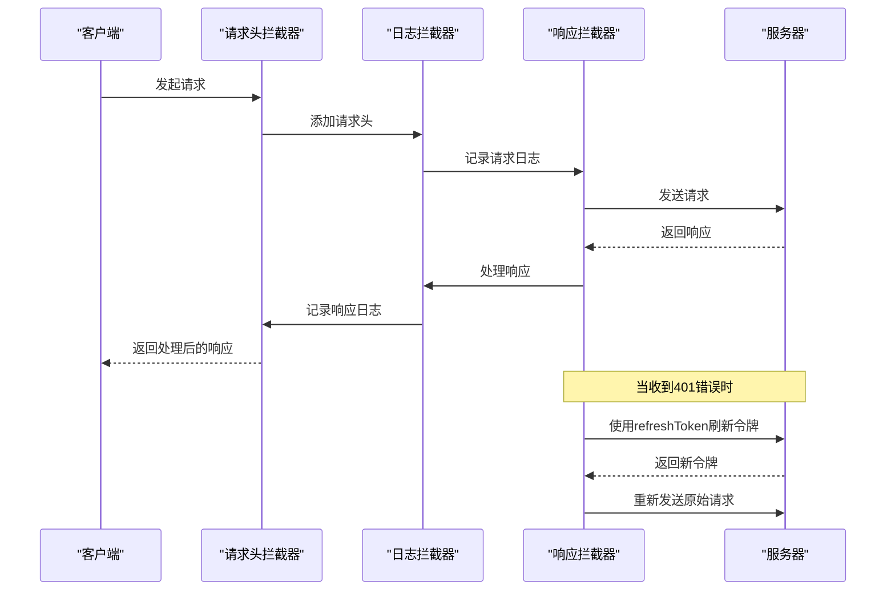
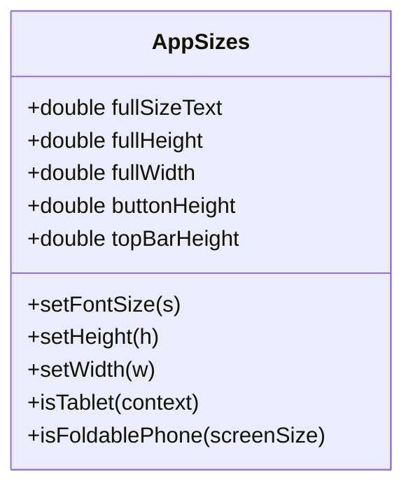

# 核心模块详解

<cite>
**本文档引用的文件**  
- [app_controller.dart](file://lib/global/app_controller.dart)
- [app_state.dart](file://lib/global/app_state.dart)
- [router.dart](file://lib/router/router.dart)
- [routes.dart](file://lib/router/routes.dart)
- [net_manager.dart](file://lib/net/net_manager.dart)
- [http_header_interceptor.dart](file://lib/net/http_header_interceptor.dart)
- [http_log_interceptor.dart](file://lib/net/http_log_interceptor.dart)
- [http_resp_interceptor.dart](file://lib/net/http_resp_interceptor.dart)
- [common_button.dart](file://lib/widgets/base/button/common_button.dart)
- [common_textformfield.dart](file://lib/widgets/base/textfield/common_textformfield.dart)
- [topbar.dart](file://lib/widgets/base/topbar/topbar.dart)
- [sizer_utils.dart](file://lib/utils/sizer_utils.dart)
- [log.dart](file://lib/utils/log.dart)
- [phone_validator.dart](file://lib/utils/validators/phone_validator.dart)
- [verification_code_validator.dart](file://lib/utils/validators/verification_code_validator.dart)
</cite>

## 目录
1. [全局状态管理模块](#全局状态管理模块)
2. [路由模块](#路由模块)
3. [网络管理模块](#网络管理模块)
4. [公共UI组件库](#公共ui组件库)
5. [工具类模块](#工具类模块)

## 全局状态管理模块

全局状态管理模块基于`HydratedCubit`实现，通过`AppController`和`AppState`两个核心类管理应用的全局状态。该模块实现了状态的持久化存储，确保应用重启后仍能恢复用户登录状态和选中的加油站信息。

`AppController`继承自`HydratedCubit<AppState>`，实现了`WidgetsBindingObserver`接口以监听应用生命周期。其核心功能包括用户认证状态管理、加油站选择管理以及登录后的流程处理。状态持久化通过`fromJson`和`toJson`方法实现，将`AppState`对象序列化为JSON格式存储，并在应用启动时反序列化恢复状态。

`AppState`类包含两个主要属性：`authResponse`（用户认证响应）和`selectedStation`（选中的加油站）。通过`copyWith`方法实现状态的不可变更新，确保状态变更的可预测性。`AppController`通过`setAuthResponse`、`setSelectedStation`等方法更新状态，并通过`BlocProvider`在应用范围内提供状态访问。

**Section sources**
- [app_controller.dart](file://lib/global/app_controller.dart#L1-L146)
- [app_state.dart](file://lib/global/app_state.dart#L1-L23)

## 路由模块

路由模块基于`go_router`库实现，通过`BaseRouter`类提供统一的导航API。该模块支持多种页面过渡动画，包括淡入淡出、缩放和底部到顶部滑动，为用户提供流畅的导航体验。

`BaseRouter`类提供了`push`、`replace`、`pop`等导航方法，支持传递额外参数（extra）。路由配置通过`BaseRoute`类定义，支持重定向和错误处理。模块还实现了路由观察者，可用于监控路由变化和执行相关逻辑。

页面过渡动画通过自定义的过渡函数实现：
- `fadein_page.dart`：实现淡入淡出动画，使用`FadeTransition`组件
- `scale_page.dart`：实现缩放动画，使用`ScaleTransition`组件
- `bottom_to_top_page.dart`：实现从底部到顶部的滑动动画，使用`SlideTransition`组件

这些动画通过`CustomTransitionPage`包装，可以在路由配置中指定使用哪种过渡效果。

**Section sources**
- [router.dart](file://lib/router/router.dart#L1-L228)
- [fadein_page.dart](file://lib/router/pageTransition/fadein_page.dart#L1-L28)
- [scale_page.dart](file://lib/router/pageTransition/scale_page.dart#L1-L28)
- [bottom_to_top_page.dart](file://lib/router/pageTransition/bottom_to_top_page.dart#L1-L28)

## 网络管理模块

网络管理模块基于`Dio`库构建，通过`NetManager`类提供统一的HTTP客户端配置和管理。该模块实现了拦截器链，确保请求和响应的统一处理。

`NetManager`类初始化一个`Dio`实例，配置了连接超时时间（30秒）和重试次数（3次）。拦截器链的执行顺序如下：
1. `HttpLogInterceptor`：日志拦截器，记录请求和响应的详细信息
2. `HttpHeaderInterceptor`：请求头拦截器，为每个请求添加必要的头信息
3. `HttpRespInterceptor`：响应拦截器，处理响应数据转换和错误处理

`HttpHeaderInterceptor`为请求添加认证信息（Authorization头）和设备信息（UserAgent相关头），但登录接口除外。`HttpRespInterceptor`实现了自动token刷新机制，当收到401错误时，会尝试使用refreshToken刷新访问令牌，并重新发送原始请求，确保用户会话的连续性。

**Diagram sources**
- [net_manager.dart](file://lib/net/net_manager.dart#L1-L88)
- [http_header_interceptor.dart](file://lib/net/http_header_interceptor.dart#L1-L56)
- [http_log_interceptor.dart](file://lib/net/http_log_interceptor.dart#L1-L60)
- [http_resp_interceptor.dart](file://lib/net/http_resp_interceptor.dart#L1-L210)

**Section sources**
- [net_manager.dart](file://lib/net/net_manager.dart#L1-L88)
- [http_header_interceptor.dart](file://lib/net/http_header_interceptor.dart#L1-L56)
- [http_log_interceptor.dart](file://lib/net/http_log_interceptor.dart#L1-L60)
- [http_resp_interceptor.dart](file://lib/net/http_resp_interceptor.dart#L1-L210)

## 公共UI组件库

公共UI组件库位于`widgets/base`目录下，提供了一系列可复用的UI组件，确保应用界面的一致性和开发效率。

### CommonButton

`CommonButton`是一个可定制的按钮组件，支持多种样式配置：
- `buttonColor`：按钮背景色
- `borderColor`：边框颜色
- `radius`：圆角半径
- `onTap`：点击回调
- `btnText`：按钮文本
- `isLoading`：加载状态，显示加载指示器

按钮支持阴影效果和自定义文本样式，通过`CommonText`组件实现文本渲染。

### CommonTextFormField

`CommonTextFormField`是一个功能丰富的文本输入框组件，支持：
- `isPasswordField`：密码输入模式，带显示/隐藏切换
- `isPhoneNumberField`：手机号输入模式，集成国际号码选择
- `validators`：输入验证
- `maxLength`：最大输入长度
- `onChanged`：输入变化回调

组件集成了`flutter_form_builder`库，支持表单验证和构建。对于手机号输入，使用`intl_phone_field`库提供国际号码选择功能。

### TopBar

`TopBar`是应用顶部导航栏组件，支持多种功能按钮：
- `isShowBack`：显示返回按钮
- `isShowNotification`：显示通知图标
- `isShowSearch`：显示搜索图标
- `isShowCart`：显示购物车图标，支持显示数量提示
- `isShowProfile`：显示用户头像

组件通过`TopBarClickListener`接口与业务逻辑解耦，点击事件通过回调传递给上层组件处理。

**Section sources**
- [common_button.dart](file://lib/widgets/base/button/common_button.dart#L1-L93)
- [common_textformfield.dart](file://lib/widgets/base/textfield/common_textformfield.dart#L1-L361)
- [topbar.dart](file://lib/widgets/base/topbar/topbar.dart#L1-L253)

## 工具类模块

工具类模块位于`utils`目录下，提供了一系列实用工具，支持应用的开发和维护。

### 尺寸适配器（AppSizes）

`AppSizes`类基于`flutter_screenutil`库实现，提供屏幕尺寸和字体大小的适配。该类支持不同设备类型的适配，包括手机、平板和折叠屏设备。通过`setWidth`、`setHeight`和`setFontSize`方法，实现UI元素的响应式布局。

**Diagram sources**
- [sizer_utils.dart](file://lib/utils/sizer_utils.dart#L1-L105)

### 日志工具

`log.dart`文件提供了全局日志工具`l`，基于`logger`库实现。支持多种日志级别（verbose、debug、info、warning、error），并提供标签化输出，便于日志的分类和过滤。日志工具支持生产环境过滤，确保不会在发布版本中输出敏感信息。

### 表单验证器

表单验证器位于`utils/validators`目录下，提供了一系列输入验证功能：
- `phone_validator.dart`：手机号验证，检查11位数字格式
- `verification_code_validator.dart`：验证码验证，检查6位数字格式

这些验证器以静态方法形式提供，可在表单中直接使用，确保输入数据的有效性。

**Section sources**
- [sizer_utils.dart](file://lib/utils/sizer_utils.dart#L1-L105)
- [log.dart](file://lib/utils/log.dart#L1-L182)
- [phone_validator.dart](file://lib/utils/validators/phone_validator.dart#L1-L35)