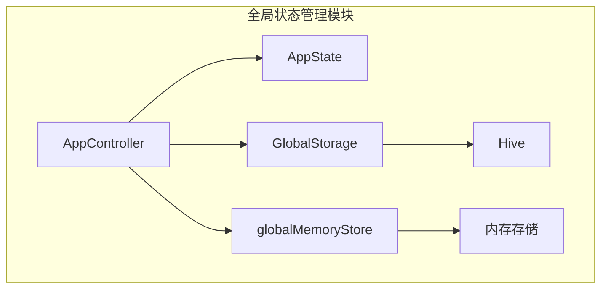
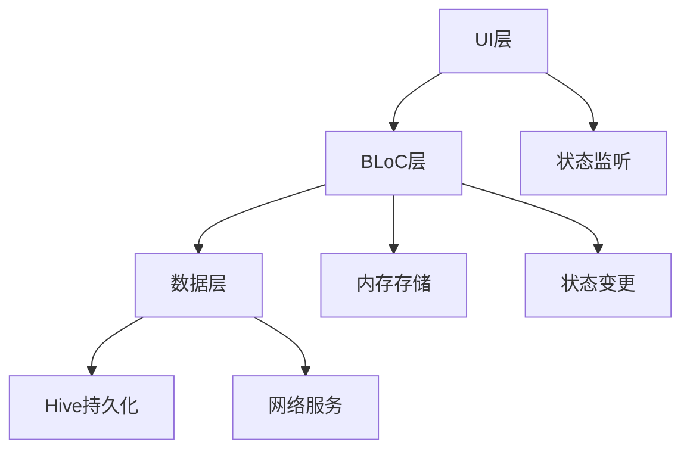
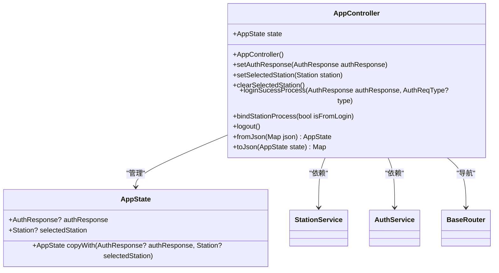
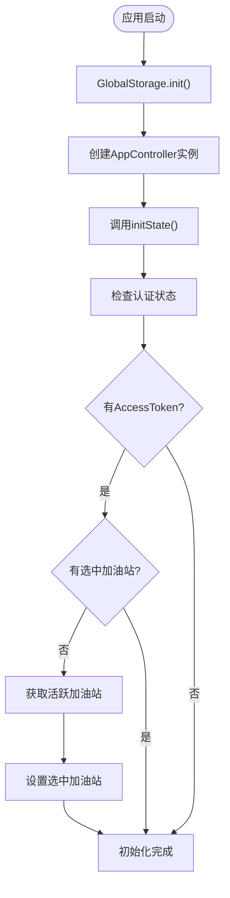
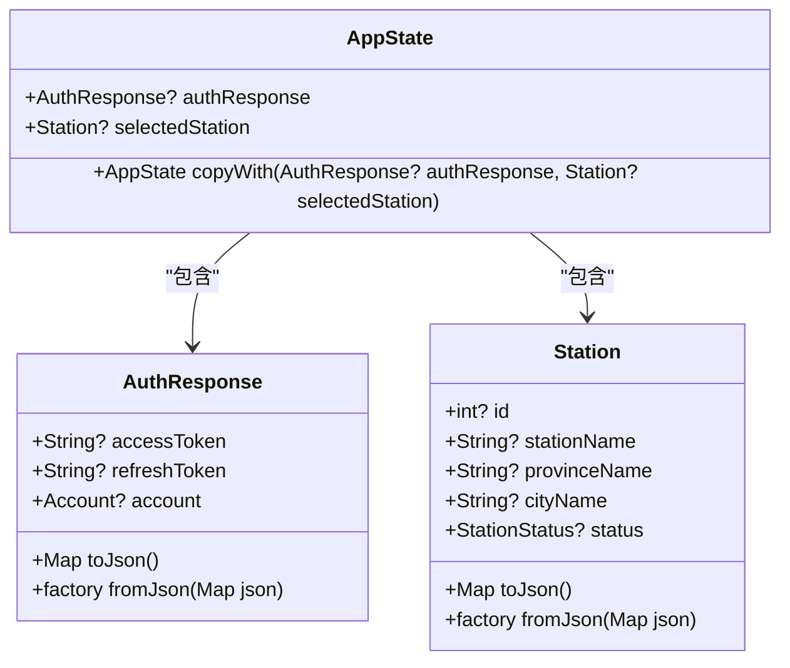
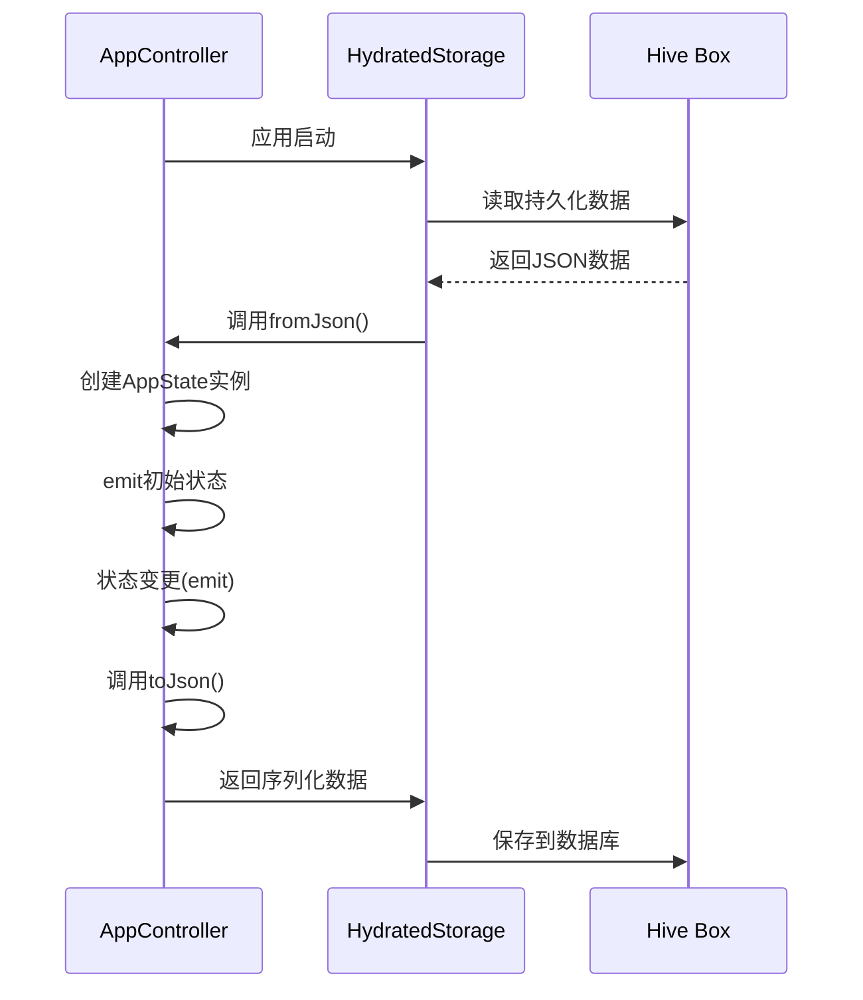
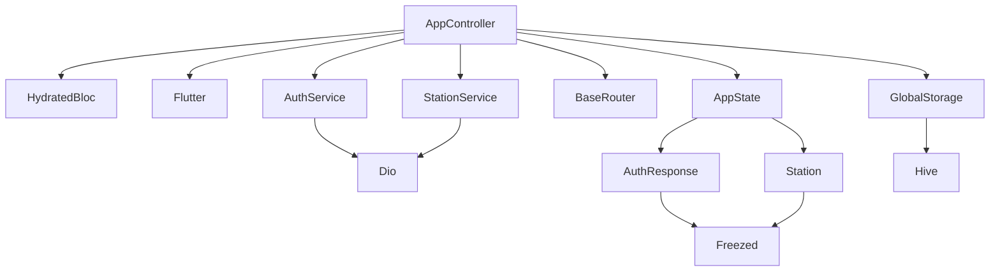

# 状态管理

<cite>
**本文档引用的文件**   
- [app_controller.dart](file://lib/global/app_controller.dart)
- [app_state.dart](file://lib/global/app_state.dart)
- [storage.dart](file://lib/global/storage.dart)
- [memory_store.dart](file://lib/global/memory_store.dart)
- [main.dart](file://lib/main.dart)
- [auth_rep_type.dart](file://lib/global/model/auth_rep_type.dart)
- [station_res_type.dart](file://lib/global/model/station_res_type.dart)
- [global_update_ui.dart](file://lib/widgets/common/global_update_ui.dart)
</cite>

## 目录
1. [简介](#简介)
2. [项目结构](#项目结构)
3. [核心组件](#核心组件)
4. [架构概述](#架构概述)
5. [详细组件分析](#详细组件分析)
6. [依赖分析](#依赖分析)
7. [性能考虑](#性能考虑)
8. [故障排除指南](#故障排除指南)
9. [结论](#结论)

## 简介
本文档详细介绍了油品业务应用中的全局状态管理模块，重点阐述了基于HydratedCubit的状态管理机制。文档涵盖了AppController和AppState的实现细节，解释了如何通过Hive实现状态的持久化存储与恢复，以及应用启动时的状态初始化流程、状态变更响应机制和跨页面状态共享的最佳实践。

## 项目结构
全局状态管理模块位于`lib/global/`目录下，包含核心的状态管理类、持久化存储和内存存储组件。该模块采用分层架构，将状态定义、状态控制器、持久化逻辑和内存缓存分离，确保代码的可维护性和可扩展性。

**Diagram sources**
- [app_controller.dart](file://lib/global/app_controller.dart#L1-L145)
- [app_state.dart](file://lib/global/app_state.dart#L1-L23)
- [storage.dart](file://lib/global/storage.dart#L1-L34)
- [memory_store.dart](file://lib/global/memory_store.dart#L1-L18)

**Section sources**
- [app_controller.dart](file://lib/global/app_controller.dart#L1-L145)
- [app_state.dart](file://lib/global/app_state.dart#L1-L23)

## 核心组件
全局状态管理模块的核心组件包括AppController（状态控制器）、AppState（状态模型）、GlobalStorage（持久化存储）和globalMemoryStore（内存存储）。这些组件协同工作，实现了应用状态的统一管理和持久化。

**Section sources**
- [app_controller.dart](file://lib/global/app_controller.dart#L1-L145)
- [app_state.dart](file://lib/global/app_state.dart#L1-L23)
- [storage.dart](file://lib/global/storage.dart#L1-L34)
- [memory_store.dart](file://lib/global/memory_store.dart#L1-L18)

## 架构概述
本应用采用BLoC（Business Logic Component）模式进行状态管理，结合HydratedCubit实现状态的持久化。架构分为三层：UI层、BLoC层和数据层。UI层通过BlocBuilder监听状态变化，BLoC层处理业务逻辑并管理状态，数据层负责与后端API和本地存储交互。

**Diagram sources**
- [app_controller.dart](file://lib/global/app_controller.dart#L1-L145)
- [storage.dart](file://lib/global/storage.dart#L1-L34)
- [memory_store.dart](file://lib/global/memory_store.dart#L1-L18)

## 详细组件分析

### AppController分析
AppController是应用的全局状态控制器，继承自HydratedCubit并混入WidgetsBindingObserver，用于监听应用生命周期。它负责管理用户认证信息和选中的加油站状态。

#### 类图

**Diagram sources**
- [app_controller.dart](file://lib/global/app_controller.dart#L16-L145)
- [app_state.dart](file://lib/global/app_state.dart#L4-L22)

#### 初始化流程

**Diagram sources**
- [app_controller.dart](file://lib/global/app_controller.dart#L34-L48)
- [main.dart](file://lib/main.dart#L17-L19)

**Section sources**
- [app_controller.dart](file://lib/global/app_controller.dart#L16-L48)
- [main.dart](file://lib/main.dart#L8-L22)

### AppState分析
AppState是应用的全局状态模型，包含用户认证信息和选中加油站两个主要属性。它通过copyWith方法支持不可变状态更新，确保状态变更的可预测性。

**Diagram sources**
- [app_state.dart](file://lib/global/app_state.dart#L4-L22)
- [auth_rep_type.dart](file://lib/global/model/auth_rep_type.dart#L6-L25)
- [station_res_type.dart](file://lib/global/model/station_res_type.dart#L27-L103)

**Section sources**
- [app_state.dart](file://lib/global/app_state.dart#L1-L23)
- [auth_rep_type.dart](file://lib/global/model/auth_rep_type.dart#L1-L46)
- [station_res_type.dart](file://lib/global/model/station_res_type.dart#L1-L164)

### 持久化机制分析
状态持久化通过HydratedCubit与Hive数据库协同工作实现。AppController实现了fromJson和toJson方法，负责状态的序列化和反序列化。

#### 序列化流程

**Diagram sources**
- [app_controller.dart](file://lib/global/app_controller.dart#L125-L142)
- [storage.dart](file://lib/global/storage.dart#L6-L8)

**Section sources**
- [app_controller.dart](file://lib/global/app_controller.dart#L125-L142)
- [storage.dart](file://lib/global/storage.dart#L1-L34)

## 依赖分析
全局状态管理模块依赖于多个外部库和内部组件，形成了清晰的依赖关系网络。

**Diagram sources**
- [app_controller.dart](file://lib/global/app_controller.dart#L1-L145)
- [pubspec.yaml](file://pubspec.yaml)

**Section sources**
- [app_controller.dart](file://lib/global/app_controller.dart#L1-L145)
- [pubspec.yaml](file://pubspec.yaml)

## 性能考虑
全局状态管理模块在性能方面进行了多项优化，包括状态变更的批量处理、持久化操作的异步执行以及内存存储的合理使用。

- **状态变更优化**：通过copyWith方法实现不可变状态更新，避免不必要的UI重建
- **持久化优化**：使用Hive作为本地数据库，提供快速的读写性能
- **内存优化**：区分持久化存储和内存存储，临时数据存储在内存中以提高访问速度
- **初始化优化**：应用启动时异步初始化状态，避免阻塞UI线程

## 故障排除指南
本节提供常见问题的解决方案，帮助开发者快速定位和解决状态管理相关的问题。

### 状态丢失问题
**问题描述**：应用重启后状态丢失
**解决方案**：
1. 确保AppController正确实现了fromJson和toJson方法
2. 检查HydratedStorage是否已正确初始化
3. 验证Hive box是否成功打开

**Section sources**
- [app_controller.dart](file://lib/global/app_controller.dart#L125-L142)
- [main.dart](file://lib/main.dart#L17-L19)

### 初始化延迟问题
**问题描述**：应用启动时状态初始化耗时较长
**解决方案**：
1. 将非关键状态的初始化移到后台线程
2. 使用预加载策略，在splash页面期间初始化状态
3. 优化数据库查询，减少初始化时的数据加载量

**Section sources**
- [app_controller.dart](file://lib/global/app_controller.dart#L34-L48)
- [main.dart](file://lib/main.dart#L17-L19)

### 状态同步问题
**问题描述**：多个页面间状态不同步
**解决方案**：
1. 确保所有页面都通过BlocBuilder监听同一AppController实例
2. 检查状态更新是否通过emit方法正确触发
3. 验证BlocProvider在widget树中的位置是否正确

**Section sources**
- [global_update_ui.dart](file://lib/widgets/common/global_update_ui.dart#L1-L18)
- [app_controller.dart](file://lib/global/app_controller.dart#L50-L60)

## 结论
本文档详细介绍了油品业务应用的全局状态管理模块，展示了基于HydratedCubit的高效状态管理方案。通过合理的架构设计和实现，该模块成功解决了状态持久化、跨页面共享和性能优化等关键问题。建议在开发新功能时遵循现有模式，确保状态管理的一致性和可维护性。