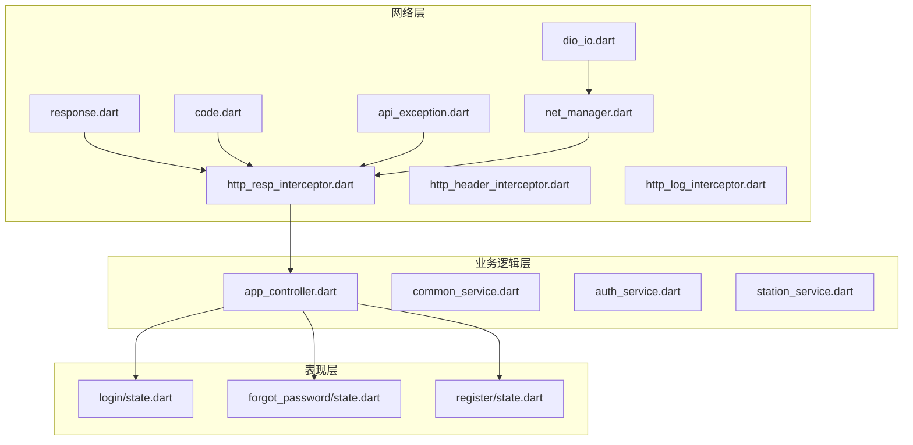
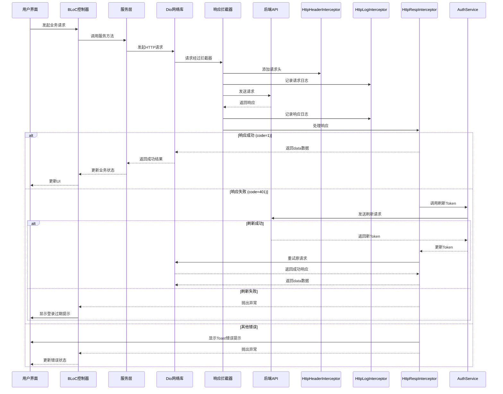
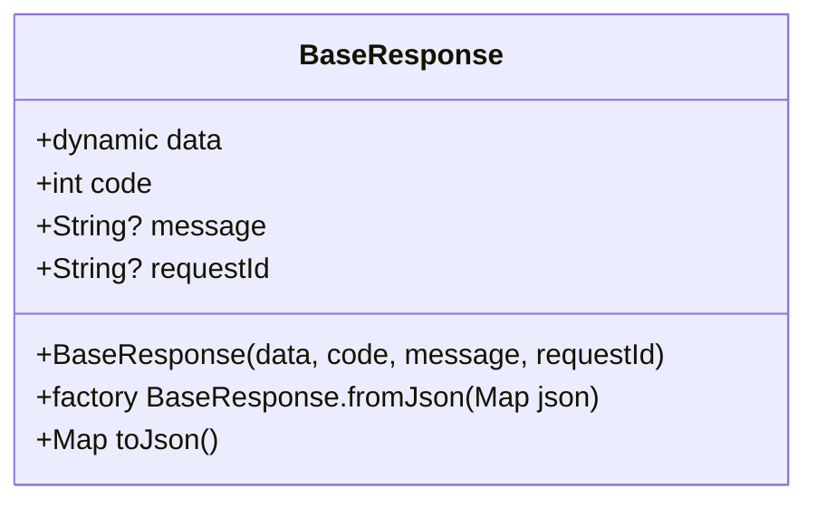
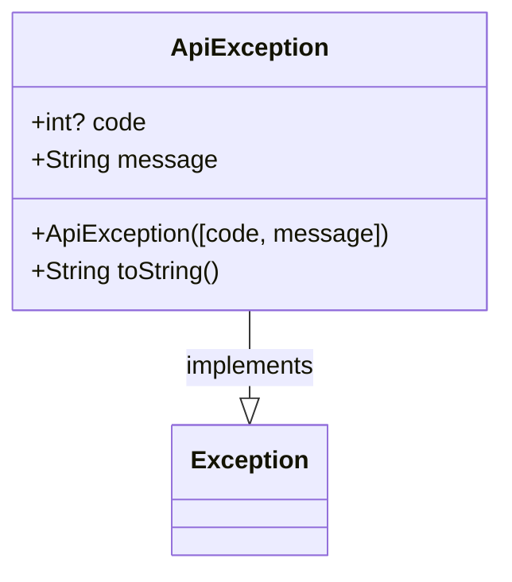
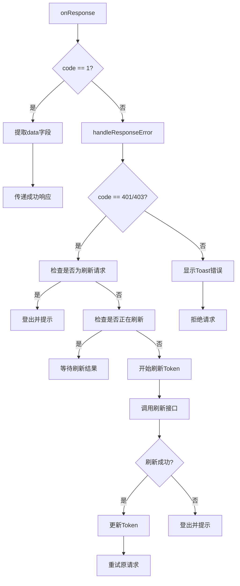
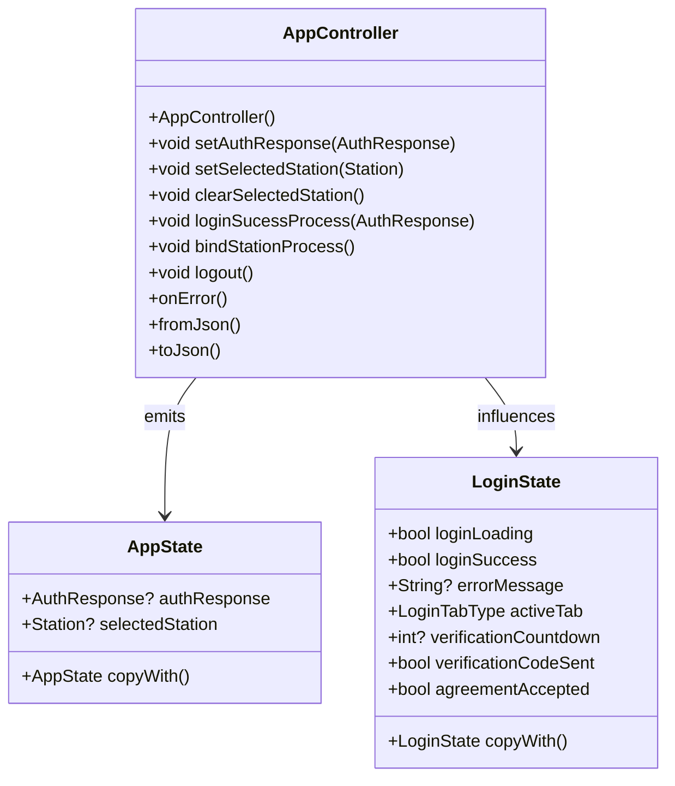
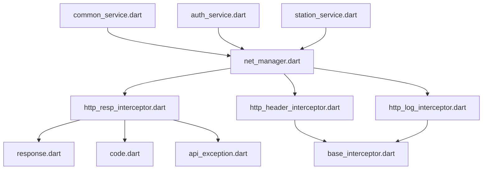

# 响应处理

<cite>
**本文档引用的文件**  
- [response.dart](file://lib/net/response.dart)
- [code.dart](file://lib/net/code.dart)
- [api_exception.dart](file://lib/net/api_exception.dart)
- [http_resp_interceptor.dart](file://lib/net/http_resp_interceptor.dart)
- [http_header_interceptor.dart](file://lib/net/http_header_interceptor.dart)
- [http_log_interceptor.dart](file://lib/net/http_log_interceptor.dart)
- [net_manager.dart](file://lib/net/net_manager.dart)
- [dio_io.dart](file://lib/net/dio_io.dart)
- [app_controller.dart](file://lib/global/app_controller.dart)
- [common_service.dart](file://lib/global/service/common_service.dart)
- [login/state.dart](file://lib/pages/login/state.dart)
- [forgot_password/state.dart](file://lib/pages/forgot_password/state.dart)
- [register/state.dart](file://lib/pages/register/state.dart)
</cite>

## 目录
1. [项目结构](#项目结构)
2. [核心组件](#核心组件)
3. [架构概述](#架构概述)
4. [详细组件分析](#详细组件分析)
5. [依赖分析](#依赖分析)
6. [性能考虑](#性能考虑)
7. [故障排除指南](#故障排除指南)
8. [结论](#结论)

## 项目结构

本项目采用典型的Flutter应用分层架构，核心网络响应处理与异常转换逻辑集中在`lib/net`目录下。该目录包含响应模型、异常定义、拦截器和网络管理器等关键组件。业务状态管理通过BLoC模式实现，位于`lib/global`和各页面的`controller.dart`、`state.dart`文件中。UI组件与状态分离，确保了良好的可维护性和可测试性。

**Diagram sources**
- [response.dart](file://lib/net/response.dart)
- [code.dart](file://lib/net/code.dart)
- [api_exception.dart](file://lib/net/api_exception.dart)
- [http_resp_interceptor.dart](file://lib/net/http_resp_interceptor.dart)
- [net_manager.dart](file://lib/net/net_manager.dart)
- [app_controller.dart](file://lib/global/app_controller.dart)
- [login/state.dart](file://lib/pages/login/state.dart)
- [forgot_password/state.dart](file://lib/pages/forgot_password/state.dart)
- [register/state.dart](file://lib/pages/register/state.dart)

**Section sources**
- [response.dart](file://lib/net/response.dart)
- [code.dart](file://lib/net/code.dart)
- [api_exception.dart](file://lib/net/api_exception.dart)
- [http_resp_interceptor.dart](file://lib/net/http_resp_interceptor.dart)
- [net_manager.dart](file://lib/net/net_manager.dart)
- [app_controller.dart](file://lib/global/app_controller.dart)

## 核心组件

项目的核心网络响应处理机制由`BaseResponse`模型、`HttpCode`错误码定义、`ApiException`异常体系和`HttpRespInterceptor`响应拦截器构成。`BaseResponse`定义了统一的响应结构，包含`data`、`code`和`message`等字段。`HttpCode`类集中管理业务错误码，如`success`和`logout`。`ApiException`实现了标准的异常接口，用于封装网络和业务错误。`HttpRespInterceptor`是核心拦截器，负责处理响应、转换异常、管理Token刷新和错误提示。

**Section sources**
- [response.dart](file://lib/net/response.dart)
- [code.dart](file://lib/net/code.dart)
- [api_exception.dart](file://lib/net/api_exception.dart)
- [http_resp_interceptor.dart](file://lib/net/http_resp_interceptor.dart)

## 架构概述

系统采用分层架构，网络请求通过Dio库发起，经过一系列拦截器处理。`HttpHeaderInterceptor`负责在请求头中添加认证信息和设备信息。`HttpLogInterceptor`记录请求和响应日志。`HttpRespInterceptor`是核心，它解析响应，根据`code`字段判断请求成功与否，对401等错误进行Token自动刷新，并将错误信息通过Toast提示用户。BLoC状态管理器（如`AppController`）接收这些错误并更新UI状态。

**Diagram sources**
- [http_header_interceptor.dart](file://lib/net/http_header_interceptor.dart)
- [http_log_interceptor.dart](file://lib/net/http_log_interceptor.dart)
- [http_resp_interceptor.dart](file://lib/net/http_resp_interceptor.dart)
- [auth_service.dart](file://lib/global/service/auth_service.dart)
- [app_controller.dart](file://lib/global/app_controller.dart)

## 详细组件分析

### BaseResponse 模型分析

`BaseResponse`是所有API响应的基类，采用泛型设计，确保了响应结构的统一性。它包含四个核心字段：`data`（业务数据）、`code`（状态码）、`message`（描述信息）和`requestId`（请求ID，用于追踪）。该模型通过`fromJson`和`toJson`工厂方法实现JSON序列化与反序列化，是前后端数据交互的基础。

**Diagram sources**
- [response.dart](file://lib/net/response.dart)

**Section sources**
- [response.dart](file://lib/net/response.dart)

### ApiException 异常体系分析

`ApiException`是项目中所有网络和业务异常的统一表示。它实现了Dart的`Exception`接口，包含`code`和`message`两个属性，分别对应错误码和错误描述。当网络请求失败或业务逻辑返回非成功状态码时，系统会抛出`ApiException`实例。该异常在`HttpRespInterceptor`中被创建，并最终传递给BLoC控制器进行状态更新。

**Diagram sources**
- [api_exception.dart](file://lib/net/api_exception.dart)

**Section sources**
- [api_exception.dart](file://lib/net/api_exception.dart)

### HttpRespInterceptor 响应拦截器分析

`HttpRespInterceptor`是响应处理的核心，它继承自Dio的`InterceptorsWrapper`。其`onResponse`方法首先检查响应的`code`是否为`HttpCode.success`（值为1），若是则提取`data`字段并传递给下一个处理器。若`code`非1，则进入`handleResponseError`方法进行错误处理。对于401/403错误，它实现了Token自动刷新机制，通过`Completer`确保并发请求的刷新操作是线程安全的。刷新成功后，原请求会被自动重试。无论何种错误，都会调用`SportsToast.showWarning`向用户显示错误提示。

**Diagram sources**
- [http_resp_interceptor.dart](file://lib/net/http_resp_interceptor.dart)

**Section sources**
- [http_resp_interceptor.dart](file://lib/net/http_resp_interceptor.dart)

### BLoC 状态管理集成分析

错误处理机制与BLoC状态管理深度集成。以`AppController`为例，它继承自`HydratedCubit`，管理全局应用状态。当`HttpRespInterceptor`检测到Token过期时，会调用`appController.logout()`方法，该方法通过`emit`更新`AppState`，触发UI重新构建，从而跳转到登录页面。各页面的`State`类（如`LoginState`、`ForgotPasswordState`）都包含`errorMessage`字段，用于存储具体的错误信息，并在UI中显示。

**Diagram sources**
- [app_controller.dart](file://lib/global/app_controller.dart)
- [login/state.dart](file://lib/pages/login/state.dart)

**Section sources**
- [app_controller.dart](file://lib/global/app_controller.dart)
- [login/state.dart](file://lib/pages/login/state.dart)
- [forgot_password/state.dart](file://lib/pages/forgot_password/state.dart)
- [register/state.dart](file://lib/pages/register/state.dart)

## 依赖分析

项目依赖关系清晰，`lib/net`目录下的组件构成了网络层的核心。`net_manager.dart`负责初始化Dio实例并注册所有拦截器，是网络层的入口。`response.dart`、`code.dart`和`api_exception.dart`是基础模型和定义，被`http_resp_interceptor.dart`直接依赖。`http_header_interceptor.dart`和`http_log_interceptor.dart`依赖基础拦截器`base_interceptor.dart`。业务层通过`common_service.dart`等Retrofit服务类依赖`net_manager`来发起网络请求。整个依赖链确保了网络逻辑的集中管理和可维护性。

**Diagram sources**
- [net_manager.dart](file://lib/net/net_manager.dart)
- [http_resp_interceptor.dart](file://lib/net/http_resp_interceptor.dart)
- [http_header_interceptor.dart](file://lib/net/http_header_interceptor.dart)
- [http_log_interceptor.dart](file://lib/net/http_log_interceptor.dart)
- [base_interceptor.dart](file://lib/net/base_interceptor.dart)
- [common_service.dart](file://lib/global/service/common_service.dart)

**Section sources**
- [net_manager.dart](file://lib/net/net_manager.dart)
- [http_resp_interceptor.dart](file://lib/net/http_resp_interceptor.dart)
- [http_header_interceptor.dart](file://lib/net/http_header_interceptor.dart)
- [http_log_interceptor.dart](file://lib/net/http_log_interceptor.dart)
- [base_interceptor.dart](file://lib/net/base_interceptor.dart)
- [common_service.dart](file://lib/global/service/common_service.dart)

## 性能考虑

系统的性能考虑主要体现在网络请求的优化上。`timeOut`常量设置为30秒，为网络请求提供了充足的超时时间，避免了因网络延迟导致的频繁失败。`retryCount`常量（未在代码中直接显示，但通常存在）可能用于配置请求重试机制。`HttpRespInterceptor`中的Token刷新机制是线程安全的，通过`_isRefreshing`标志和`_refreshCompleter`确保了在Token过期时，多个并发请求不会重复发起刷新，而是共享同一个刷新结果，这既保证了用户体验，又减少了不必要的网络开销。日志拦截器在非调试模式下会减少日志输出，避免了生产环境的性能损耗。

## 故障排除指南

当遇到网络相关问题时，可以按照以下步骤进行排查：
1.  **检查网络连接**：确认设备网络是否正常。
2.  **查看日志**：启用`BaseConfig.debug`模式，通过`HttpLogInterceptor`输出的详细日志，检查请求URL、参数、请求头和响应内容。
3.  **验证Token状态**：如果频繁出现401错误，检查`AppController`中的`authResponse`是否包含有效的`accessToken`和`refreshToken`。
4.  **检查拦截器逻辑**：确认`HttpRespInterceptor`的`handleResponseError`方法是否按预期处理了错误码。特别是Token刷新逻辑，确保`refreshToken`请求的路径和参数正确。
5.  **模拟错误场景**：在`code.dart`中临时修改`HttpCode.success`的值，或在`HttpRespInterceptor`中强制抛出异常，以测试UI的错误处理和Toast提示是否正常工作。
6.  **检查BLoC状态**：使用Flutter DevTools观察`AppController`和页面BLoC的状态变化，确认`errorMessage`是否被正确设置。

**Section sources**
- [http_log_interceptor.dart](file://lib/net/http_log_interceptor.dart)
- [http_resp_interceptor.dart](file://lib/net/http_resp_interceptor.dart)
- [app_controller.dart](file://lib/global/app_controller.dart)

## 结论

该项目建立了一套完整且健壮的HTTP响应处理与异常转换规范。通过`BaseResponse`模型实现了响应数据的统一结构，通过`HttpCode`集中管理业务错误码。`ApiException`提供了标准的异常封装。核心的`HttpRespInterceptor`拦截器不仅处理了常规的错误提示，还实现了优雅的Token自动刷新机制，极大地提升了用户体验。该机制与BLoC状态管理无缝集成，使得错误状态能够高效地传递到UI层。整体设计遵循了单一职责和关注点分离原则，代码结构清晰，易于维护和扩展。对于自定义业务错误码的扩展，只需在`code.dart`中添加新的静态常量即可，系统会自动将其映射到相应的错误提示。