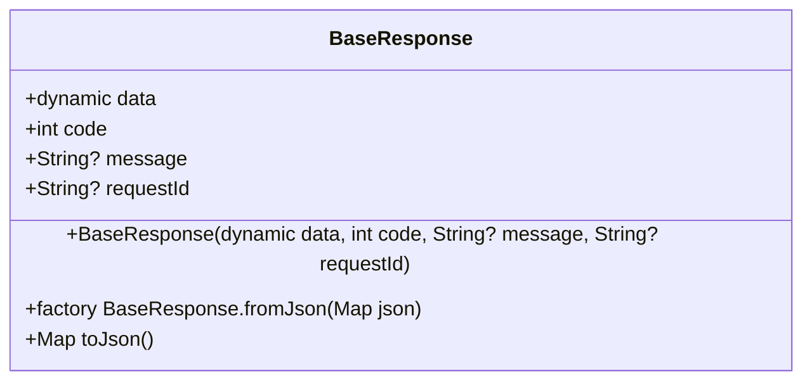
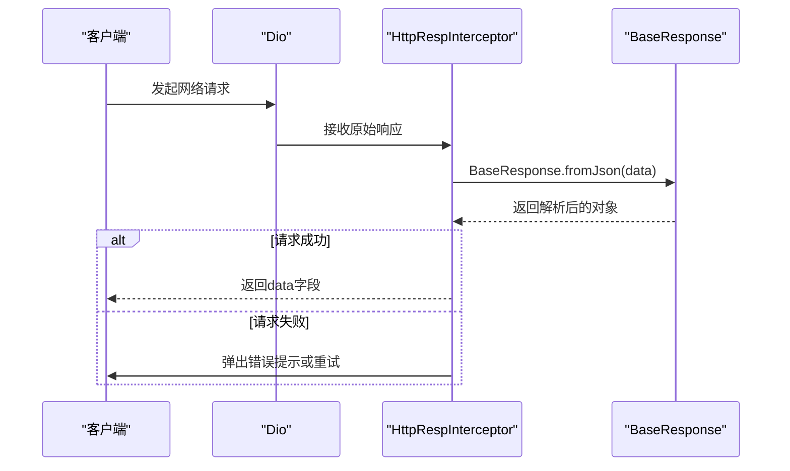

# 响应数据模型

<cite>
**本文档引用的文件**  
- [response.dart](file://lib/net/response.dart#L1-L24)
- [http_resp_interceptor.dart](file://lib/net/http_resp_interceptor.dart#L29-L38)
- [common_response_type.dart](file://lib/global/model/common_response_type.dart#L5-L16)
</cite>

## 目录
1. [简介](#简介)
2. [核心字段语义解析](#核心字段语义解析)
3. [序列化与反序列化机制](#序列化与反序列化机制)
4. [实际网络请求中的使用方式](#实际网络请求中的使用方式)
5. [在BLoC架构中的数据传递](#在bloc架构中的数据传递)
6. [与后端JSON结构的一致性要求](#与后端json结构的一致性要求)
7. [扩展能力：分页与嵌套数据处理](#扩展能力分页与嵌套数据处理)

## 简介
`BaseResponse` 类是本项目中统一API响应封装的核心模型，位于 `lib/net/response.dart` 文件中。该类通过标准化的字段设计，实现了前后端之间结构化通信，确保所有网络请求的响应都遵循一致的数据格式。它不仅提升了代码的可维护性，还为错误处理、日志记录和用户体验提供了统一支持。

**Section sources**
- [response.dart](file://lib/net/response.dart#L1-L24)

## 核心字段语义解析
`BaseResponse` 类包含四个关键字段，分别承担不同的语义职责：

- **data**: 类型为 `dynamic`，用于承载实际的业务数据。可以是任意类型（如 `Map`、`List` 或自定义对象），具有高度灵活性。
- **code**: 类型为 `int`，表示请求的响应状态码。通常用于判断请求是否成功（如 `200` 表示成功，`401` 表示未授权等）。
- **message**: 类型为 `String?`，提供对响应状态的可读性描述，常用于向用户展示提示信息。
- **requestId**: 类型为 `String?`，用于唯一标识一次请求，便于后端追踪和前端调试。

这些字段的设计严格遵循与后端约定的JSON结构，确保跨平台通信的可靠性。

**Section sources**
- [response.dart](file://lib/net/response.dart#L2-L5)

## 序列化与反序列化机制
`BaseResponse` 提供了完整的序列化与反序列化支持，通过两个核心方法实现：

- **fromJson**: 工厂构造函数，接收一个 `Map<String, dynamic>` 类型的JSON对象，并将其转换为 `BaseResponse` 实例。该方法对每个字段进行类型断言（如 `json['code'] as int`），确保类型安全。
- **toJson**: 实例方法，将当前对象转换为标准的JSON格式 `Map<String, dynamic>`，便于网络传输或本地存储。

`dynamic` 类型在 `data` 字段中的应用，使得该模型能够灵活处理各种复杂结构的业务数据，无需为每种响应单独定义包装类。



**Diagram sources**
- [response.dart](file://lib/net/response.dart#L1-L24)

## 实际网络请求中的使用方式
在实际网络请求中，`BaseResponse` 被集成在响应拦截器 `HttpRespInterceptor` 中。当Dio接收到服务器响应后，拦截器会立即调用 `BaseResponse.fromJson(response.data)` 将原始JSON数据解析为 `BaseResponse` 对象。

随后根据 `code` 值判断请求状态：
- 若 `code == HttpCode.success`，则将 `data` 字段提取并传递给后续处理逻辑；
- 否则，根据错误码进行相应处理（如token过期则触发刷新机制，或弹出错误提示）。

这种方式实现了统一的响应处理流程，避免了在每个业务层重复编写解析逻辑。



**Diagram sources**
- [http_resp_interceptor.dart](file://lib/net/http_resp_interceptor.dart#L29-L48)
- [response.dart](file://lib/net/response.dart#L9-L16)

**Section sources**
- [http_resp_interceptor.dart](file://lib/net/http_resp_interceptor.dart#L29-L48)

## 在BLoC架构中的数据传递
在BLoC（Business Logic Component）架构中，`BaseResponse` 的 `data` 字段被用作事件（Event）和状态（State）之间传递业务数据的载体。例如，在获取提油订单列表时，服务层返回 `WithdrawOrderListResponse` 对象，该对象作为 `data` 的值被封装在 `BaseResponse` 中。

BLoC组件通过解析 `BaseResponse` 的 `data` 字段，提取出具体的业务模型，并据此更新UI状态。这种模式实现了业务逻辑与界面展示的解耦，提高了代码的可测试性和可维护性。

**Section sources**
- [oil_pickup_service.dart](file://lib/pages/oil_pickup/service/oil_pickup_service.dart#L15-L19)
- [withdraw_data.dart](file://lib/pages/oil_pickup/model/withdraw_data.dart)

## 与后端JSON结构的一致性要求
`BaseResponse` 的设计严格遵循与后端约定的JSON结构，其字段命名和类型必须与后端保持完全一致。任何变更都需要前后端协同调整，以确保兼容性。

例如，后端返回的JSON结构如下：
```json
{
  "data": { "userId": "123", "name": "张三" },
  "code": 200,
  "message": "请求成功",
  "requestId": "req-abc123"
}
```
前端必须确保 `BaseResponse` 能够正确映射此结构，否则会导致解析失败。

**Section sources**
- [response.dart](file://lib/net/response.dart#L9-L16)
- [common_response_type.dart](file://lib/global/model/common_response_type.dart#L5-L16)

## 扩展能力：分页与嵌套数据处理
`BaseResponse` 具备良好的扩展性，能够轻松应对分页和嵌套数据场景：

- **分页处理**：当接口返回分页数据时，`data` 字段可封装为包含 `items`（数据列表）和 `pagination`（分页信息）的对象，如 `OrderListResponse`。
- **嵌套数据**：对于复杂的业务模型（如提油订单详情），`data` 可嵌套多层对象结构，通过Freezed或json_serializable等代码生成工具自动完成解析。

这种设计使得 `BaseResponse` 成为一个通用的响应容器，适用于各种业务场景，极大减少了重复代码。

**Section sources**
- [pay_order_list.dart](file://lib/pages/pay_order_list/service/pay_order_list.dart#L15-L19)
- [withdraw_data.dart](file://lib/pages/oil_pickup/model/withdraw_data.dart)