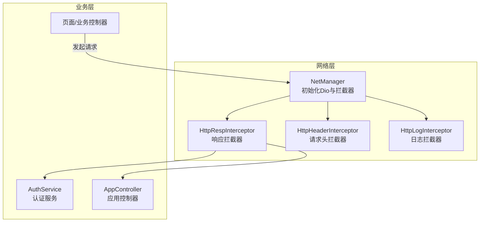
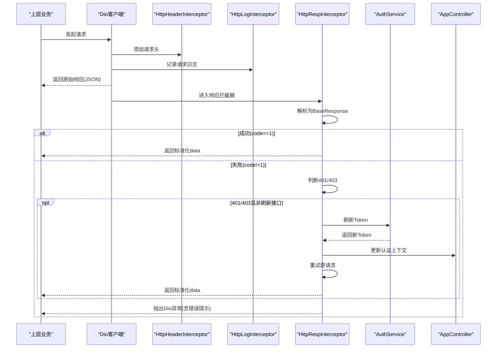
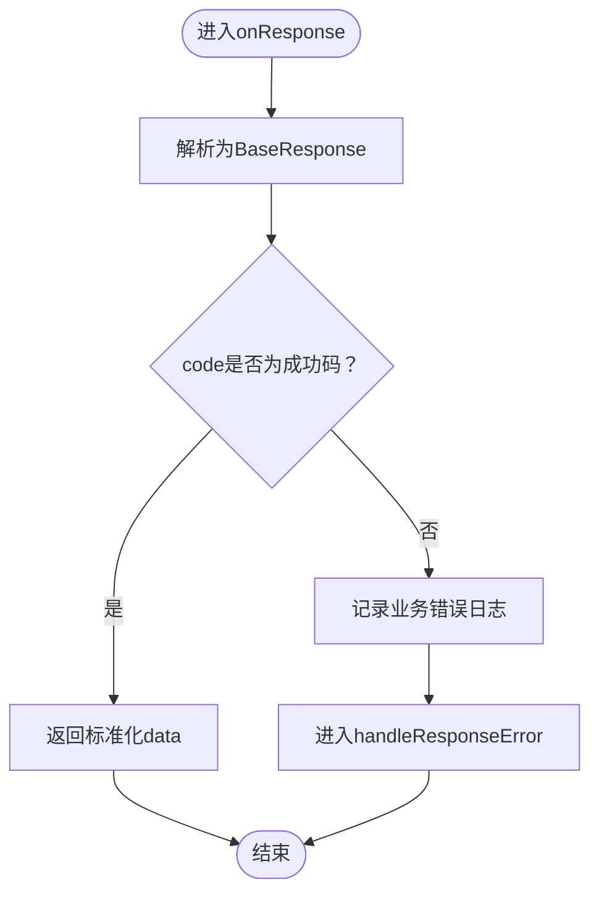
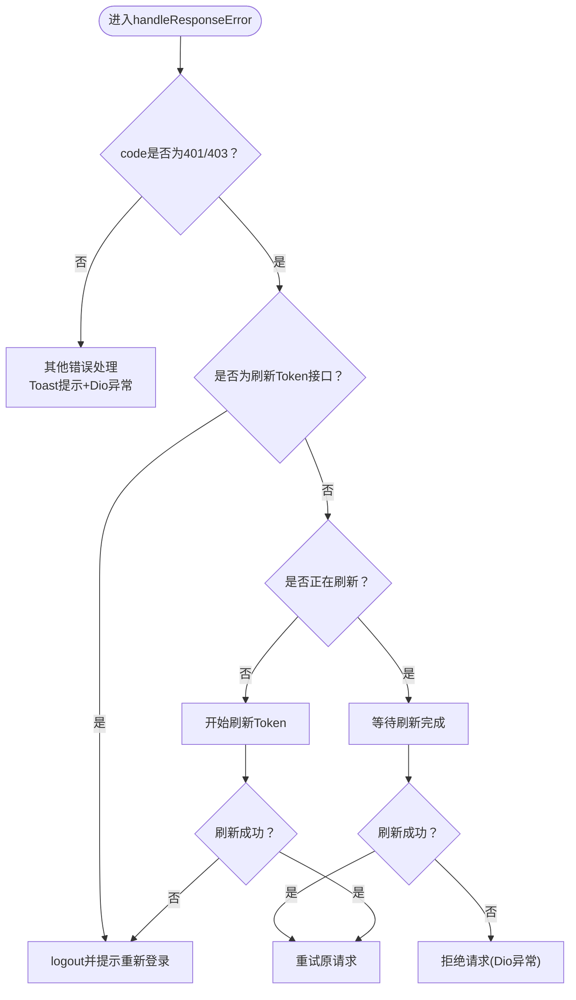
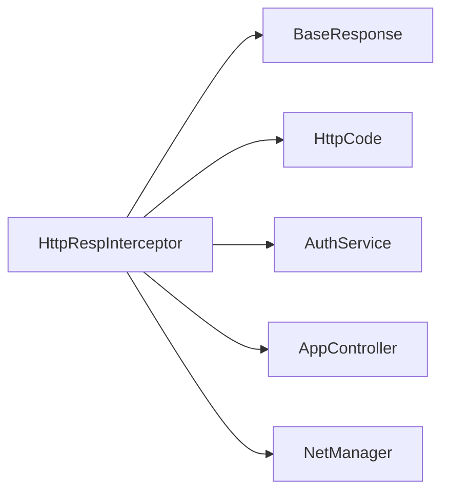

# 响应拦截器

<cite>
**本文引用的文件列表**
- [http_resp_interceptor.dart](file://lib/net/http_resp_interceptor.dart)
- [response.dart](file://lib/net/response.dart)
- [code.dart](file://lib/net/code.dart)
- [net_manager.dart](file://lib/net/net_manager.dart)
- [auth_service.dart](file://lib/global/service/auth_service.dart)
- [app_controller.dart](file://lib/global/app_controller.dart)
- [api_exception.dart](file://lib/net/api_exception.dart)
</cite>

## 目录
1. [简介](#简介)
2. [项目结构](#项目结构)
3. [核心组件](#核心组件)
4. [架构总览](#架构总览)
5. [详细组件分析](#详细组件分析)
6. [依赖关系分析](#依赖关系分析)
7. [性能考量](#性能考量)
8. [故障排查指南](#故障排查指南)
9. [结论](#结论)

## 简介
本文件系统化梳理 HttpRespInterceptor 的响应预处理能力，重点覆盖以下方面：
- 对原始响应数据的解析流程：从原始 JSON 解析为统一的 BaseResponse 结构，再根据业务状态码进行分流处理。
- 状态码映射与业务错误码：将 HTTP 层面的状态码与业务层面的 code 字段进行映射，识别成功与失败分支，并对 401/403 场景触发自动 Token 刷新。
- 响应体结构标准化：统一将 data、code、message、requestId 字段纳入 BaseResponse，便于上层业务无差别消费。
- 业务异常提取与统一捕获：对 token 失效、权限不足、网络错误等场景进行分类处理，并通过 Dio 异常与 Toast 提示进行反馈。
- 与 api_exception.dart 的协同：明确拦截器内部的异常抛出与上层业务如何接收与处理。
- 成功与失败响应处理路径示例：结合实际响应示例，展示拦截器链中的处理顺序与结果。
- 拦截器链位置对上层透明化：解释拦截器在拦截器链中的职责边界，如何让上层业务仅感知“标准化后的数据”。

## 项目结构
HttpRespInterceptor 作为网络层拦截器之一，位于 lib/net 目录下，与 NetManager 初始化流程紧密耦合，负责在响应阶段对业务数据进行统一处理与异常转换。

图表来源
- [net_manager.dart](file://lib/net/net_manager.dart#L59-L66)
- [http_resp_interceptor.dart](file://lib/net/http_resp_interceptor.dart#L1-L20)

章节来源
- [net_manager.dart](file://lib/net/net_manager.dart#L59-L66)

## 核心组件
- HttpRespInterceptor：响应拦截器，负责解析原始响应、状态码映射、业务异常提取、Token 自动刷新与重试、以及错误到 Dio 异常的转换。
- BaseResponse：统一响应模型，承载 data、code、message、requestId 字段，支持 fromJson 序列化。
- HttpCode：业务错误码常量集合，包含 success、logout、tokenExpired 等。
- NetManager：网络客户端初始化入口，注册拦截器链。
- AuthService/AppController：与认证相关的服务与状态管理，用于刷新 Token 并更新全局认证上下文。
- ApiException：业务异常模型，用于上层统一捕获与展示。

章节来源
- [http_resp_interceptor.dart](file://lib/net/http_resp_interceptor.dart#L1-L20)
- [response.dart](file://lib/net/response.dart#L1-L25)
- [code.dart](file://lib/net/code.dart#L1-L13)
- [net_manager.dart](file://lib/net/net_manager.dart#L59-L66)
- [auth_service.dart](file://lib/global/service/auth_service.dart#L1-L41)
- [app_controller.dart](file://lib/global/app_controller.dart#L111-L116)
- [api_exception.dart](file://lib/net/api_exception.dart#L1-L12)

## 架构总览
拦截器链在 NetManager 中按顺序注册，HttpRespInterceptor 位于请求头与日志拦截器之后，负责在响应阶段进行统一处理。

图表来源
- [net_manager.dart](file://lib/net/net_manager.dart#L59-L66)
- [http_resp_interceptor.dart](file://lib/net/http_resp_interceptor.dart#L25-L209)
- [auth_service.dart](file://lib/global/service/auth_service.dart#L18-L21)
- [app_controller.dart](file://lib/global/app_controller.dart#L111-L116)

## 详细组件分析

### 响应解析与状态码映射
- 原始响应解析：拦截器将 response.data 解析为 BaseResponse，统一读取 data、code、message、requestId 字段。
- 成功分支：当 code 等于 HttpCode.success 时，拦截器将 Response 的 data 替换为 response.data['data']，并继续向下传递，使上层业务仅感知“业务数据主体”，无需再拆包。
- 失败分支：当 code 不等于 HttpCode.success 时，进入 handleResponseError 分支，记录业务错误日志并进行后续处理。

图表来源
- [http_resp_interceptor.dart](file://lib/net/http_resp_interceptor.dart#L25-L48)
- [response.dart](file://lib/net/response.dart#L1-L25)
- [code.dart](file://lib/net/code.dart#L1-L13)

章节来源
- [http_resp_interceptor.dart](file://lib/net/http_resp_interceptor.dart#L25-L48)
- [response.dart](file://lib/net/response.dart#L1-L25)
- [code.dart](file://lib/net/code.dart#L1-L13)

### 业务异常提取与统一捕获
- 401/403 场景：拦截器识别业务错误码为 401 或 403 时，优先判断是否为刷新 Token 接口自身返回 401，若是则判定 refreshToken 已过期，触发 AppController.logout 并提示用户重新登录；否则进入自动刷新流程。
- 并发刷新控制：通过静态变量与 Completer 控制并发刷新，避免重复刷新与竞态。
- 刷新成功后重试：更新 Authorization 请求头后，使用原始请求参数重新发送请求，并将新响应再次交由拦截器处理，形成“刷新+重试”的闭环。
- 其他错误：若 response.data 是字符串或包含 message 字段，则通过 Toast 提示；最终以 DioException.badResponse 形式向上传递，便于上层统一捕获与处理。

图表来源
- [http_resp_interceptor.dart](file://lib/net/http_resp_interceptor.dart#L49-L155)
- [app_controller.dart](file://lib/global/app_controller.dart#L111-L116)
- [auth_service.dart](file://lib/global/service/auth_service.dart#L18-L21)

章节来源
- [http_resp_interceptor.dart](file://lib/net/http_resp_interceptor.dart#L49-L155)
- [app_controller.dart](file://lib/global/app_controller.dart#L111-L116)
- [auth_service.dart](file://lib/global/service/auth_service.dart#L18-L21)

### 与 api_exception.dart 的协同
- 拦截器内部通过构造 DioException.badResponse 将业务错误转换为 Dio 层异常，便于上层统一捕获与处理。
- 上层业务可选择性地捕获 DioException 或自定义 ApiException，实现“统一异常模型 + 业务异常模型”的双层抽象，既保证与 Dio 生态兼容，又能在业务层使用更语义化的异常类型。

章节来源
- [http_resp_interceptor.dart](file://lib/net/http_resp_interceptor.dart#L52-L57)
- [api_exception.dart](file://lib/net/api_exception.dart#L1-L12)

### 成功与失败响应处理路径示例
- 成功响应示例（简化）：
  - 原始响应包含字段：code=1、data={...}、message=null、requestId=xxx
  - 拦截器解析为 BaseResponse 后，识别 code=1，返回标准化 data 给上层业务
- 失败响应示例（简化）：
  - 原始响应包含字段：code=401、data=null、message="登录已过期"、requestId=xxx
  - 拦截器识别 401，触发刷新流程；若刷新成功，重试原请求并返回标准化 data；若刷新失败，抛出 Dio 异常并提示重新登录

章节来源
- [http_resp_interceptor.dart](file://lib/net/http_resp_interceptor.dart#L25-L48)
- [http_resp_interceptor.dart](file://lib/net/http_resp_interceptor.dart#L49-L155)

### 拦截器链位置对上层透明化数据处理
- 注册顺序：NetManager 在初始化时依次添加 HttpLogInterceptor、HttpHeaderInterceptor、HttpRespInterceptor。
- 透明化数据：HttpRespInterceptor 将“原始响应 JSON”转换为“标准化 data + Dio 异常”，上层业务仅需关心 data 或 DioException，无需感知底层 JSON 结构差异与业务错误码细节。

章节来源
- [net_manager.dart](file://lib/net/net_manager.dart#L59-L66)

## 依赖关系分析
- HttpRespInterceptor 依赖：
  - BaseResponse：统一响应结构
  - HttpCode：业务错误码常量
  - AuthService：刷新 Token
  - AppController：更新认证上下文
  - NetManager：获取 Dio 实例、重试请求
  - 日志与 Toast：记录错误与提示用户

图表来源
- [http_resp_interceptor.dart](file://lib/net/http_resp_interceptor.dart#L1-L20)
- [response.dart](file://lib/net/response.dart#L1-L25)
- [code.dart](file://lib/net/code.dart#L1-L13)
- [auth_service.dart](file://lib/global/service/auth_service.dart#L1-L41)
- [app_controller.dart](file://lib/global/app_controller.dart#L111-L116)
- [net_manager.dart](file://lib/net/net_manager.dart#L17-L20)

## 性能考量
- 并发刷新控制：通过静态变量与 Completer 避免多个并发刷新请求，减少无效网络开销。
- 重试策略：仅在 401/403 且非刷新接口时重试，避免对正常请求造成额外延迟。
- 日志与提示：仅在失败时输出业务错误日志并 Toast 提示，降低对成功路径的影响。

## 故障排查指南
- 刷新 Token 接口返回 401：拦截器会直接触发 logout 并提示重新登录，检查 refreshToken 是否有效。
- 正在刷新时并发请求：拦截器会等待刷新完成再重试，若刷新失败则拒绝请求，检查 AuthService.refreshToken 的实现与网络环境。
- 无 Dio 实例：重试时若 netManager.clientDio 为空，拦截器会 reject 一个 Dio 异常，检查 NetManager.init 是否正确执行。
- 未显示错误提示：确认 Toast 机制与业务层对 DioException 的处理是否一致。

章节来源
- [http_resp_interceptor.dart](file://lib/net/http_resp_interceptor.dart#L62-L69)
- [http_resp_interceptor.dart](file://lib/net/http_resp_interceptor.dart#L71-L87)
- [http_resp_interceptor.dart](file://lib/net/http_resp_interceptor.dart#L157-L209)
- [net_manager.dart](file://lib/net/net_manager.dart#L17-L20)

## 结论
HttpRespInterceptor 在拦截器链中承担“响应预处理”的关键角色：它将原始 JSON 响应标准化为统一的数据结构，将业务错误码与 Dio 异常桥接，对 401/403 场景提供自动 Token 刷新与重试能力，并通过 Toast 与日志提升可观测性。得益于拦截器链的有序注册与职责边界清晰，上层业务可以透明地消费“标准化 data”，无需关心底层响应结构与错误码细节，从而实现简洁、稳定、可维护的网络层抽象。