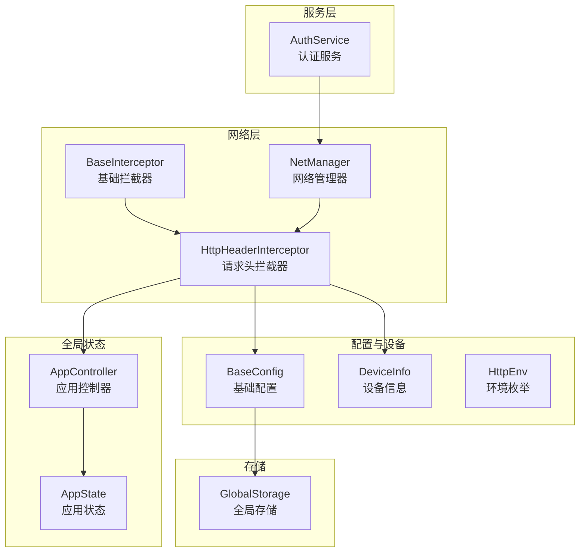
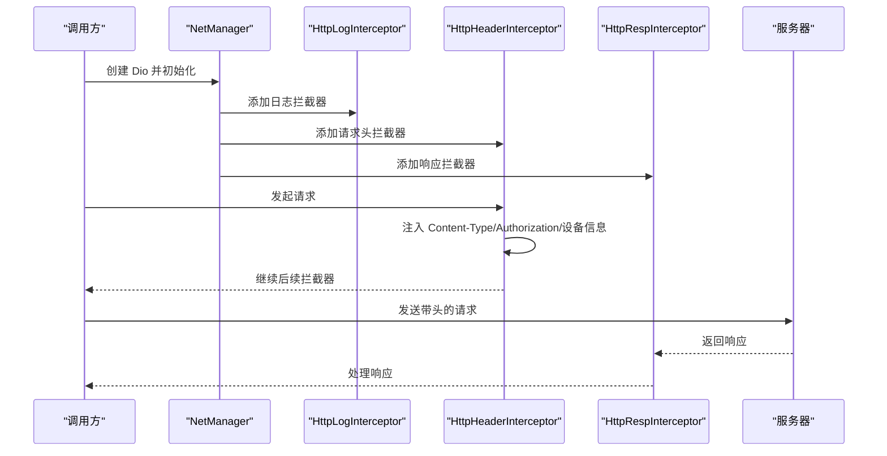
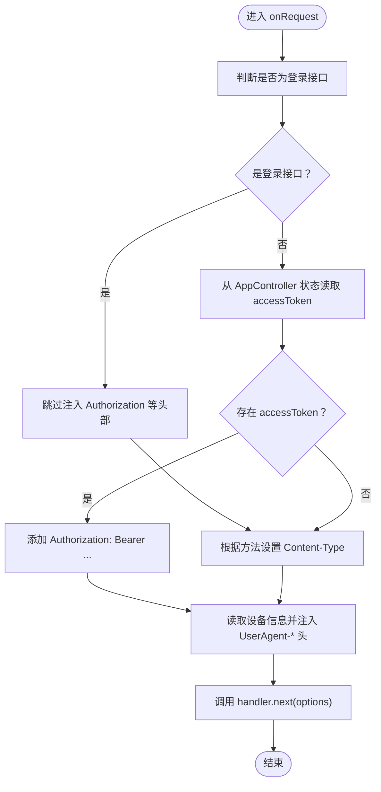
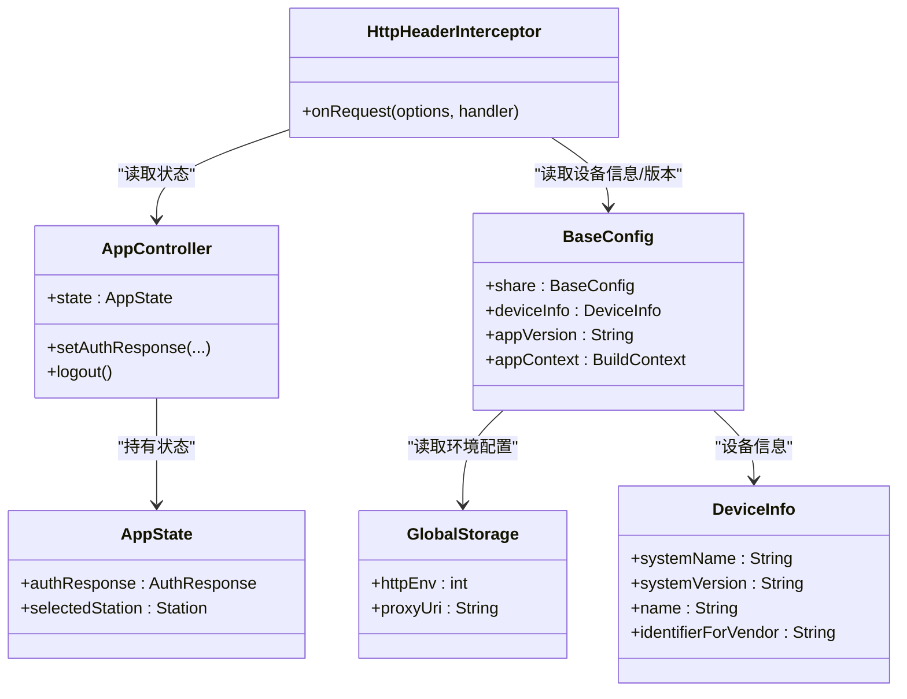
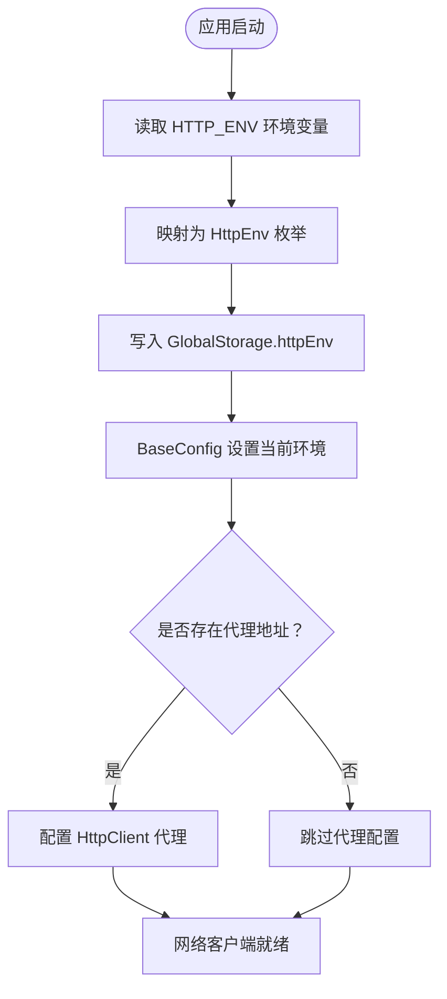
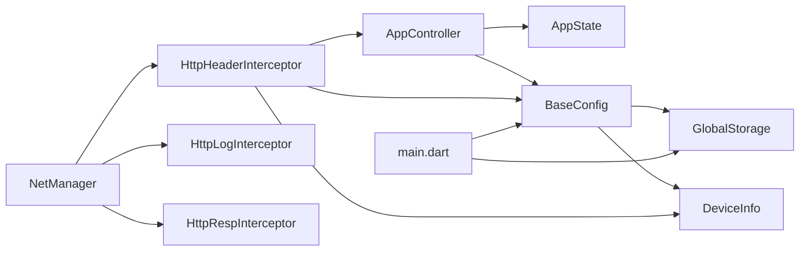

# 头信息拦截器

<cite>
**本文引用的文件**
- [http_header_interceptor.dart](file://lib/net/http_header_interceptor.dart)
- [base_interceptor.dart](file://lib/net/base_interceptor.dart)
- [net_manager.dart](file://lib/net/net_manager.dart)
- [config.dart](file://lib/config/config.dart)
- [env.dart](file://lib/config/env.dart)
- [models/global.dart](file://lib/models/global.dart)
- [global/app_controller.dart](file://lib/global/app_controller.dart)
- [global/app_state.dart](file://lib/global/app_state.dart)
- [global/storage.dart](file://lib/global/storage.dart)
- [auth_service.dart](file://lib/global/service/auth_service.dart)
- [main.dart](file://lib/main.dart)
</cite>

## 目录
1. [简介](#简介)
2. [项目结构](#项目结构)
3. [核心组件](#核心组件)
4. [架构总览](#架构总览)
5. [组件详解](#组件详解)
6. [依赖关系分析](#依赖关系分析)
7. [性能考量](#性能考量)
8. [故障排查指南](#故障排查指南)
9. [结论](#结论)
10. [附录](#附录)

## 简介
本文围绕 HttpHeaderInterceptor 的请求头自动注入机制进行深入解析，重点说明：
- 如何在请求前拦截并动态添加认证令牌（Authorization）、设备标识（Device-ID）、平台类型（Platform）、内容类型（Content-Type）等关键请求头；
- 与 AppController 和 Storage 模块的依赖关系，如何从本地持久化存储中获取用户会话信息；
- 多环境配置下请求头的差异化处理策略；
- 如何支持临时头信息覆盖；
- 在拦截器链中的执行时机对认证流程的影响；
- 提供实际代码示例路径以展示请求头构造逻辑。

## 项目结构
与 HttpHeaderInterceptor 相关的关键文件组织如下：
- 网络层拦截器：http_header_interceptor.dart、base_interceptor.dart、net_manager.dart
- 应用配置与设备信息：config.dart、models/global.dart、env.dart
- 全局状态与会话：global/app_controller.dart、global/app_state.dart
- 本地存储：global/storage.dart
- 服务层示例：global/service/auth_service.dart
- 应用入口：main.dart

图表来源
- [http_header_interceptor.dart](file://lib/net/http_header_interceptor.dart#L1-L56)
- [base_interceptor.dart](file://lib/net/base_interceptor.dart#L1-L8)
- [net_manager.dart](file://lib/net/net_manager.dart#L1-L88)
- [config.dart](file://lib/config/config.dart#L1-L108)
- [models/global.dart](file://lib/models/global.dart#L1-L35)
- [env.dart](file://lib/config/env.dart#L1-L24)
- [global/app_controller.dart](file://lib/global/app_controller.dart#L1-L146)
- [global/app_state.dart](file://lib/global/app_state.dart#L1-L23)
- [global/storage.dart](file://lib/global/storage.dart#L1-L34)
- [auth_service.dart](file://lib/global/service/auth_service.dart#L1-L41)

章节来源
- [http_header_interceptor.dart](file://lib/net/http_header_interceptor.dart#L1-L56)
- [net_manager.dart](file://lib/net/net_manager.dart#L1-L88)
- [config.dart](file://lib/config/config.dart#L1-L108)
- [models/global.dart](file://lib/models/global.dart#L1-L35)
- [env.dart](file://lib/config/env.dart#L1-L24)
- [global/app_controller.dart](file://lib/global/app_controller.dart#L1-L146)
- [global/app_state.dart](file://lib/global/app_state.dart#L1-L23)
- [global/storage.dart](file://lib/global/storage.dart#L1-L34)
- [auth_service.dart](file://lib/global/service/auth_service.dart#L1-L41)
- [main.dart](file://lib/main.dart#L1-L22)

## 核心组件
- HttpHeaderInterceptor：继承自 BaseInterceptor，负责在请求前注入通用请求头，包括 Content-Type、Authorization、设备信息等；并对登录接口做特殊处理，避免携带某些头部。
- NetManager：统一创建 Dio 实例并按顺序添加拦截器，其中包含 HttpHeaderInterceptor。
- BaseConfig：提供设备信息、应用版本、环境配置等全局能力；通过 GlobalStorage 读取环境变量。
- AppController/AppState：维护用户会话信息（如 accessToken），供拦截器读取。
- GlobalStorage：提供 httpEnv、proxyUri 等持久化配置项。

章节来源
- [http_header_interceptor.dart](file://lib/net/http_header_interceptor.dart#L1-L56)
- [base_interceptor.dart](file://lib/net/base_interceptor.dart#L1-L8)
- [net_manager.dart](file://lib/net/net_manager.dart#L1-L88)
- [config.dart](file://lib/config/config.dart#L1-L108)
- [global/app_controller.dart](file://lib/global/app_controller.dart#L1-L146)
- [global/app_state.dart](file://lib/global/app_state.dart#L1-L23)
- [global/storage.dart](file://lib/global/storage.dart#L1-L34)

## 架构总览
拦截器链在 NetManager 中按顺序添加，HttpHeaderInterceptor 位于日志拦截器之后、响应拦截器之前。请求进入时，HttpHeaderInterceptor 会在 onRequest 阶段完成请求头注入。

图表来源
- [net_manager.dart](file://lib/net/net_manager.dart#L58-L66)
- [http_header_interceptor.dart](file://lib/net/http_header_interceptor.dart#L16-L54)

## 组件详解

### HttpHeaderInterceptor 请求头注入逻辑
- 登录接口豁免：当请求路径匹配登录接口时，不注入 Authorization 等头部，避免登录失败。
- 认证令牌注入：从 AppController 的全局状态中读取 accessToken，并注入到 Authorization 头部。
- 内容类型注入：根据请求方法自动设置 Content-Type：
  - GET：application/x-www-form-urlencoded
  - POST：application/json;charset=UTF-8
- 设备信息注入：从 BaseConfig 或构造参数 deviceInfo 获取设备信息，注入 UserAgent-* 系列头部，包括设备名、系统名、系统版本、设备唯一标识、应用版本、应用类型等。
- 执行时机：在 onRequest 阶段修改 RequestOptions.headers 后继续链路。

图表来源
- [http_header_interceptor.dart](file://lib/net/http_header_interceptor.dart#L16-L54)

章节来源
- [http_header_interceptor.dart](file://lib/net/http_header_interceptor.dart#L16-L54)

### 与 AppController 和 Storage 的依赖关系
- 会话信息来源：HttpHeaderInterceptor 通过 BaseConfig.appContext 读取 AppController 的全局状态，获取 authResponse.accessToken。
- 状态模型：AppState 包含 authResponse 字段，AppController 负责更新该字段并在登出时清空。
- 本地存储：GlobalStorage 提供 httpEnv、proxyUri 等持久化配置；BaseConfig 在初始化时读取并设置当前环境。

图表来源
- [http_header_interceptor.dart](file://lib/net/http_header_interceptor.dart#L16-L54)
- [global/app_controller.dart](file://lib/global/app_controller.dart#L1-L146)
- [global/app_state.dart](file://lib/global/app_state.dart#L1-L23)
- [global/storage.dart](file://lib/global/storage.dart#L1-L34)
- [config.dart](file://lib/config/config.dart#L1-L108)
- [models/global.dart](file://lib/models/global.dart#L1-L35)

章节来源
- [global/app_controller.dart](file://lib/global/app_controller.dart#L1-L146)
- [global/app_state.dart](file://lib/global/app_state.dart#L1-L23)
- [global/storage.dart](file://lib/global/storage.dart#L1-L34)
- [config.dart](file://lib/config/config.dart#L1-L108)
- [models/global.dart](file://lib/models/global.dart#L1-L35)

### 多环境配置下的差异化处理策略
- 环境枚举：HttpEnv 提供 pro（正式）、qa（测试）两种环境，映射值与名称可相互转换。
- 环境读取：BaseConfig.init() 从环境变量读取 HTTP_ENV，结合调试模式决定最终环境；并将结果写回 GlobalStorage，供运行时读取。
- 代理设置：NetManager 在初始化时读取 GlobalStorage.proxyUri，按需配置 HttpClient 代理，间接影响请求头的可达性与稳定性。

图表来源
- [config.dart](file://lib/config/config.dart#L90-L107)
- [env.dart](file://lib/config/env.dart#L1-L24)
- [global/storage.dart](file://lib/global/storage.dart#L1-L34)
- [net_manager.dart](file://lib/net/net_manager.dart#L47-L56)

章节来源
- [config.dart](file://lib/config/config.dart#L90-L107)
- [env.dart](file://lib/config/env.dart#L1-L24)
- [global/storage.dart](file://lib/global/storage.dart#L1-L34)
- [net_manager.dart](file://lib/net/net_manager.dart#L47-L56)

### 支持临时头信息覆盖
- 临时头注入：在发起请求时，可通过 RequestOptions.headers 传入临时头信息，这些头会在拦截器链中被合并或覆盖。
- 优先级说明：由于拦截器链在 onRequest 阶段修改 RequestOptions.headers，若上层调用方已在请求选项中设置了同名头，则以调用方为准，形成“后设置者优先”的覆盖策略。

章节来源
- [http_header_interceptor.dart](file://lib/net/http_header_interceptor.dart#L16-L54)

### 在拦截器链中的执行时机对认证流程的影响
- 位置：HttpHeaderInterceptor 位于日志拦截器之后、响应拦截器之前，确保日志拦截器能记录完整请求头，同时在响应拦截器处理前完成认证头注入。
- 影响：对于登录接口，拦截器不会注入 Authorization，避免因缺少令牌导致登录失败；对于非登录接口，若存在有效 accessToken，将自动注入 Authorization，提升认证成功率。

章节来源
- [net_manager.dart](file://lib/net/net_manager.dart#L58-L66)
- [http_header_interceptor.dart](file://lib/net/http_header_interceptor.dart#L16-L54)

## 依赖关系分析
- 直接依赖
  - HttpHeaderInterceptor 依赖 BaseInterceptor、BaseConfig、AppController、DeviceInfo。
  - NetManager 依赖 HttpHeaderInterceptor、HttpLogInterceptor、HttpRespInterceptor。
  - BaseConfig 依赖 GlobalStorage、DeviceInfo、HttpEnv。
  - AppController 依赖 AppState。
- 运行时依赖
  - main.dart 负责初始化 GlobalStorage 与 BaseConfig，确保后续组件可用。

图表来源
- [global/app_controller.dart](file://lib/global/app_controller.dart#L1-L146)
- [global/app_state.dart](file://lib/global/app_state.dart#L1-L23)
- [config.dart](file://lib/config/config.dart#L1-L108)
- [global/storage.dart](file://lib/global/storage.dart#L1-L34)
- [http_header_interceptor.dart](file://lib/net/http_header_interceptor.dart#L1-L56)
- [net_manager.dart](file://lib/net/net_manager.dart#L1-L88)
- [main.dart](file://lib/main.dart#L1-L22)

章节来源
- [global/app_controller.dart](file://lib/global/app_controller.dart#L1-L146)
- [global/app_state.dart](file://lib/global/app_state.dart#L1-L23)
- [config.dart](file://lib/config/config.dart#L1-L108)
- [global/storage.dart](file://lib/global/storage.dart#L1-L34)
- [http_header_interceptor.dart](file://lib/net/http_header_interceptor.dart#L1-L56)
- [net_manager.dart](file://lib/net/net_manager.dart#L1-L88)
- [main.dart](file://lib/main.dart#L1-L22)

## 性能考量
- 拦截器链顺序：将日志拦截器放在请求头注入之前，有助于记录最终生效的请求头，便于诊断。
- 设备信息读取：DeviceInfo 由 BaseConfig 初始化时获取，避免每次请求重复读取磁盘或系统接口。
- 临时头覆盖：允许上层调用方直接设置头，减少额外封装成本，但应避免频繁覆盖造成不必要的对象复制。

## 故障排查指南
- 无认证头
  - 确认 AppController.state.authResponse.accessToken 是否存在且非空。
  - 确认请求路径是否命中登录接口豁免逻辑。
  - 参考路径：[http_header_interceptor.dart](file://lib/net/http_header_interceptor.dart#L21-L42)
- Content-Type 不正确
  - 检查请求方法是否为 GET/POST，确认对应 Content-Type 是否被设置。
  - 参考路径：[http_header_interceptor.dart](file://lib/net/http_header_interceptor.dart#L31-L35)
- 设备信息缺失
  - 确认 BaseConfig.deviceInfo 是否初始化，Android 平台 identifierForVendor 是否为空。
  - 参考路径：[config.dart](file://lib/config/config.dart#L60-L72)
- 环境配置不生效
  - 检查 HTTP_ENV 环境变量与 GlobalStorage.httpEnv 的映射关系。
  - 参考路径：[config.dart](file://lib/config/config.dart#L90-L107)，[env.dart](file://lib/config/env.dart#L1-L24)，[global/storage.dart](file://lib/global/storage.dart#L1-L34)
- 代理导致请求异常
  - 检查 GlobalStorage.proxyUri 是否为空，NetManager 是否正确配置代理。
  - 参考路径：[net_manager.dart](file://lib/net/net_manager.dart#L47-L56)

章节来源
- [http_header_interceptor.dart](file://lib/net/http_header_interceptor.dart#L21-L54)
- [config.dart](file://lib/config/config.dart#L60-L72)
- [config.dart](file://lib/config/config.dart#L90-L107)
- [env.dart](file://lib/config/env.dart#L1-L24)
- [global/storage.dart](file://lib/global/storage.dart#L1-L34)
- [net_manager.dart](file://lib/net/net_manager.dart#L47-L56)

## 结论
HttpHeaderInterceptor 通过在请求前注入 Content-Type、Authorization、设备信息等关键头部，显著提升了认证流程的自动化与一致性。它与 AppController、BaseConfig、GlobalStorage 等模块协同工作，既满足了多环境配置需求，又支持临时头覆盖，保证了灵活性与可维护性。在拦截器链中的合理位置，使其既能记录完整请求头，又能确保认证头在非登录场景下及时生效。

## 附录
- 实际代码示例路径（不直接展示代码内容）
  - 请求头注入逻辑：[http_header_interceptor.dart](file://lib/net/http_header_interceptor.dart#L16-L54)
  - 拦截器链添加顺序：[net_manager.dart](file://lib/net/net_manager.dart#L58-L66)
  - 设备信息初始化与环境读取：[config.dart](file://lib/config/config.dart#L60-L107)
  - 会话状态模型与控制器：[global/app_state.dart](file://lib/global/app_state.dart#L1-L23)，[global/app_controller.dart](file://lib/global/app_controller.dart#L1-L146)
  - 本地存储与代理配置：[global/storage.dart](file://lib/global/storage.dart#L1-L34)，[net_manager.dart](file://lib/net/net_manager.dart#L47-L56)
  - 服务层使用网络客户端：[auth_service.dart](file://lib/global/service/auth_service.dart#L1-L41)
  - 应用入口初始化顺序：[main.dart](file://lib/main.dart#L1-L22)