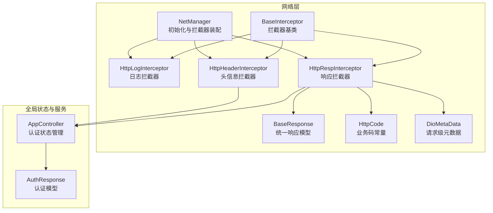
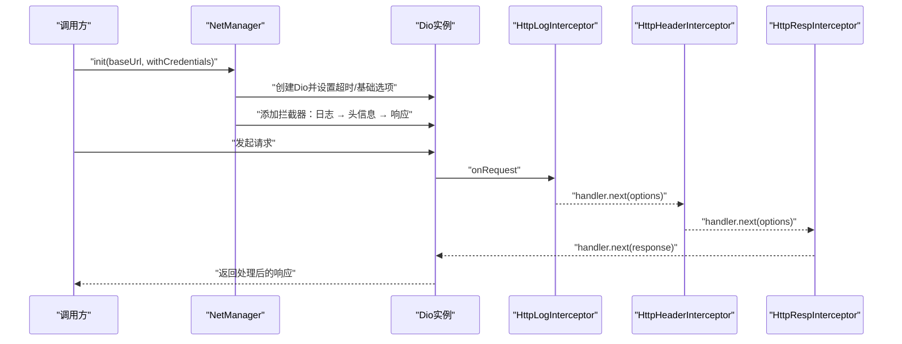
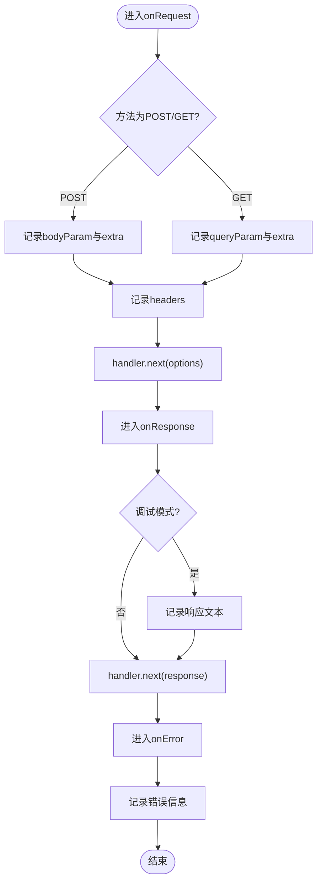
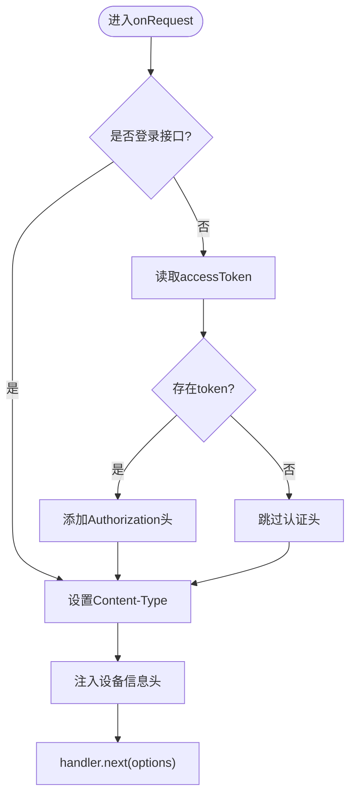
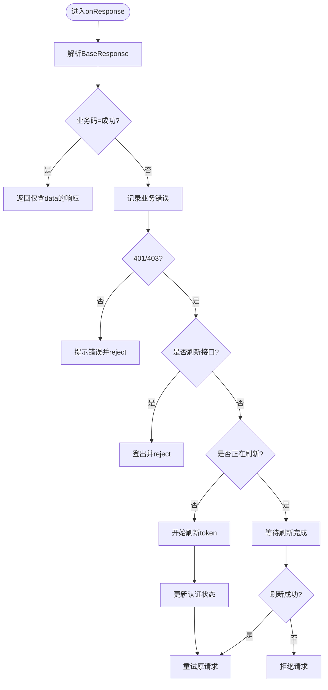
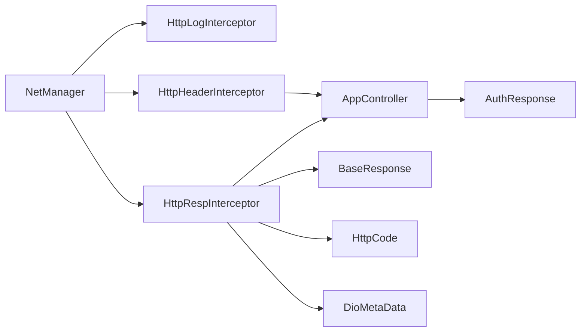

# 拦截器体系

<cite>
**本文引用的文件**
- [base_interceptor.dart](file://lib/net/base_interceptor.dart)
- [http_log_interceptor.dart](file://lib/net/http_log_interceptor.dart)
- [http_header_interceptor.dart](file://lib/net/http_header_interceptor.dart)
- [http_resp_interceptor.dart](file://lib/net/http_resp_interceptor.dart)
- [net_manager.dart](file://lib/net/net_manager.dart)
- [response.dart](file://lib/net/response.dart)
- [code.dart](file://lib/net/code.dart)
- [dio_io.dart](file://lib/net/dio_io.dart)
- [auth_rep_type.dart](file://lib/global/model/auth_rep_type.dart)
- [app_controller.dart](file://lib/global/app_controller.dart)
</cite>

## 目录
1. [引言](#引言)
2. [项目结构](#项目结构)
3. [核心组件](#核心组件)
4. [架构总览](#架构总览)
5. [详细组件分析](#详细组件分析)
6. [依赖关系分析](#依赖关系分析)
7. [性能考量](#性能考量)
8. [故障排查指南](#故障排查指南)
9. [结论](#结论)

## 引言
本文件系统化梳理本项目的拦截器体系，围绕 NetManager 中的拦截器链设计与执行流程展开，重点说明：
- BaseInterceptor 抽象类作为所有拦截器基类的契约定义
- HttpLogInterceptor 的日志记录机制（请求/响应时间、数据序列化）
- HttpHeaderInterceptor 的请求头自动注入策略（认证令牌、设备信息、内容类型等）
- HttpRespInterceptor 的响应数据预处理（状态码映射、业务错误解析、Token 刷新与重试）
- 拦截器在 NetManager 中的添加顺序（日志 → 头信息 → 响应）及其对请求生命周期的影响
- 拦截器间数据传递机制与异常处理协作模式
- 如何通过 DioMetaData 实现请求级配置覆盖（如关闭 Toast 提示）

## 项目结构
拦截器相关代码集中在 lib/net 目录，配合全局状态与模型文件共同构成完整的网络层。

图表来源
- [net_manager.dart](file://lib/net/net_manager.dart#L58-L66)
- [base_interceptor.dart](file://lib/net/base_interceptor.dart#L1-L8)
- [http_log_interceptor.dart](file://lib/net/http_log_interceptor.dart#L1-L60)
- [http_header_interceptor.dart](file://lib/net/http_header_interceptor.dart#L1-L56)
- [http_resp_interceptor.dart](file://lib/net/http_resp_interceptor.dart#L1-L210)
- [response.dart](file://lib/net/response.dart#L1-L25)
- [code.dart](file://lib/net/code.dart#L1-L13)
- [dio_io.dart](file://lib/net/dio_io.dart#L16-L23)
- [auth_rep_type.dart](file://lib/global/model/auth_rep_type.dart#L1-L46)
- [app_controller.dart](file://lib/global/app_controller.dart#L1-L146)

章节来源
- [net_manager.dart](file://lib/net/net_manager.dart#L58-L66)

## 核心组件
- BaseInterceptor：定义拦截器基类，提供 tag 字段用于日志标识，继承自 Dio 的 InterceptorsWrapper，作为所有拦截器的契约。
- HttpLogInterceptor：负责在请求前、响应后、异常时输出结构化日志，便于调试与审计。
- HttpHeaderInterceptor：在请求前自动注入 Content-Type、Authorization、设备信息等头部，支持登录接口白名单。
- HttpRespInterceptor：统一解析响应、处理业务错误、处理 401/403 并进行 Token 刷新与重试，必要时触发登出。
- NetManager：集中初始化 Dio、设置超时与代理，并按固定顺序添加拦截器。
- BaseResponse/HttpCode：统一响应模型与业务码常量，支撑响应拦截器的错误处理逻辑。
- DioMetaData：请求级元数据载体，支持关闭 Toast 等配置项，便于在调用侧覆盖默认行为。

章节来源
- [base_interceptor.dart](file://lib/net/base_interceptor.dart#L1-L8)
- [http_log_interceptor.dart](file://lib/net/http_log_interceptor.dart#L1-L60)
- [http_header_interceptor.dart](file://lib/net/http_header_interceptor.dart#L1-L56)
- [http_resp_interceptor.dart](file://lib/net/http_resp_interceptor.dart#L1-L210)
- [net_manager.dart](file://lib/net/net_manager.dart#L58-L66)
- [response.dart](file://lib/net/response.dart#L1-L25)
- [code.dart](file://lib/net/code.dart#L1-L13)
- [dio_io.dart](file://lib/net/dio_io.dart#L16-L23)

## 架构总览
拦截器链在 NetManager 初始化时按顺序装配，形成“日志 → 头信息 → 响应”的执行序列。该顺序决定了：
- 日志拦截器先于头信息拦截器，能完整记录请求参数与头部
- 头信息拦截器先于响应拦截器，确保后续处理拿到带认证与设备信息的请求
- 响应拦截器最后处理，统一解析业务结果、错误与 Token 刷新

图表来源
- [net_manager.dart](file://lib/net/net_manager.dart#L58-L66)
- [http_log_interceptor.dart](file://lib/net/http_log_interceptor.dart#L10-L33)
- [http_header_interceptor.dart](file://lib/net/http_header_interceptor.dart#L16-L54)
- [http_resp_interceptor.dart](file://lib/net/http_resp_interceptor.dart#L25-L48)

## 详细组件分析

### BaseInterceptor 抽象类
- 角色：所有拦截器的基类，提供统一的 tag 标识，便于日志区分
- 关键点：继承自 InterceptorsWrapper，遵循 Dio 拦截器约定；子类需实现 onRequest/onResponse/onError 或其变体

章节来源
- [base_interceptor.dart](file://lib/net/base_interceptor.dart#L1-L8)

### HttpLogInterceptor 日志拦截器
- 请求阶段：记录方法、路径、URL、查询参数或表单参数、额外信息、请求头
- 响应阶段：在调试模式下输出完整响应文本
- 异常阶段：记录路径、URL、状态码、消息
- 影响：为后续拦截器与上层调用提供可追踪的请求上下文

图表来源
- [http_log_interceptor.dart](file://lib/net/http_log_interceptor.dart#L10-L59)

章节来源
- [http_log_interceptor.dart](file://lib/net/http_log_interceptor.dart#L1-L60)

### HttpHeaderInterceptor 请求头拦截器
- 内容类型：根据方法自动设置 Content-Type（GET 使用表单类型，POST 使用JSON）
- 认证头：从全局状态读取 accessToken，拼接 Authorization 头；登录接口白名单不注入
- 设备信息：注入设备名称、系统名、系统版本、设备ID、应用版本、应用类型等
- 影响：为后续响应拦截器提供带认证与设备信息的请求上下文

图表来源
- [http_header_interceptor.dart](file://lib/net/http_header_interceptor.dart#L16-L54)

章节来源
- [http_header_interceptor.dart](file://lib/net/http_header_interceptor.dart#L1-L56)
- [app_controller.dart](file://lib/global/app_controller.dart#L50-L60)
- [auth_rep_type.dart](file://lib/global/model/auth_rep_type.dart#L1-L26)

### HttpRespInterceptor 响应拦截器
- 成功路径：当业务码为成功时，剥离 BaseResponse 包装，仅传递 data 字段
- 错误路径：记录业务错误详情，构造 401 错误并交由错误处理
- 401/403 处理：并发刷新 token，避免重复刷新；刷新成功后重试原请求；刷新失败或刷新接口自身返回 401/403 则登出并拒绝
- 其他错误：根据响应内容展示 Toast，最终 reject
- 重试机制：更新 Authorization 头后重新发送请求，再次进入 onResponse 流程

图表来源
- [http_resp_interceptor.dart](file://lib/net/http_resp_interceptor.dart#L25-L209)
- [response.dart](file://lib/net/response.dart#L1-L25)
- [code.dart](file://lib/net/code.dart#L1-L13)
- [app_controller.dart](file://lib/global/app_controller.dart#L111-L116)

章节来源
- [http_resp_interceptor.dart](file://lib/net/http_resp_interceptor.dart#L1-L210)
- [response.dart](file://lib/net/response.dart#L1-L25)
- [code.dart](file://lib/net/code.dart#L1-L13)
- [app_controller.dart](file://lib/global/app_controller.dart#L111-L116)

### NetManager 中的拦截器装配顺序与生命周期影响
- 装配顺序：日志拦截器 → 头信息拦截器 → 响应拦截器
- 生命周期影响：
  - 日志拦截器先于头信息拦截器，确保日志包含最终的认证与设备信息
  - 头信息拦截器先于响应拦截器，保证业务处理与错误处理基于带认证的请求
  - 响应拦截器最后执行，统一处理业务错误、Token 刷新与重试

章节来源
- [net_manager.dart](file://lib/net/net_manager.dart#L58-L66)

### 请求级配置覆盖：DioMetaData
- 作用：通过 RequestOptions.extra 传递请求级元数据，典型用途包括关闭 Toast 提示
- 使用方式：在调用侧为 Options.extra 设置 DioMetaData，拦截器读取 noShowToast 控制是否弹出 Toast
- 注意：本仓库中 DioMetaData 定义在 net 层，建议在服务层或调用侧按需注入

章节来源
- [dio_io.dart](file://lib/net/dio_io.dart#L16-L23)

## 依赖关系分析
- NetManager 依赖各拦截器类，负责装配顺序与 Dio 初始化
- HttpHeaderInterceptor 依赖全局认证状态（AppController）与认证模型（AuthResponse）
- HttpRespInterceptor 依赖 BaseResponse/HttpCode、AppController、AuthService（刷新 token）、Toast 工具
- HttpLogInterceptor 依赖日志工具与配置开关
- DioMetaData 作为请求级配置载体，贯穿拦截器链

图表来源
- [net_manager.dart](file://lib/net/net_manager.dart#L58-L66)
- [http_header_interceptor.dart](file://lib/net/http_header_interceptor.dart#L16-L54)
- [http_resp_interceptor.dart](file://lib/net/http_resp_interceptor.dart#L25-L209)
- [response.dart](file://lib/net/response.dart#L1-L25)
- [code.dart](file://lib/net/code.dart#L1-L13)
- [dio_io.dart](file://lib/net/dio_io.dart#L16-L23)
- [auth_rep_type.dart](file://lib/global/model/auth_rep_type.dart#L1-L26)
- [app_controller.dart](file://lib/global/app_controller.dart#L50-L60)

## 性能考量
- 日志拦截器在调试模式下输出完整响应文本，可能带来额外内存与 I/O 开销，建议在生产环境谨慎开启
- 响应拦截器的并发刷新 token 使用静态 Completer 控制，避免重复刷新，提升稳定性
- 头信息拦截器在每次请求前读取认证状态，建议保持状态访问高效，避免阻塞
- 重试机制仅在 401/403 场景触发，减少不必要的重试

## 故障排查指南
- 请求未带认证头
  - 检查登录接口路径是否命中白名单
  - 确认 AppController 中的 accessToken 是否存在且非空
- 401/403 频繁出现
  - 检查刷新 token 接口是否返回 401/403，若为自身接口则触发登出
  - 查看刷新流程是否被并发触发，确认 Completer 逻辑是否正确
- 响应数据为空或结构异常
  - 确认响应拦截器剥离 data 字段后是否符合预期
  - 检查业务码是否为成功，否则会走错误分支
- 请求级配置无效
  - 确认在调用侧为 Options.extra 正确设置了 DioMetaData
  - 在拦截器中检查 noShowToast 是否生效

章节来源
- [http_header_interceptor.dart](file://lib/net/http_header_interceptor.dart#L21-L42)
- [http_resp_interceptor.dart](file://lib/net/http_resp_interceptor.dart#L50-L155)
- [response.dart](file://lib/net/response.dart#L1-L25)
- [code.dart](file://lib/net/code.dart#L1-L13)
- [dio_io.dart](file://lib/net/dio_io.dart#L16-L23)

## 结论
本拦截器体系以 NetManager 为中心，通过“日志 → 头信息 → 响应”的顺序装配，实现了清晰的请求生命周期分层：
- 日志拦截器提供可追溯的请求上下文
- 头信息拦截器统一注入认证与设备信息
- 响应拦截器统一处理业务错误、Token 刷新与重试
- DioMetaData 支持请求级配置覆盖，增强灵活性
整体设计具备良好的扩展性与可维护性，适合在多端与复杂业务场景中复用。