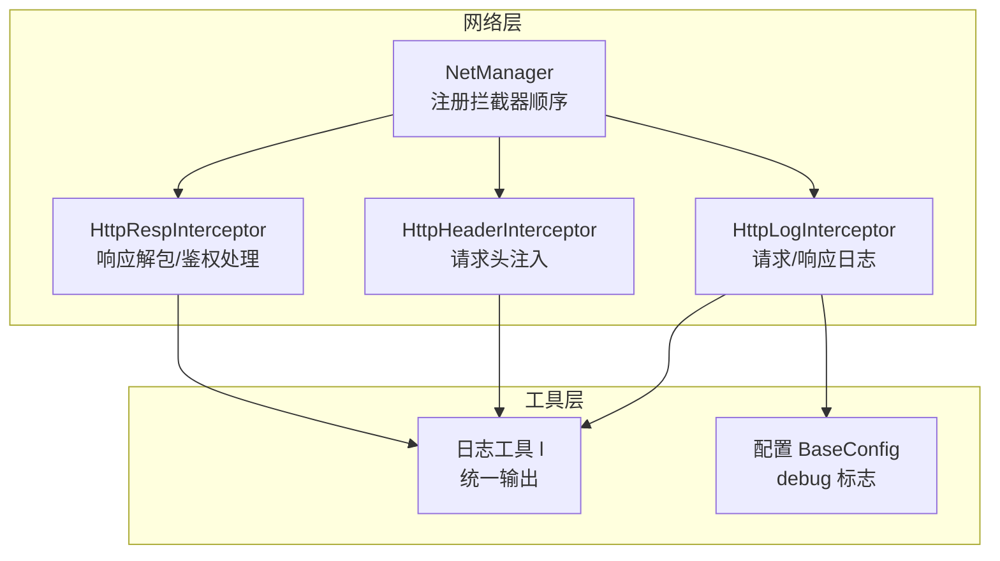
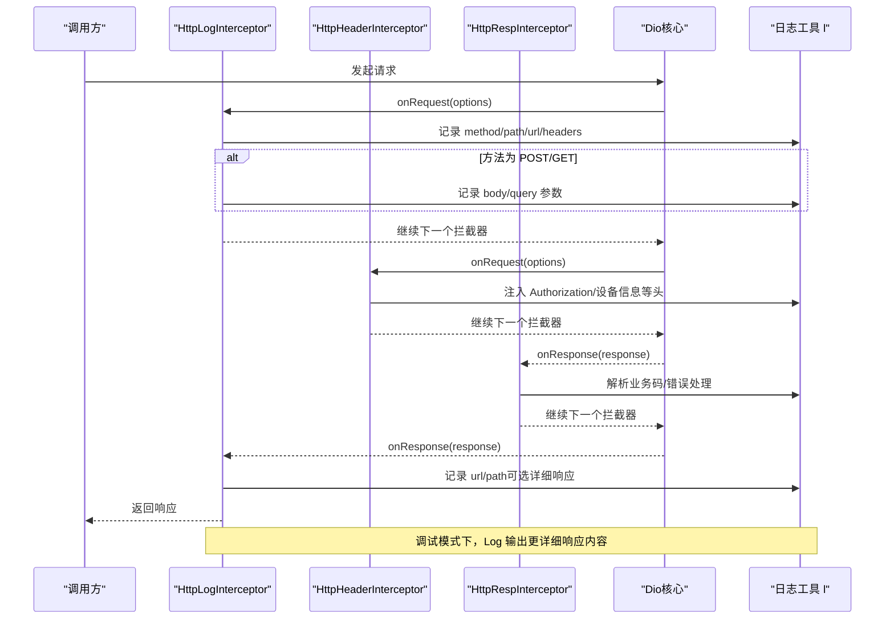
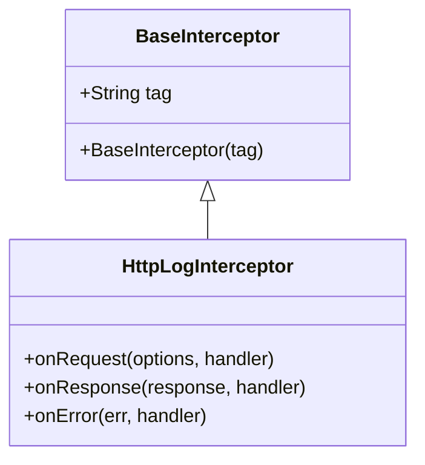
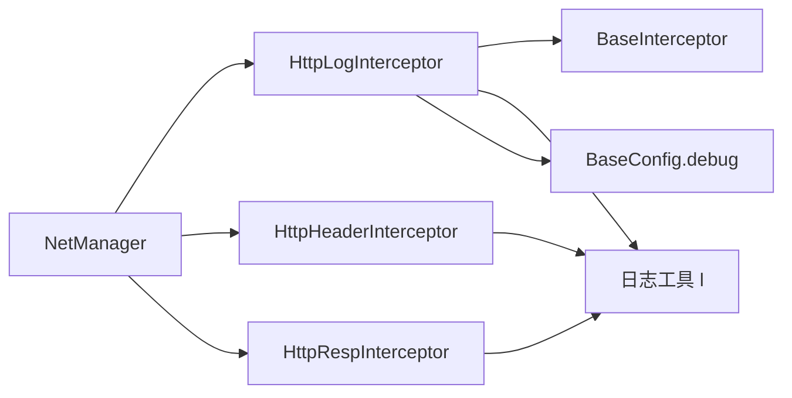

# 日志拦截器

<cite>
**本文引用的文件列表**
- [http_log_interceptor.dart](file://lib/net/http_log_interceptor.dart)
- [net_manager.dart](file://lib/net/net_manager.dart)
- [base_interceptor.dart](file://lib/net/base_interceptor.dart)
- [log.dart](file://lib/utils/log.dart)
- [config.dart](file://lib/config/config.dart)
- [http_header_interceptor.dart](file://lib/net/http_header_interceptor.dart)
- [http_resp_interceptor.dart](file://lib/net/http_resp_interceptor.dart)
</cite>

## 目录
1. [简介](#简介)
2. [项目结构](#项目结构)
3. [核心组件](#核心组件)
4. [架构总览](#架构总览)
5. [详细组件分析](#详细组件分析)
6. [依赖关系分析](#依赖关系分析)
7. [性能考量](#性能考量)
8. [故障排查指南](#故障排查指南)
9. [结论](#结论)
10. [附录](#附录)

## 简介
本文围绕 HttpLogInterceptor 的实现机制进行深入解析，重点说明其在请求生命周期中的日志记录行为，包括：
- 请求发出前的时间戳记录（通过日志系统记录）
- 请求方法、URL、路径
- 请求体与查询参数的序列化输出
- 响应到达后的耗时计算、状态码、响应体内容记录
- 如何基于 Dio 的 InterceptorContract 实现日志拦截逻辑
- 在调试模式下启用详细日志输出
- 结合代码示例说明日志格式化策略与敏感信息过滤机制
- 该拦截器在 NetManager 中的注册顺序及其对性能监控的支持作用
- 提供自定义日志格式的扩展方法

## 项目结构
与日志拦截器相关的关键文件组织如下：
- 日志拦截器：lib/net/http_log_interceptor.dart
- 网络管理器：lib/net/net_manager.dart（负责拦截器注册顺序）
- 基类拦截器：lib/net/base_interceptor.dart（统一继承结构）
- 日志工具：lib/utils/log.dart（统一的日志输出入口）
- 配置与调试开关：lib/config/config.dart（包含 debug 标志）
- 其他拦截器：lib/net/http_header_interceptor.dart、lib/net/http_resp_interceptor.dart（影响请求/响应上下文）

图表来源
- [net_manager.dart](file://lib/net/net_manager.dart#L58-L66)
- [http_log_interceptor.dart](file://lib/net/http_log_interceptor.dart#L1-L60)
- [http_header_interceptor.dart](file://lib/net/http_header_interceptor.dart#L1-L56)
- [http_resp_interceptor.dart](file://lib/net/http_resp_interceptor.dart#L1-L210)
- [log.dart](file://lib/utils/log.dart#L1-L182)
- [config.dart](file://lib/config/config.dart#L1-L108)

章节来源
- [net_manager.dart](file://lib/net/net_manager.dart#L58-L66)
- [http_log_interceptor.dart](file://lib/net/http_log_interceptor.dart#L1-L60)
- [base_interceptor.dart](file://lib/net/base_interceptor.dart#L1-L8)
- [log.dart](file://lib/utils/log.dart#L1-L182)
- [config.dart](file://lib/config/config.dart#L1-L108)
- [http_header_interceptor.dart](file://lib/net/http_header_interceptor.dart#L1-L56)
- [http_resp_interceptor.dart](file://lib/net/http_resp_interceptor.dart#L1-L210)

## 核心组件
- HttpLogInterceptor：基于 BaseInterceptor，覆盖 onRequest/onResponse/onError，实现请求/响应阶段的日志记录；在调试模式下输出更详细的响应内容。
- NetManager：集中初始化 Dio 并按顺序注册拦截器，确保日志拦截器位于头部以捕获完整上下文。
- 日志工具 l：封装 logger，提供统一的 debug/info/error 输出入口。
- 配置 BaseConfig：提供 debug 标志，控制是否输出详细响应内容。

章节来源
- [http_log_interceptor.dart](file://lib/net/http_log_interceptor.dart#L1-L60)
- [net_manager.dart](file://lib/net/net_manager.dart#L58-L66)
- [log.dart](file://lib/utils/log.dart#L1-L182)
- [config.dart](file://lib/config/config.dart#L1-L108)

## 架构总览
下图展示了请求从发起到响应的生命周期中，各拦截器的执行顺序与职责分工，以及日志拦截器在其中的位置。

图表来源
- [net_manager.dart](file://lib/net/net_manager.dart#L58-L66)
- [http_log_interceptor.dart](file://lib/net/http_log_interceptor.dart#L10-L59)
- [http_header_interceptor.dart](file://lib/net/http_header_interceptor.dart#L16-L55)
- [http_resp_interceptor.dart](file://lib/net/http_resp_interceptor.dart#L25-L155)
- [log.dart](file://lib/utils/log.dart#L1-L182)
- [config.dart](file://lib/config/config.dart#L1-L108)

## 详细组件分析

### HttpLogInterceptor 实现机制
- 继承关系：HttpLogInterceptor 继承自 BaseInterceptor，后者继承自 InterceptorsWrapper，从而具备拦截请求/响应的能力。
- onRequest 阶段：
  - 记录请求方法、路径、完整 URL
  - 对 POST 请求记录请求体与 extra
  - 对 GET 请求记录查询参数与 extra
  - 记录请求头
- onResponse 阶段：
  - 记录响应对应的 URL 与路径
  - 在调试模式下输出更详细的响应对象
- onError 阶段：
  - 记录错误路径、URL、状态码、消息等

图表来源
- [base_interceptor.dart](file://lib/net/base_interceptor.dart#L1-L8)
- [http_log_interceptor.dart](file://lib/net/http_log_interceptor.dart#L1-L60)

章节来源
- [http_log_interceptor.dart](file://lib/net/http_log_interceptor.dart#L10-L59)
- [base_interceptor.dart](file://lib/net/base_interceptor.dart#L1-L8)

### 请求生命周期中的日志记录行为
- 请求发出前：
  - 记录请求方法、路径、完整 URI
  - 根据方法类型分别记录请求体或查询参数
  - 记录请求头
- 响应到达后：
  - 记录响应对应的 URL 与路径
  - 在调试模式下输出更详细的响应内容
- 错误发生时：
  - 记录错误路径、URL、状态码、消息

章节来源
- [http_log_interceptor.dart](file://lib/net/http_log_interceptor.dart#L10-L59)
- [config.dart](file://lib/config/config.dart#L1-L108)

### Dio 的 InterceptorContract 实现
- HttpLogInterceptor 通过继承 InterceptorsWrapper（Dio 内部拦截器基类），实现 onRequest/onResponse/onError 三个钩子，符合 Dio 的拦截器契约。
- 在 onRequest 中，使用 l.d/l.i 等方法输出日志；在 onError 中使用 l.e 输出错误日志。
- 通过 handler.next(...) 将控制权传递给下一个拦截器，保证链式调用的完整性。

章节来源
- [http_log_interceptor.dart](file://lib/net/http_log_interceptor.dart#L10-L59)
- [log.dart](file://lib/utils/log.dart#L1-L182)

### 调试模式下的详细日志输出
- 调试模式由 BaseConfig.debug 控制，当为 true 时，HttpLogInterceptor 在 onResponse 阶段会输出更详细的响应对象内容，便于定位问题。
- 日志工具 l 支持多种级别输出，统一由 logger 实现，便于在不同环境下控制输出。

章节来源
- [http_log_interceptor.dart](file://lib/net/http_log_interceptor.dart#L41-L46)
- [config.dart](file://lib/config/config.dart#L1-L108)
- [log.dart](file://lib/utils/log.dart#L1-L182)

### 日志格式化策略与敏感信息过滤
- 日志格式化策略：
  - 使用统一的日志工具 l，按级别输出（debug/info/error），标签统一为拦截器名称，便于检索。
  - 在请求阶段，按“键:值”的形式输出关键字段，便于快速定位问题。
- 敏感信息过滤机制：
  - 当前实现未对请求体、响应体中的敏感字段进行显式过滤。建议在实际生产环境中：
    - 在 onRequest/onResponse 中对包含敏感字段（如密码、令牌、身份证号等）的对象进行脱敏处理后再输出
    - 或者在日志工具层增加过滤规则，仅输出必要字段
  - 由于当前实现直接输出 options.data/options.queryParameters/response.toString()，存在泄露风险，建议在生产环境关闭详细响应输出或进行脱敏

章节来源
- [http_log_interceptor.dart](file://lib/net/http_log_interceptor.dart#L10-L59)
- [log.dart](file://lib/utils/log.dart#L1-L182)

### 在 NetManager 中的注册顺序与性能监控支持
- 注册顺序：
  - NetManager.init 中按顺序添加拦截器：HttpLogInterceptor -> HttpHeaderInterceptor -> HttpRespInterceptor
  - 这种顺序确保日志拦截器最先捕获请求上下文，随后头拦截器注入必要的请求头，最后响应拦截器进行业务解包与错误处理
- 性能监控支持：
  - 日志拦截器记录请求方法、URL、路径、头信息，有助于定位慢请求与异常请求
  - 在调试模式下输出详细响应，便于分析响应体大小与结构
  - 建议在日志中补充耗时统计（例如在 onRequest 记录时间戳，在 onResponse 计算耗时并输出），以支持性能监控

章节来源
- [net_manager.dart](file://lib/net/net_manager.dart#L58-L66)
- [http_log_interceptor.dart](file://lib/net/http_log_interceptor.dart#L10-L59)

### 自定义日志格式的扩展方法
- 扩展点一：在 HttpLogInterceptor 中增加耗时统计
  - 在 onRequest 中记录时间戳，在 onResponse 中计算耗时并输出
- 扩展点二：统一日志格式
  - 在 l 工具中定义统一的格式化器，或在拦截器内部构造统一的 JSON 字符串
- 扩展点三：敏感信息脱敏
  - 在 onRequest/onResponse 中对敏感字段进行替换或屏蔽
- 扩展点四：条件输出
  - 基于 BaseConfig.debug 或环境变量控制是否输出详细响应
- 扩展点五：异步日志
  - 将日志写入文件或远程日志服务，避免阻塞主线程

章节来源
- [http_log_interceptor.dart](file://lib/net/http_log_interceptor.dart#L10-L59)
- [log.dart](file://lib/utils/log.dart#L1-L182)
- [config.dart](file://lib/config/config.dart#L1-L108)

## 依赖关系分析
- HttpLogInterceptor 依赖：
  - BaseInterceptor（继承链）
  - 日志工具 l（统一输出）
  - 配置 BaseConfig（调试标志）
- NetManager 依赖：
  - HttpLogInterceptor、HttpHeaderInterceptor、HttpRespInterceptor 的注册顺序
- 其他拦截器：
  - HttpHeaderInterceptor 注入 Authorization 与设备信息，影响日志中头信息的完整性
  - HttpRespInterceptor 负责业务解包与鉴权处理，可能改变响应结构

图表来源
- [http_log_interceptor.dart](file://lib/net/http_log_interceptor.dart#L1-L60)
- [base_interceptor.dart](file://lib/net/base_interceptor.dart#L1-L8)
- [log.dart](file://lib/utils/log.dart#L1-L182)
- [config.dart](file://lib/config/config.dart#L1-L108)
- [net_manager.dart](file://lib/net/net_manager.dart#L58-L66)
- [http_header_interceptor.dart](file://lib/net/http_header_interceptor.dart#L1-L56)
- [http_resp_interceptor.dart](file://lib/net/http_resp_interceptor.dart#L1-L210)

章节来源
- [http_log_interceptor.dart](file://lib/net/http_log_interceptor.dart#L1-L60)
- [net_manager.dart](file://lib/net/net_manager.dart#L58-L66)
- [http_header_interceptor.dart](file://lib/net/http_header_interceptor.dart#L1-L56)
- [http_resp_interceptor.dart](file://lib/net/http_resp_interceptor.dart#L1-L210)
- [log.dart](file://lib/utils/log.dart#L1-L182)
- [config.dart](file://lib/config/config.dart#L1-L108)

## 性能考量
- 日志输出成本：
  - 在高频请求场景下，频繁的字符串拼接与对象序列化会带来额外开销
  - 建议在生产环境关闭详细响应输出，或限制日志级别
- 耗时统计：
  - 建议在 onRequest/onResponse 中增加耗时统计，便于性能分析
- 日志落盘：
  - 对于移动端应用，建议将日志写入本地文件并在合适时机上传，避免阻塞主线程

[本节为通用指导，不直接分析具体文件]

## 故障排查指南
- 无日志输出：
  - 检查日志工具 l.enablePrintLog 是否为 true
  - 检查 Logger.level 是否允许输出对应级别的日志
- 无详细响应：
  - 确认 BaseConfig.debug 是否为 true
  - 检查 onResponse 中的条件分支是否命中
- 敏感信息泄露：
  - 在 onRequest/onResponse 中对敏感字段进行脱敏处理
  - 生产环境建议关闭详细响应输出

章节来源
- [log.dart](file://lib/utils/log.dart#L1-L182)
- [config.dart](file://lib/config/config.dart#L1-L108)
- [http_log_interceptor.dart](file://lib/net/http_log_interceptor.dart#L41-L46)

## 结论
HttpLogInterceptor 通过在请求生命周期的关键节点输出关键上下文信息，为调试与性能分析提供了基础能力。其与 NetManager 的注册顺序确保了日志拦截器能够捕获完整的请求上下文。建议在生产环境中加强敏感信息过滤与日志级别控制，并补充耗时统计以更好地支持性能监控。

[本节为总结性内容，不直接分析具体文件]

## 附录
- 关键实现位置参考：
  - 日志拦截器实现：[http_log_interceptor.dart](file://lib/net/http_log_interceptor.dart#L10-L59)
  - 拦截器注册顺序：[net_manager.dart](file://lib/net/net_manager.dart#L58-L66)
  - 日志工具入口：[log.dart](file://lib/utils/log.dart#L1-L182)
  - 调试标志：[config.dart](file://lib/config/config.dart#L1-L108)
  - 请求头拦截器（影响日志头信息）：[http_header_interceptor.dart](file://lib/net/http_header_interceptor.dart#L16-L55)
  - 响应拦截器（影响响应结构）：[http_resp_interceptor.dart](file://lib/net/http_resp_interceptor.dart#L25-L155)