# 网络层

<cite>
**本文档引用的文件**   
- [net_manager.dart](file://lib/net/net_manager.dart)
- [base_interceptor.dart](file://lib/net/base_interceptor.dart)
- [http_log_interceptor.dart](file://lib/net/http_log_interceptor.dart)
- [http_header_interceptor.dart](file://lib/net/http_header_interceptor.dart)
- [http_resp_interceptor.dart](file://lib/net/http_resp_interceptor.dart)
- [code.dart](file://lib/net/code.dart)
- [response.dart](file://lib/net/response.dart)
- [dio_io.dart](file://lib/net/dio_io.dart)
- [app_controller.dart](file://lib/global/app_controller.dart)
- [auth_service.dart](file://lib/global/service/auth_service.dart)
- [config.dart](file://lib/config/config.dart)
</cite>

## 目录
1. [网络层架构概述](#网络层架构概述)
2. [NetManager与Dio客户端封装](#netmanager与dio客户端封装)
3. [拦截器链设计与执行流程](#拦截器链设计与执行流程)
4. [BaseInterceptor抽象设计](#baseinterceptor抽象设计)
5. [HTTP请求统一处理规范](#http请求统一处理规范)
6. [认证令牌刷新与错误处理](#认证令牌刷新与错误处理)
7. [自定义拦截器开发指南](#自定义拦截器开发指南)
8. [性能优化建议](#性能优化建议)

## 网络层架构概述

本项目网络通信模块采用Dio作为HTTP客户端库，通过NetManager单例模式进行封装管理。网络层采用拦截器链模式实现日志记录、请求头注入、响应处理等功能的解耦。整体架构遵循分层设计原则，将网络请求的通用处理逻辑与业务逻辑分离，提高了代码的可维护性和可扩展性。

**Section sources**
- [net_manager.dart](file://lib/net/net_manager.dart#L1-L87)
- [base_interceptor.dart](file://lib/net/base_interceptor.dart#L1-L8)

## NetManager与Dio客户端封装

NetManager作为网络层的核心管理器，采用单例模式（_NetManager）提供全局唯一的Dio实例。它负责Dio客户端的初始化配置、拦截器链的构建以及网络请求的统一管理。

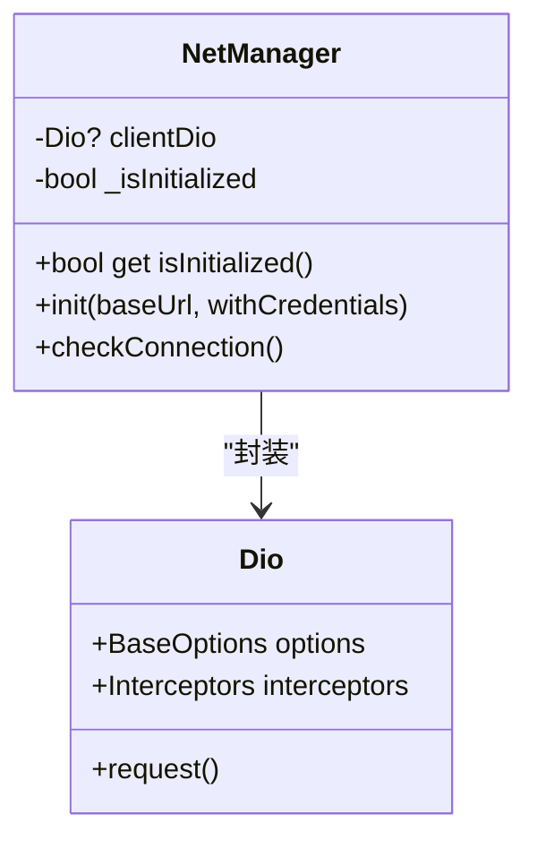

**Diagram sources**
- [net_manager.dart](file://lib/net/net_manager.dart#L21-L87)
- [dio_io.dart](file://lib/net/dio_io.dart#L4-L13)

**Section sources**
- [net_manager.dart](file://lib/net/net_manager.dart#L1-L87)
- [dio_io.dart](file://lib/net/dio_io.dart#L4-L13)

## 拦截器链设计与执行流程

网络层采用拦截器模式构建了三层拦截器链，按照特定顺序执行，确保请求和响应的正确处理。拦截器链的构建顺序在NetManager的init方法中定义，遵循"日志→头信息→响应处理"的原则。

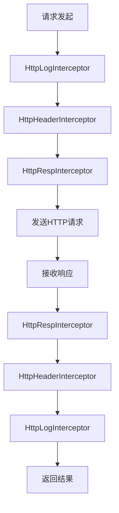

**Diagram sources**
- [net_manager.dart](file://lib/net/net_manager.dart#L58-L65)
- [http_log_interceptor.dart](file://lib/net/http_log_interceptor.dart#L7-L59)
- [http_header_interceptor.dart](file://lib/net/http_header_interceptor.dart#L10-L56)
- [http_resp_interceptor.dart](file://lib/net/http_resp_interceptor.dart#L16-L209)

**Section sources**
- [net_manager.dart](file://lib/net/net_manager.dart#L58-L65)
- [http_log_interceptor.dart](file://lib/net/http_log_interceptor.dart#L7-L59)
- [http_header_interceptor.dart](file://lib/net/http_header_interceptor.dart#L10-L56)
- [http_resp_interceptor.dart](file://lib/net/http_resp_interceptor.dart#L16-L209)

## BaseInterceptor抽象设计

BaseInterceptor作为所有自定义拦截器的基类，继承自Dio的InterceptorsWrapper，提供了统一的标签（tag）管理和基础功能。这种抽象设计模式使得所有拦截器具有一致的接口和行为，便于管理和扩展。

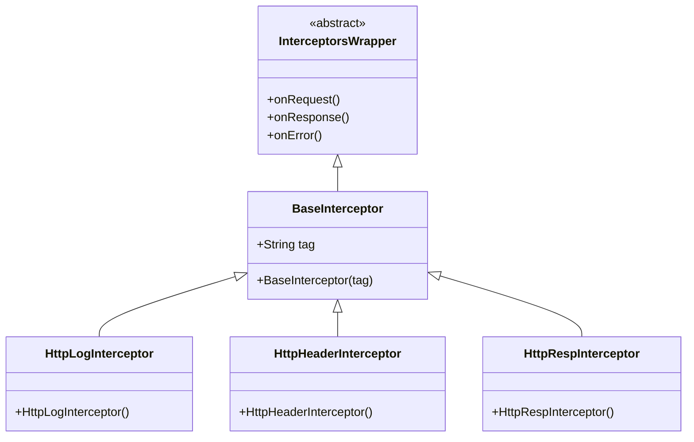

**Diagram sources**
- [base_interceptor.dart](file://lib/net/base_interceptor.dart#L3-L7)
- [http_log_interceptor.dart](file://lib/net/http_log_interceptor.dart#L7-L8)
- [http_header_interceptor.dart](file://lib/net/http_header_interceptor.dart#L10-L14)
- [http_resp_interceptor.dart](file://lib/net/http_resp_interceptor.dart#L16-L23)

**Section sources**
- [base_interceptor.dart](file://lib/net/base_interceptor.dart#L3-L7)
- [http_log_interceptor.dart](file://lib/net/http_log_interceptor.dart#L7-L8)
- [http_header_interceptor.dart](file://lib/net/http_header_interceptor.dart#L10-L14)
- [http_resp_interceptor.dart](file://lib/net/http_resp_interceptor.dart#L16-L23)

## HTTP请求统一处理规范

网络层实现了HTTP请求的统一处理规范，包括请求头自动注入、错误码统一处理、响应数据解析和异常转换等核心功能。

### 请求头自动注入

HttpHeaderInterceptor负责为每个请求自动注入必要的头信息，包括内容类型、认证令牌和设备信息。登录接口等特定请求会跳过认证令牌的注入。

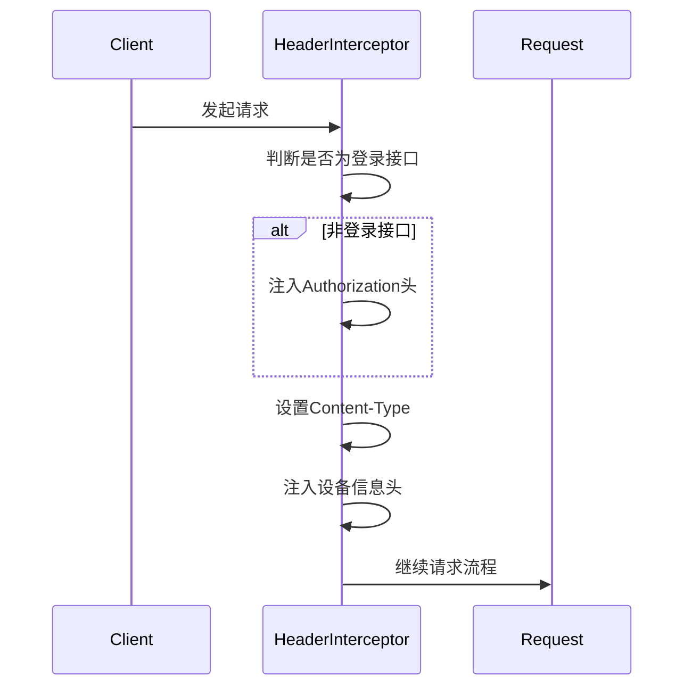

**Diagram sources**
- [http_header_interceptor.dart](file://lib/net/http_header_interceptor.dart#L16-L54)

### 错误码统一处理

code.dart文件定义了统一的HTTP错误码规范，特别是业务错误码的定义。HttpCode类集中管理了常见的错误状态码，如请求成功（1）、登录失效（401）和令牌过期（401）。

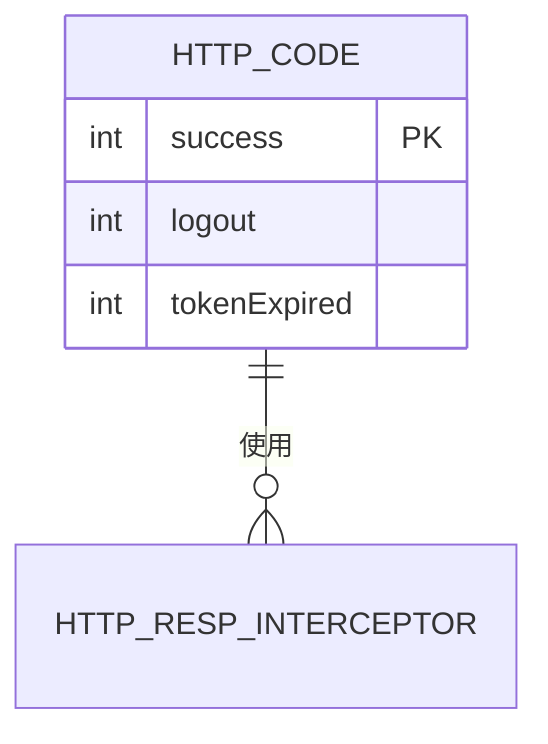

**Diagram sources**
- [code.dart](file://lib/net/code.dart#L3-L12)
- [http_resp_interceptor.dart](file://lib/net/http_resp_interceptor.dart#L32-L47)

### 响应数据解析

response.dart文件定义了BaseResponse类，用于统一解析服务器返回的响应数据结构。该类提供了fromJson和toJson方法，实现了响应数据的序列化和反序列化。

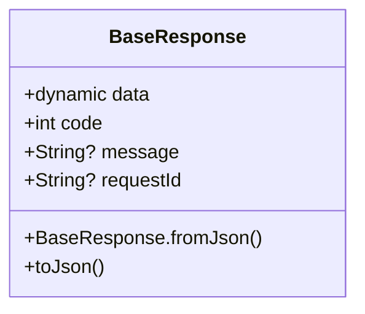

**Diagram sources**
- [response.dart](file://lib/net/response.dart#L1-L24)

**Section sources**
- [code.dart](file://lib/net/code.dart#L3-L12)
- [response.dart](file://lib/net/response.dart#L1-L24)
- [http_header_interceptor.dart](file://lib/net/http_header_interceptor.dart#L16-L54)
- [http_resp_interceptor.dart](file://lib/net/http_resp_interceptor.dart#L30-L39)

## 认证令牌刷新与错误处理

网络层实现了完善的认证令牌刷新机制，能够自动处理令牌过期的情况，提升用户体验。

### 令牌刷新流程

当服务器返回401或403状态码时，HttpRespInterceptor会自动尝试刷新令牌。系统通过Completer模式确保同一时间只有一个刷新请求在执行，避免并发刷新问题。

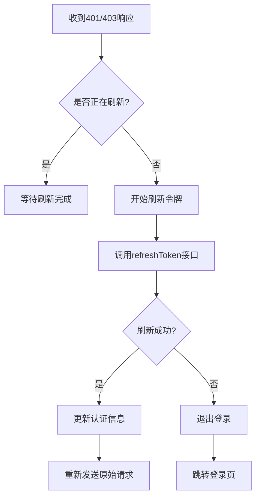

**Diagram sources**
- [http_resp_interceptor.dart](file://lib/net/http_resp_interceptor.dart#L59-L139)

### 错误处理策略

系统实现了分层的错误处理策略，包括网络错误、业务错误和认证错误的统一处理。错误信息会通过SportsToast组件向用户展示友好的提示。

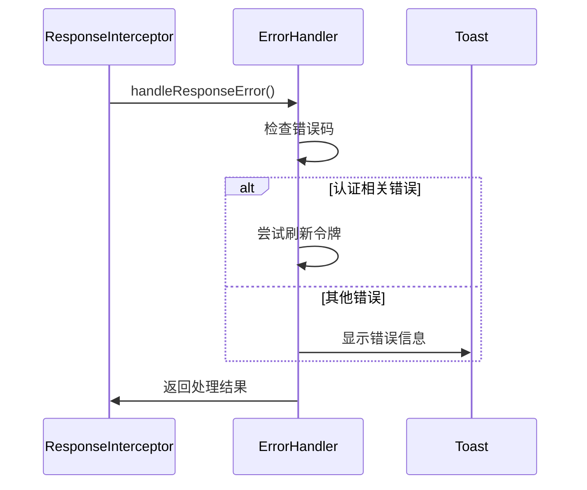

**Diagram sources**
- [http_resp_interceptor.dart](file://lib/net/http_resp_interceptor.dart#L47-L154)
- [app_controller.dart](file://lib/global/app_controller.dart#L111-L116)

**Section sources**
- [http_resp_interceptor.dart](file://lib/net/http_resp_interceptor.dart#L47-L154)
- [app_controller.dart](file://lib/global/app_controller.dart#L111-L116)
- [auth_service.dart](file://lib/global/service/auth_service.dart#L19-L20)

## 自定义拦截器开发指南

开发者可以基于BaseInterceptor基类创建自定义拦截器，以满足特定的业务需求。

### 创建自定义拦截器

要创建自定义拦截器，需要继承BaseInterceptor类，并重写onRequest、onResponse或onError方法。每个拦截器都需要提供唯一的标签（tag）用于日志记录和调试。

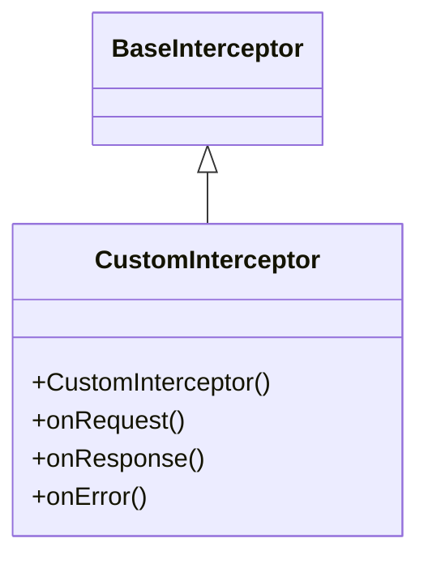

### 处理复杂场景

#### 认证令牌刷新

对于需要处理认证令牌刷新的场景，可以参考HttpRespInterceptor的实现。关键是要使用静态Completer来管理并发刷新请求，确保线程安全。

#### 请求重试机制

系统可以通过在onError方法中实现重试逻辑来处理临时性网络错误。建议设置最大重试次数和重试间隔，避免无限重试。

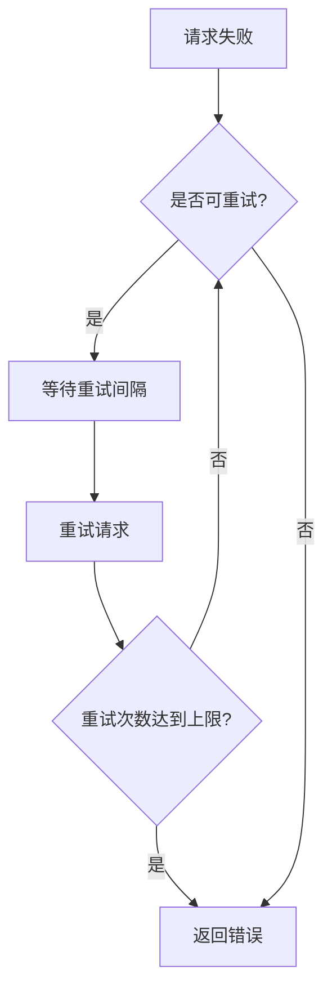

**Section sources**
- [base_interceptor.dart](file://lib/net/base_interceptor.dart#L3-L7)
- [http_resp_interceptor.dart](file://lib/net/http_resp_interceptor.dart#L18-L21)
- [config.dart](file://lib/config/config.dart#L14-L107)

## 性能优化建议

### 连接池配置

NetManager在初始化时配置了合理的超时时间，连接、接收和发送超时均设置为30秒，平衡了用户体验和资源消耗。

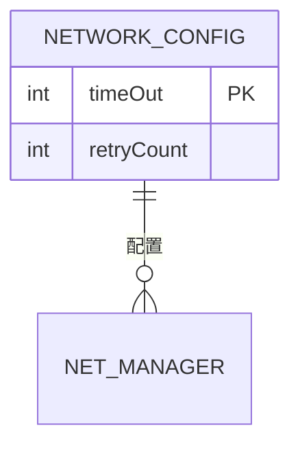

**Diagram sources**
- [net_manager.dart](file://lib/net/net_manager.dart#L11-L15)

### 超时设置

系统在BaseOptions中设置了统一的超时策略，避免请求长时间挂起。建议根据实际网络环境和业务需求调整超时时间。

**Section sources**
- [net_manager.dart](file://lib/net/net_manager.dart#L38-L40)
- [config.dart](file://lib/config/config.dart#L14-L107)