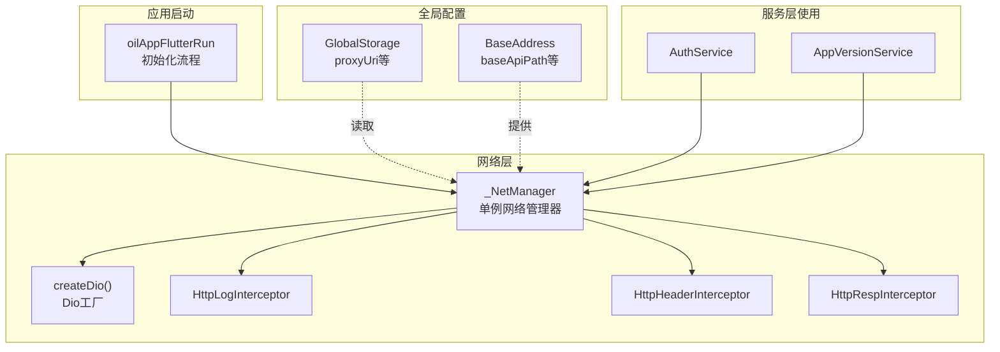
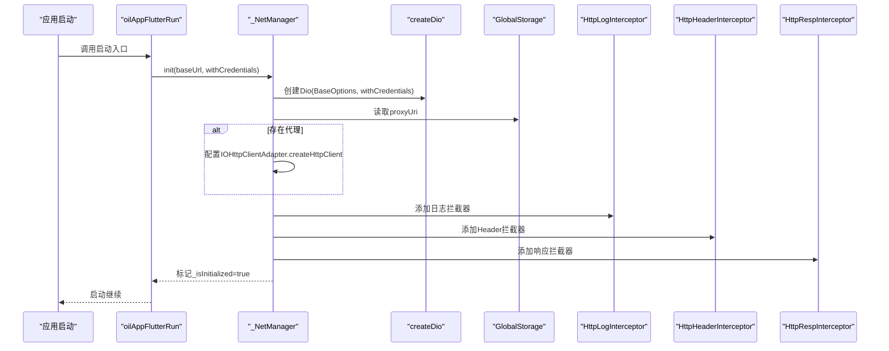
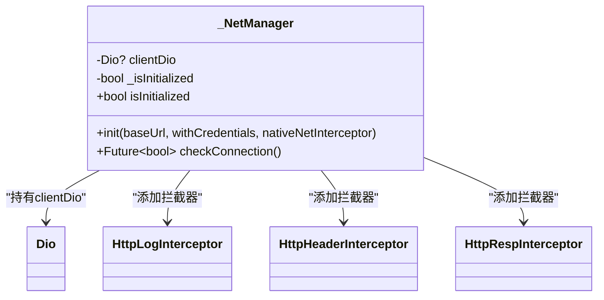
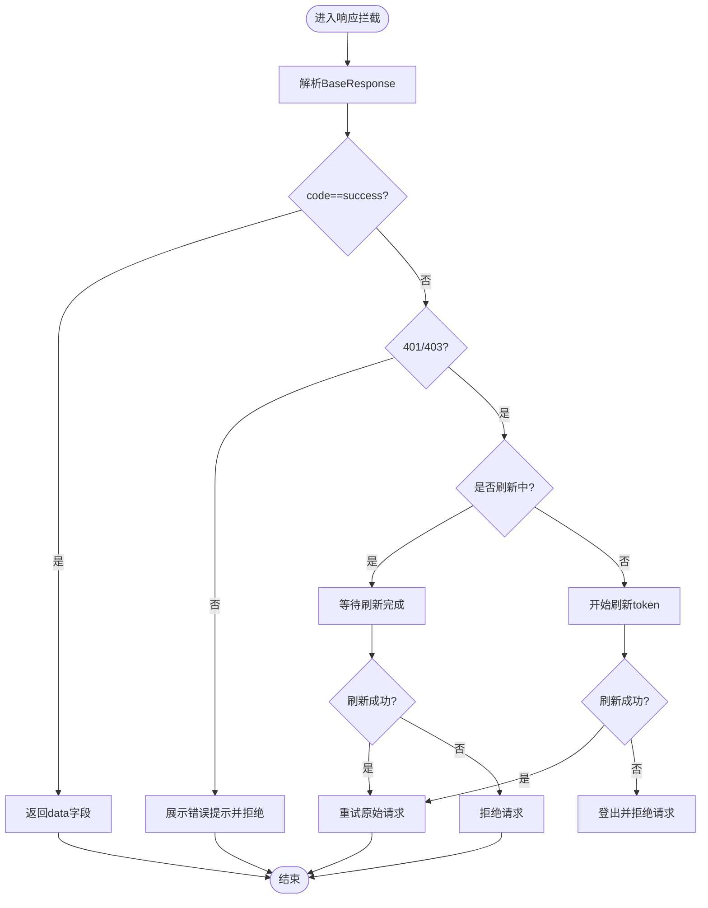
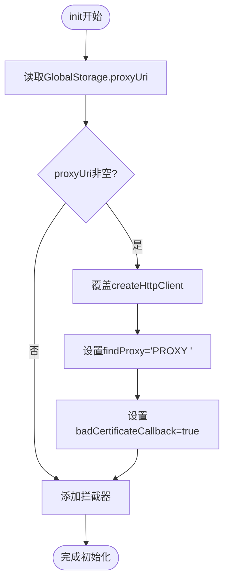
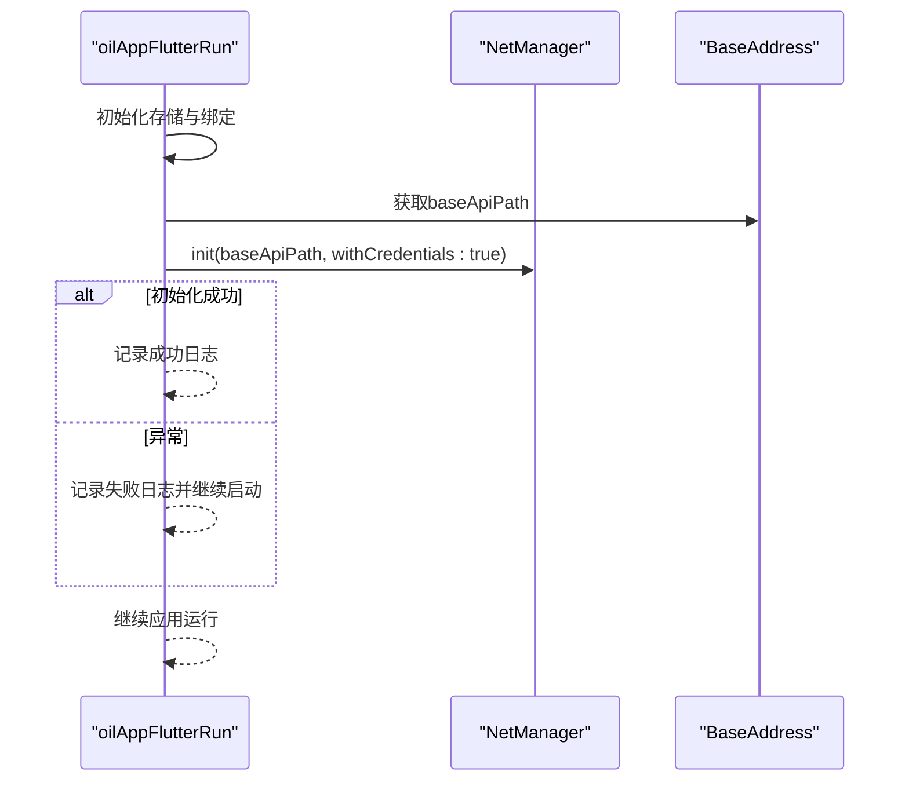
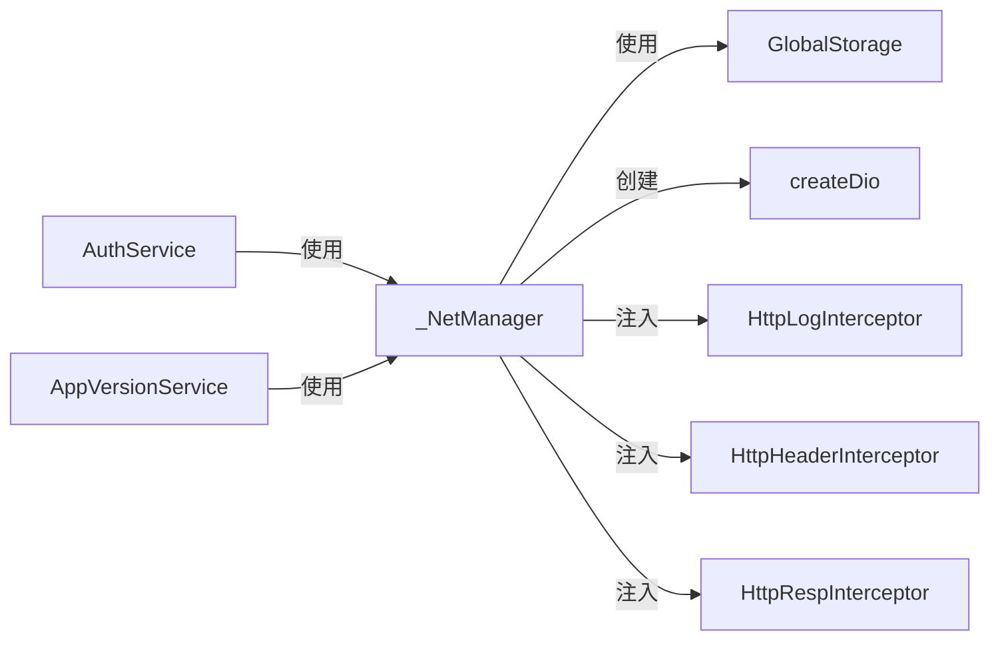

# 网络管理器

<cite>
**本文引用的文件列表**
- [net_manager.dart](file://lib/net/net_manager.dart)
- [dio_io.dart](file://lib/net/dio_io.dart)
- [http_header_interceptor.dart](file://lib/net/http_header_interceptor.dart)
- [http_log_interceptor.dart](file://lib/net/http_log_interceptor.dart)
- [http_resp_interceptor.dart](file://lib/net/http_resp_interceptor.dart)
- [base_interceptor.dart](file://lib/net/base_interceptor.dart)
- [storage.dart](file://lib/global/storage.dart)
- [address.dart](file://lib/config/address.dart)
- [sports_run.dart](file://lib/sports_run.dart)
- [auth_service.dart](file://lib/global/service/auth_service.dart)
- [app_version_service.dart](file://lib/global/service/app_version_service.dart)
</cite>

## 目录
1. [简介](#简介)
2. [项目结构](#项目结构)
3. [核心组件](#核心组件)
4. [架构总览](#架构总览)
5. [详细组件分析](#详细组件分析)
6. [依赖关系分析](#依赖关系分析)
7. [性能考量](#性能考量)
8. [故障排查指南](#故障排查指南)
9. [结论](#结论)
10. [附录](#附录)

## 简介
本文件深入解析 NetManager 单例类的设计与实现，重点说明其作为 Dio 客户端工厂的核心职责、init 方法如何通过 BaseOptions 配置超时时间、基础 URL 和凭据策略，并构建完整的 Dio 实例；详解代理配置机制（GlobalStorage.proxyUri 动态设置 HTTP 代理及 SSL 证书验证处理）；解释 clientDio 属性的延迟初始化模式与 isInitialized 状态检查；给出应用启动时（sports_run.dart）的初始化流程示例；说明 checkConnection 方法的连接状态检测逻辑；并提供自定义 Dio 实例创建（createDio 函数）的扩展点说明。

## 项目结构
围绕网络层的关键文件组织如下：
- 网络管理器与工厂：lib/net/net_manager.dart、lib/net/dio_io.dart
- 拦截器体系：lib/net/base_interceptor.dart、lib/net/http_header_interceptor.dart、lib/net/http_log_interceptor.dart、lib/net/http_resp_interceptor.dart
- 全局存储与地址配置：lib/global/storage.dart、lib/config/address.dart
- 应用启动入口：lib/sports_run.dart
- 使用示例：lib/global/service/*.dart

图表来源
- [net_manager.dart](file://lib/net/net_manager.dart#L1-L87)
- [dio_io.dart](file://lib/net/dio_io.dart#L1-L23)
- [http_header_interceptor.dart](file://lib/net/http_header_interceptor.dart#L1-L56)
- [http_log_interceptor.dart](file://lib/net/http_log_interceptor.dart#L1-L60)
- [http_resp_interceptor.dart](file://lib/net/http_resp_interceptor.dart#L1-L210)
- [storage.dart](file://lib/global/storage.dart#L1-L34)
- [address.dart](file://lib/config/address.dart#L1-L41)
- [sports_run.dart](file://lib/sports_run.dart#L1-L117)
- [auth_service.dart](file://lib/global/service/auth_service.dart#L1-L41)
- [app_version_service.dart](file://lib/global/service/app_version_service.dart#L1-L26)

章节来源
- [net_manager.dart](file://lib/net/net_manager.dart#L1-L87)
- [dio_io.dart](file://lib/net/dio_io.dart#L1-L23)
- [storage.dart](file://lib/global/storage.dart#L1-L34)
- [address.dart](file://lib/config/address.dart#L1-L41)
- [sports_run.dart](file://lib/sports_run.dart#L1-L117)

## 核心组件
- 单例网络管理器：_NetManager 提供 init 构建 Dio、配置代理、注入拦截器、延迟初始化 clientDio 与 isInitialized 状态检查。
- Dio 工厂：createDio 接收 BaseOptions 与 withCredentials 参数，返回 Dio 实例。
- 拦截器体系：日志、Header、响应处理三类拦截器，统一由 NetManager 注入。
- 全局存储：GlobalStorage.proxyUri 用于动态读取代理地址。
- 启动流程：sports_run.dart 中调用 netManager.init 初始化网络栈。
- 服务层使用：各 Service 通过 netManager.clientDio 或回退到新建 Dio 实例。

章节来源
- [net_manager.dart](file://lib/net/net_manager.dart#L1-L87)
- [dio_io.dart](file://lib/net/dio_io.dart#L1-L23)
- [http_header_interceptor.dart](file://lib/net/http_header_interceptor.dart#L1-L56)
- [http_log_interceptor.dart](file://lib/net/http_log_interceptor.dart#L1-L60)
- [http_resp_interceptor.dart](file://lib/net/http_resp_interceptor.dart#L1-L210)
- [storage.dart](file://lib/global/storage.dart#L1-L34)
- [sports_run.dart](file://lib/sports_run.dart#L1-L117)
- [auth_service.dart](file://lib/global/service/auth_service.dart#L1-L41)
- [app_version_service.dart](file://lib/global/service/app_version_service.dart#L1-L26)

## 架构总览
NetManager 作为 Dio 客户端工厂，承担以下职责：
- 统一创建 Dio 实例（createDio）
- 通过 BaseOptions 配置超时、基础 URL、响应类型
- 注入拦截器链（日志、Header、响应处理）
- 动态代理配置（基于 GlobalStorage.proxyUri）
- 延迟初始化 clientDio 与状态标记 isInitialized
- 提供连接状态检查 checkConnection

图表来源
- [sports_run.dart](file://lib/sports_run.dart#L1-L117)
- [net_manager.dart](file://lib/net/net_manager.dart#L1-L87)
- [dio_io.dart](file://lib/net/dio_io.dart#L1-L23)
- [storage.dart](file://lib/global/storage.dart#L1-L34)
- [http_log_interceptor.dart](file://lib/net/http_log_interceptor.dart#L1-L60)
- [http_header_interceptor.dart](file://lib/net/http_header_interceptor.dart#L1-L56)
- [http_resp_interceptor.dart](file://lib/net/http_resp_interceptor.dart#L1-L210)

## 详细组件分析

### NetManager 单例与工厂
- 单例导出：通过 final netManager = _NetManager() 与 final netDio = netManager.clientDio 提供便捷访问。
- 延迟初始化：clientDio 为 Dio?，首次 init 成功后赋值并设置 _isInitialized = true。
- init 方法要点：
  - BaseOptions 配置 connectTimeout/receiveTimeout/sendTimeout 为 30 秒，baseUrl 来自外部传入，responseType 为 json。
  - withCredentials 控制跨域凭据策略（由 createDio 的 withCredentials 参数传递给底层 HttpClientAdapter）。
  - 注入拦截器顺序：日志 -> Header -> 响应处理。
  - 错误处理：捕获异常并记录日志，设置 _isInitialized=false 并抛出。
- checkConnection：仅当 _isInitialized 且 clientDio 非空时返回 true，否则 false。

图表来源
- [net_manager.dart](file://lib/net/net_manager.dart#L1-L87)
- [http_log_interceptor.dart](file://lib/net/http_log_interceptor.dart#L1-L60)
- [http_header_interceptor.dart](file://lib/net/http_header_interceptor.dart#L1-L56)
- [http_resp_interceptor.dart](file://lib/net/http_resp_interceptor.dart#L1-L210)

章节来源
- [net_manager.dart](file://lib/net/net_manager.dart#L1-L87)

### createDio 工厂与 BaseOptions
- createDio 接收 BaseOptions 与 withCredentials，返回 Dio 实例。
- BaseOptions 关键项：
  - 超时：connectTimeout/receiveTimeout/sendTimeout 均为 30 秒。
  - baseUrl：来自外部传入。
  - responseType：json。
- withCredentials 用于控制跨域凭据策略（由底层 IOHttpClientAdapter 适配）。

章节来源
- [dio_io.dart](file://lib/net/dio_io.dart#L1-L23)
- [net_manager.dart](file://lib/net/net_manager.dart#L1-L87)

### 拦截器体系
- BaseInterceptor：拦截器基类，统一 tag。
- HttpLogInterceptor：打印请求方法、路径、URL、参数与头部；调试模式下输出响应详情；记录错误。
- HttpHeaderInterceptor：根据请求方法设置 Content-Type；非登录接口附加 Authorization；注入设备信息与应用版本信息。
- HttpRespInterceptor：统一业务响应转换；处理 401/403 的 Token 刷新与重试；错误提示与拒绝；并发刷新控制。

图表来源
- [http_resp_interceptor.dart](file://lib/net/http_resp_interceptor.dart#L1-L210)

章节来源
- [base_interceptor.dart](file://lib/net/base_interceptor.dart#L1-L8)
- [http_log_interceptor.dart](file://lib/net/http_log_interceptor.dart#L1-L60)
- [http_header_interceptor.dart](file://lib/net/http_header_interceptor.dart#L1-L56)
- [http_resp_interceptor.dart](file://lib/net/http_resp_interceptor.dart#L1-L210)

### 代理配置机制
- 动态代理来源：GlobalStorage.proxyUri 从持久化存储读取代理地址字符串。
- 配置时机：init 中读取 proxyUri，若非空，则覆盖 IOHttpClientAdapter.createHttpClient，设置 HttpClient 的 findProxy 为 "PROXY <proxyUri>"。
- SSL 证书处理：在 createHttpClient 中设置 badCertificateCallback 返回 true，允许忽略证书校验问题（谨慎使用）。

图表来源
- [net_manager.dart](file://lib/net/net_manager.dart#L1-L87)
- [storage.dart](file://lib/global/storage.dart#L1-L34)

章节来源
- [net_manager.dart](file://lib/net/net_manager.dart#L1-L87)
- [storage.dart](file://lib/global/storage.dart#L1-L34)

### 应用启动初始化流程（sports_run.dart）
- 初始化步骤：
  - 初始化 Hive、HydratedBloc 存储。
  - 设置 ErrorWidget.builder。
  - 调用 prepareAppRun。
  - 尝试调用 netManager.init(BaseAddress.baseApiPath, withCredentials: true)，捕获异常并记录日志，保证应用可离线启动。
  - 继续运行应用。
- BaseAddress.baseApiPath 提供 baseUrl，来源于环境映射。

图表来源
- [sports_run.dart](file://lib/sports_run.dart#L1-L117)
- [address.dart](file://lib/config/address.dart#L1-L41)
- [net_manager.dart](file://lib/net/net_manager.dart#L1-L87)

章节来源
- [sports_run.dart](file://lib/sports_run.dart#L1-L117)
- [address.dart](file://lib/config/address.dart#L1-L41)

### 连接状态检测（checkConnection）
- 逻辑：仅当 _isInitialized 为 true 且 clientDio 非空时返回 true，否则 false。
- 用途：在服务层或 UI 层判断网络栈是否可用。

章节来源
- [net_manager.dart](file://lib/net/net_manager.dart#L1-L87)

### 自定义 Dio 实例创建扩展点（createDio）
- 扩展点位置：createDio 接收 BaseOptions 与 withCredentials，返回 Dio。
- 可扩展性：
  - 在 createDio 内部可进一步配置 HttpClientAdapter（如证书校验策略、代理、缓存策略等）。
  - 可按需增加或替换拦截器。
  - 可根据 withCredentials 决定是否启用 Cookie 或凭据策略。
- 使用建议：
  - 在 NetManager.init 中调用 createDio，确保统一配置。
  - 服务层优先使用 netManager.clientDio；若尚未初始化，再考虑回退到新建 Dio 实例（注意 withCredentials 与 baseUrl 的一致性）。

章节来源
- [dio_io.dart](file://lib/net/dio_io.dart#L1-L23)
- [net_manager.dart](file://lib/net/net_manager.dart#L1-L87)
- [auth_service.dart](file://lib/global/service/auth_service.dart#L1-L41)
- [app_version_service.dart](file://lib/global/service/app_version_service.dart#L1-L26)

## 依赖关系分析
- NetManager 依赖：
  - GlobalStorage.proxyUri：动态代理地址。
  - BaseOptions：超时、baseUrl、responseType。
  - 拦截器：HttpLogInterceptor、HttpHeaderInterceptor、HttpRespInterceptor。
- 服务层依赖：
  - 各 Service 通过 netManager.clientDio 使用统一的 Dio 实例。
  - 若 clientDio 为空，部分服务会回退到新建 Dio 实例（需注意 withCredentials 与 baseUrl）。

图表来源
- [net_manager.dart](file://lib/net/net_manager.dart#L1-L87)
- [dio_io.dart](file://lib/net/dio_io.dart#L1-L23)
- [http_log_interceptor.dart](file://lib/net/http_log_interceptor.dart#L1-L60)
- [http_header_interceptor.dart](file://lib/net/http_header_interceptor.dart#L1-L56)
- [http_resp_interceptor.dart](file://lib/net/http_resp_interceptor.dart#L1-L210)
- [storage.dart](file://lib/global/storage.dart#L1-L34)
- [auth_service.dart](file://lib/global/service/auth_service.dart#L1-L41)
- [app_version_service.dart](file://lib/global/service/app_version_service.dart#L1-L26)

章节来源
- [net_manager.dart](file://lib/net/net_manager.dart#L1-L87)
- [auth_service.dart](file://lib/global/service/auth_service.dart#L1-L41)
- [app_version_service.dart](file://lib/global/service/app_version_service.dart#L1-L26)

## 性能考量
- 超时设置：统一 30 秒，有助于避免长时间阻塞；可根据接口特性调整。
- 拦截器链：日志与响应处理可能带来额外开销，建议在生产环境减少日志输出或关闭调试日志。
- 代理与证书：代理可能引入额外网络延迟；badCertificateCallback=true 会放宽证书校验，存在安全风险，仅在受控环境下使用。
- 并发刷新：响应拦截器对 Token 刷新做了并发控制，避免重复刷新请求，提升稳定性。

[本节为通用指导，不直接分析具体文件]

## 故障排查指南
- 初始化失败：
  - 检查 sports_run.dart 中的 try/catch 是否捕获异常并记录日志。
  - 确认 BaseAddress.baseApiPath 是否正确。
- 代理无效：
  - 确认 GlobalStorage.proxyUri 是否已写入有效值。
  - 检查 IOHttpClientAdapter.createHttpClient 是否被覆盖。
- 401/403：
  - 响应拦截器会尝试刷新 Token；若刷新接口也返回 401/403，则触发登出流程。
  - 检查 refreshToken 接口与 AppController 状态更新。
- 证书错误：
  - 当前实现允许忽略证书错误；若出现证书问题，建议在代理或服务端修复，而非长期依赖 badCertificateCallback=true。

章节来源
- [sports_run.dart](file://lib/sports_run.dart#L1-L117)
- [net_manager.dart](file://lib/net/net_manager.dart#L1-L87)
- [http_resp_interceptor.dart](file://lib/net/http_resp_interceptor.dart#L1-L210)

## 结论
NetManager 以单例与工厂模式为核心，统一管理 Dio 的创建、配置与拦截器注入，提供延迟初始化与状态检查能力。init 方法通过 BaseOptions 明确超时与基础 URL，并结合 withCredentials 控制跨域凭据策略；代理配置通过 GlobalStorage.proxyUri 动态生效，并在必要时放宽证书校验。服务层通过 netManager.clientDio 获取统一的 Dio 实例，保障请求的一致性与可维护性。整体设计清晰、扩展点明确，适合在多模块场景中复用。

[本节为总结性内容，不直接分析具体文件]

## 附录
- 关键路径参考：
  - NetManager 初始化与代理配置：[net_manager.dart](file://lib/net/net_manager.dart#L1-L87)
  - Dio 工厂与 BaseOptions：[dio_io.dart](file://lib/net/dio_io.dart#L1-L23)
  - 拦截器基类与实现：[base_interceptor.dart](file://lib/net/base_interceptor.dart#L1-L8)、[http_log_interceptor.dart](file://lib/net/http_log_interceptor.dart#L1-L60)、[http_header_interceptor.dart](file://lib/net/http_header_interceptor.dart#L1-L56)、[http_resp_interceptor.dart](file://lib/net/http_resp_interceptor.dart#L1-L210)
  - 全局存储与代理读取：[storage.dart](file://lib/global/storage.dart#L1-L34)
  - 启动流程与地址来源：[sports_run.dart](file://lib/sports_run.dart#L1-L117)、[address.dart](file://lib/config/address.dart#L1-L41)
  - 服务层使用示例：[auth_service.dart](file://lib/global/service/auth_service.dart#L1-L41)、[app_version_service.dart](file://lib/global/service/app_version_service.dart#L1-L26)