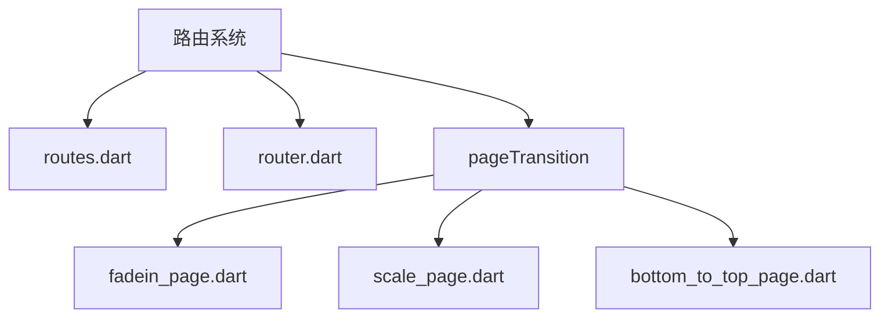
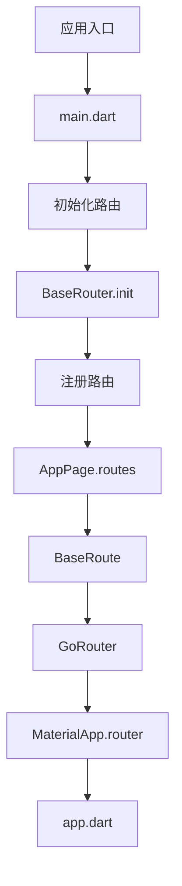
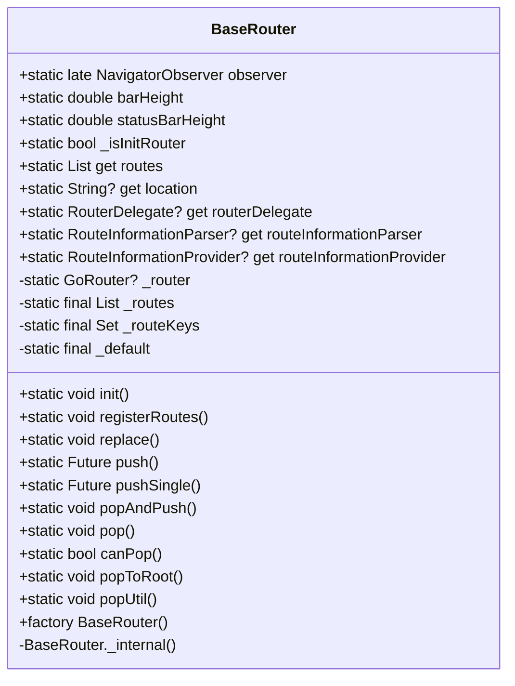
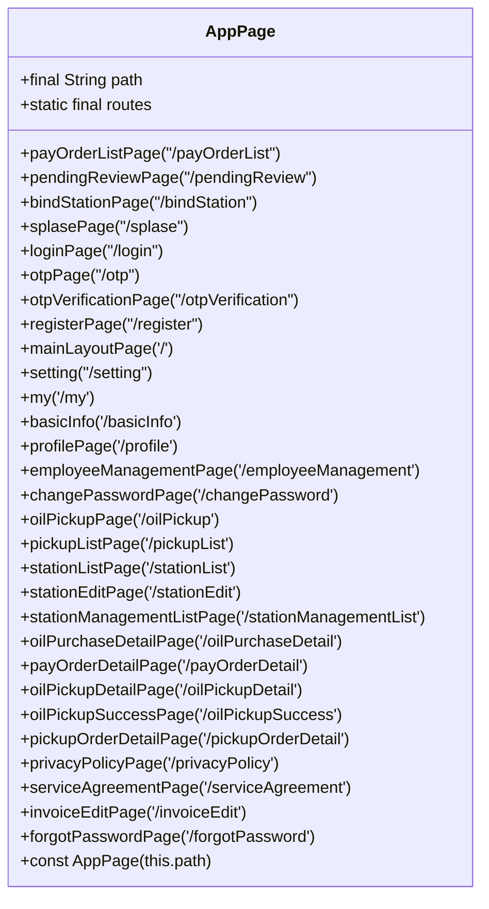
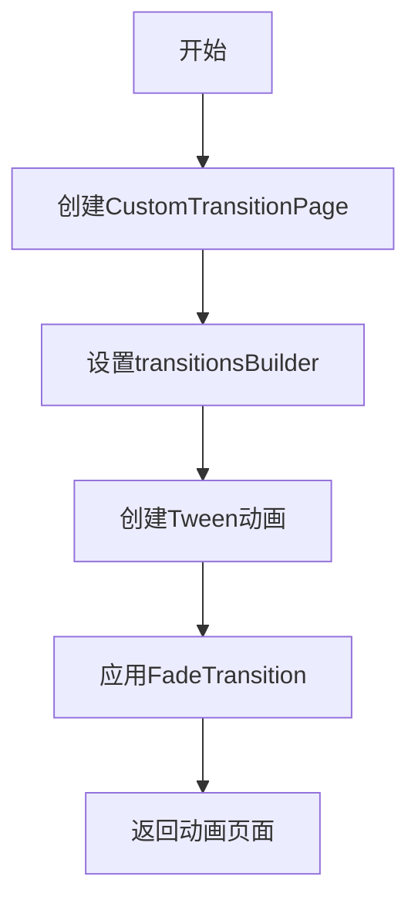
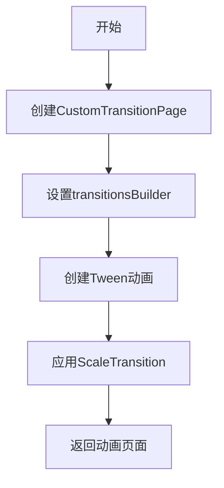
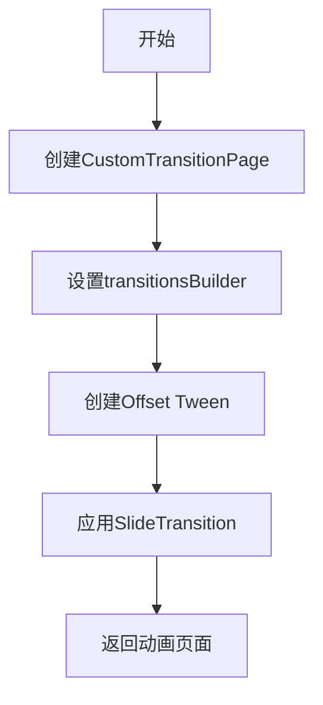
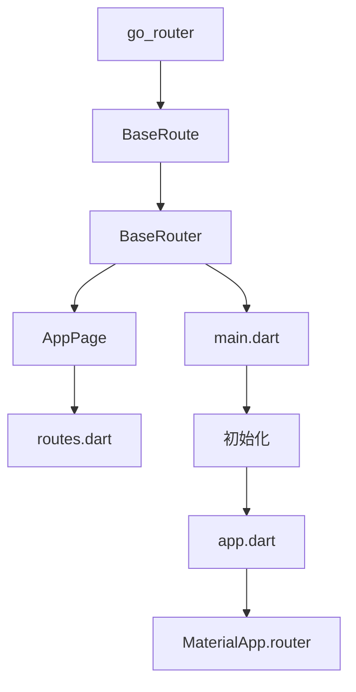

# 路由系统

<cite>
**本文档引用的文件**
- [routes.dart](file://lib/router/routes.dart)
- [router.dart](file://lib/router/router.dart)
- [main.dart](file://lib/main.dart)
- [app.dart](file://lib/app.dart)
- [fadein_page.dart](file://lib/router/pageTransition/fadein_page.dart)
- [scale_page.dart](file://lib/router/pageTransition/scale_page.dart)
- [bottom_to_top_page.dart](file://lib/router/pageTransition/bottom_to_top_page.dart)
- [login/controller.dart](file://lib/pages/login/controller.dart)
- [global/app_controller.dart](file://lib/global/app_controller.dart)
</cite>

## 目录
1. [项目结构](#项目结构)
2. [核心组件](#核心组件)
3. [架构概述](#架构概述)
4. [详细组件分析](#详细组件分析)
5. [依赖分析](#依赖分析)
6. [性能考虑](#性能考虑)
7. [故障排除指南](#故障排除指南)

## 项目结构

本项目采用模块化设计，路由系统位于`lib/router`目录下，包含路由定义、路由管理器和页面过渡动画三个主要部分。路由配置通过`routes.dart`文件集中管理，`router.dart`实现路由管理器，`pageTransition`目录包含各种页面过渡动画。

**图表来源**
- [routes.dart](file://lib/router/routes.dart)
- [router.dart](file://lib/router/router.dart)
- [pageTransition](file://lib/router/pageTransition)

**章节来源**
- [routes.dart](file://lib/router/routes.dart)
- [router.dart](file://lib/router/router.dart)

## 核心组件

路由系统的核心组件包括`BaseRouter`类、`AppPage`枚举和自定义页面过渡动画。`BaseRouter`采用单例模式实现全局路由管理，`AppPage`枚举定义了所有路由路径和对应的页面构建器，页面过渡动画提供了淡入、缩放和底部弹出三种效果。

**章节来源**
- [router.dart](file://lib/router/router.dart)
- [routes.dart](file://lib/router/routes.dart)

## 架构概述

路由系统基于go_router构建，采用分层架构设计。最上层是路由定义层，通过`AppPage`枚举集中管理所有路由；中间是路由管理层，由`BaseRouter`单例类实现；底层是页面过渡层，提供多种动画效果。系统通过`main.dart`初始化，`app.dart`集成到MaterialApp.router中。

**图表来源**
- [main.dart](file://lib/main.dart)
- [app.dart](file://lib/app.dart)
- [router.dart](file://lib/router/router.dart)
- [routes.dart](file://lib/router/routes.dart)

**章节来源**
- [main.dart](file://lib/main.dart)
- [app.dart](file://lib/app.dart)

## 详细组件分析

### BaseRouter类分析

`BaseRouter`类是路由系统的核心，采用单例模式确保全局唯一实例。它封装了go_router的复杂性，提供了简洁的API用于页面导航。类中包含静态方法如`push`、`replace`、`pop`等，以及路由观察者、路由表等静态属性。

**图表来源**
- [router.dart](file://lib/router/router.dart)

**章节来源**
- [router.dart](file://lib/router/router.dart)

### AppPage枚举分析

`AppPage`枚举定义了应用中所有页面的路由路径和构建逻辑。每个枚举值对应一个页面，包含路径属性和构建器扩展方法。通过`PageRoute`扩展，实现了类型安全的页面构建，避免了字符串硬编码。

**图表来源**
- [routes.dart](file://lib/router/routes.dart)

**章节来源**
- [routes.dart](file://lib/router/routes.dart)

### 页面过渡动画分析

系统提供了三种自定义页面过渡动画：淡入、缩放和底部弹出。每种动画都封装在独立的函数中，返回`CustomTransitionPage`实例。这些动画通过`pageBuilder`属性在特定页面上应用，如登录页面使用底部弹出动画。

#### 淡入动画

**图表来源**
- [fadein_page.dart](file://lib/router/pageTransition/fadein_page.dart)

#### 缩放动画

**图表来源**
- [scale_page.dart](file://lib/router/pageTransition/scale_page.dart)

#### 底部弹出动画

**图表来源**
- [bottom_to_top_page.dart](file://lib/router/pageTransition/bottom_to_top_page.dart)

**章节来源**
- [fadein_page.dart](file://lib/router/pageTransition/fadein_page.dart)
- [scale_page.dart](file://lib/router/pageTransition/scale_page.dart)
- [bottom_to_top_page.dart](file://lib/router/pageTransition/bottom_to_top_page.dart)

## 依赖分析

路由系统依赖于go_router库，通过`BaseRoute`类继承`GoRoute`实现扩展。系统通过`main.dart`中的`BaseRouter.registerRoutes`和`BaseRouter.init`方法初始化，`app.dart`中的`MaterialApp.router`集成路由系统。页面之间通过`extra`参数传递数据，实现了松耦合的组件通信。

**图表来源**
- [router.dart](file://lib/router/router.dart)
- [routes.dart](file://lib/router/routes.dart)
- [main.dart](file://lib/main.dart)
- [app.dart](file://lib/app.dart)

**章节来源**
- [router.dart](file://lib/router/router.dart)
- [routes.dart](file://lib/router/routes.dart)
- [main.dart](file://lib/main.dart)
- [app.dart](file://lib/app.dart)

## 性能考虑

路由系统在设计时考虑了性能优化。通过单例模式避免了重复创建路由管理器，使用`pushSingle`方法防止相同页面重复入栈。路由表在应用启动时一次性注册，减少了运行时的查找开销。页面过渡动画使用Flutter内置的动画组件，确保了流畅的用户体验。

## 故障排除指南

### 页面白屏问题
1. 检查路由路径是否正确
2. 确认页面构建器是否返回了正确的Widget
3. 检查`extra`参数是否为空或类型不匹配
4. 验证页面是否在`AppPage`枚举中正确定义

### 参数丢失问题
1. 确保在`push`或`replace`时正确传递`extra`参数
2. 检查页面构建器中是否正确解析`state.extra`
3. 验证参数类型是否匹配
4. 使用`print`语句调试参数传递过程

### 路由跳转失败
1. 检查`BuildContext`是否有效
2. 确认路由是否已注册
3. 验证路由路径是否正确
4. 检查是否有循环依赖或无限重定向

**章节来源**
- [router.dart](file://lib/router/router.dart)
- [routes.dart](file://lib/router/routes.dart)
- [login/controller.dart](file://lib/pages/login/controller.dart)
- [global/app_controller.dart](file://lib/global/app_controller.dart)