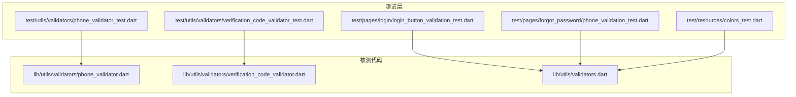
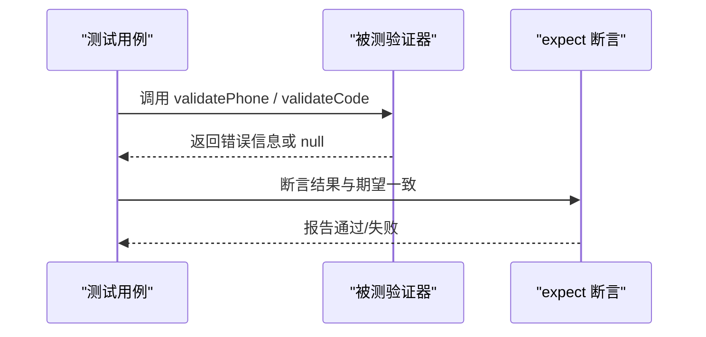
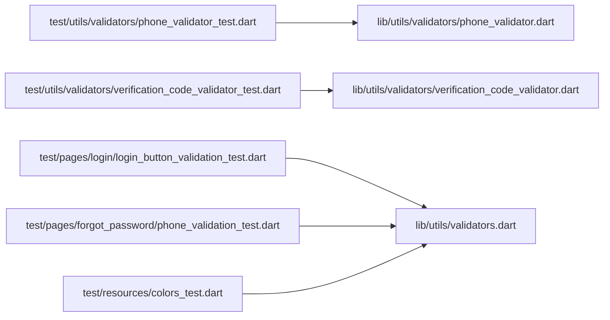

# 单元测试

<cite>
**本文引用的文件**
- [phone_validator_test.dart](file://test/utils/validators/phone_validator_test.dart)
- [phone_validator.dart](file://lib/utils/validators/phone_validator.dart)
- [verification_code_validator_test.dart](file://test/utils/validators/verification_code_validator_test.dart)
- [verification_code_validator.dart](file://lib/utils/validators/verification_code_validator.dart)
- [validators.dart](file://lib/utils/validators.dart)
- [colors_test.dart](file://test/resources/colors_test.dart)
- [phone_validation_test.dart](file://test/pages/forgot_password/phone_validation_test.dart)
- [login_button_validation_test.dart](file://test/pages/login/login_button_validation_test.dart)
- [analysis_options.yaml](file://analysis_options.yaml)
- [pubspec.yaml](file://pubspec.yaml)
</cite>

## 目录
1. [简介](#简介)
2. [项目结构](#项目结构)
3. [核心组件](#核心组件)
4. [架构总览](#架构总览)
5. [详细组件分析](#详细组件分析)
6. [依赖关系分析](#依赖关系分析)
7. [性能考量](#性能考量)
8. [故障排查指南](#故障排查指南)
9. [结论](#结论)
10. [附录](#附录)

## 简介
本文件聚焦于本仓库的单元测试实践，围绕工具类、验证器与资源的测试展开，系统讲解如何使用 Flutter 测试框架与 expect 断言编写高质量的单元测试；以手机号验证器与验证码验证器为例，演示边界条件、异常输入、确定性与错误消息的测试策略；同时给出测试文件命名规范、目录组织方式、最佳实践与覆盖率识别建议，帮助团队建立可维护、可扩展的测试体系。

## 项目结构
测试代码主要位于 test 目录，采用按功能域分层的组织方式：
- test/utils/validators：验证器相关测试
- test/pages：页面级行为测试（含登录、忘记密码等）
- test/resources：资源常量与主题色测试
- lib/utils/validators：被测工具类与验证器
- lib/utils/validators.dart：聚合导出（包含密码与手机号验证器）

图表来源
- [phone_validator_test.dart](file://test/utils/validators/phone_validator_test.dart#L1-L256)
- [verification_code_validator_test.dart](file://test/utils/validators/verification_code_validator_test.dart#L1-L181)
- [login_button_validation_test.dart](file://test/pages/login/login_button_validation_test.dart#L1-L242)
- [phone_validation_test.dart](file://test/pages/forgot_password/phone_validation_test.dart#L1-L90)
- [colors_test.dart](file://test/resources/colors_test.dart#L1-L69)
- [phone_validator.dart](file://lib/utils/validators/phone_validator.dart#L1-L35)
- [verification_code_validator.dart](file://lib/utils/validators/verification_code_validator.dart#L1-L34)
- [validators.dart](file://lib/utils/validators.dart#L1-L82)

章节来源
- [phone_validator_test.dart](file://test/utils/validators/phone_validator_test.dart#L1-L256)
- [verification_code_validator_test.dart](file://test/utils/validators/verification_code_validator_test.dart#L1-L181)
- [login_button_validation_test.dart](file://test/pages/login/login_button_validation_test.dart#L1-L242)
- [phone_validation_test.dart](file://test/pages/forgot_password/phone_validation_test.dart#L1-L90)
- [colors_test.dart](file://test/resources/colors_test.dart#L1-L69)
- [validators.dart](file://lib/utils/validators.dart#L1-L82)

## 核心组件
- 手机号验证器：提供 validatePhone 与 isValidPhone，支持空值、长度、字符与前缀校验，并返回中文提示。
- 验证码验证器：提供 validateCode 与 isValidCode，支持空值、长度（4位）、字符校验，并返回中文提示。
- 资源常量测试：对主题色常量进行断言，保证颜色值与别名一致性。
- 页面行为测试：登录按钮验证门禁、忘记密码手机号验证一致性等，模拟表单状态与交互约束。

章节来源
- [phone_validator.dart](file://lib/utils/validators/phone_validator.dart#L1-L35)
- [verification_code_validator.dart](file://lib/utils/validators/verification_code_validator.dart#L1-L34)
- [validators.dart](file://lib/utils/validators.dart#L1-L82)
- [colors_test.dart](file://test/resources/colors_test.dart#L1-L69)

## 架构总览
测试架构遵循“被测代码 -> 测试用例 -> 断言”的清晰链路，测试文件与被测模块一一对应或按功能域组织，便于定位与维护。

图表来源
- [phone_validator_test.dart](file://test/utils/validators/phone_validator_test.dart#L1-L256)
- [verification_code_validator_test.dart](file://test/utils/validators/verification_code_validator_test.dart#L1-L181)
- [phone_validator.dart](file://lib/utils/validators/phone_validator.dart#L1-L35)
- [verification_code_validator.dart](file://lib/utils/validators/verification_code_validator.dart#L1-L34)

## 详细组件分析

### 手机号验证器测试（phone_validator_test.dart）
- 测试目标
  - 验证有效/无效手机号的一致性
  - 边界条件与异常输入（空值、长度、字符、前缀）
  - 错误消息的正确性
  - 空格处理与清洗后的预期
  - 100次迭代与确定性
  - 全部常见中国手机号前缀通过
  - isValidPhone 与 validatePhone 的一致性

- 关键测试点
  - 有效手机号集合遍历并通过 isValidPhone 与 validatePhone 双重断言
  - 无效集合覆盖空串、长度不符、非数字、不以1开头等
  - 错误消息断言覆盖空值与非法格式
  - 空格处理：清洗后长度为11且以1开头才视为有效
  - 100次随机生成有效/无效号码的稳定性
  - 前缀集合覆盖主流运营商前缀
  - 确定性：多次调用返回一致结果

- 断言模式
  - 使用 isNull/isNotNull 判断错误信息
  - 使用 equals 判断具体错误消息
  - 使用 true/false 判断布尔接口
  - 使用 reason 提供上下文信息，便于失败定位

- 边界与异常
  - 10位/12位、字母、混合字符、以0开头、以2开头等
  - null/空串的处理与提示

- 可扩展性
  - 可增加更多前缀与更严格的正则匹配
  - 可引入国际化错误消息

章节来源
- [phone_validator_test.dart](file://test/utils/validators/phone_validator_test.dart#L1-L256)
- [phone_validator.dart](file://lib/utils/validators/phone_validator.dart#L1-L35)

### 验证码验证器测试（verification_code_validator_test.dart）
- 测试目标
  - 验证4位纯数字验证码的有效性
  - 边界长度（3位、4位、5位）与异常输入
  - 错误消息的正确性
  - 空格处理与清洗后的预期
  - 确定性与一致性

- 关键测试点
  - 有效集合：1234、0000、9999 等
  - 无效集合：空串、少于4位、多于4位、字母、混合
  - 错误消息断言：空值、长度不足、长度过长、非数字
  - 空格处理：清洗后恰好4位数字才有效
  - 100次迭代与确定性

- 断言模式
  - 与手机号验证器一致，使用 isNull/isNotNull、equals、true/false
  - reason 提供上下文

章节来源
- [verification_code_validator_test.dart](file://test/utils/validators/verification_code_validator_test.dart#L1-L181)
- [verification_code_validator.dart](file://lib/utils/validators/verification_code_validator.dart#L1-L34)

### 页面行为测试示例
- 登录按钮验证门禁（login_button_validation_test.dart）
  - 模拟密码登录与验证码登录两种 Tab 的必填字段校验
  - 验证空表单、部分字段缺失、切换 Tab 后的状态一致性
  - 验证加载态下的登录门禁
  - 100次迭代验证稳定性

- 忘记密码手机号验证一致性（phone_validation_test.dart）
  - 自定义 isValidPhone 模拟逻辑，覆盖空串、长度、字符、运营商前缀
  - 100次迭代验证一致性

章节来源
- [login_button_validation_test.dart](file://test/pages/login/login_button_validation_test.dart#L1-L242)
- [phone_validation_test.dart](file://test/pages/forgot_password/phone_validation_test.dart#L1-L90)

### 资源常量测试（colors_test.dart）
- 测试目标
  - 主题色常量值断言
  - 别名一致性（btnPurple、txtPurple、borderPurple、icPurple）
  - 油品主题色断言

- 断言模式
  - 使用 equals 对比 Color 常量
  - 分组测试提升可读性

章节来源
- [colors_test.dart](file://test/resources/colors_test.dart#L1-L69)

## 依赖关系分析
- 测试到被测代码的依赖
  - phone_validator_test.dart 依赖 lib/utils/validators/phone_validator.dart
  - verification_code_validator_test.dart 依赖 lib/utils/validators/verification_code_validator.dart
  - 页面测试依赖 lib/utils/validators.dart（聚合导出）
  - colors_test.dart 依赖 lib/resources/colors.dart（在当前仓库结构中，实际资源文件路径可能不同，此处按测试文件引用为准）

- 工具与框架
  - 使用 flutter_test 与 expect 断言
  - 使用正则表达式进行格式校验
  - 使用分组与循环批量断言，提高可维护性

图表来源
- [phone_validator_test.dart](file://test/utils/validators/phone_validator_test.dart#L1-L256)
- [verification_code_validator_test.dart](file://test/utils/validators/verification_code_validator_test.dart#L1-L181)
- [login_button_validation_test.dart](file://test/pages/login/login_button_validation_test.dart#L1-L242)
- [phone_validation_test.dart](file://test/pages/forgot_password/phone_validation_test.dart#L1-L90)
- [colors_test.dart](file://test/resources/colors_test.dart#L1-L69)
- [phone_validator.dart](file://lib/utils/validators/phone_validator.dart#L1-L35)
- [verification_code_validator.dart](file://lib/utils/validators/verification_code_validator.dart#L1-L34)
- [validators.dart](file://lib/utils/validators.dart#L1-L82)

## 性能考量
- 断言开销
  - expect 断言本身开销极低，主要成本在测试数据准备与循环次数
- 测试规模
  - 100次迭代用于稳定性验证，建议仅在必要场景使用，避免 CI 时间过长
- 正则匹配
  - 验证器内部正则简单，性能稳定；若未来扩展复杂规则，应关注正则编译与缓存

[本节为通用指导，无需列出章节来源]

## 故障排查指南
- 常见问题
  - 断言失败：检查 reason 信息与输入数据，确认边界条件是否覆盖
  - 错误消息不一致：核对被测验证器返回的消息文本与测试断言
  - 空格处理：确认清洗逻辑与预期一致
  - 确定性问题：检查外部状态依赖（如随机数），确保测试独立

- 定位步骤
  - 逐步缩小用例范围，先运行最小可复现用例
  - 使用 reason 输出辅助信息
  - 对比被测函数与断言期望

章节来源
- [phone_validator_test.dart](file://test/utils/validators/phone_validator_test.dart#L1-L256)
- [verification_code_validator_test.dart](file://test/utils/validators/verification_code_validator_test.dart#L1-L181)

## 结论
本仓库的单元测试以“验证器 + 页面行为 + 资源常量”为主线，采用 expect 断言与分组/循环批量断言，覆盖了边界条件、异常输入、确定性与错误消息等关键质量维度。建议在后续迭代中持续完善覆盖率，补充更多边界与异常场景，并保持测试文件与被测代码的清晰映射关系。

[本节为总结性内容，无需列出章节来源]

## 附录

### 测试文件命名规范与目录结构
- 命名规范
  - 被测类名 + _test.dart（如 phone_validator_test.dart）
  - 页面测试以页面名 + _test.dart（如 login_button_validation_test.dart）
  - 资源测试以资源名 + _test.dart（如 colors_test.dart）

- 目录结构
  - test/utils/validators：验证器测试
  - test/pages：页面行为测试
  - test/resources：资源常量测试

- 与被测代码对应
  - 测试文件与被测类一一对应，便于查找与维护

章节来源
- [phone_validator_test.dart](file://test/utils/validators/phone_validator_test.dart#L1-L256)
- [verification_code_validator_test.dart](file://test/utils/validators/verification_code_validator_test.dart#L1-L181)
- [login_button_validation_test.dart](file://test/pages/login/login_button_validation_test.dart#L1-L242)
- [phone_validation_test.dart](file://test/pages/forgot_password/phone_validation_test.dart#L1-L90)
- [colors_test.dart](file://test/resources/colors_test.dart#L1-L69)

### 使用 test 包编写测试用例的模式
- 导入与分组
  - 使用 group 对相关测试进行分组，提升可读性
- 断言模式
  - isNull/isNotNull：判断错误信息是否存在
  - equals：判断具体错误消息或常量值
  - true/false：判断布尔接口
- 上下文信息
  - 使用 reason 提供失败原因，便于快速定位

章节来源
- [phone_validator_test.dart](file://test/utils/validators/phone_validator_test.dart#L1-L256)
- [verification_code_validator_test.dart](file://test/utils/validators/verification_code_validator_test.dart#L1-L181)
- [colors_test.dart](file://test/resources/colors_test.dart#L1-L69)

### 通过 expect 断言验证函数输出
- 错误消息断言：针对 validatePhone/validateCode 的返回值进行断言
- 布尔接口断言：针对 isValidPhone/isValidCode 的返回值进行断言
- 常量断言：针对资源常量进行断言

章节来源
- [phone_validator_test.dart](file://test/utils/validators/phone_validator_test.dart#L1-L256)
- [verification_code_validator_test.dart](file://test/utils/validators/verification_code_validator_test.dart#L1-L181)
- [colors_test.dart](file://test/resources/colors_test.dart#L1-L69)

### 以 phone_validator_test.dart 为例的测试要点
- 有效/无效集合遍历
- 空值与空串处理
- 错误消息断言
- 空格处理与清洗
- 100次迭代与确定性
- 前缀覆盖与边界长度

章节来源
- [phone_validator_test.dart](file://test/utils/validators/phone_validator_test.dart#L1-L256)
- [phone_validator.dart](file://lib/utils/validators/phone_validator.dart#L1-L35)

### 测试文件命名规范与目录结构（补充）
- 验证器测试统一放置于 test/utils/validators
- 页面测试按页面名分层
- 资源测试放置于 test/resources

章节来源
- [phone_validator_test.dart](file://test/utils/validators/phone_validator_test.dart#L1-L256)
- [verification_code_validator_test.dart](file://test/utils/validators/verification_code_validator_test.dart#L1-L181)
- [login_button_validation_test.dart](file://test/pages/login/login_button_validation_test.dart#L1-L242)
- [phone_validation_test.dart](file://test/pages/forgot_password/phone_validation_test.dart#L1-L90)
- [colors_test.dart](file://test/resources/colors_test.dart#L1-L69)

### 编写高效、可维护单元测试的最佳实践
- 避免过度模拟
  - 优先使用真实被测函数，减少对外部依赖的模拟
- 保持测试独立与确定性
  - 不依赖全局状态或随机数；每次断言前后不相互影响
- 使用分组与循环批量断言
  - 提升可读性与可维护性
- 用 reason 提供上下文
  - 失败时能快速定位问题
- 覆盖边界与异常
  - 空值、长度边界、非法字符、前缀等
- 保持测试文件与被测代码一一对应
  - 便于查找与维护

章节来源
- [analysis_options.yaml](file://analysis_options.yaml#L1-L208)
- [pubspec.yaml](file://pubspec.yaml#L138-L148)

### 通过覆盖率报告识别未覆盖的分支
- 建议流程
  - 在本地或 CI 中运行 flutter test --coverage
  - 生成覆盖率报告（如 lcov 或 HTML）
  - 查看未覆盖的分支与行，针对性补充测试用例
- 注意事项
  - 仅对关键分支补充测试，避免冗余
  - 优先覆盖错误路径与边界条件

[本节为通用指导，无需列出章节来源]