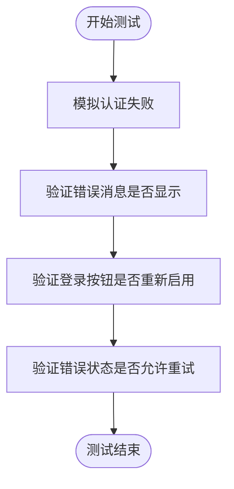
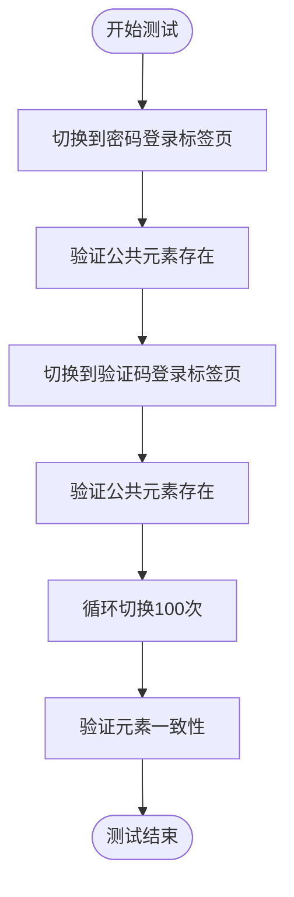

# 测试工具与实践

<cite>
**本文档引用的文件**
- [authentication_error_handling_test.dart](file://test/pages/login/authentication_error_handling_test.dart)
- [common_elements_persistence_test.dart](file://test/pages/login/common_elements_persistence_test.dart)
- [tab_switching_test.dart](file://test/pages/login/tab_switching_test.dart)
- [error_recovery_test.dart](file://test/pages/forgot_password/error_recovery_test.dart)
- [phone_validator_test.dart](file://test/utils/validators/phone_validator_test.dart)
- [verification_code_validator_test.dart](file://test/utils/validators/verification_code_validator_test.dart)
- [project.md](file://openspec/project.md)
- [pubspec.yaml](file://pubspec.yaml)
- [analysis_options.yaml](file://analysis_options.yaml)
</cite>

## 目录
1. [引言](#引言)
2. [测试工具链](#测试工具链)
3. [模拟对象与依赖隔离](#模拟对象与依赖隔离)
4. [异常场景与错误恢复测试](#异常场景与错误恢复测试)
5. [UI元素持久化验证](#ui元素持久化验证)
6. [测试组织与可读性](#测试组织与可读性)
7. [运行测试套件与覆盖率](#运行测试套件与覆盖率)

## 引言
本文档旨在全面介绍油品业务应用中的测试工具链和通用实践。文档将详细说明如何使用`mockito`库创建模拟对象来隔离被测代码，如何测试异常场景和错误恢复机制，以及如何验证UI元素的持久化。同时，文档将提供关于组织测试文件、编写可读测试用例和管理测试状态的指导，并说明如何运行整个测试套件和生成代码覆盖率报告。

## 测试工具链
项目采用了一套完整的测试工具链，以确保代码质量和功能的正确性。核心测试框架是`flutter_test`，它提供了丰富的API来编写单元测试和组件测试。在`pubspec.yaml`文件中，`flutter_test`作为开发依赖被引入，为测试提供了基础支持。

项目还遵循了严格的测试策略，包括业务逻辑单元测试、Widget组件测试和端到端集成测试。为了模拟外部依赖，项目使用`mockito`库，这在`openspec/project.md`文件中明确指出。此外，项目配置了`analysis_options.yaml`文件，其中包含了详细的静态分析规则，以确保代码质量和一致性。

**Section sources**
- [pubspec.yaml](file://pubspec.yaml#L138-L140)
- [project.md](file://openspec/project.md#L858)

## 模拟对象与依赖隔离
在测试中，创建模拟对象（mocks）是隔离被测代码、避免外部依赖影响测试结果的关键实践。项目使用`mockito`库来实现这一目标。通过模拟`AuthService`等服务，测试可以专注于验证业务逻辑，而不必依赖真实的网络请求或数据库操作。

例如，在测试登录功能时，可以通过模拟`AuthService`来验证不同错误场景下的处理逻辑。这允许测试在不实际调用后端API的情况下，验证错误消息的显示、按钮状态的更新以及用户重试机制的正确性。

**Section sources**
- [project.md](file://openspec/project.md#L859)

## 异常场景与错误恢复测试
测试异常场景和错误恢复机制是确保应用健壮性的重要环节。项目中的测试用例充分覆盖了各种错误情况，包括网络超时、无效凭据、账户不存在等。

在`authentication_error_handling_test.dart`文件中，测试用例验证了在认证失败时是否正确显示错误消息，以及登录按钮是否在错误发生后重新启用。测试还检查了不同错误类型是否产生适当的错误消息，确保用户能够获得清晰的反馈。

**Diagram sources**
- [authentication_error_handling_test.dart](file://test/pages/login/authentication_error_handling_test.dart#L7-L85)

**Section sources**
- [authentication_error_handling_test.dart](file://test/pages/login/authentication_error_handling_test.dart#L7-L85)
- [error_recovery_test.dart](file://test/pages/forgot_password/error_recovery_test.dart#L7-L144)

## UI元素持久化验证
验证UI元素的持久化是确保用户体验一致性的关键。在`common_elements_persistence_test.dart`文件中，测试用例验证了在切换标签页后，公共元素（如注册链接、忘记密码链接、登录按钮和协议部分）是否仍然存在。

测试用例通过模拟在密码登录和验证码登录标签页之间切换，验证了这些公共元素在所有标签页上都保持一致。这确保了用户在不同登录方式之间切换时，界面元素的可见性和功能不会发生变化。

**Diagram sources**
- [common_elements_persistence_test.dart](file://test/pages/login/common_elements_persistence_test.dart#L74-L100)

**Section sources**
- [common_elements_persistence_test.dart](file://test/pages/login/common_elements_persistence_test.dart#L7-L237)
- [tab_switching_test.dart](file://test/pages/login/tab_switching_test.dart#L8-L173)

## 测试组织与可读性
良好的测试组织和可读性是维护测试套件的关键。项目中的测试文件按照功能模块进行组织，位于`test`目录下的相应子目录中。例如，登录相关的测试位于`test/pages/login/`目录下。

测试用例采用Given-When-Then模式编写，以提高可读性和可维护性。这种模式清晰地描述了测试的前置条件（Given）、执行的操作（When）和预期的结果（Then）。例如，在`phone_validator_test.dart`文件中，测试用例首先定义有效的手机号码列表（Given），然后对每个号码执行验证（When），最后断言验证结果（Then）。

**Section sources**
- [phone_validator_test.dart](file://test/utils/validators/phone_validator_test.dart#L7-L256)
- [verification_code_validator_test.dart](file://test/utils/validators/verification_code_validator_test.dart#L5-L181)

## 运行测试套件与覆盖率
运行整个测试套件和生成代码覆盖率报告是衡量测试完整性的重要手段。项目使用`flutter test`命令来运行所有测试。在`scripts`目录中，虽然没有直接的测试脚本，但可以通过标准的Flutter命令来执行测试。

为了生成代码覆盖率报告，可以使用`flutter test --coverage`命令。生成的覆盖率数据通常位于`coverage/lcov.info`文件中，可以使用工具如`genhtml`将其转换为HTML报告，以便于查看和分析。项目中的一些文件（如`http_config_type.freezed.dart`）被标记为`// coverage:ignore-file`，表示这些生成的代码文件不需要被纳入覆盖率计算。

**Section sources**
- [http_config_type.freezed.dart](file://lib/models/http_config_type.freezed.dart#L1)
- [orders_data.freezed.dart](file://lib/pages/pay_order_list/model/orders_data.freezed.dart#L1)