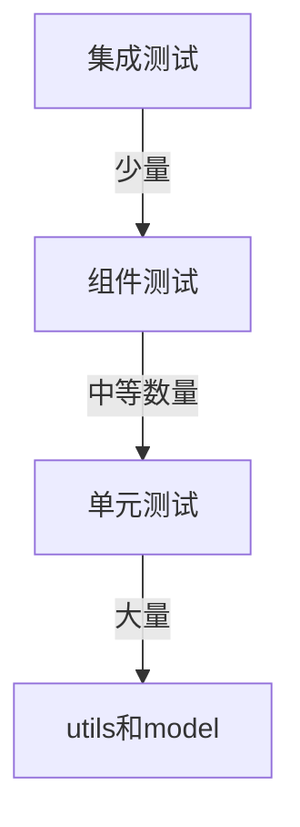
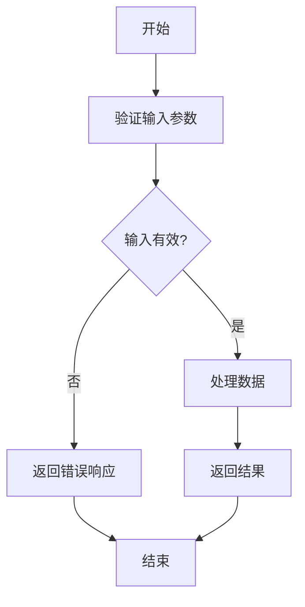
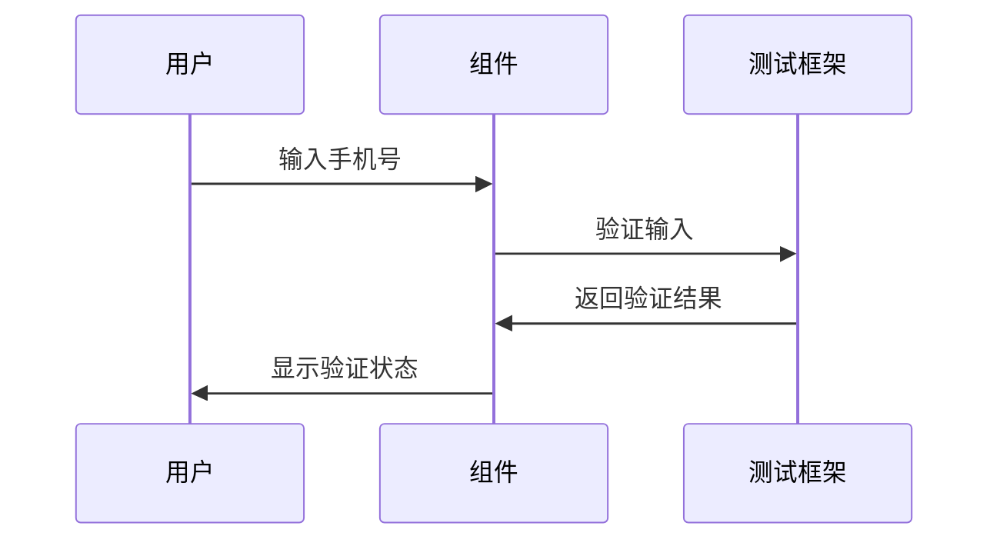
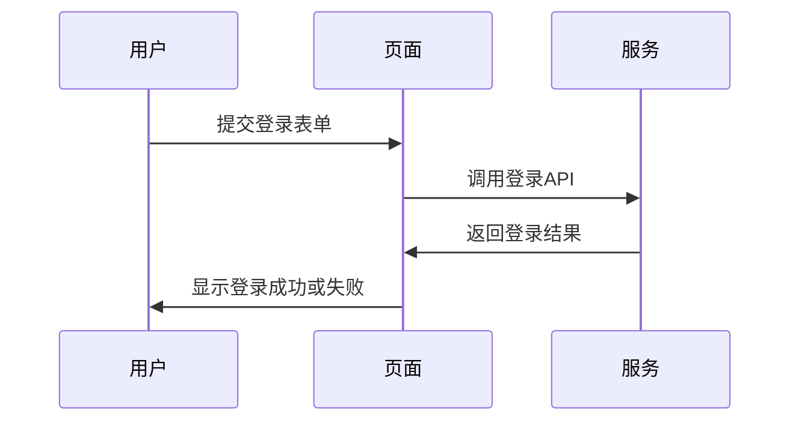
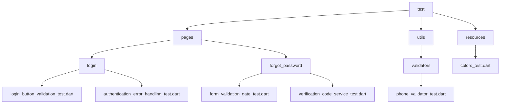
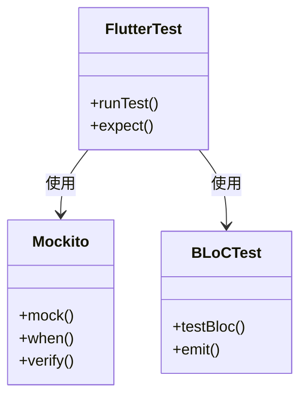
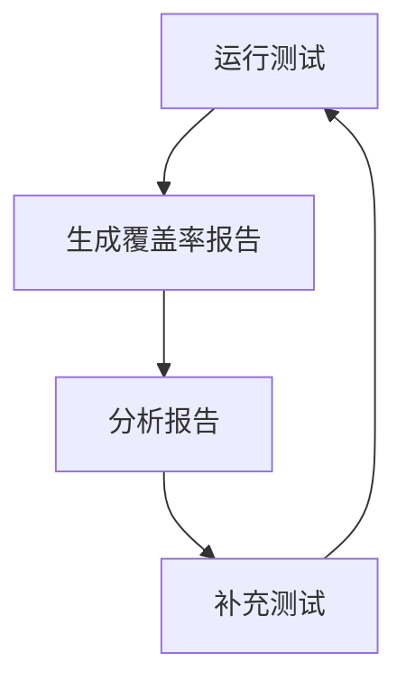

# 测试策略

<cite>
**本文档引用的文件**
- [phone_validator.dart](file://lib/utils/validators/phone_validator.dart)
- [phone_validator_test.dart](file://test/utils/validators/phone_validator_test.dart)
- [login_button_validation_test.dart](file://test/pages/login/login_button_validation_test.dart)
- [authentication_error_handling_test.dart](file://test/pages/login/authentication_error_handling_test.dart)
- [login_button_loading_state_test.dart](file://test/pages/login/login_button_loading_state_test.dart)
- [form_validation_gate_test.dart](file://test/pages/forgot_password/form_validation_gate_test.dart)
- [verification_code_service_test.dart](file://test/pages/forgot_password/verification_code_service_test.dart)
- [colors_test.dart](file://test/resources/colors_test.dart)
- [state.dart](file://lib/pages/login/state.dart)
- [analysis_options.yaml](file://analysis_options.yaml)
- [pubspec.yaml](file://pubspec.yaml)
</cite>

## 目录
1. [测试金字塔结构](#测试金字塔结构)
2. [测试类型与最佳实践](#测试类型与最佳实践)
3. [测试文件组织结构](#测试文件组织结构)
4. [测试框架与工具](#测试框架与工具)
5. [测试执行与覆盖率](#测试执行与覆盖率)

## 测试金字塔结构

本项目采用分层的测试金字塔策略，确保代码质量和稳定性。测试金字塔由三层构成：底层是大量的单元测试，中间层是组件测试，顶层是少量的集成测试。这种结构确保了测试的高效性和可靠性。

**Diagram sources**
- [phone_validator_test.dart](file://test/utils/validators/phone_validator_test.dart)
- [form_validation_gate_test.dart](file://test/pages/forgot_password/form_validation_gate_test.dart)

**Section sources**
- [phone_validator_test.dart](file://test/utils/validators/phone_validator_test.dart)
- [form_validation_gate_test.dart](file://test/pages/forgot_password/form_validation_gate_test.dart)

## 测试类型与最佳实践

### 单元测试

单元测试是测试金字塔的基础，主要针对`utils`和`model`目录下的独立函数和类。这些测试确保核心逻辑的正确性，例如表单验证、数据转换等。

**Diagram sources**
- [phone_validator.dart](file://lib/utils/validators/phone_validator.dart)
- [phone_validator_test.dart](file://test/utils/validators/phone_validator_test.dart)

**Section sources**
- [phone_validator.dart](file://lib/utils/validators/phone_validator.dart)
- [phone_validator_test.dart](file://test/utils/validators/phone_validator_test.dart)

### 组件测试

组件测试针对独立的UI组件，如登录页面的表单字段、按钮等。这些测试确保组件在不同状态下的行为符合预期。

**Diagram sources**
- [login_button_validation_test.dart](file://test/pages/login/login_button_validation_test.dart)
- [state.dart](file://lib/pages/login/state.dart)

**Section sources**
- [login_button_validation_test.dart](file://test/pages/login/login_button_validation_test.dart)
- [state.dart](file://lib/pages/login/state.dart)

### 集成测试

集成测试覆盖完整的页面流程，如登录流程、密码重置流程等。这些测试确保各个组件协同工作，流程顺畅。

**Diagram sources**
- [authentication_error_handling_test.dart](file://test/pages/login/authentication_error_handling_test.dart)
- [verification_code_service_test.dart](file://test/pages/forgot_password/verification_code_service_test.dart)

**Section sources**
- [authentication_error_handling_test.dart](file://test/pages/login/authentication_error_handling_test.dart)
- [verification_code_service_test.dart](file://test/pages/forgot_password/verification_code_service_test.dart)

## 测试文件组织结构

测试文件的组织结构与被测代码的结构相对应，确保测试文件易于查找和维护。每个功能模块都有对应的测试目录，测试文件命名清晰，反映其测试内容。

**Diagram sources**
- [test](file://test)
- [lib](file://lib)

**Section sources**
- [test](file://test)
- [lib](file://lib)

## 测试框架与工具

本项目使用Flutter Test框架进行测试，结合Mockito进行依赖模拟，以及bloc_test来测试BLoC的状态转换。这些工具确保测试的独立性和可靠性。

**Diagram sources**
- [pubspec.yaml](file://pubspec.yaml)
- [analysis_options.yaml](file://analysis_options.yaml)

**Section sources**
- [pubspec.yaml](file://pubspec.yaml)
- [analysis_options.yaml](file://analysis_options.yaml)

## 测试执行与覆盖率

测试套件可以通过命令行工具运行，生成代码覆盖率报告。覆盖率报告帮助识别未被测试覆盖的代码区域，确保代码质量。

**Diagram sources**
- [pubspec.yaml](file://pubspec.yaml)

**Section sources**
- [pubspec.yaml](file://pubspec.yaml)