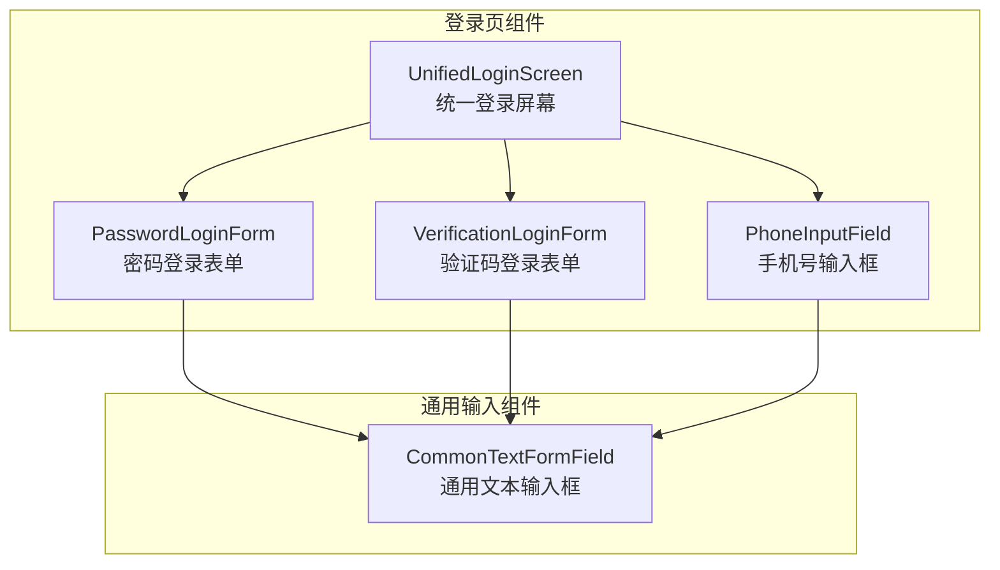
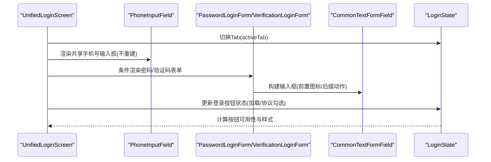
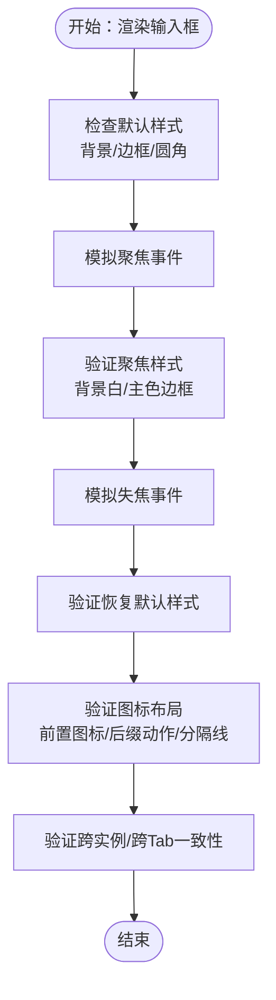
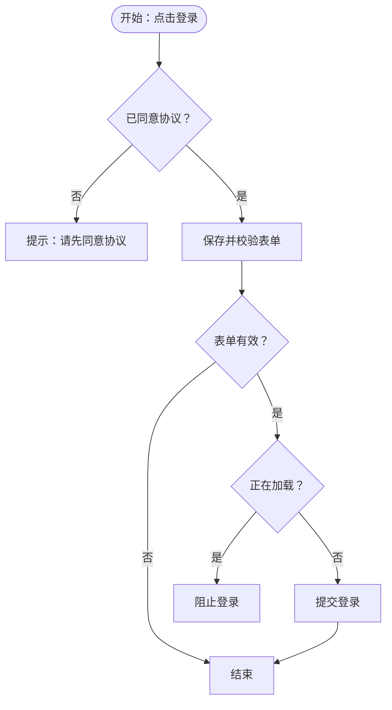
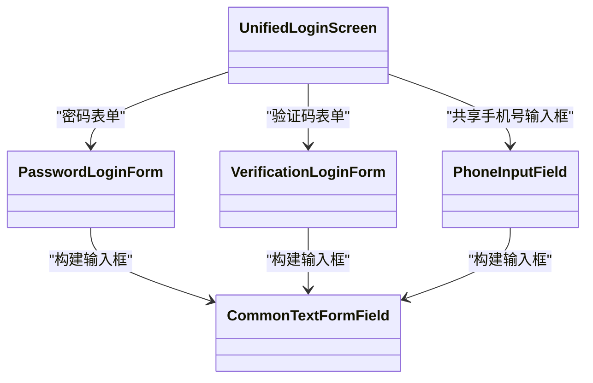

# 组件测试

<cite>
**本文引用的文件**
- [input_field_default_styling_test.dart](file://test/pages/login/input_field_default_styling_test.dart)
- [input_field_focus_styling_test.dart](file://test/pages/login/input_field_focus_styling_test.dart)
- [input_field_icon_positioning_test.dart](file://test/pages/login/input_field_icon_positioning_test.dart)
- [login_button_validation_test.dart](file://test/pages/login/login_button_validation_test.dart)
- [password_visibility_test.dart](file://test/pages/login/password_visibility_test.dart)
- [common_elements_persistence_test.dart](file://test/pages/login/common_elements_persistence_test.dart)
- [unified_login_screen.dart](file://lib/pages/login/widgets/unified_login_screen.dart)
- [password_login_form.dart](file://lib/pages/login/widgets/password_login_form.dart)
- [verification_login_form.dart](file://lib/pages/login/widgets/verification_login_form.dart)
- [phone_input_field.dart](file://lib/pages/login/widgets/phone_input_field.dart)
- [common_textformfield.dart](file://lib/widgets/base/textfield/common_textformfield.dart)
- [state.dart](file://lib/pages/login/state.dart)
</cite>

## 目录
1. [简介](#简介)
2. [项目结构](#项目结构)
3. [核心组件](#核心组件)
4. [架构总览](#架构总览)
5. [详细组件分析](#详细组件分析)
6. [依赖关系分析](#依赖关系分析)
7. [性能考量](#性能考量)
8. [故障排查指南](#故障排查指南)
9. [结论](#结论)
10. [附录](#附录)

## 简介
本测试文档围绕独立UI小组件（输入框、按钮与表单字段）的组件测试展开，重点基于flutter_test框架中的WidgetTester进行渲染、交互与断言。以登录页输入框样式测试为例，覆盖默认样式、聚焦态样式与图标布局，强调测试应关注组件的公共接口与行为，而非内部实现细节。同时总结查找器最佳实践（find.byWidget、find.byType），以及如何验证组件的响应式行为与动画。

## 项目结构
登录页组件由统一登录屏幕、密码登录表单、验证码登录表单与共享手机号输入框组成；底层通用输入组件为CommonTextFormField，负责输入框的外观、焦点态、图标布局、可选的密码可见性切换与后缀动作按钮等。

图表来源
- [unified_login_screen.dart](file://lib/pages/login/widgets/unified_login_screen.dart#L1-L174)
- [password_login_form.dart](file://lib/pages/login/widgets/password_login_form.dart#L1-L27)
- [verification_login_form.dart](file://lib/pages/login/widgets/verification_login_form.dart#L1-L78)
- [phone_input_field.dart](file://lib/pages/login/widgets/phone_input_field.dart#L1-L40)
- [common_textformfield.dart](file://lib/widgets/base/textfield/common_textformfield.dart#L1-L361)

章节来源
- [unified_login_screen.dart](file://lib/pages/login/widgets/unified_login_screen.dart#L1-L174)
- [password_login_form.dart](file://lib/pages/login/widgets/password_login_form.dart#L1-L27)
- [verification_login_form.dart](file://lib/pages/login/widgets/verification_login_form.dart#L1-L78)
- [phone_input_field.dart](file://lib/pages/login/widgets/phone_input_field.dart#L1-L40)
- [common_textformfield.dart](file://lib/widgets/base/textfield/common_textformfield.dart#L1-L361)

## 核心组件
- 统一登录屏幕：负责Tab切换、共享手机号输入框、根据Tab动态渲染不同表单、登录按钮状态控制与协议勾选校验。
- 密码登录表单：封装密码输入字段，带前置图标与密码可见性切换。
- 验证码登录表单：封装验证码输入字段，带前置图标、分隔线与“获取验证码”后缀按钮。
- 手机号输入框：封装手机号输入字段，限制键盘类型与数字格式化、长度与校验。
- 通用文本输入框：CommonTextFormField，统一处理焦点态、边框颜色、圆角半径、前后缀图标、可选的密码遮挡与可见性切换、表单校验器等。

章节来源
- [unified_login_screen.dart](file://lib/pages/login/widgets/unified_login_screen.dart#L1-L174)
- [password_login_form.dart](file://lib/pages/login/widgets/password_login_form.dart#L1-L27)
- [verification_login_form.dart](file://lib/pages/login/widgets/verification_login_form.dart#L1-L78)
- [phone_input_field.dart](file://lib/pages/login/widgets/phone_input_field.dart#L1-L40)
- [common_textformfield.dart](file://lib/widgets/base/textfield/common_textformfield.dart#L1-L361)

## 架构总览
登录页通过Bloc管理状态，Tab切换时复用共享手机号输入框，避免不必要的重建；根据当前Tab渲染密码或验证码表单；登录按钮根据加载状态与协议勾选状态决定可用性与样式。

图表来源
- [unified_login_screen.dart](file://lib/pages/login/widgets/unified_login_screen.dart#L1-L174)
- [state.dart](file://lib/pages/login/state.dart#L1-L63)
- [password_login_form.dart](file://lib/pages/login/widgets/password_login_form.dart#L1-L27)
- [verification_login_form.dart](file://lib/pages/login/widgets/verification_login_form.dart#L1-L78)
- [common_textformfield.dart](file://lib/widgets/base/textfield/common_textformfield.dart#L1-L361)

## 详细组件分析

### 输入框样式测试（默认、聚焦、图标布局）
- 默认样式测试要点
  - 背景色、边框色、圆角半径一致性，跨多个输入框实例与两个登录表单均需一致。
  - 颜色分量范围与正数约束，确保视觉与可访问性。
  - 不变性与完整性断言，保证样式常量稳定。
- 聚焦样式测试要点
  - 聚焦态背景白、边框主色，与默认态不同。
  - 失焦恢复默认，多次快速聚焦/失焦仍保持一致性。
  - 内容无关性：无论输入内容为何，聚焦态样式一致。
- 图标布局测试要点
  - 所有输入框均有前置图标，位置固定在左侧。
  - 密码输入框有右侧后缀动作（可见性切换），验证码输入框有右侧后缀动作（发送验证码）与分隔线。
  - 位置互斥：前置图标与后缀动作不在同一侧。
  - 分隔线仅出现在验证码输入框。
  - 内容无关性与Tab切换后的稳定性。

图表来源
- [input_field_default_styling_test.dart](file://test/pages/login/input_field_default_styling_test.dart#L1-L172)
- [input_field_focus_styling_test.dart](file://test/pages/login/input_field_focus_styling_test.dart#L1-L225)
- [input_field_icon_positioning_test.dart](file://test/pages/login/input_field_icon_positioning_test.dart#L1-L262)
- [common_textformfield.dart](file://lib/widgets/base/textfield/common_textformfield.dart#L1-L361)
- [password_login_form.dart](file://lib/pages/login/widgets/password_login_form.dart#L1-L27)
- [verification_login_form.dart](file://lib/pages/login/widgets/verification_login_form.dart#L1-L78)
- [phone_input_field.dart](file://lib/pages/login/widgets/phone_input_field.dart#L1-L40)

章节来源
- [input_field_default_styling_test.dart](file://test/pages/login/input_field_default_styling_test.dart#L1-L172)
- [input_field_focus_styling_test.dart](file://test/pages/login/input_field_focus_styling_test.dart#L1-L225)
- [input_field_icon_positioning_test.dart](file://test/pages/login/input_field_icon_positioning_test.dart#L1-L262)
- [common_textformfield.dart](file://lib/widgets/base/textfield/common_textformfield.dart#L1-L361)

### 登录按钮验证门禁测试
- 验证规则
  - 密码登录：手机号与密码必填。
  - 验证码登录：手机号与验证码必填。
  - 加载中时禁止登录。
  - Tab切换不影响验证逻辑。
- 断言策略
  - 正确表单通过，缺失任一字段失败。
  - 连续100次迭代验证一致性。
  - 不同Tab要求不同字段，交叉验证通过/失败。

图表来源
- [login_button_validation_test.dart](file://test/pages/login/login_button_validation_test.dart#L1-L242)
- [unified_login_screen.dart](file://lib/pages/login/widgets/unified_login_screen.dart#L1-L174)
- [state.dart](file://lib/pages/login/state.dart#L1-L63)

章节来源
- [login_button_validation_test.dart](file://test/pages/login/login_button_validation_test.dart#L1-L242)
- [unified_login_screen.dart](file://lib/pages/login/widgets/unified_login_screen.dart#L1-L174)
- [state.dart](file://lib/pages/login/state.dart#L1-L63)

### 密码可见性切换测试
- 行为目标
  - 切换两次回到初始状态。
  - 100次迭代保持往返一致性。
- 测试策略
  - 以布尔状态变量模拟可见性，断言往返结果。

章节来源
- [password_visibility_test.dart](file://test/pages/login/password_visibility_test.dart#L1-L52)
- [common_textformfield.dart](file://lib/widgets/base/textfield/common_textformfield.dart#L1-L361)

### 通用元素跨Tab持久性测试
- 目标
  - 注册链接、忘记密码链接、登录按钮、协议区域在两个Tab中始终存在。
  - 登录按钮文案随加载状态变化。
  - Tab切换过程中元素数量与种类不变。
- 测试策略
  - 断言元素集合恒定，跨100次切换保持一致。

章节来源
- [common_elements_persistence_test.dart](file://test/pages/login/common_elements_persistence_test.dart#L1-L237)
- [unified_login_screen.dart](file://lib/pages/login/widgets/unified_login_screen.dart#L1-L174)

## 依赖关系分析
- 组件耦合
  - UnifiedLoginScreen依赖PhoneInputField（共享）、PasswordLoginForm/VerificationLoginForm（按Tab条件渲染）、CommonButton与Toast。
  - PasswordLoginForm/VerificationLoginForm依赖CommonTextFormField。
  - PhoneInputField依赖CommonTextFormField与校验器。
  - CommonTextFormField内部维护FocusNode与控制器监听，处理焦点态与文本变化。
- 状态依赖
  - LoginState驱动Tab切换、验证码倒计时、协议勾选与登录按钮可用性。

图表来源
- [unified_login_screen.dart](file://lib/pages/login/widgets/unified_login_screen.dart#L1-L174)
- [password_login_form.dart](file://lib/pages/login/widgets/password_login_form.dart#L1-L27)
- [verification_login_form.dart](file://lib/pages/login/widgets/verification_login_form.dart#L1-L78)
- [phone_input_field.dart](file://lib/pages/login/widgets/phone_input_field.dart#L1-L40)
- [common_textformfield.dart](file://lib/widgets/base/textfield/common_textformfield.dart#L1-L361)

章节来源
- [unified_login_screen.dart](file://lib/pages/login/widgets/unified_login_screen.dart#L1-L174)
- [common_textformfield.dart](file://lib/widgets/base/textfield/common_textformfield.dart#L1-L361)

## 性能考量
- 避免不必要的重建
  - 共享手机号输入框在Tab切换时不重建，减少渲染开销。
- 动画与可见性
  - 使用隐式动画组件时，注意在不可见或后台场景下的刷新节流，避免无意义动画执行。
- 输入处理
  - 在输入法组合状态时过滤onChange回调，降低无效状态变更成本。

章节来源
- [unified_login_screen.dart](file://lib/pages/login/widgets/unified_login_screen.dart#L1-L174)
- [common_textformfield.dart](file://lib/widgets/base/textfield/common_textformfield.dart#L1-L361)

## 故障排查指南
- 输入框样式异常
  - 检查默认与聚焦态颜色常量定义是否被意外修改。
  - 确认圆角半径与边框宽度配置一致。
- 图标布局错位
  - 确认前置图标与后缀动作的位置策略（左/右）与分隔线仅在验证码输入框出现。
- 登录按钮不可用
  - 检查协议勾选状态与加载状态，确认表单保存与校验流程。
- 密码可见性切换失效
  - 检查后缀动作按钮的可见性切换逻辑与状态同步。
- 动画不生效或卡顿
  - 检查动画控制器与可见性检测的初始化时机与节流设置。

章节来源
- [input_field_default_styling_test.dart](file://test/pages/login/input_field_default_styling_test.dart#L1-L172)
- [input_field_focus_styling_test.dart](file://test/pages/login/input_field_focus_styling_test.dart#L1-L225)
- [input_field_icon_positioning_test.dart](file://test/pages/login/input_field_icon_positioning_test.dart#L1-L262)
- [login_button_validation_test.dart](file://test/pages/login/login_button_validation_test.dart#L1-L242)
- [password_visibility_test.dart](file://test/pages/login/password_visibility_test.dart#L1-L52)
- [common_textformfield.dart](file://lib/widgets/base/textfield/common_textformfield.dart#L1-L361)

## 结论
通过对登录页输入框样式、按钮验证门禁、密码可见性切换与通用元素持久性的系统化测试，可以有效保障组件的公共接口与行为稳定性。建议在实际测试中：
- 使用WidgetTester渲染组件树，结合find.byType与find.byWidget定位目标控件。
- 关注组件对外暴露的属性与行为，而非内部实现细节。
- 对响应式行为（焦点、加载、协议勾选）与动画进行端到端验证，确保用户体验一致性。

## 附录

### 使用WidgetTester进行组件测试的最佳实践
- 定位控件
  - find.byType：适用于按组件类型定位，如CommonTextFormField、CommonButton等。
  - find.byWidget：适用于按具体Widget实例定位，适合唯一性控件或需要精确匹配的场景。
  - find.byValueKey：推荐为关键控件设置ValueKey，便于稳定定位。
- 模拟用户交互
  - tap：点击按钮、切换开关、触发后缀动作。
  - enterText：向输入框输入文本，配合控制器与onChange断言。
  - longPress、scroll、drag：用于更复杂的交互场景。
- 断言UI状态
  - 使用expect断言颜色、尺寸、文本、可见性、启用/禁用状态。
  - 对焦点态、加载态、协议勾选等状态进行组合断言。
- 验证响应式行为与动画
  - 通过多次交互与时间推进（pumpAndSettle）验证状态切换与动画完成。
  - 对隐式动画组件，关注动画控制器与可见性检测的生命周期。

章节来源
- [common_textformfield.dart](file://lib/widgets/base/textfield/common_textformfield.dart#L1-L361)
- [unified_login_screen.dart](file://lib/pages/login/widgets/unified_login_screen.dart#L1-L174)